# Filters: grain, riso, ASCII, pixel

Research and suggestions for the filter layer, with proof renders. Nothing here changes the engine or the tool. Read on 2026-11-02; every link was opened unless it is marked unverified.

The brief (`docs/light/BRIEF.md` §4, Figma 33:173 and 44:224 to 44:226):

- "Grain, ASCII or pixel, one at a time, with a strength slider. It changes the surface, never the color."
- "Rendered at 2x, filter applied last at output size, exported to the preset sizes with the seed in the file name."
- Grain: "Fine film grain, 1 to 2 percent, applied last at output size so it never scales with the image. Doubles as dither on dark gradients."
- ASCII: "The render re-drawn as a character grid, pack-colored text on the dark base."
- Pixel: "The render quantized to a coarse grid, like an LED wall seen up close. Keep the contrast low so it reads as light, not pattern."

The owner, 2026-11-02: explore grain, risograph and ASCII, avoid overly complex territory, and keep the focus on color and the feeling of light.

The prototype, its scripts and the full sheet set are in [`prototypes/filters-research/`](../../../prototypes/filters-research/README.md).

## Summary

| Filter | First version | Keeps the color by | Effort | Payoff |
| --- | --- | --- | --- | --- |
| Grain | The engine's `grain.ts` as it is; add the strength control to the tool page | Zero-mean noise on Oklab L only | Very low | High |
| Riso | The same grain pass with the riso-end settings at every strength | Same as grain | Very low | Medium to high |
| ASCII | One cell pass: a glyph per cell, glyph density from the cell's light, each pixel keeps its own color | Lit and dim parts of each cell weighted so the cell's mean light is unchanged | Medium | Medium |
| Pixel | The ASCII pass with a soft round LED spot instead of a glyph | Same as ASCII | Low once ASCII exists | Low |

- **Ship Grain first.** It is already built and measured. It removes banding and makes soft light read as photographic.
- **Riso is the top of the same grain pass.** The grain study showed that what reads as riso at screen size is coarse, mono grain that grows with ink. The dot screens I tried read as noise or camouflage. So Riso costs a second set of numbers, not new code.
- **ASCII keeps the color exactly** if every cell's lit and dim parts are weighted to the cell's mean, and if the glyph flips from lit (in dark cells) to dim (in bright cells). Then the strength slider only sets contrast.
- **Pixel fights the light the most.** The brief's flat cells turn thin rims into rows of squares. Keeping each pixel's own color fixes that, but it is still the filter most likely to read as pattern.
- **Recommendation for the menu: Grain, Riso, ASCII.** Riso replaces Pixel. Pixel can come back later as an LED-spot glyph set inside the ASCII pass, since it is the same code.

## Real-world examples

Each line says what keeps the color and light readable through the texture.

### Riso gradient prints

- **The moodboard riso prints** (Figma 41:26 to 41:28; scan on slide 33:109; measured in `prototypes/grain-study/README.md`). Heavy, fine, mono grain that grows with ink, paper white at the light end, soft ink edges. The grain has no color of its own and is much finer than the bands, so each band reads as one ink.
- **RISOTTO Studio (Glasgow), [Advanced Risograph Print Setup](https://risottostudio.com/pages/advanced-print-setup).** Printers' notes on gradients: "The riso doesn't print 10%→0% ink very well", "Large areas with 100% Ink coverage will never print evenly", and vector gradients step unless they are rasterised with added noise, with the warning "Be careful not to add too much 'noise'". Printers add a little noise to stop banding and keep it small, the same job our grain does.
- **Exploriso (Studio Tillack Knöll), [Printing grained colour separations](https://en.exploriso.info/exploriso/printing/printing-grained-colour-separations/).** The riso's "Grained" mode is a frequency-modulated screen: "halftone dots of the same size are stochastically distributed", with no moiré or rosettes. The dots are far below viewing size, so only the ink's average color shows. At our export sizes (3840 px across an A3 sheet is about 230 dpi) a riso dot is smaller than a pixel.
- **[riso-windowseat](https://github.com/sevenevesai/riso-windowseat)** (2026, MIT): "Procedural risograph films in single HTML files". A current example of riso as a screen look. Not studied in detail.

Several studio sites (Hato Press, Knust, Perfectly Acceptable Press, Colour Code) could not be reached from here, so they are not cited.

### Film grain over soft color fields

- **Uta Barth, *Grounds* (1992 to 1995)** ([Wikipedia](https://en.wikipedia.org/wiki/Uta_Barth)). She photographed places "as if she was shooting a formal portrait but removed the subject … and left the out-of-focus background behind". The fields are large and soft, so any film texture is far finer than the changes of color.
- **Hiroshi Sugimoto, *Seascapes* (since 1980)** ([Wikipedia](https://en.wikipedia.org/wiki/Hiroshi_Sugimoto)). Sea and horizon on a large-format camera with exposures up to three hours. Large format makes grain tiny against the frame, and the horizon is the only structure.
- **Richard Misrach, *Golden Gate Bridge*** ([Wikipedia](https://en.wikipedia.org/wiki/Richard_Misrach)). Four years of the same view "under different climate conditions". The image is carried by the color of the light; texture never competes with it.
- **James Welling, *Degradés* (late 1980s onward)** ([Wikipedia](https://en.wikipedia.org/wiki/James_Welling)). Color photograms: gradients made by light on photographic paper. The paper's grain is the only texture and it is even across the field.
- **Wolfgang Tillmans, *Freischwimmer*** ([Wikipedia](https://en.wikipedia.org/wiki/Wolfgang_Tillmans)) and **Garry Fabian Miller**, camera-less photography since 1986 ([Wikipedia](https://en.wikipedia.org/wiki/Garry_Fabian_Miller)). Images made with light directly in the darkroom. Again the only texture is the paper's, and it does not change the hue.
- **Jessica Eaton, *Cubes for Albers and LeWitt*** ([Wikipedia](https://en.wikipedia.org/wiki/Jessica_Eaton)). Analog, in-camera color made by adding exposures through color filters: light adding up, as in our engine, with film grain on top.

### ASCII in current design, branding and motion

- **GitHub Copilot CLI's animated ASCII banner** ([GitHub blog](https://github.blog/engineering/from-pixels-to-characters-the-engineering-behind-github-copilot-clis-animated-ascii-banner/), 2026; brand designer Cameron Foxly). The team treated "color as a semantic system, not a literal one": a few roles (eyes, goggles, shadow, border) mapped to terminal colors. Few colors, assigned by role, keep the mascot readable when terminals remap colors.
- **Cognition's landing page**, an animated 3D scene drawn in ASCII ([cognition.ai](https://www.cognition.ai/); the ASCII scene is described in Alex Harri's post below; I could not see it without running the page's scripts). Harri criticises its blurry edges because the characters are treated as pixels. On soft light that is what we want: there are no edges to keep sharp.
- **Andreas Gysin / [ertdfgcvb](https://ertdfgcvb.xyz/)**, "Studio for design and code. Specialized in procedural graphics and animations for screen and print". Text-mode works such as *EGA Sunset* and the ASCII Playground below. Each cell has its own text color and background color, so color fields survive the characters.
- **[textmode.art](https://textmode.art/)** and **[glyphcss](https://glyphcss.com/)** ("3D models, Mermaid diagrams and charts as text"), 2025 and 2026: current libraries for text-mode graphics on the web.

### Pixel and dither in current design

- **Lucas Pope, *Return of the Obra Dinn*** ([devlog post](https://forums.tigsource.com/index.php?topic=40832.msg1363742), read through the Internet Archive). An 8-bit grayscale render turned into 1-bit with an 8×8 Bayer matrix "for a smoother range of shades" and a 128×128 blue-noise field "for a less ordered output". The patterns stand for greys, and the eye averages them because the dots map 1:1 to screen pixels.
- **[Playdate](https://play.date/)** (Panic): "a very special black and white screen – not backlit, but super reflective", "400 × 240 1-bit". Dither patterns replace grey across the whole product.
- **[Low-tech Magazine](https://solar.lowtechmagazine.com/)**, the solar-powered site, serves every photo dithered (`images/dithers/…_dithered.png`) to save energy. The dither keeps each photo's tones on average with very few colors.
- **[Nothing](https://nothing.tech/)** uses a dot-matrix typeface (Ndot) and dot-matrix elements across its site. The dot grid is used for type and accents, not laid over images.
- **Design tools ship these as one-click effects**: Paper's [Dithering](https://shaders.paper.design/dithering), [Halftone Dots](https://shaders.paper.design/halftone-dots) and [Paper Texture](https://shaders.paper.design/paper-texture), [Efecto](https://efecto.app/) and Unicorn Studio (Maxime Heckel names these three as the source of the current halftone wave).

## People and sources

| Who | Link | What they do and how | What we take |
| --- | --- | --- | --- |
| Andreas Gysin (ertdfgcvb) | [play.core / ASCII Playground](https://github.com/ertdfgcvb/play.core), [manual](https://play.ertdfgcvb.xyz/abc.html) (Apache-2.0) | `main()` runs "once per each cell", "an approach not so different from fragment shaders", and returns a character with its own `color` and `backgroundColor`. | ASCII is a per-cell shader. Color the glyph and the cell background separately, both from the light. |
| Alex Harri | [ASCII characters are not pixels](https://alexharri.com/blog/ascii-rendering) (Jan 2026) | Picks glyphs by shape: 6 sampling circles per cell give a "shape vector", matched to each glyph's vector; contrast is boosted at edges. He notes that a uniform cell "barely" changes, and he leaves glyph color out. | Shape matching only pays off at edges. Our light has no edges, so pick glyphs by density only. |
| Acerola (Garrett Gunnell) | [I Tried Turning Games Into Text](https://www.youtube.com/watch?v=gg40RWiaHRY), [AcerolaFX ASCII, film grain, dither shaders](https://github.com/GarrettGunnell/AcerolaFX), [Color Quantization and Dithering](https://www.youtube.com/watch?v=8wOUe32Pt-E) | ASCII: luminance picks one of 10 glyphs per 8×8 cell, and difference-of-gaussians plus Sobel edges pick edge glyphs; ASCII and background colors, blend with the base. Film grain: `c + c · noise · intensity · weight`, with weight `1 − sqrt(luminance)`. | Drop the edge pass. His grain scales RGB with zero-mean noise, so it keeps the mean and the hue, the same goal as ours. |
| Surma | [Ditherpunk](https://surma.dev/things/ditherpunk/) (2021) | Dither in linear light, or "the dithered gradient gets bright way too quickly"; Bayer matrices bias the result lighter; blue noise from void-and-cluster; error diffusion. | Do every average in linear light. Atkinson dithering (6/8 of the error) does not keep the mean. |
| makeworld | [Ditherpunk 2: beyond 1-bit](https://www.makeworld.space/2021/02/dithering.html) | Dithering to color palettes in linear RGB, with 16-bit working values because 8-bit linear bands. | A palette dither to pack colors is possible, but it puts saturated specks in pale bridges. Left out. |
| Maxime Heckel | [The Art of Dithering and Retro Shading for the Web](https://blog.maximeheckel.com/posts/the-art-of-dithering-and-retro-shading-web/) (2024), [Shades of Halftone](https://blog.maximeheckel.com/posts/shades-of-halftone/) (2026) | Bayer and blue-noise dithering, quantization, pixelation and CRT cells as post passes; he notes the CRT mask "can yield some strange colors or even lack some luminosity". Halftone: sample each cell once, radius = `maxRadius · sqrt(coverage)`, and an inverse "dots and squares" variant with white dots in dark cells. | Cell filters change the color unless the cell's mean is rebuilt on purpose. The inverse variant is the polarity flip our ASCII uses. |
| Lucas Pope | [Obra Dinn dithering](https://forums.tigsource.com/index.php?topic=40832.msg1363742) | 8×8 Bayer plus 128×128 blue noise; "dithering works best when the dither pattern dots have a 1:1 correlation with the output pixels". | Our images are stills, so the patterns cannot swim. Pixel-sized patterns shrink away when an export is shown smaller, so size patterns by the short side. |
| Paper (Ksenia Kondrashova and team) | [paper-design/shaders](https://github.com/paper-design/shaders) (Apache-2.0), [Exploring retro print with CMYK Halftone](https://paper.design/blog/retro-print-cmyk-halftone-shader) | Image Dithering works on luminance read straight from sRGB values, with pixel size in device pixels; its "original colors" mode divides the color by luminance and quantizes luminance only. Halftone Dots sizes its grid to the image ("cellsPerSide"). The CMYK filter recreates the Inklab plugin with dot-center sampling and "gooey" ink. | Change only lightness and keep the color (our grain). Size cells to the image, not to pixels. |
| Sam Lavigne and Tega Brain | [p5.riso](https://antiboredom.github.io/p5.riso/) ([repo](https://github.com/antiboredom/p5.riso)) | A p5.js library that separates a sketch into one file per ink layer, with `ditherImage` (Atkinson, Floyd-Steinberg, Bayer) and `halftoneImage`. | Real riso is one layer per ink. That separation is the part we leave out. |
| Amelia and Adam Greenhall (ANEMONE) | [Spectrolite](https://spectrolite.app) | Mac app for riso separations: "RISO-ify" with halftone, posterize, and "greyscale art as single-color ink", plus ink profiles. Built because separation software "is too expensive" and has "a big learning curve". | Separation is a whole app. Out of scope for a filter. |
| Matt DesLauriers | [riso-colors](https://github.com/mattdesl/riso-colors) (MIT), [glsl-film-grain](https://github.com/mattdesl/glsl-film-grain) | A list of real riso ink colors; film grain blended with soft light, fading in bright areas (see `research-artists.md`). | Inks would be pack colors anyway, so the list is reference only. |
| Robin Payot | [Creating a Risograph Grain Light Effect in Three.js](https://tympanus.net/codrops/2022/03/07/creating-a-risograph-grain-light-effect-in-three-js/) (Codrops, read through the Internet Archive) | Simplex noise times `light^5`, then `max(noise, color)` per channel: grain that turns to white speckle where light is strong. | Grain that follows the light is a good idea, but `max()` brightens the mean. Ours keeps it. |
| Christoph Peters | [Free blue noise textures](https://momentsingraphics.de/BlueNoise.html) (CC0) | Tileable blue-noise threshold maps. | If we add a visible dither later, use his tiles. The grain uses hashed lattice noise and needs none. |
| Bart Wronski | [Dithering in Games](https://bartwronski.com/2016/10/30/dithering-in-games-mini-series/) (2016), [Optimizing blue noise dithering](https://bartwronski.com/2020/04/26/optimizing-blue-noise-dithering-backpropagation-through-fourier-transform-and-sorting/) (2020) | Quantization, triangular and blue-noise dither for games. | Already applied: the output pass dithers with triangular noise before 8 bits. |
| Paul Bourke | [Character representation of grey scale images](https://paulbourke.net/dataformats/asciiart/) (1997) | "A more convincing but shorter sequence for representing 10 levels of grey is ' .:-=+*#%@'", and "the variation in apparent density between some typefaces". | The prototype uses this ramp, re-sorted by the measured ink of its own font. |
| Andrey Norkin / Netflix | [Film grain in AV1](https://norkin.org/research/film_grain/index.html); Netflix tech blog "AV1@Scale: Film Grain Synthesis, The Awakening" (2025; unverified, the page blocked scripted requests) | Grain is removed before compression and re-synthesised as a separate layer whose strength depends on intensity. | The same structure as `grain.ts`: a grain layer with amplitude by lightness. |
| Others checked | [LYGIA](https://lygia.xyz/) (dither functions: Bayer, blue noise, interleaved gradient, triangle, Vlachos), [Alan Wolfe on void-and-cluster](https://blog.demofox.org/2019/06/25/generating-blue-noise-textures-with-void-and-cluster/), [XorDev, GM Shaders Mini: CRT](https://mini.gmshaders.com/p/gm-shaders-mini-crt) | Shader building blocks. | Reference only. |

Unverified and left out: Alex Charlton's "Dithering on the GPU" (the site did not answer) and Romello Goodman's riso study on Observable (blocked scripted requests).

## Recommendations

### Where the filter runs and how big it is

- **One pass at output size, after the tone curve, before the sRGB encode and the dither**, as the brief says. The input is display-linear color (largest channel at most 1). Grain and Riso go inside the existing output pass. ASCII and Pixel need each cell's mean and brightest channel, so they add a tiny pre-pass at one texel per cell (about 171 × 64 texels for ASCII at 16:9).
- **All sizes are fractions of the short side**, never fixed pixels. Grain clump size, cell height and LED pitch all follow the short side. Reasons:
  - The same seed must give the same picture at every export size. With 64 rows tied to the short side, the same characters sit in the same places at 1080, 2160 and 3840.
  - Fixed-pixel grain loses about two thirds of its strength when a 4K export is shown smaller, which is almost always (measured in the grain study).
  - The preview then matches the export at the same viewing size.
- **Strength is the only control**, 0 to 1, and the seed feeds every random choice. No cell-size, font, color or contrast controls.

### Grain

- **Build:** nothing new in the engine. `grain.ts` is the measured design: mono grain on Oklab L, four octaves of lattice noise sized to the short side, amplitude by lightness (zero at black, eased toward white), film up to strength 0.6 and riso above. Add the strength slider to the tool page, keep it off by default, start at 0.5 when turned on.
- **If Riso gets its own entry**, make Grain film-only: strength 1 = 2% Oklab L at mid-tones (the brief's "1 to 2 percent"), and leave the riso end to Riso.
- **Keeps the color:** `L' = L + amp(L) · G(x)` with `G` zero-mean; a and b are untouched. The amplitude goes to 0 at black and eases near white, so clamping does not bias the mean.
- **What the user sees:**
  - 0.25: nothing at full view; at 1:1 a faint, fine grain; long ramps stop banding.
  - 0.5: fine film grain at 1:1 (about 1.25% at mid-tones), slightly weaker in the brightest and darkest areas; barely visible at full view.
  - 1: coarse, sandy riso grain with soft cloudy mottle, visible at full view, strongest in dense colors such as the Meta Blue sky.

### Riso

- **Build:** the same grain pass with the riso-end settings at every strength (clump size 0.0011 of the short side, octave weights 0.10/0.60/0.72/0.12 at 0.5/1/2/8 × size, grain growing in dense ink), amplitude = 0.016 × strength. Strength 1 equals the measured moodboard prints. This is a second set of uniforms, not a new shader.
- **Keeps the color:** the same as grain.
- **What I tried and left out:**
  - A two-level ink screen that keeps the mean exactly: each pixel prints as paper white and its own ink on the line from white through its color (coverage `q`, ink `1 − D·t` with `q·t = 1`, `D = 1 − C`). At pixel size it reads as salt-and-pepper noise even at 0.25. With clumped dots it turns into camouflage blotches with white patches. Both bury the light ([sheet](#riso-dot-screens-left-out)).
  - Misregistration: shifting one layer of a soft gradient by a few pixels changes nothing you can see, and on a thin rim it reads as chromatic aberration.
  - Pack colors as inks: needs a per-pixel separation into 4 or 5 inks with seams where the chosen inks change, and inks multiply where light adds. That is Spectrolite's job, not a filter's.
- **What the user sees:**
  - 0.25: fine sandy grain, a little coarser than film grain, strongest in dense colors.
  - 0.5: clear print grain: dense Meta Blue, Forest and Plum mottled, pale areas lightly speckled, Contour falloffs speckled.
  - 1: the moodboard riso prints: heavy grain, cloudy mottle in pale areas, sprayed-looking falloffs. The near-black base stays clean because grain fades to zero at black.

### ASCII

- **Build:** one cell pass plus the per-cell pre-pass.
  - Cells: height = short side / 64, width = 6/9 of that (a 5×7 pixel font in a 6×9 cell). That is 34 px cells at a 2160 px short side and 16 px in the 1030 px preview.
  - Glyphs: Bourke's 10-glyph ramp re-sorted by measured ink: space . - : + = * % # @ (ink 0 to 39% of the cell). A 5×7 bitmap font fits in a few integer constants in GLSL; no font file.
  - Each pixel keeps its own color, scaled up (lit part) or down (dim part), so the gradient continues through glyphs and backgrounds.
  - Glyph choice by the cell's brightest channel `P` (linear): in dark cells (`P` up to 39%) the glyph is the lit part, with ink coverage at least `P`; in bright cells the glyph is the dim part on a lit background, with coverage at most `1 − P`. Glyph density follows the light both ways.
  - The choice is dithered per cell between the two nearest glyphs (seeded), so neighbouring rows mix glyphs instead of lining up in straight bands.
  - Below 3% linear the glyphs thin out and stop, and the contrast fades in up to 12%, so Contour's near-black base stays clean. Near white the dim glyphs thin out the same way, so the hottest cores stay pure light.
- **Keeps the color:** in a cell with glyph coverage `g`, the lit part is multiplied by `k` and the dim part by `d`, with `k · litArea + d · (1 − litArea) = 1`, so the cell's mean light is unchanged. Strength sets `d = 1 − 0.7 · strength` (the dim part keeps 30% at 1). The lit part may not push any channel past 1 (`k ≤ 1 / P`); where it would, `d` rises instead and the light bleeds through. Glyph placement does not change with strength.
- **What the user sees:**
  - 0.25: characters are faint at 1:1, a fine mesh at full view, thumbnails look unchanged.
  - 0.5: characters are clearly readable at 1:1: dark characters over Sunset skies and pale bands, gold or cyan characters over Contour glows. Hot cores and the dark base stay clear.
  - 1: strong text. At full view the grid shows, and on flat bands the gaps between text lines read as horizontal stripes. Thumbnails get darker (see the check below).
- **Known limit:** where a falloff is steep compared with a cell (the halo's outer edge), the last cells with glyphs can show as a stepped edge at strength 1. Fading the contrast by each pixel's own brightness instead of the cell's would hide it, at the cost of a small error in the cell's mean.
- **Leave out:** shape-aware and edge-aware glyph choice (Harri, Acerola), several fonts, a cell-size control, animation.

### Pixel

- **Build:** the ASCII pass with a soft round spot (gaussian, sigma 0.3 of the cell) instead of a glyph, 72 rows, and each pixel keeping its own color. The dim gaps keep 35% at strength 1.
- **Do not quantize the color per cell.** The brief's "quantized to a coarse grid" turns soft gradients into steps and the rim's thin line into a row of squares, already at 0.25 ([sheet](#pixel-flat-cells-vs-own-color)).
- **Keeps the color:** the same cell math as ASCII.
- **What the user sees:** 0.25 a faint grid of soft dots at 1:1; 0.5 a visible LED grid with the light shining through it; 1 a strong LED grid.

### Riso, pixel and the menu

- **Riso replaces Pixel** in the filter list: Grain, Riso, ASCII. Riso is on the moodboard, costs almost nothing and helps the light up to 0.5; Pixel reads as pattern even with low contrast.
- **Pixel folds into ASCII** if it is wanted later: an LED spot is one more "glyph" in the same pass.
- If the brief's list stays (Grain, ASCII, Pixel), keep `grain.ts` as it is: film below 0.6, riso at the top. Then riso is the top of the Grain slider.

### Which filters help the light and which fight it

- **Grain helps.** It dithers long ramps and dark falloffs, so nothing bands, and it keeps doing so when the export is shown smaller because it is sized to the picture. Fine mono grain makes soft gradients read as photographed light, as in the photographs above.
- **Riso helps up to 0.5.** At 1 the coarse mottle competes with smooth glows and pale bridges.
- **ASCII fights soft light when cells are coarse and contrast is high.** It also risks Contour's "must not": "a science-fiction interface" (33:154), since light text on a dark base is the familiar look of film interfaces. What keeps the light reading:
  - cells no larger than 1/48 of the short side (1/64 by default);
  - each pixel keeps its own color, so the gradient continues inside the cells;
  - the glyph flips polarity with brightness, so there is always room to keep the mean;
  - the light bleeds through in the brightest cells and the dark base stays clean;
  - the dim part never goes below 30%;
  - the glyph choice is dithered, so there are no straight bands.
- **Pixel fights it the most.** A regular grid is the one structure the owner's rules exclude from the light itself ("No straight, ruler-like or evenly spaced boundaries"). Here it is a surface, but it is the most visible one.

## Proof renders

- **What was rendered:** ten tool shots from `localhost:3000`: Sunset Ramp, Bands and Blooms and Contour Halo and Rim, each in 16:9 and 9:16, all three packs. These are screenshots of the preview canvas at device scale 2 (1832 × 1030 and 828 × 1472), not 2× exports. Export-size crops enlarge the shot 2× first (the light is smooth, so this stands in for a 2160 px export).
- **How:** CPU versions of each filter in Node (`prototypes/filters-research/lib/filters.mjs`; the grain is a port of `grain.ts`), on display-linear color decoded from the shot, written as 8-bit PNG with the engine's triangular dither.
- **The color check:** the unfiltered and filtered images are blurred in linear light (gaussian, sigma = 1% of the short side, or one cell height for the cell filters) and compared in Oklab (mean distance per image, and the 95th percentile). The roadmap's limit is about 0.01; about 0.02 is one just-noticeable difference. "Shrunk 8×" compares 8× smaller copies made the way most apps do it, by averaging sRGB values.

| Filter | Strength | Blur: mean (worst image) | Blur: worst p95 | Shrunk 8×: mean (worst image) | Shrunk 8×: worst p95 |
| --- | --- | --- | --- | --- | --- |
| grain | 0.25 | 0.0003 (0.0007) | 0.0013 | 0.0013 (0.0022) | 0.0083 |
| grain | 0.5 | 0.0005 (0.0014) | 0.0025 | 0.0018 (0.0031) | 0.0083 |
| grain | 1 | 0.0024 (0.0029) | 0.0073 | 0.0067 (0.0086) | 0.0217 |
| riso | 0.25 | 0.0006 (0.0007) | 0.0018 | 0.0021 (0.0034) | 0.0086 |
| riso | 0.5 | 0.0011 (0.0015) | 0.0036 | 0.0037 (0.0051) | 0.0116 |
| riso | 1 | 0.0023 (0.0029) | 0.0072 | 0.0067 (0.0086) | 0.0217 |
| ascii | 0.25 | 0.0001 (0.0002) | 0.0007 | 0.0020 (0.0045) | 0.0109 |
| ascii | 0.5 | 0.0002 (0.0003) | 0.0009 | 0.0036 (0.0089) | 0.0232 |
| ascii | 1 | 0.0003 (0.0006) | 0.0018 | 0.0085 (0.0201) | 0.0607 |
| pixel | 0.25 | 0.0001 (0.0002) | 0.0008 | 0.0021 (0.0046) | 0.0101 |
| pixel | 0.5 | 0.0001 (0.0002) | 0.0009 | 0.0032 (0.0075) | 0.0183 |
| pixel | 1 | 0.0001 (0.0003) | 0.0010 | 0.0043 (0.0092) | 0.0337 |

- **Every filter keeps the mean color in linear light**, well under the 0.01 limit at every strength. For Grain and Riso at 1 most of the remainder is the coarse octave's texture surviving the 1% blur: with sigma 3% and 6% of the short side it falls to 0.0012 and 0.0008.
- **Shrunk copies are the weak spot for high contrast.** Averaging sRGB values darkens any pattern with dark and light parts. Grain, Riso and Pixel stay under 0.01 on average. ASCII at 1 reaches about one just-noticeable difference on the worst image (Elemental Bands, 0.020), with spots up to 0.06. At full view on a screen the eye averages in linear light, so this shows in small thumbnails, not in the image itself. Letting the dim part go to 15% instead of 30% made it about 40% worse, which is why 30% is the floor.

### All filters at 0.5 and at 1

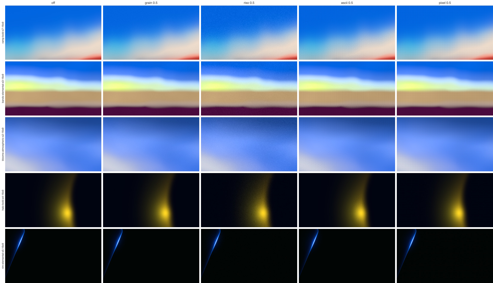

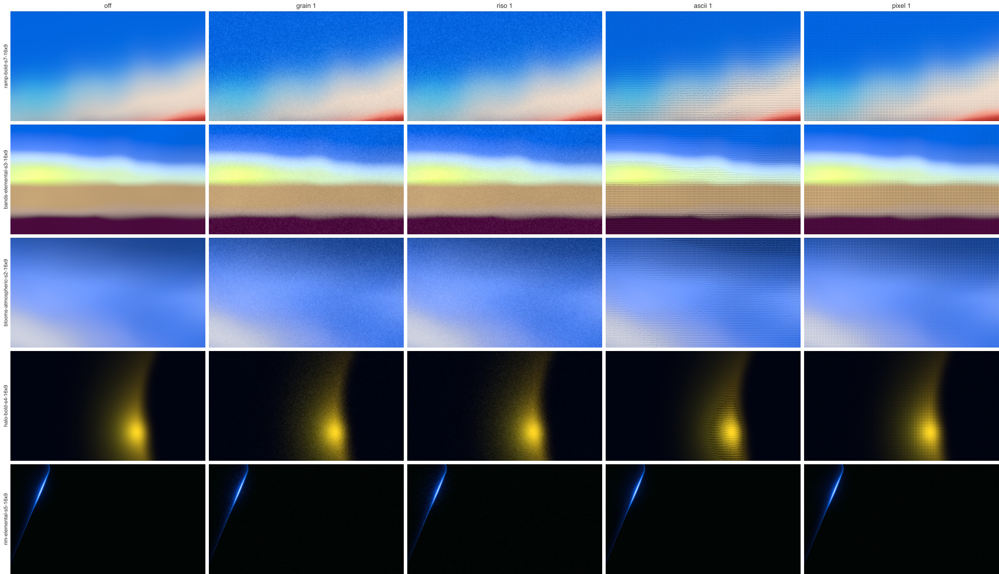

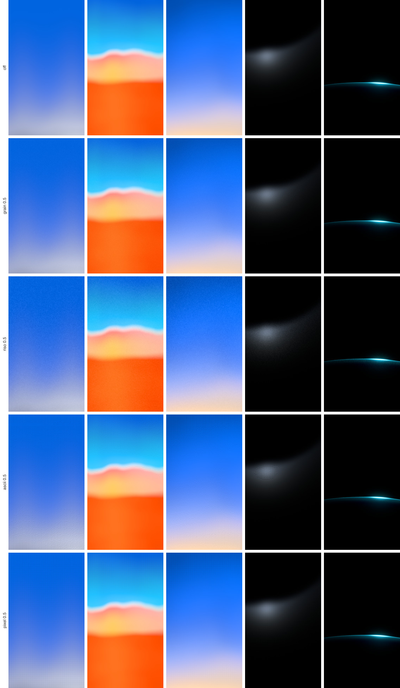

### 1:1 crops per filter (off, 0.25, 0.5, 1; the last two rows at 3×)

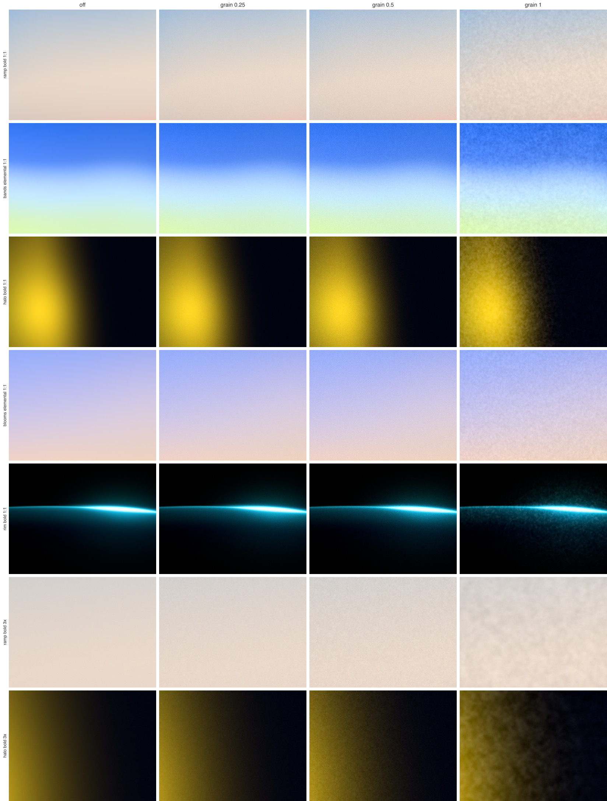

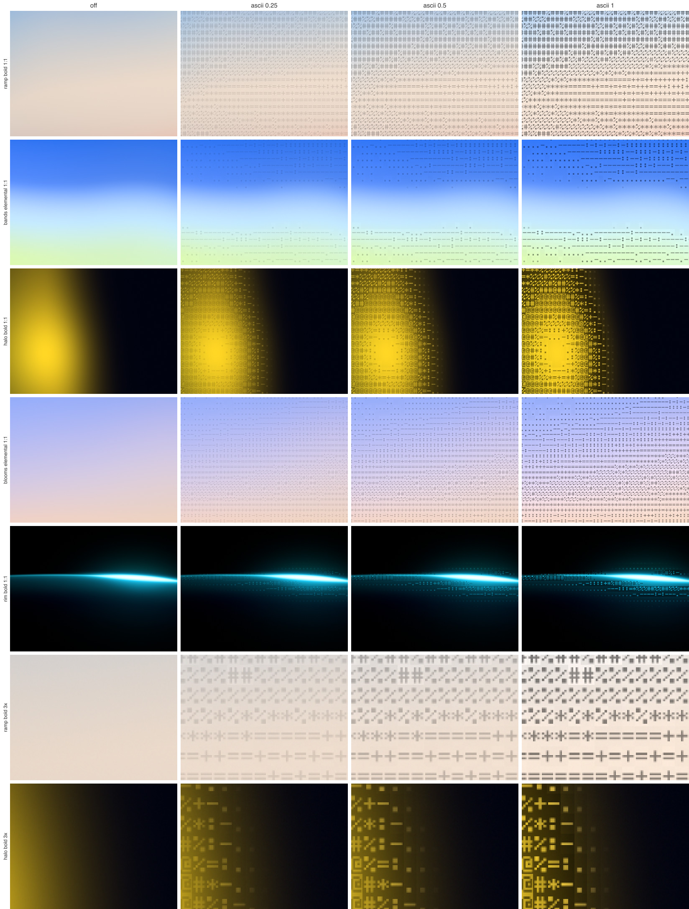

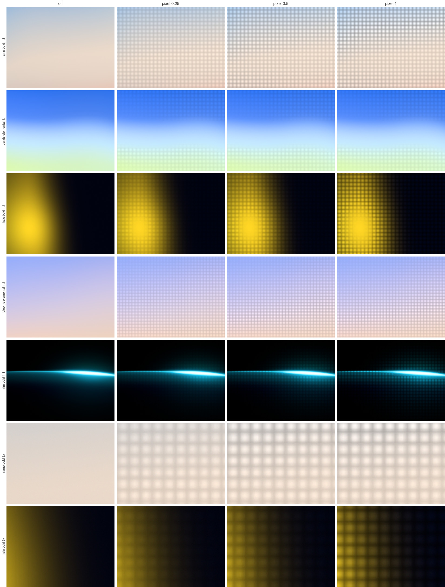

### Strength sweeps

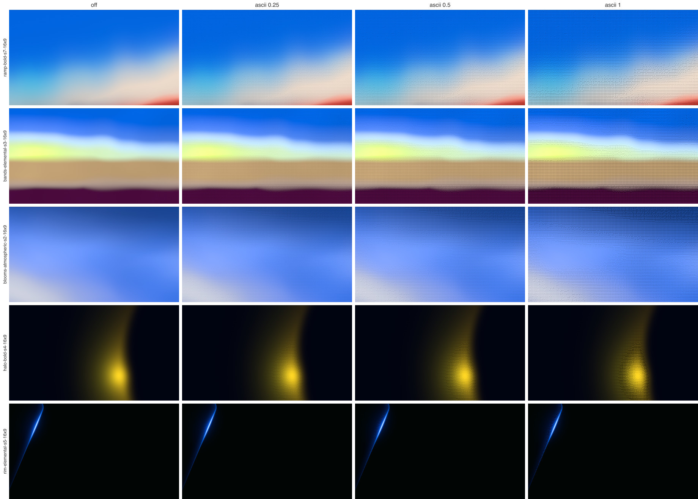

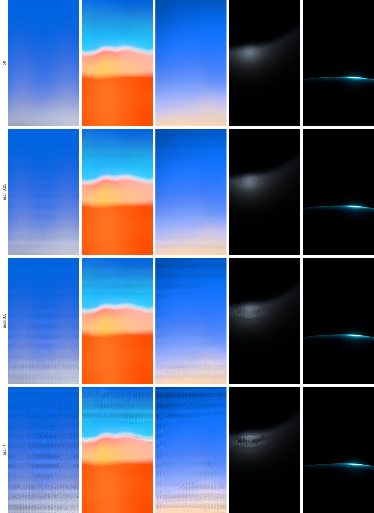

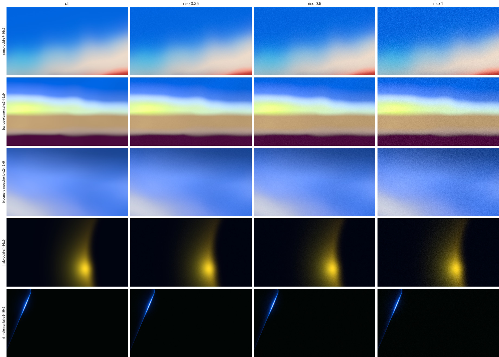

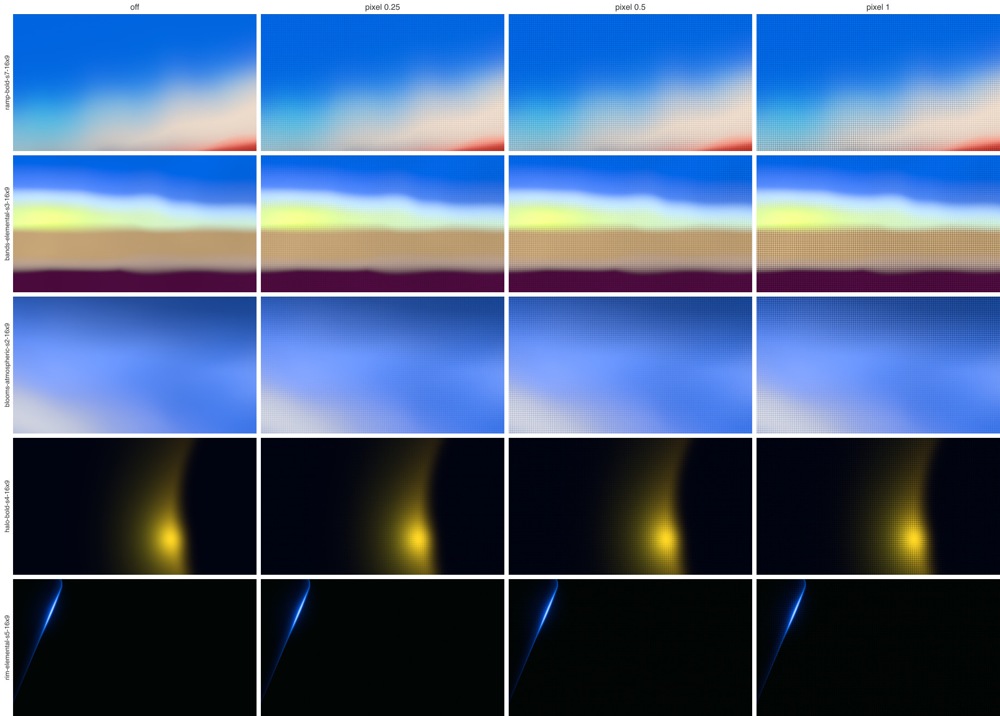

### ASCII cell sizes at export size

Halo, shot enlarged 2×, 40, 64 and 96 rows, then Pixel at 72 rows. 40 rows reads as text, 96 as texture; 64 sits between.

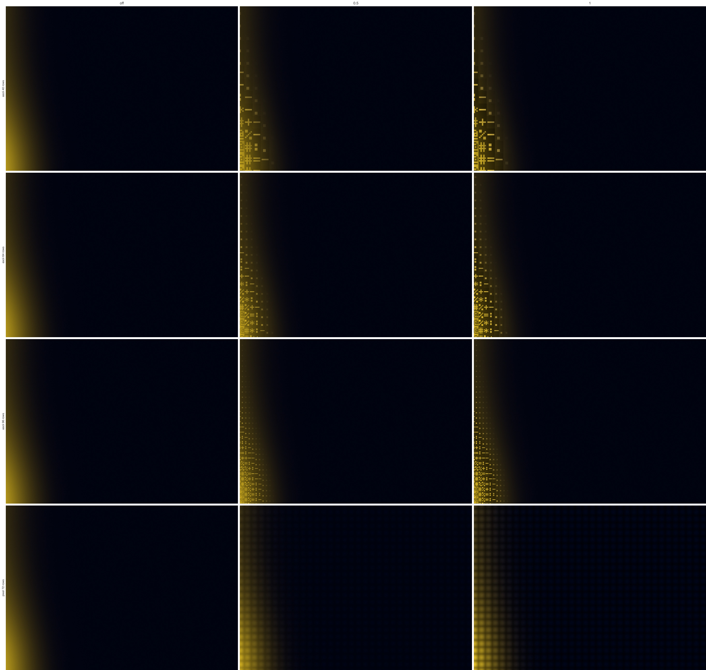

### Riso dot screens (left out)

Rows: riso-end grain (recommended), plus a soft two-level dot screen, plus bigger dots, and the current Grain. Strength 0.5 and 1.

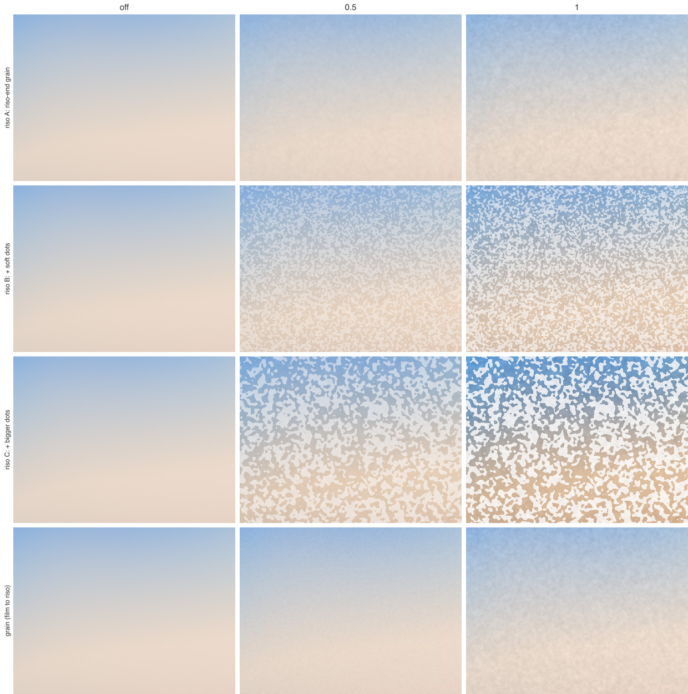

### Pixel: flat cells vs own color

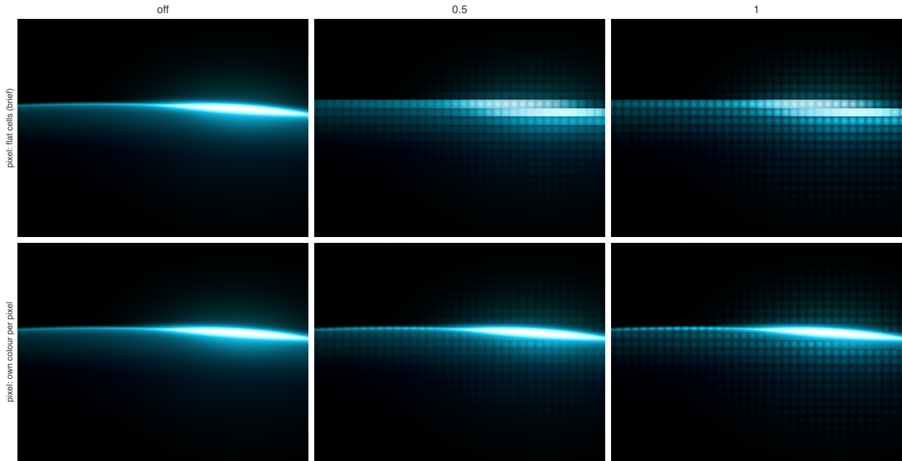

## Open questions for the owner

1. **Riso or Pixel?** Recommended list: Grain, Riso, ASCII, with Pixel later as a glyph set inside ASCII. The brief's list is Grain, ASCII, Pixel.
2. **If Riso has its own entry,** should Grain stop at fine film grain (1 to 2%) and leave the coarse riso end to Riso? Today one slider covers both.
3. **ASCII polarity.** The brief says "pack-colored text on the dark base". Keeping the color exact gives light text on Contour's dark base but dark text over Sunset's light. Light text everywhere would darken every Sunset image, which breaks "never the color". Is dark text over Sunset acceptable?
4. **ASCII contrast.** At strength 1 the dim part keeps 30% of the light, and small thumbnails come out about one just-noticeable difference darker. Is that the right ceiling, or should strength 1 be stronger text?
5. **Glyph font.** A 5×7 pixel font (used here, no asset) or a real monospace or brand font (needs a font atlas)?
6. **Is ASCII allowed on Contour,** given "not a science-fiction interface"?
7. **Saving the filter.** Should the filter and its strength go into the URL, the presets and the export file name next to the seed?
