# Horizon placement for the Sunset looks

Where the horizon and the light sit in the frame, how steep the line is, and what fills the frame below it. The owner, about the riso prints (33:109) and the sea sunset (33:106): "these are also interesting as the horizon starts not necessarily at the bottom of the image if that makes sense". About the ridge frame (33:112): "love the organic blending of shapes/colors".

Other notes cover the Bands critique, why the poster feels organic, and filters. This one is only about placement.

Prototype and sheets: [`prototypes/horizon-placement/`](../../../prototypes/horizon-placement/) (README there). The sketches are CPU renders in pack hexes, made to judge placement; their sky colors are rough.

## Short answer

1. Today the light sits at the bottom edge. Ramp puts the horizon just below the frame for 3 seeds in 4, and Blooms puts its light on or past the bottom or side edge. Bands is the only look that always shows a horizon (30% to 90% down, 64% at the default), and below it there is always land.
2. Proposal: every Sunset look uses one horizon height. Horizon 0 puts it below the frame, the default 0.5 puts it about two-thirds of the way down, and 1 puts it a quarter of the way down. The seed picks what fills the frame below the line: more sky, water or land.
3. Water is the sky mirrored under the line, squeezed toward the line, smeared up and down by ripples and dimmer with depth (Fresnel). The water's own light, a dark pack color, shows where the reflection weakens. Land is lit only by the sky, so it is darker, and far land is paler because of the air in front of it.
4. A water horizon stays level, but it is soft and its softness changes along it. Land is a low, calm bank or one long ridge climbing toward the light. It is never a row of bumps and never more than about half the frame.
5. Only some lights can be reflected without mud. Orange-red, Ice, and Tan over Plum water stay clean. Yellow and Lime turn khaki or olive over any water.
6. Blooms keeps "no horizon" (deck 33:117). Its light follows the same Horizon mapping.
7. Turning the gradient sideways like the scanned prints is a question for the owner. If the answer is yes: Bands only, about 1 seed in 8, and only in wide frames.

## 1. Where the horizon and the light land now

I shot Ramp, Bands and Blooms × 3 packs × 16:9 and 9:16 × seeds 1-8 × Horizon 0, 0.5 and 1 (432 shots, Intensity and Softness 0.5) from the dev server. I measured the brightest row and the light center on each shot. I also read the intended horizon and light positions straight from the compose code for seeds 1-64 and Horizon 0, 0.25, 0.5, 0.75 and 1 (5,760 rows). Shots were taken from 23:24 to 23:44 UTC on 2026-11-02, at commits `8bb0b9a` and then `1360a3d`, with the Ramp, Bands, Blooms and Contour work uncommitted (the `git status` lists are in the prototype README). The code was read at `1360a3d` plus the same uncommitted work.

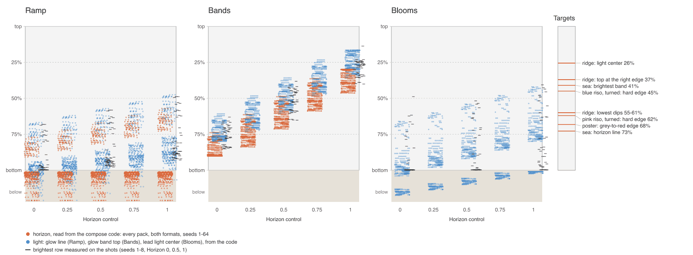

Heights are fractions of the frame height, down from the top, at the center column. Values above 1 are below the bottom edge.

| Look | Horizon (code) at Horizon 0 / 0.5 / 1 | Brightest row on the shots, median (p10-p90) at Horizon 0 / 0.5 / 1 | Light center on the shots |
| --- | --- | --- | --- |
| Ramp, open / corner / arcs (3 seeds in 4) | just below the frame, 1.02-1.16, at every Horizon | 0.99 (0.73-1.00) / 0.93 (0.63-0.97) / 0.87 (0.54-0.92) | on the bottom or side edge (72% of shots at a side edge) |
| Ramp, wave (1 seed in 4) | 0.84 / 0.74 / 0.64 (16:9); 0.88 / 0.79 / 0.70 (9:16) | (included above) | |
| Bands | 0.89 / 0.64 / 0.39 median, ±0.12 by seed (range 0.30-0.90) | 0.76 / 0.52 / 0.27 | 0.72 / 0.48 / 0.24 down, inside the frame |
| Blooms | none | 1.00 / 1.00 / 0.94 | lead light center from the code: 1.00 / 0.88 / 0.76 median; 69% beyond a side edge, 31% below the bottom |

What that means:

- **Ramp.** Its horizon is in the frame only for the wave structure. For the other three, `horizonBelow` puts the line 0.02 short sides under the lowest corner of the frame, and the Horizon control only lifts the glow line, by 0.04-0.26 short sides (`lift`). The brightest row is in the bottom 5% of the frame for 71% of shots at Horizon 0 and in the bottom 20% for 65% of shots even at Horizon 1. The wave's horizon has no light step: the sky dims to the dark band's own brightness first (`seamDim`), so it reads as a change of color, not a line. Tilt: open 2° median, corner 8° (up to 14°), arcs 4°, wave 2°.
- **Bands.** `horizon = clamp(lerp(0.85, 0.35, Horizon) ± 0.12, 0.3, 0.9)` always puts the line in the frame, and what fills the frame under it is always ground bands in pack order. The glow band's top sits about 0.13 above the horizon, and the brightest row sits in that glow band. The horizon is level (median slope 0.01 of the height across the width) and fairly crisp, with a lighter seam along it.
- **Blooms.** It has no horizon. `rise` moves the lead light from just below the bottom edge (1.0) to about three-quarters down, beyond a side edge for most seeds. On the shots the brightest row is at the bottom edge for 65% of frames at Horizon 0.5.

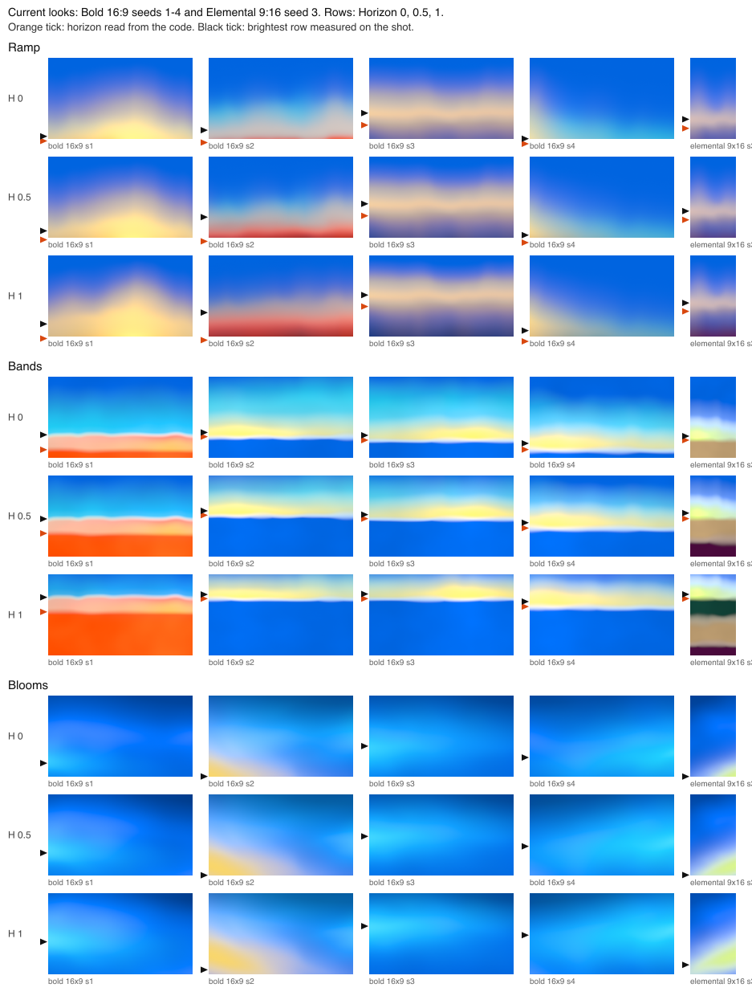

## 2. The targets

All numbers below are measurements for notes. No reference pixel goes into a renderer.

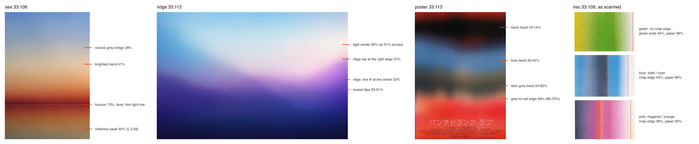

### Sea sunset, 33:106 (541×812)

- **Horizon:** 72.8% down. It is level: −0.04°, 0.4 px of difference across the full width. It is also straight: 0.03 px RMS from a line, per 20 px column group. The sky above runs from blue (0%) through a neutral grey bridge (28%, `#B1B2B2`) to the brightest band, a pale peach at 41% (L 0.80, `#D1BAA1`). Below that come orange, red, and deep crimson right above the line (L 0.36, `#6E1B1F`, the darkest rows in the image). The brightest band sits 44% of the sky's height above the horizon.
- **The bright line:** a 3 px line (rows 589-591, 0.4% of the height) at 2.8× the luminance of the rows 5-6 px away. It is a pinkish red, `#A55556` (L 0.55), not white. Likely cause: on the far water, wave faces tilted toward the camera reflect sky from a few degrees up, which is brighter than the crimson right at the horizon.
- **The reflection, color order:** mirrored. Read down from the line, the water runs crimson, red, orange, tan, then olive-grey at the bottom (`#78725F`, C 0.03). That is the sky's order read up from the line.
- **Squeezed:** a water row at depth d below the line has the hue of the sky row 1.07-1.36 d above it (beyond the first 2% of the height). So the reflection shows the sky's colors closer to the line than a flat mirror would.
- **Darker with depth:** against the sky row of the same hue, the water's luminance is 0.95 right under the line, 0.74 at 7% of the height below it, 0.51 at 12%, 0.39 at 20% and 0.34 at the bottom (27%). This follows water's Fresnel reflectance for a normal lens, about 25-30° across the short side (chart below). I chose that lens, I did not fit it.
- **Saturation:** at the matching hue, the chroma is 0.92-1.0× the sky's, so the water is darker but about as saturated. Dim peach and orange then read as tan and brown. The bottom's olive-grey is the one muddy color in the image.
- **Softer:** the color changes 0.5-0.7× as fast per pixel as the sky at the same distance from the line. There are no visible ripple streaks.
- **Brighter toward the sun:** the right side has 1.33× the luminance of the left in the sky, and 1.6-1.8× in the water near the line.

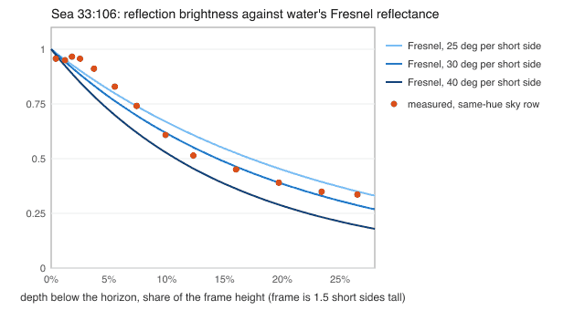

### Riso prints, 33:109 (567×1134, as scanned)

The gradients run left to right and fade to paper on the right. Positions below are measured across each print from the left.

| Print | Structure | Crisp edge | Paper reached |
| --- | --- | --- | --- |
| green | mustard, then green (flat 40-64%), then a fade to paper | none | within 0.15 L of paper from 81%, at paper by 96% |
| blue | light blue, grey lavender, slate (40-52%), then cyan (60-72%), then a fade to paper | at 54%, slate to cyan, 10-90 about 3% of the width; straight | within 0.15 L from 78%, at paper by 89% |
| pink | slate, violet, magenta, then an orange stripe from 38% (soft side fading by 47%), a pink plateau, then a fade to paper | at 38%, magenta to orange, 10-90 about 2% of the width; straight (±3 px down the print) | within 0.15 L from 74%, at paper by 93% |

Measured from the paper side, the crisp edges are 46% (blue) and 62% (pink) across. In the turned references (paper on top) they read as horizons 41-45% and 62% down. The ink-to-paper fade takes the last 20-35% of each print on the paper side. So the "horizon" of these prints sits near the middle of the sheet, and the side beyond it is ink (ground), not more sky.

### Ridge frame, 33:112 (1200×800)

- **The light:** its center (the brightest 40 px block) is at 91% across and 26% down: near-white warm `#F2EEEB`, 9% of the width in from the right edge. Its flat core (L ≥ 0.925) spans from 70% across to the right edge (from the `sunset-violet-wave` note).
- **The ridge line:** highest at the right edge (37% down), right under the light. It dips to 55-61% at 68-83% across and again at 17-38% across. On the left a soft diagonal, the light's lower edge, climbs to the upper left. A straight-line fit gives 53% at the center and −2.8°, but the shape is a broad bowl, not one slope.
- **Light and ridge:** the light sits about 11% of the height above the ridge's highest point. The ridge hides the lower part of the glow, so the brightest sky is just above the crest in front of the sun.
- **Below:** violet right under the light (lit by it, chroma up to 0.155), then indigo, then navy at the bottom (L 0.19-0.20). Land fills about 45% of the frame.

### Poster, 33:113

The grey-to-red edge sits at 68% down on average (66-70% across the width, lower on the right). Above it is a dark grey band (54-62%), and below it the red fills the bottom third. Here the light is below the "horizon" and a dark band sits above it, like a lit sky under a cloud bank. It is the opposite of land.

## 3. The physics we need

- **Calm water reflects more at grazing angles (Fresnel).** Water reflects about 2% of the light from straight below, 6% from 30° below the horizon, 13% at 20°, 35% at 10°, 58% at 5°, 80% at 2° and 90% at 1°. So the reflection is brightest right under the horizon and dims downward. The sea photo follows this curve.
- **Ripples smear the reflection up and down.** Each wave face is a small tilted mirror, so one spot on the water reflects a spread of sky heights. Nearer water shows bigger faces and more spread. Faces tilted toward the camera are seen more, and they reflect sky from higher up. That is why the sea's reflection is squeezed toward the line and why the farthest water can be a thin lighter line.
- **Land below the horizon is lit only by the sky.** With the sun down, land returns about 5-20% of the sky light falling on it. So it is much darker than the sky, and it takes the sky's average hue: blue-violet at dusk. The air between the camera and far land adds the low sky's light, so far land is paler and closer to the horizon sky's color. That is the lavender-grey band and the navy foreground of 33:112.
- **Light glows above and behind a ridge.** The sun, or the brightest part of the twilight glow, is just behind the crest. The glow around it spreads into the sky above the crest, the ridge hides its lower part, and a little light spills over the soft crest. That is the violet top of the right hill in 33:112.

## 4. Proposal

### One horizon height for every Sunset look

The horizon height `h` (frame fraction from the top, at the center column) comes from the Horizon control plus a small seeded shift:

| Horizon | 0 | 0.25 | 0.5 (default) | 0.75 | 1 |
| --- | --- | --- | --- | --- | --- |
| `h` | 1.06 (below the frame) | 0.86 | 0.67 | 0.47 | 0.27 |

That is `h = lerp(1.06, 0.27, Horizon)`, shifted by up to ±0.05 per seed. The shift shrinks near the ends, so Horizon 0 always keeps the line below the frame and Horizon 1 never puts it above 25%. The default puts the line about two-thirds down, where the sea (73%), the poster (68%) and the pink print (62%) have theirs. It also leaves the brief's thirds intact: blue on top, the light in the middle, water or land below ("Holds text on any third of the canvas", 33:115). The same fractions are used in every format.

The brightest band sits 25-45% of the sky's height above the horizon. The seed picks within that range and Softness moves it up, since haze lifts the glow. The sea's band sits at 44%.

### What fills the frame below the line

The seed picks one of three scenes. Seeds come in runs of three, and each run holds every scene once in a seeded order (as Ramp's runs of four do now), so neighboring seeds differ.

| Scene | Below the line | Notes |
| --- | --- | --- |
| Open sky | more sky: the line stays below the frame | The Horizon control raises the brightest band instead, from the bottom edge to about mid-frame (sky-peach's band is at 56%). This is today's open, corner and arcs skies. |
| Water | the sky mirrored, squeezed 1.1-1.4×, smeared up and down (more with depth), dimmed by Fresnel; the water's own light shows where the reflection weakens | The water uses a long-lens scale: the bottom of the frame is 8-12° below the horizon, so the reflection never drops below about 35-45% of the sky and the water stays light. The water's own light is a dark pack color: Meta Blue (Bold), Plum (Elemental), Slate (Atmospheric). Dim warm light over it turns rose, mauve or blue-grey instead of brown. |
| Land | a far bank or a ridge, lit by the sky, darker than the sky, paler with distance | When the line is higher than 40% down, land becomes a far shore over water, so land never fills more than about 55% of the frame. A ridge only when the line is 40-80% down. |

### The line itself

- **Water:** level. Tilt at most 0.5° and wander at most 0.2% of the height. The edge is soft, 0.5-1.5% of the height, and its softness changes along the line by ×0.6-1.6. A soft lighter strip, 0.5-1% of the height, runs under the line. It is brighter toward the sun and its brightness changes along it. It is never a thin crisp line.
- **Bank:** tilt at most 2°. Low undulation with long waves: 0.4-0.8% of the height, wavelength at least half the frame width. Edge 2-4% of the height, softness changing along it; the far land is paler.
- **Ridge:** one long climb toward the light (10-25% of the height across the width) or one broad dip, as in 33:112. Never two bumps of the same size. Softness changes along it by about 4× (1.5-6% of the height), softest near the light. The light sits 5-15% of the height above the ridge's high end.
- **Open sky:** no line in the frame. Lines of equal color tilt by at most 4° and bow slightly, as today.

### Sideways

The scanned prints run left to right with paper on one side, and the gradient runs along the sheet's long side. In a wide frame, a turned gradient runs along the long side too. The deck, though, asks for "Horizontal structure" (33:115). I would leave it out unless the owner wants it. If yes: Bands only, about 1 seed in 8, 16:9 and 1:1 only, turned 90° with the pale side on the left or right and the crisp edge 40-60% across. See the sideways sheet.

### How it fits the shared boundary model

`src/light/recipes/sunset/boundary.ts` already has what each line needs:

- **Water horizon:** its own transition with wander close to 0 (at most 0.002 short sides), soft amount 0.2-0.3 so its softness changes along it, and contrast 0.
- **Reflection:** it reads the sky's boundary field mirrored. Water at `s0` takes the sky at `h - (s0 - h) × k` (k = 1.1-1.4), with the sky's move `D` scaled by about 0.6, averaged a little along the boundary, and stretched in depth. The reflected edges follow the sky's shapes, softer.
- **Land:** the contrast from the colors on each side is well above 0.3, so the silhouette rules switch on by themselves. The edge moves as one piece, keeps only long waves, is softer at its crests and has gentler slopes. That is the existing guard against a ground that reads as a hill.
- **Ridge:** a seeded base shape (one lean and one broad bow, like the lean and bow in `bands-compose.ts`) with the boundary noise on top, under the same silhouette rule.
- **Other edges** keep their own wander, lean and bow, so the sky edges are never parallel to a level water horizon.

### Which looks

- **Ramp:** all of it (open sky, water, land).
- **Bands:** the shared height. Below the line: ground bands (land, as now) or the bands above mirrored in reverse order (water), and open-sky seeds with no crisp edge in the frame, like the green print. Sideways only if the owner wants it.
- **Blooms:** no horizon, no water or land. Only its light height follows the shared mapping.

### What must not happen

- **A ruler-straight hard horizon.** No crisp, constant, full-width line. A level water line needs a soft edge whose softness changes along it, a lighter strip whose brightness changes along it, and sky edges above it that are not parallel to it.
- **Mud in the reflection.** Reflect only lights whose dim versions stay clean (mud sheet below): Orange-red turns rose and deep red, Ice turns blue-grey, and Tan over Plum water turns mauve. Never Yellow or Lime over water, and never Tan over Forest. The water's own light is a dark pack color added where the reflection weakens, never a grey or brown multiply.
- **A dark ground that reads as a hill when it should not.** A bank stays calm (silhouette rule, long low waves, soft edge), far land is paler, land fills at most about half the frame, and a ridge is one climb, not bumps.

## 5. Sketches

All sketches are 16:9 unless marked, in exact pack hexes, and are CPU renders through the engine's tone curve (copied; checked identical on 20,000 colors).

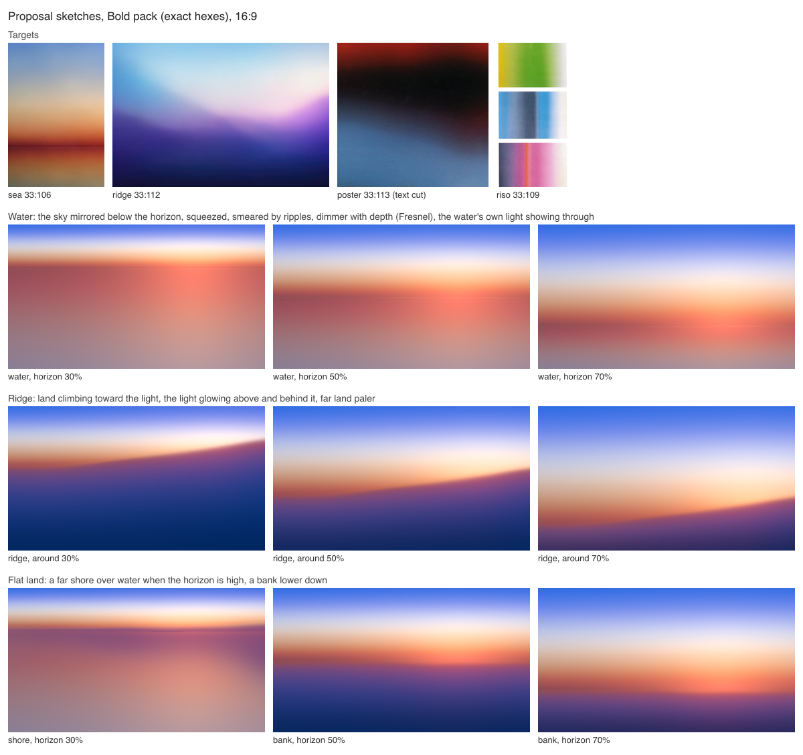

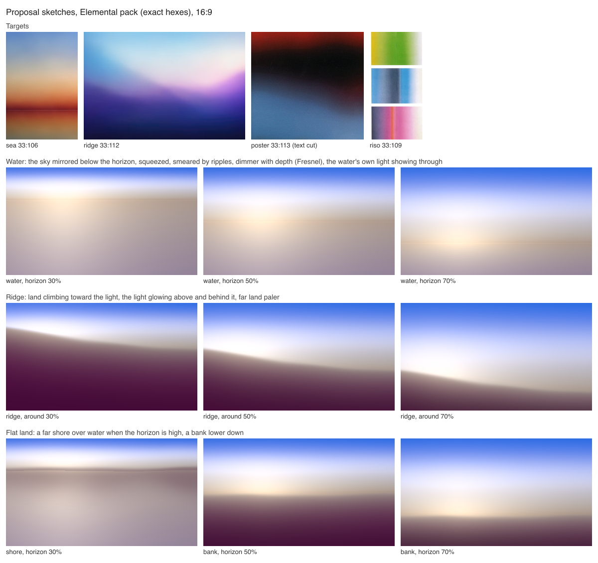

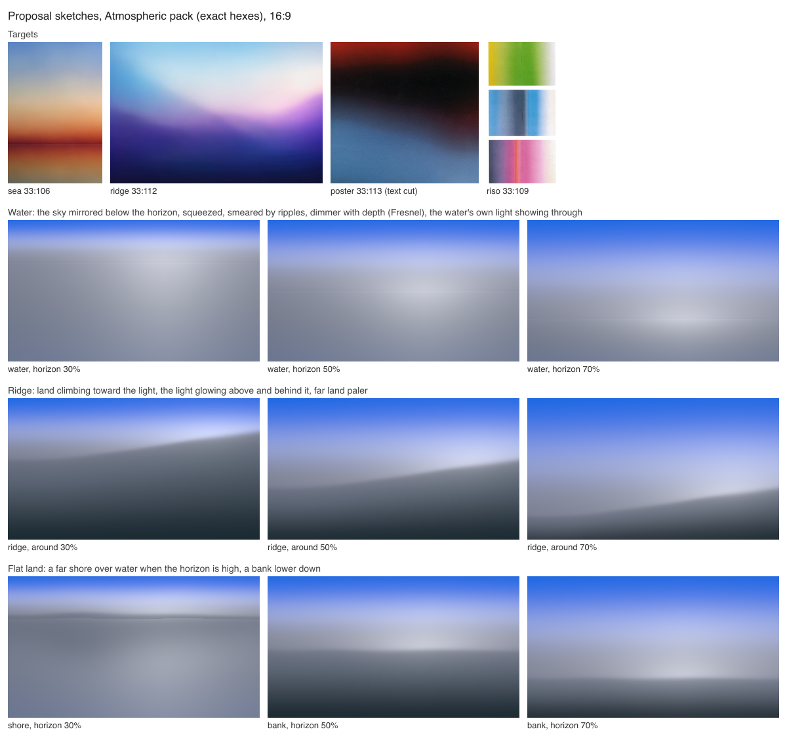

What I see:

- **Water** reads as water at every height and stays light. With Bold, the reflection runs rose to mauve and the bottom stays dusky lavender, not brown. The horizon reads as an edge without a drawn line. At 30% the sky is a short strip and the water fills the frame. That works with Atmospheric and Elemental. With Bold, the red horizon band then sits in the top third as a strong stripe.
- **The ridge** reads like 33:112's diagonal, with the light behind its high end. At 30% it covers 70% of the frame and is too heavy, especially Elemental's Plum. That is why land becomes a far shore when the horizon is high.
- **Flat land:** the far shore over water at 30% looks like a lake with a distant shore, close to the blue print's dark band. Bold's bank is Meta Blue and reads more like sea than land, so for Bold land the ridge is the better choice.
- **Sky colors:** the sketches' sky has a slightly lavender bridge and an overexposed Elemental glow. That is the sketch sky, not the placement.
- **The strip on the water line** is at the thin end of the proposed range. In small tiles, Elemental's reads as a thin tan line, so production should keep it toward 1% of the height.

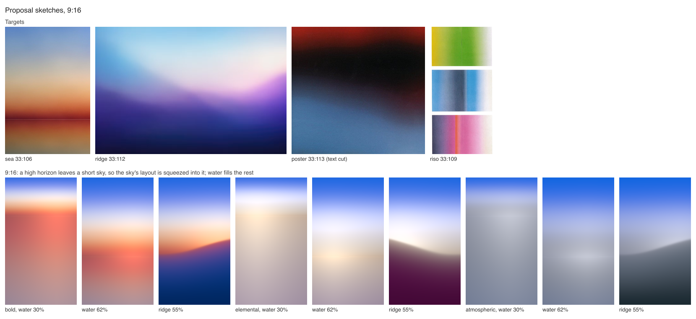

In 9:16 the same fractions work. A 30% horizon leaves a short sky band and a tall water area. Bold's water then becomes a large rose field, which may be too much. The ridge at 55% works well tall.

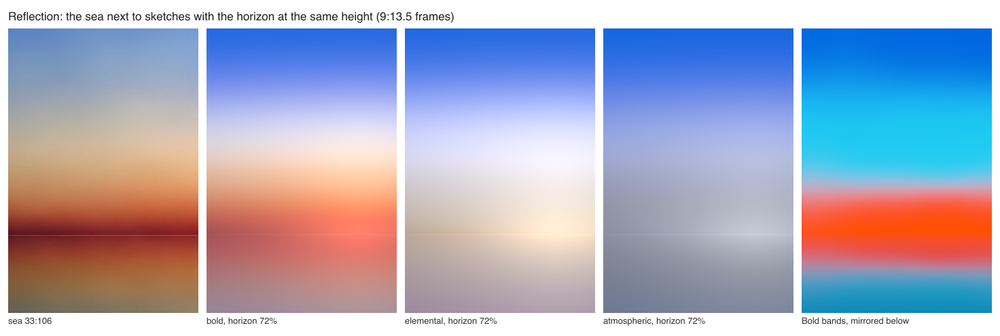

With the horizon at the sea's 72%, the Bold sketch has the sea's layout: blue, peach, red at the line, and a dimmer mirrored band below. Its reflection is lighter and pinker than the photo's, with no olive at the bottom. The Bands version mirrors Meta Blue, Cyan and Orange-red below the line and reads as a reflection.

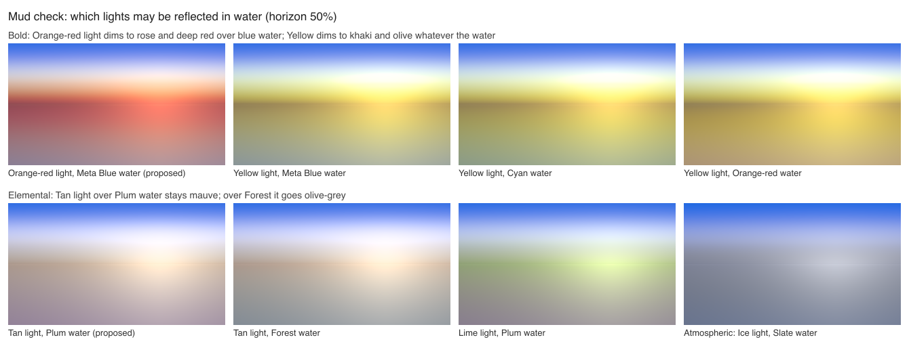

Yellow over any water (Meta Blue, Cyan or Orange-red as the water's own light) goes khaki or olive. So do Tan over Forest and Lime. Orange-red over Meta Blue, Tan over Plum and Ice over Slate stay clean.

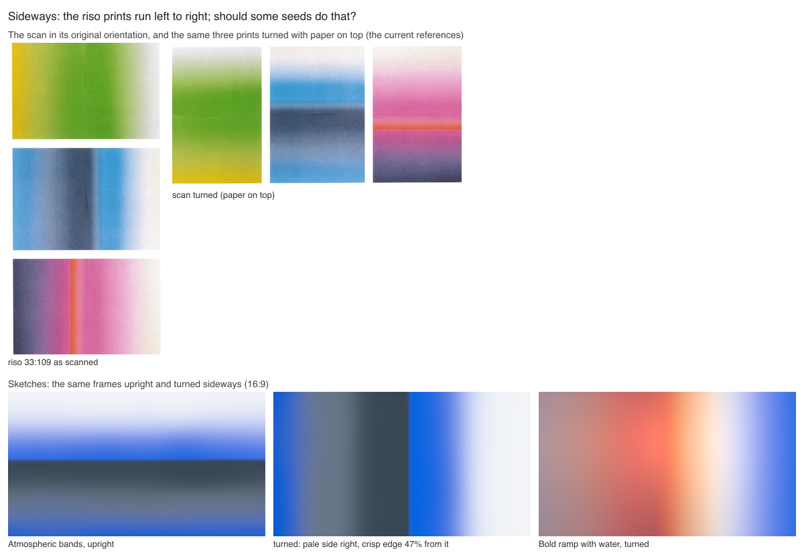

Turned, the Atmospheric bands look like the blue print: pale side right, crisp Slate edge, Steel and Meta Blue. A turned ramp with water no longer reads as sky, so if sideways happens at all, it suits Bands only.

## 6. What each look needs to change

- **Ramp**
  - Replace the structure pick with the scene pick: open sky keeps today's open, corner and arcs skies, and water and land are new. The wave structure becomes the land scene, keeping its no-seam rule.
  - The Horizon control places the line from the shared mapping for water and land seeds. For open-sky seeds it raises the brightest band from the bottom edge to about mid-frame (today it stops around 0.8-0.9).
  - Squeeze the sky's layout into the visible sky when the line is high, with the glow peak 25-45% of the sky's height above the line.
  - Add the reflection term: the mirrored sky field, the squeeze, the smear, Fresnel with a long-lens scale, and the water's own light.
  - Add the land term: lit by the sky, aerial haze, and the ridge base shape on the boundary model.
  - Pack rules for water: Bold uses Orange-red as the light (not Yellow), Elemental uses Plum and Atmospheric uses Slate as the water's own light.
- **Bands**
  - Take the shared height instead of `lerp(0.85, 0.35) ± 0.12`. The range grows to below the frame at Horizon 0 and 27% at 1.
  - Add water: the bands above mirrored below in reverse order, squeezed, softer and dimmer with depth, with the water's own light. Leave Yellow and Lime out of the mirrored part.
  - Add open-sky seeds with no crisp edge in the frame.
  - Keep the lighter seam on the horizon, but vary its strength along the edge so it is never a constant white line.
  - Add the sideways option only if the owner approves.
- **Blooms**
  - No horizon. Map the lead light's height to the shared mapping: from just below the frame at 0 to about 55% down at 1 (today 1.00 to 0.76 median).

## 7. Risks

- **The default look changes.** Ramp goes from 3 open-sky seeds in 4 to 1 in 3. At the default, two seeds in three show a horizon in the frame.
- **Stock-photo risk.** A water scene doubles the warm band and can read as a stock sunset over the sea (deck, 33:119: "A stock sunset"). The reflection must stay muted and smeared. No sun disc, and any column under the sun stays wide and faint.
- **High horizons.** At 25-35% down the sky is a short strip. Bold's red horizon band then becomes a stripe across the top third, and the large reflection area is busy.
- **Bold land** is Meta Blue and can read as sea. Use the ridge, or the far shore over water.
- **Land is a shape.** The deck says "no shapes" and "nothing reads as an object". Ridges must stay wide, soft and calm.
- **Sideways** goes against "Horizontal structure".
- **Moving code.** The Ramp, Bands and Blooms code is changing in parallel. The current numbers were read from uncommitted work and will drift.

## 8. Open questions for the owner

1. At the default (Horizon 0.5), should two seeds in three show a horizon in the frame (water or land), or should most seeds stay open sky?
2. Should some seeds run sideways like the scan? If yes, Bands only?
3. The sea's thin bright line on the horizon: keep it as a soft lighter strip (as proposed), or drop it?
4. Is land (a ridge or a bank) welcome in Sunset, given "no shapes"? Or only water and open sky?
5. Bold over water: always use Orange-red as the light (as proposed), since Yellow turns khaki?

## How it was made

- `shoot.mjs`: one browser, one page per shot. A shot is kept once two screenshots 600 ms apart match.
- `measure-shots.mjs`: brightest row, light center, the strongest drop in light going down and the sharpest color edge per shot. `code-placement.mjs` reads positions from the compose code through a read-only import of `src/`.
- `measure-sea.mjs`, `measure-riso.mjs`, `measure-ridge-poster.mjs`: target numbers; their outputs are in `out/*.txt`.
- `render.mjs`: sketches, using `lib/scene.mjs` (sky, water, shore, bank, ridge) and `lib/bands.mjs` (bands, mirrored bands). `plot.mjs` and `targets.mjs` make the charts and sheets.
