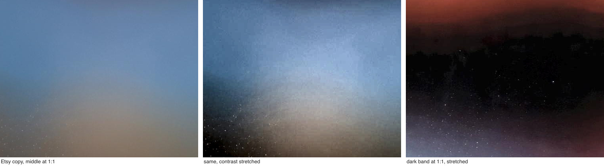
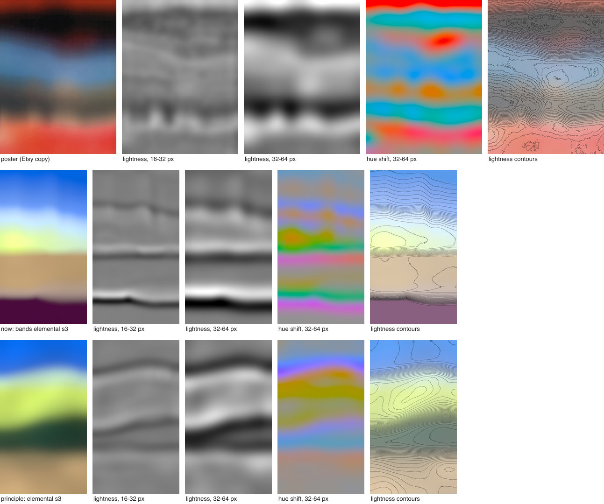
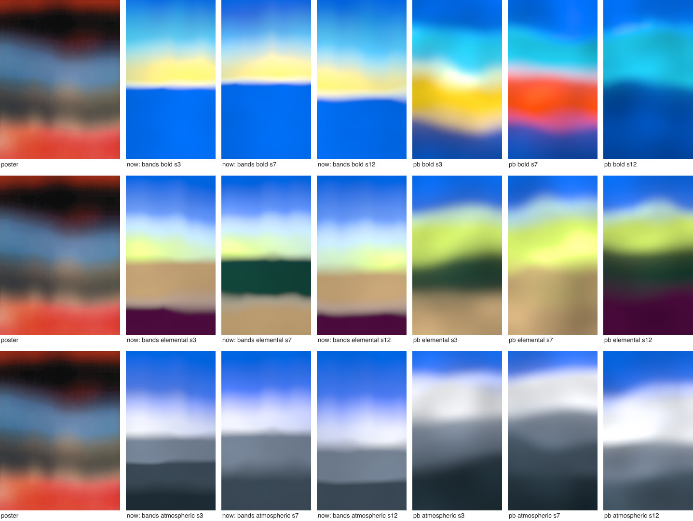
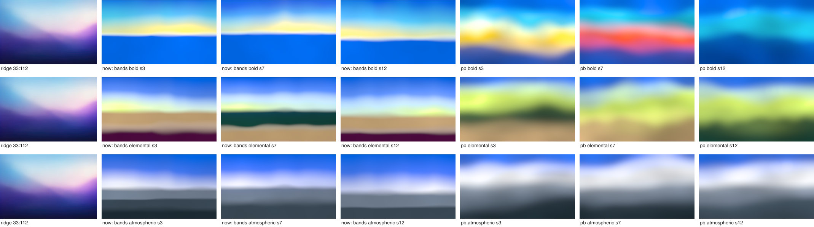
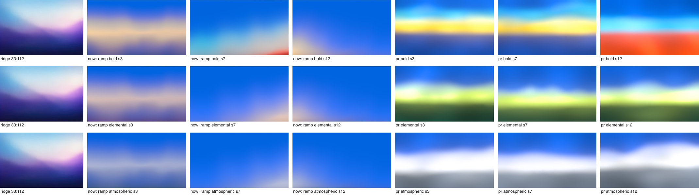
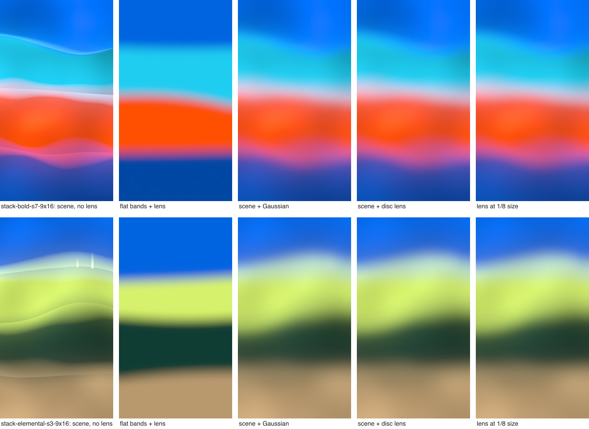
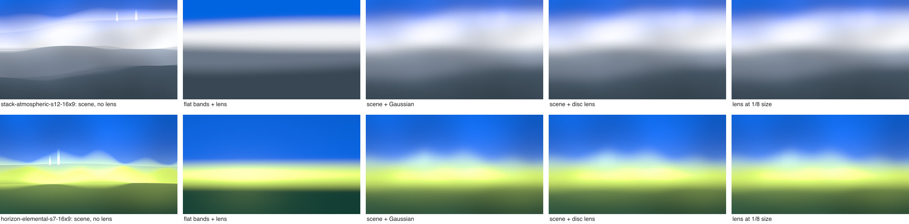
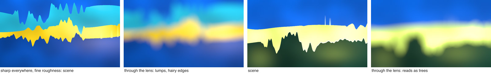

# Why the poster and the ridge frame feel organic

What makes the Japanese *Punch-Drunk Love* poster (artwork by Jeremy Blake, moodboard 33:113) and the blurred ridge frame (33:112) look organic, what our Sunset looks lack by comparison, and a rule the tool can apply to every Sunset look. The prototype and its scripts are in [`prototypes/organic-principle/`](../../../prototypes/organic-principle/README.md). Reference images were only measured and shown next to renders; nothing that renders reads them.

Tool shots were taken on 2026-11-02 at commit `8bb0b9a` with uncommitted work from other agents in `src/light/recipes/sunset/` (bands, ramp, blooms) and `src/light/recipes/contour/`; the list is in `prototypes/organic-principle/out/tool/shots.json`.

## Short answer

Both images look like a real scene seen through a lens that is far out of focus: big masses with uneven outlines, soft light inside and between them, and one blur over everything. One blur sets a minimum softness for every edge; edges are wider wherever the scene itself is soft; things thinner than the blur come out as faint ghosts; and no area is flat. Our Bands draw each edge with its own designed softness and wiggle, so the result is thin wavy lines between flat blocks.

The rule, in one sentence: **build a scene of pack-colored light that is sharp where things are things and soft where light is light, uneven at every scale above the lens, then look at the whole frame through one out-of-focus lens; don't draw soft edges one by one.**

## The rule

1. **Scene first, then one lens.** Each image is a scene of pack-colored light, blurred as a whole by one out-of-focus lens (a disc with a soft rim, in linear light, before the tone curve). No edge gets its own softness setting.
2. **Sharp where things are things, soft where light is light.** Outlines of masses (bands, ground) are sharp in the scene, softer in some stretches. Light transitions (sky into glow, light fading out) are soft in the scene. The lens gives every edge the same minimum 10-90 width (1.37 lens radii); scene softness only adds to it. So edge widths differ, and change along each edge, with no per-edge setting.
3. **Uneven above the lens, smooth below it.** Outlines get a few broad lobes and broad bumps, from about three lens radii up to the frame width, different on every edge. Detail finer than the lens is left out: through a lens it does not vanish, it comes back as lumps.
4. **Thin things are light, dark things are thick.** Anything thinner than the lens comes out as a faint ghost of itself. A thin light (a column, a lit rim) reads as a soft glow; a thin dark band reads as a dirty seam. Dark bands stay at least about 3 lens radii thick at every point; thin features are always light.
5. **Light varies inside every mass.** Each mass has slow light changes (patches a third to half of the frame across, 10 to 17% more or less light) and leans brighter to one side. No area is flat. The exact pack hex is where the light is nominal.
6. **Lights add.** Where two lights overlap before the lens they add, so the bridge between two hues is lighter than a plain mix; between distant hues the overlap is wider and the bridge goes pale. A lighter mass spills a little light onto its darker neighbour. Outlines cover what is behind them, and the lens then mixes in linear light, which never makes a bridge darker than both sides.
7. **Dark next to light.** A dark mass (a dark pack color, or less light of the same color) sits beside a light one. The contrast makes the light colors read as lit.

## What the images show

### Looking at the poster up close

At 1:1 in the Etsy copy (left), the middle is a warm dome rising from the grey into the blue, with a dark mass to its left. Stretched (middle, right), the dark band at the top has a ragged upper outline like a blurred treeline, and the dark areas carry hundreds of sharp 1 to 2 px specks. The specks are on the surface: they are sharp, so they were not seen through the same blur. The moodboard copy has only four specks, so most of them come from the Etsy reproduction. Its halftone and moiré, and faint horizontal ripples 8 to 16 px apart in both copies, are print and scan texture. These are notes for the filter work, not for the light.

### What lives at each scale

Each image is resized to a short side of 720 px, blurred at sigma 2 to 128 px, and the differences between neighbouring blurs are shown (grey means no change). Columns: the image, lightness structure 16 to 32 px across, 32 to 64 px, hue shifts 32 to 64 px, and lightness contours every 0.02 Oklab L.

- **Poster (top row).** The band-pass layers hold blobs, not lines: rounded pale columns rising from the red into the grey (about five, each roughly 50 to 60 px wide at this size), a dome in the middle, dark masses with lumpy tops. The hue layer shows patches of a neighbour's color inside bands: a maroon patch inside the black, warm patches inside the grey. The contours close into loops (the blue band has a core) and bend into U shapes at the columns. Below about 16 px there is nothing but print texture.
- **Current Bands (middle row).** The band-pass layers are thin horizontal lines along the edges and nothing else. The tan band has almost no contours: it is flat. Every contour runs across the frame, parallel to its neighbours.
- **Prototype (bottom row).** Broad waving shapes in the band-pass layers, closed contour loops inside the lime band, a dark band whose two edges move independently. It has fewer hue patches inside bands than the poster.

The ridge frame shows the same thing in a landscape: a few thin ridge lines that cross and diverge, contours that loop around the glow, and edges of very different widths (sheet: `prototypes/organic-principle/out/sheets/scale-space-16x9.jpg`, not committed).

## Measurements

All at a short side of 720 px. "2D" is the image minus its vertical profile (the mean of each row), so pure horizontal bands count as zero; the numbers are the RMS Oklab lightness of its band-pass layers, times 1000. Renders are the median (and range) over 3 packs × seeds 3, 7, 12 × 16:9 and 9:16; Blooms over 3 packs × seeds 3, 7 at 16:9. Script: `measure.mjs`, table: `summary.mjs`.

|  | 2D, 4-16 px | 2D, 16-32 px | 2D, 32-64 px | 2D, 64-128 px | flat share | edge 10-90, p10 | edge 10-90, median | value reversals | lightness range |
| --- | --- | --- | --- | --- | --- | --- | --- | --- | --- |
| poster (Etsy copy) | 2.3 | 4.5 | 9.4 | 15.8 | 0.01 | 0.10 | 0.14 | 4 | 0.46 |
| poster (moodboard copy) | 2.7 | 5.5 | 10.9 | 17.0 | 0.01 | 0.10 | 0.16 | 4 | 0.46 |
| ridge frame | 1.8 | 4.1 | 8.8 | 16.1 | 0.00 | 0.16 | 0.17 | 1 | 0.70 |
| now: Bands (18) | 2.1 (0.8-5.2) | 2.9 (1.5-6.4) | 4.0 (2.7-6.7) | 4.8 (3.7-9.8) | 0.17 (0.08-0.23) | 0.25 (0.03-0.48) | 0.26 (0.04-0.60) | 2 (1-3) | 0.54 (0.41-0.67) |
| now: Ramp (18) | 0.4 (0.3-1.3) | 1.1 (0.6-2.8) | 2.3 (1.6-5.4) | 5.0 (3.4-9.7) | 0.22 (0.03-0.40) | 0.80 (0.52-0.88) | 0.83 (0.57-0.92) | 1 (0-1) | 0.23 (0.13-0.34) |
| now: Blooms (6) | 0.3 (0.3-0.4) | 1.0 (0.7-1.0) | 2.7 (1.9-3.0) | 6.1 (3.9-6.9) | 0.11 (0.00-0.17) | - | - | 1 (0-1) | 0.31 (0.21-0.35) |
| principle, stacked (18) | 1.4 (1.0-2.1) | 4.3 (2.9-6.3) | 9.8 (6.5-13.3) | 13.2 (8.7-20.9) | 0.01 (0.00-0.07) | 0.15 (0.11-0.39) | 0.29 (0.18-0.73) | 1 (1-3) | 0.54 (0.32-0.66) |
| principle, horizon (18) | 1.5 (0.7-2.0) | 4.0 (1.9-5.7) | 7.4 (4.1-13.0) | 10.1 (7.5-19.0) | 0.02 (0.01-0.24) | 0.16 (0.09-0.23) | 0.22 (0.15-0.50) | 2 (1-4) | 0.52 (0.35-0.62) |

Edge widths are 10-90 widths in short sides, measured down each column only between turning points of the lightness profile, so a staircase of steadily darker bands counts as one run and is skipped; read those two columns as rough. Value reversals count turning points of the mean lightness down the middle 60% of the frame, with steps of at least 0.06 Oklab L.

What separates the targets from our current looks:

1. **2D structure that keeps growing toward large scales, with almost nothing at the lens scale.** Poster and ridge have nearly the same signature: about 4, 9 and 16 (×10⁻³ L) in the 16-32, 32-64 and 64-128 px layers, doubling per octave. Current Bands, Ramp and Blooms have 2 to 4 times less at 32 to 128 px. Bands at 16:9 also put relatively too much into the fine layers (the crisp horizon), which reads as a drawn line.
2. **No flat areas.** About 1% of the poster and none of the ridge frame is flat (lightness and hue change by less than 0.05 per short side after a 12 px blur). Current renders are 8 to 23% flat (Bands) and up to 40% (Ramp at 9:16).
3. **Edges start at one floor and widen from there.** The narrowest tenth of the poster's edges are 0.10 of the short side wide (10-90), the median 0.14, the widest tenth 0.24. Their shape matches a disc blur: the 10-90 width is 1.77 times the 25-75 width (disc 1.70, Gaussian 1.90, logistic 2.00). The crispest edges in current Bands (the horizons in Bold and Elemental) are 0.03 to 0.075 wide, a third to two thirds of the poster's floor, while their wander is 3 to 10 times smaller than the poster's (detrended RMS 0.001 to 0.009 short side against 0.013 to 0.028): thin, nearly straight lines.
4. **One lens of radius about 0.07 short side.** Two independent estimates agree. The narrowest edges give 0.10 / 1.37 = 0.073. The column power spectrum has a dip at 8 to 9 cycles per short side, where a disc of radius 0.61 / 8.5 = 0.072 has its first zero (`tools-colspec.mjs`). The ridge frame's crispest silhouette (36 px at 925 px wide) gives about 0.04 short side; its trough and upper-left edges are 2 to 4 times wider because the light there is soft in the scene.
5. **Value structure.** Down the poster: dark red, black, blue, grey, red, with lightness 0.41, 0.17, 0.60, 0.44, 0.65: four reversals and steps of up to 0.43. Current Ramp and Blooms have a lightness range of 0.13 to 0.35; most of the frame is Meta Blue.

What argues against the rule, or limits it:

- **A disc over a fully sharp, detailed scene does not match.** An early prototype drew outlines sharp with roughness finer than the lens; through the lens it had 2 to 3.5 times the poster's structure at 8 to 32 px and read as blurred trees and flames (below). So either the poster's source had little fine detail, or its blur was softer than a pure disc (its edge shape sits between disc and Gaussian), or both. The image cannot separate these. Rule 2 and rule 3 come from this.
- **The spectral dip is shallow** (1 to 3 dB) and could be chance. The edge-width estimate is the stronger one.
- **The poster has detail finer than its blur** in a few places: the ragged top of the dark band and faint vertical streaks in it are visible only with a strong contrast stretch. Either the blur was not uniform, or these are ghosts of very contrasty source material.
- **Neighbouring edges in the poster are not always unparallel.** The black-to-blue and blue-to-grey edges keep almost the same gap across the frame (its standard deviation is 4% of its mean). The organic feel comes from patches, columns and thickness changes elsewhere, not from every pair of edges.
- **No horizontal smear.** The 2D structure has slightly more change down than across (the ratio of across to down gradient energy is 0.65 to 0.72 for the poster, 0.80 for the ridge), i.e. patches a little wider than tall, and no streaks. A sideways camera move would show streaks; there are none, so intentional camera movement is not the model. A lens stretched 10% wider than tall is enough.
- **The lens shape matters little.** A Gaussian with the same edge width looks almost the same in the prototype (ablation below). The disc's practical advantage: a band wider than two lens radii reaches its exact color in the middle; a Gaussian of the same edge width needs about 3.2 radii.

How the prototype measures against the same numbers (bottom two rows): its 2D structure matches the poster's signature (4.3, 9.8 and 13.2 against 4.5, 9.4 and 15.8 in the three largest layers for the stacked layout), and 1% of it is flat, like the poster. Two gaps remain. Its median edge is wider than the poster's (0.29 against 0.14 short side) because its soft light transitions are softer than the poster's; that is one range in `lib/scene.mjs`. And value reversals depend on pack order: Elemental alternates by itself (Lime, Forest, Tan, Plum), while Atmospheric after Ice and Bold step one way only, so they reach one reversal where the poster has four.

## How it was made (sources)

**Jeremy Blake** (1971-2007) called his works "time-based paintings" or "moving paintings". Sources found:

- "fabricated in Photoshop, After Effects and the movie-editing program Avid, and then relayed from the computer onto DVD's"; "Blending paintings, photographs, film, music and sound on banks of computers". Paul Thomas Anderson saw *Liquid Villa* and *Guccinam* at SFMOMA's "010101" show in 2001 ("glacially moving abstract and architectural forms, their colors emotionally hot and cool") and wrote "three places into the script where the art's rainbow-rich abstractions flow between scenes". Steven Henry Madoff, *The New York Times*, 27 February 2005 ([estate PDF](https://www.jeremyblakeestate.com/s/2005-4.pdf)).
- "Working initially with ink and gouache drawings (and at times sketching directly onto the computer), Blake manipulates his work into dreamlike DVD animations." Blake: "trying to bring to film the 2-D logic of painting". Anderson "had been messing around with the idea of some color changes to demonstrate what the character was experiencing". Jessica Hundley, *Los Angeles Times*, 14 November 2002 ([estate PDF](https://www.jeremyblakeestate.com/s/2002-1.pdf)).
- His work was "influenced by the saturated colors and shapes of Ellsworth Kelly's oeuvre, the stains and veils of Morris Louis, the targets of Kenneth Noland and the 'zips' through the fields of Barnett Newman", with images "culled from Blake's data bank of photos and film stills that he manipulated with relatively unsophisticated computer programs"; his C-prints "are never stills 'grabbed' from the DVDs". Edward Leffingwell, *Art in America*, April 2008 ([estate PDF](https://www.jeremyblakeestate.com/s/2008.pdf)). In *Punch-Drunk Love* "his painterly manipulation of abstract color becomes a perceptible force". Leffingwell, *Art in America*, February 2004 ([estate PDF](https://www.jeremyblakeestate.com/s/2004.pdf)).
- Background: [Wikipedia: Jeremy Blake](https://en.wikipedia.org/wiki/Jeremy_Blake), [Wikipedia: Punch-Drunk Love](https://en.wikipedia.org/wiki/Punch-Drunk_Love), [NPR, 27 October 2007](https://www.npr.org/templates/story/story.php?storyId=15637707) (Anderson "asked Blake to design digital sequences for his movie"), [Washington Post, 8 November 2007](https://www.jeremyblakeestate.com/s/2007.pdf).

Not verified: how the poster image itself was made (a frame from the interludes, a separate digital print, or a designer's treatment of Blake's art); who designed the poster; whether a photograph sits underneath. The "real scene thrown out of focus" reading fits the image, and the sources say Blake layered photographs, drawings and painted color in Photoshop and After Effects, but no source describes this image. The estate's catalogue essays (Relyea 2002, Wilder 2003, Sichel 2003) are scans without text and were not read.

**Related practice.**

- Uta Barth, *Ground* (1992-95): she photographed "generic locations outdoors as if she was shooting a formal portrait but removed the subject of the portrait in focus and left the out-of-focus background behind" ([Wikipedia](https://en.wikipedia.org/wiki/Uta_Barth)). The closest match to the poster's middle: an ordinary scene, far out of focus.
- Gerhard Richter painted from photographs from the 1960s and blurred them (the "blur" photo-paintings); in the abstract pictures he uses "blurring and scraping to veil and expose prior layers" ([Wikipedia](https://en.wikipedia.org/wiki/Gerhard_Richter)). Blur over a structured layer, not soft shapes drawn directly.
- Hiroshi Sugimoto: *Seascapes* (long exposures with a large-format camera) and *Architecture*, buildings photographed with the focus set to "twice infinity" ([sugimotohiroshi.com](https://www.sugimotohiroshi.com/seascapes-1), and `../research-artists.md`).
- Intentional camera movement: the camera moves during the exposure; "1/8 of a second is an example of what might retain the shape of subjects, and strip away surface detail" ([Wikipedia](https://en.wikipedia.org/wiki/Intentional_camera_movement)). It gives streaks in one direction, which the poster does not have.
- Mark Rothko layered thinned paint on untreated canvas so layers dried "without mixing of colors" ([Wikipedia](https://en.wikipedia.org/wiki/Mark_Rothko)): soft edges from translucent layers, not from blending. Morris Louis's veils, which Blake cited, are the same idea with poured paint (not read further).

**Graphics.**

- Defocus: light from a point spreads into a "blur disk", and the image is "the convolution of the in-focus image with the PSF" ([Wikipedia: Defocus aberration](https://en.wikipedia.org/wiki/Defocus_aberration), [Circle of confusion](https://en.wikipedia.org/wiki/Circle_of_confusion)). That is rule 1: one blur over the whole scene.
- Photos of real scenes have power spectra falling roughly as 1/f², so they hold structure at every scale (D. J. Field, [doi:10.1364/JOSAA.4.002379](https://doi.org/10.1364/JOSAA.4.002379), 1987; van der Schaaf and van Hateren, [doi:10.1016/0042-6989(96)00002-8](https://doi.org/10.1016/0042-6989(96)00002-8), 1996). A defocused photo keeps that structure above the blur size and loses it below, which is the signature measured above.
- Smooth noise and domain warping: Inigo Quilez's `f(p) = fbm(p + fbm(p + fbm(p)))` ([iquilezles.org/articles/warp](https://iquilezles.org/articles/warp/)) gives flowing, marbled fields with "a pretty organic quality". They are organic in a different way: liquid, with no masses, no outlines and no occlusion, and noise blobs mixed by weight are the Stripe-gradient look the brief rules out (`../research-artists.md`). Blurring a structured scene keeps masses and outlines. Warping is still useful inside the rule, to bend outlines.
- Defocus on the GPU: a pyramid of downsampled images (Kraus and Strengert, [doi:10.1111/j.1467-8659.2007.01088.x](https://doi.org/10.1111/j.1467-8659.2007.01088.x), 2007), separable complex kernels that approximate a disc (Garcia, [doi:10.1145/3084363.3085022](https://doi.org/10.1145/3084363.3085022), 2017), polygonal aperture blurs (McIntosh, Riecke and DiPaola, [doi:10.1111/j.1467-8659.2012.02097.x](https://doi.org/10.1111/j.1467-8659.2012.02097.x), 2012). These handle blur that changes with depth. Ours is one blur for the whole frame, and a direct disc gather on a small grid is enough (measured below).

## The prototype

`render.mjs` builds a seeded scene (`lib/scene.mjs`) in linear light, blurs it with one lens (a disc of radius R with a soft rim: 65% disc, 35% Gaussian with sigma R/2, 10% wider than tall, by FFT), then applies the engine's tone curve (copied from `src/light/engine/output.ts`). R runs from 0.045 to 0.12 short side with Softness; the renders use Softness 0.5 (R = 0.0825). Two layouts share the same parts:

- **stacked** (Bands-like): three to five bands in pack order, no light source. The seed picks which colors are used (the brightest always stays), their heights, which edges are soft light transitions and which are outlines, a broad dome where a band rises into a darker one above, a dark band swelling on one side, thin columns of a light band's light rising into its neighbour, light patches and a darker stretch. Bold, with only three usable colors, ends with Meta Blue at half light.
- **horizon** (Ramp-like): sky, glow band near the horizon, ground; a dome of light over the light source below the horizon, a thin lit rim, and the same parts.

### Bands: current against the rule

Current Bands: flat blocks, a crisp near-straight horizon, the same sky-glow-ground layout every seed. Through the lens: bands that wave and change thickness and light along their length, edges of different widths, dark next to light, no flat area, and a different set of colors and proportions per seed. The layout is not the poster's; the kind of softness is.

### Ramp: current against the rule

The horizon layout reads like a defocused photo of land at dusk, closer to the ridge frame than current Ramp. It is also much louder than Ramp is meant to be; that comes from this layout's strong glow band, not from the lens. For Ramp the useful part is narrower: a sharp horizon through the lens instead of a designed soft horizon (proposal below).

### What each part adds

- **Scene, no lens:** reads as a vector illustration; the columns are sticks.
- **Flat straight bands through the same lens:** a generic blurred stripe gradient. The lens alone does not make it organic.
- **Scene through a Gaussian of the same edge width:** almost the same as the disc, a little mushier, and the columns vanish instead of leaving ghosts.
- **Scene through the disc:** the rule.
- **Disc at 1/8 size, upsampled:** indistinguishable (numbers under GPU cost).

### The variant the measurements argued against

Every outline sharp, with roughness finer than the lens. Through the lens: lumps at the lens size and hairy edges; the dark swell reads as a tree. Measured on the next version (light transitions already soft, outlines still rough): 2 to 3.5 times the poster's structure in the 8-32 px layers, and little or no growth from the 32-64 to the 64-128 px layer, where the poster's grows by 1.7 times. This is where rules 2 and 3 came from.

### Checks against the owner's rules

`checks.mjs` over the 36 renders (stacked and horizon, 3 packs, 3 seeds, 2 formats):

- **No darker bridges.** Down 23 columns, within 1.5 lens radii of each boundary, lightness never drops more than 0.02 Oklab L below the darker of the two band middles. All 18 stacked renders pass. 4 of 18 horizon renders at 9:16 dip by 0.03 to 0.065 where a dark ground band gets darker toward the lighter band under it (the dome light falls off down the ground). It reads as a darker band, not a seam; the ground's light should fall off continuously across ground bands.
- **Dark bands are thick.** Every band is at least 2 lens radii thick at every point, every band darker than both neighbours at least 3.2 (enforced by scaling the two boundaries' shapes down where needed).
- **Exact hexes.** With the organic parts off (the flat variant, `plainb`), 58 of 62 band middles are their exact pack hex within 1/255. The other 4 are bands only 2.6 lens radii tall (at 16:9), which miss by up to 5/255 because the soft rim reaches further than the disc. Bands need about 3 lens radii to show the exact hex in their middle. Bold's last band is Meta Blue at half light (#0047A4), on purpose.
- **Neighbouring edges.** Band thickness changes across the frame by 3 to 27% (standard deviation over mean; the poster: 4 and 19%). The correlation between neighbouring edge shapes is not a useful test in a 9:16 frame: it shows only part of one wave, and any two broad curves correlate.
- **Every edge soft.** The narrowest edge in each render is 0.85 to 3.3 times the lens floor of 1.37 R; values just under 1 come from measuring between turning points. None is sharper than the lens allows.

## How to build it into the tool

### Bands

Replace the per-edge blur with a scene and one lens. The scene: the pack's bands in order as areas with sharp-in-places outlines (lobes and broad noise, each edge its own), about half the boundaries soft light transitions that add where they overlap, one dome, one dark swell, columns of light, light patches, every band at least 2 lens radii thick and dark bands at least 3.2. Then the lens.

What it replaces or simplifies in `bands-compose.ts`, `bands.ts` and `boundary.ts`: per-edge softness (`Soft`, `SoftVary`, the disk edge weights, `MIN_RADIUS`, the crisp-edge kind), and in the shared boundary model the fold guard, the bump-aspect, flank and steepness rules, the silhouette special case and most of the calibration. Those exist because the blur is applied down each column in 1D, so a steep or narrow wiggle creases; a 2D blur cannot crease, so the outline can be any shape. What stays: pack roles, pack order, band heights and the room logic, light gains and headroom, the noise functions.

### Ramp

Keep the sky a smooth light ramp with exact stops (it is light, soft in the scene). Draw the horizon, and any ridge, as a sharp outline in the scene and let the lens soften it; keep glows as analytic light. The 'wave' structure (the ridge frame's kind) gains most: the crispest stretch of the horizon sits at the lens floor and the rest is wider where the scene's light is soft, which is what the ridge frame measures (36 px at the right edge, 60 to 90 in the trough, over 100 on the upper-left diagonal). This replaces the horizon's designed soft coverage edge and its softness-along-the-edge calibration in `ramp-boundary.ts`. Ramp's calm composition stays; the horizon layout above is louder than Ramp should be.

### Blooms

Blooms are already soft light, so the lens changes little. Two small gains: run the lens over the sum so every bloom shares one softness floor, and allow one sharp-edged light or dark mass (a cropped lit edge) so a frame has at least one firmer edge. Lowest priority.

### Seed and pack

The seed picks the layout: which colors are used (the brightest always stays, pack order kept, at most one warm color), band heights, edge shapes, which edges are light transitions, intrusions, light patches, the sun's side. The pack gives the colors and their roles: Meta Blue first, the brightest color as the light, dark pack colors as dark masses. Bold has only three usable colors with one warm color, so its stack repeats Meta Blue at half light at the bottom (owner question below).

### Controls

- **Softness:** the lens radius, 0.045 to 0.12 short side (0.0825 at the default; the poster measures about 0.07). Minimum band thicknesses scale with it, so at high Softness a band is dropped rather than turning into a ghost.
- **Intensity:** the scene's light level before the lens and the tone curve; bright lights roll toward white as now.
- **Horizon (the mood control):** where the weight sits. In Bands it shifts height from the top bands to the bottom ones; in Ramp it is the horizon height.

### GPU cost

1. Scene pass on a small grid, sized so the lens radius is about 6 grid pixels (at the default Softness about 130 × 73 pixels for 16:9, whatever the output size; about 240 × 133 at the lowest Softness), 16 samples per grid pixel for the sharp outlines. That is 150,000 to 500,000 evaluations of an analytic scene, under a tenth of one full-resolution pass at 4K (8.3 million pixels).
2. Lens pass on the same grid: a disc of radius 6 is about 115 to 130 taps per pixel; the soft rim is a weight per tap.
3. Upsample (Catmull-Rom) inside the output pass, then the tone curve, grain and dither at output size as now.

Measured on the CPU (`ablate.mjs`, `lowres.mjs`): with the lens radius at about 6 grid pixels the result differs from a full-size lens by a mean of 0.02 to 0.06 and at most 0.13 to 1.5 Oklab ΔE×100 (about 2 is a just-noticeable difference); at about 3 grid pixels by at most 1.0 to 3.3; at about 1.5 grid pixels by up to 5.7, and below one pixel by up to 8.8. Because the grid follows the lens radius relative to the frame, the preview and a 4K export compute the same image. Thin light features (columns 1 to 3% of the short side) can fall between the 16 samples of a grid pixel; give them analytic coverage (the area of a strip inside a grid pixel) rather than more samples.

### Risks

- **Mud where blurred colors meet.** Three cases, all seen in the prototype. A thin dark band between two light ones becomes a dark seam: keep dark bands thick everywhere (rule 4). Distant hues mixed by the lens give a saturated middle (Meta Blue with Orange-red gives magenta-pink, Cyan with Yellow gives mint): make that boundary a light transition with a wider overlap, so the two lights add and the bridge goes pale. A neighbour's light spilled into a band of a distant hue makes a stain (orange into blue gave a violet blob): spill only between close hues or into near-grey bands. Linear light guarantees the rest: the lens averages light, so a bridge between two areas can never be darker than the darker one.
- **Objects.** Steep domes and swells read as mountains and trees. Keep lobes broad (several lens radii) and low.
- **Large white areas.** Atmospheric's Ice is close to white, and any extra light rolls it to white; the stacked layout can make a wide white band.
- **Exact hexes in thin bands.** A band needs about 3 lens radii to show its exact hex in the middle; at maximum Softness only three bands fit at 16:9.
- **Thin features on a coarse grid** can shimmer between seeds or sizes if sampled; use analytic coverage.
- **Work in progress elsewhere.** Bands, Ramp and the boundary model are being edited by other agents now; this proposal touches the same files.

## Contour

Partly. The rule's first half applies directly: draw the light's source shape sharp (the cropped rim, the ring, the line) and let a lens soften it, instead of computing glow from the distance to the nearest edge, which the owner rules out. The second half does not: Contour needs a thin bright core with a long tail (the engine's bloom pyramid, halation), not a uniform disc, which would erase the core. So for Contour the lens is the bloom point-spread shape applied to a sharp scene, and dark areas stay flat by design.

## Open questions for the owner

1. Is a "defocused photo of land at dusk" reading acceptable for Ramp, or should Ramp only take the sharp-horizon-through-a-lens part and stay calm?
2. Bold has three usable colors when only one warm color is allowed. Repeat Meta Blue at half light at the bottom of Bold's bands, or allow Yellow and Orange-red together in Bands?
3. Does less light of a pack color (Meta Blue at half light, a dimmer Cyan) count as the same pack color?
4. Keep thin columns of light (the poster's pale columns, like a sun pillar), or drop them as too object-like?
5. Default lens radius 0.08 of the short side (the poster measures about 0.07): right amount of softness?
