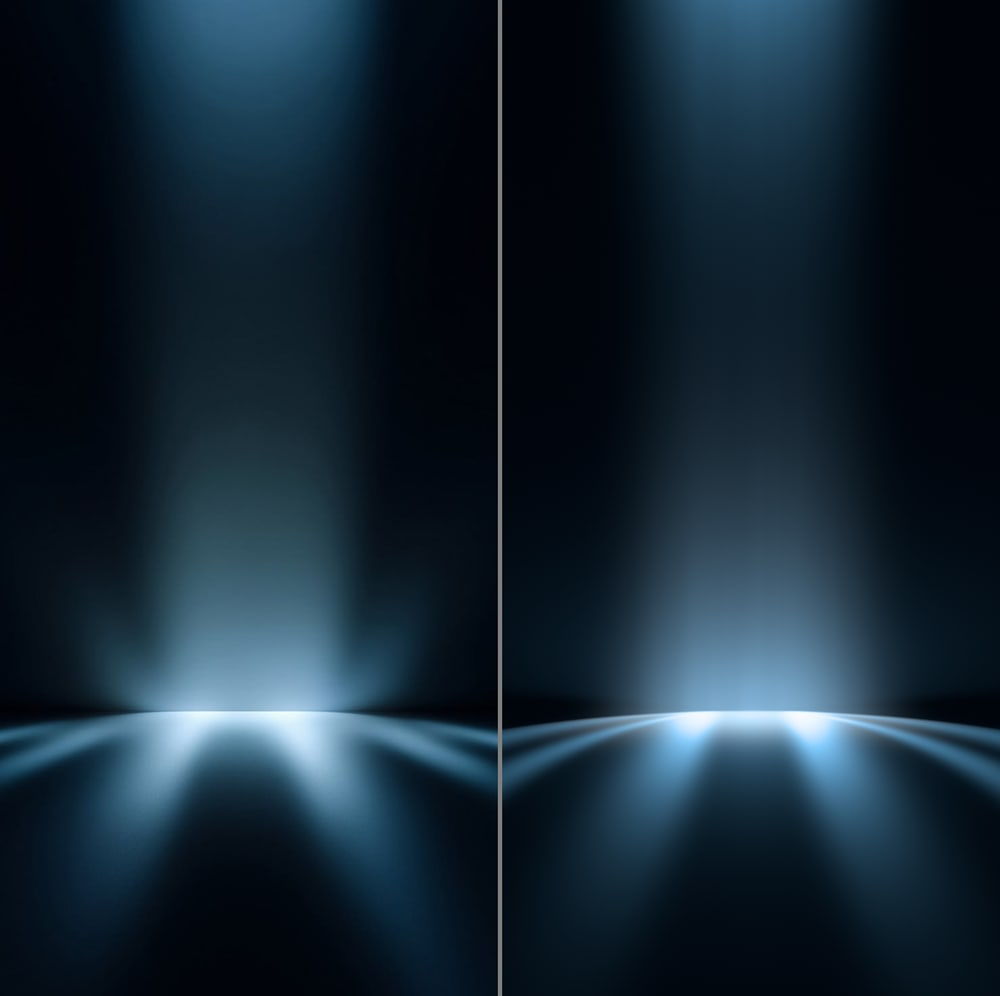
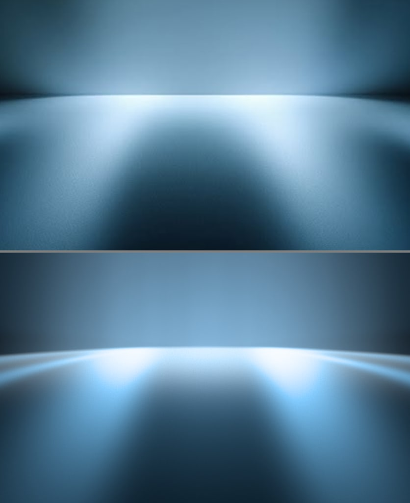
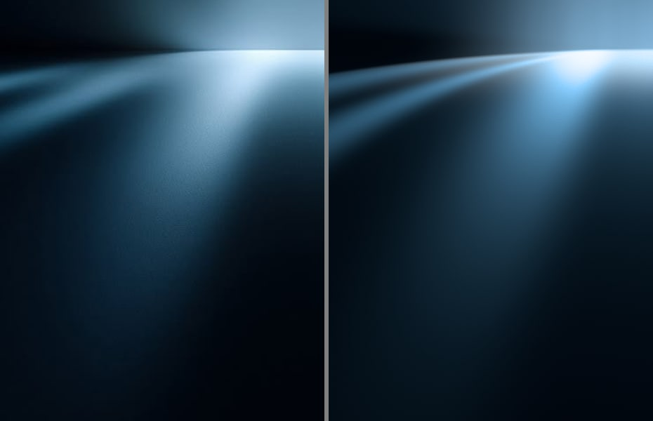
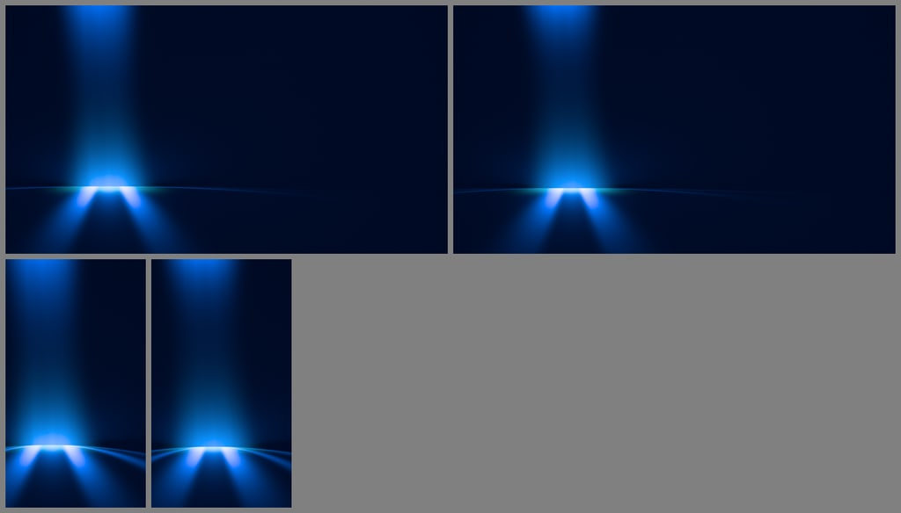
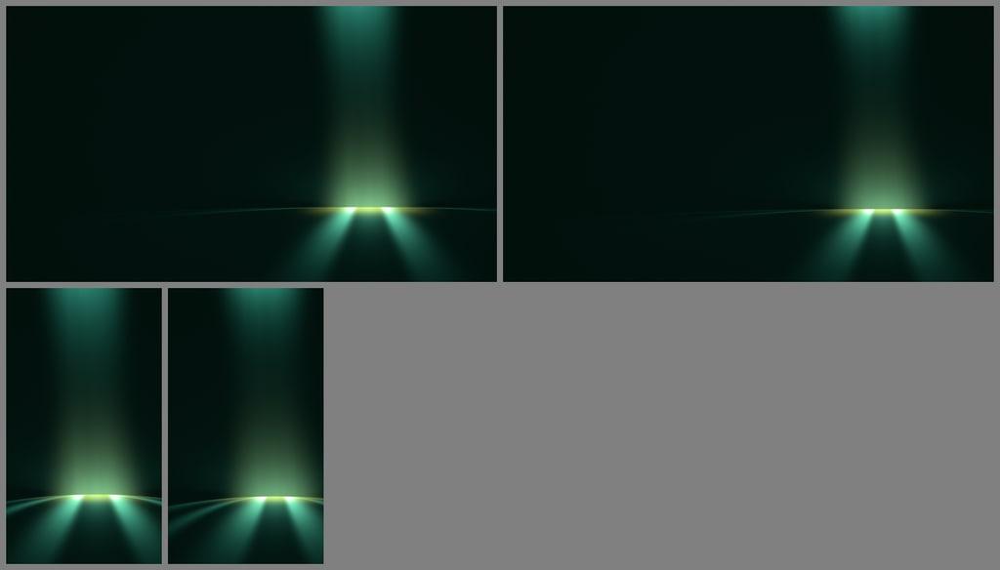
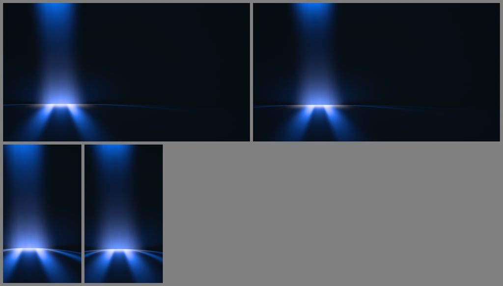
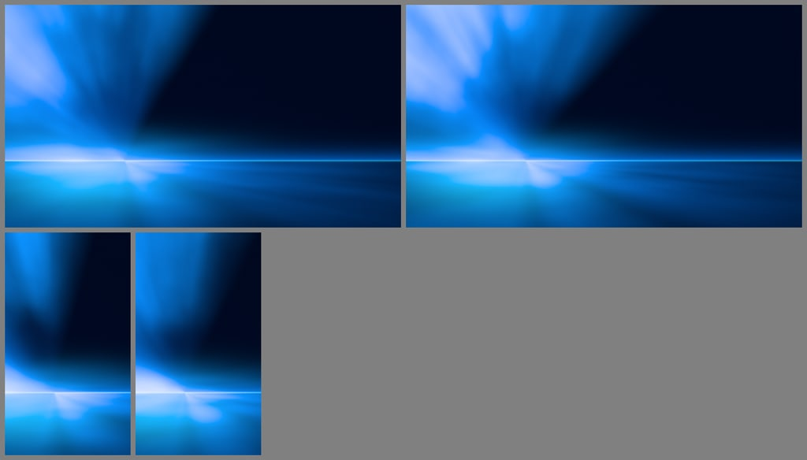
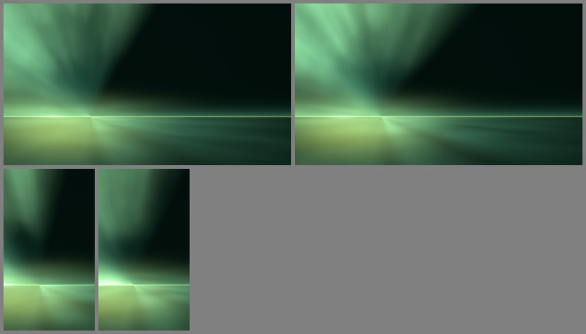
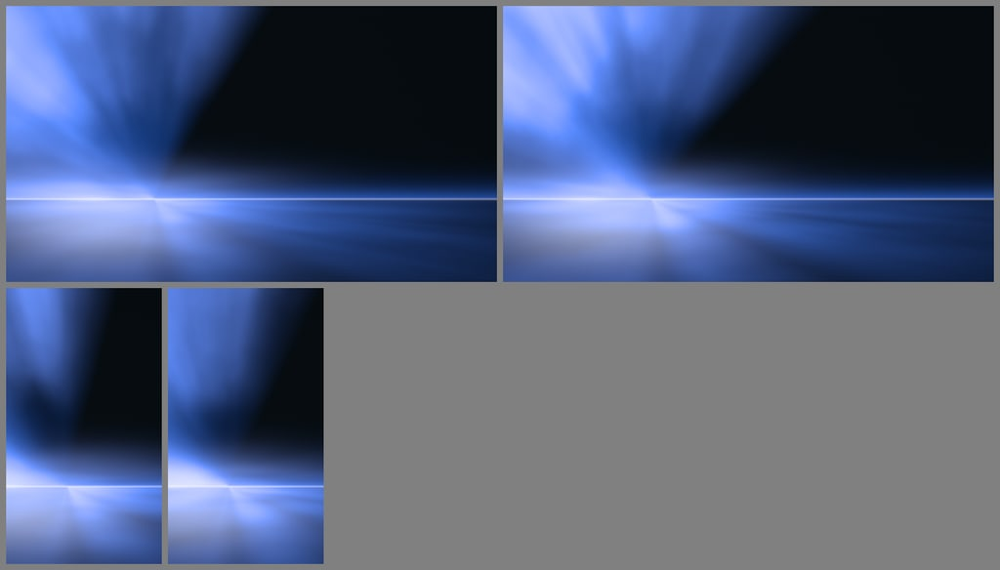

# contour-beams prototype

CPU prototype (Node, `Float32Array` linear RGB, `sharp` for PNG I/O) of two Contour light models:

- `contour.beam`: a beam through haze with a pool where it lands (reference `contour-beam-pool`).
- `contour.streaks`: long-exposure radial streaks converging on a bright horizon (reference `contour-radial-streaks`).

Both run through the engine output stage: linear radiance, then lens (bloom, vignette), then the tone curve (unchanged at max channel ≤ 1, a luminance-matched path to white above), exact piecewise sRGB, ±1 LSB triangular dither, then 8-bit PNG. Neither reference has grain, so grain is 0.

## Running it

```sh
node prototypes/contour-beams/render.mjs prototypes/contour-beams/presets/ref-contour-beam-pool.json
node prototypes/contour-beams/render.mjs prototypes/contour-beams/presets/ref-contour-radial-streaks.json
node prototypes/contour-beams/production.mjs            # all prod-*.json presets, 16:9 and 9:16, seeds 1 and 2
```

`render.mjs` renders at the reference's size and writes `out/<name>.png`, a side-by-side (`-sbs`), zoom crops (`-zoomN`), and prints a coarse Oklab ΔE grid. Helper scripts: `analyze.mjs` (cell colors and crops), `profile.mjs` (lightness along rows and columns), `spots.mjs` (patch colors in two images), `grain.mjs` (high-pass noise), `convergence.mjs` (fits where streaks meet). The renderers never read reference pixels. The reference presets use a few colors picked from the references; production presets use pack hexes only.

Coordinates in both recipes are in frame-height units: `x̂ = (x − W/2)/H`, `ŷ = y/H` (0 at the top). Intensities are relative to each color's own hex: intensity 1 renders the hex.

## Finding that affects the engine: brighter is paler, before clipping

Both references get paler as they get brighter, starting at about 30% of the maximum. In the beam, the blue channel is 0.23 linear at r/b 0.16, 0.60 at r/b 0.42, and 0.82 at r/b 0.60. In the streaks, r/b goes from 0.13 at L 50 to 0.5 at L 83 and 0.89 at L 97. The engine's tone curve leaves colors with max channel ≤ 1 unchanged, so one light color cannot produce this. Both recipes therefore use two colors per light:

- `light`: pale; carries the direct light, the pool core and the brightest highlights.
- `haze`: saturated; carries scattered light.

Each term splits its energy between the two by a luminance share (`pale`, `floorTint`). The light-colored part is scaled by `Y(haze)/Y(light)`, so changing the share changes the color but not the brightness. The reference notes reach the same conclusion: a per-channel shoulder fits the midtones but leaves highlights too blue, so the line and pool cores need their own near-white color. The other option is a tone curve that starts desaturating below 1, which would break "a pack color at nominal intensity encodes to its exact hex" near the knee.

## Model 1: beam through haze (`beam.mjs`)

One per-pixel pass. All terms add in linear light.

**Beam in-scatter**, above the stage edge:

- Cross-section: `u = (x̂ − x_axis(ŷ))·cos(tilt) / w(ŷ)`, with `w(ŷ) = w₀·(1 + g·(ŷ − 0.5))`, and `P(u) = exp(−½|u|^p)`. With `p = 3`, the measured top row matches to 1–2%: flat top, steep shoulders.
- The beam is a near-parallel column (`g = 0.1`). Its brightness along the axis falls about 10× from the top to 0.3 H and rises again toward the floor, at the same exponential rate both ways. A point or cone source cannot do that (1/d and 1/d² both misfit), so haze density is layered: `ρ(ŷ) = ρ_mid + ρ_top·e^(−ŷ/h_top) + ρ_floor·e^(−(y_f − ŷ)/h_floor)`. That is haze collected under the ceiling and lying on the floor.
- `L_beam = I·(w₀/w)·P(u)·ρ(ŷ)·(1 + n·fbm(u·k₁, ŷ·k₂))`. The fbm is density noise, so the beam is not a clean geometric column.
- The floor layer's share `floorTint` goes to the light color, so the beam gets paler near the floor.

**Pool light in the haze** (the "bounce glow"), point-light airlight with a Lambert lobe:

- `h = √((Δx/k)² + Δy² + r²)`.
- `L = I_g·r·e^(−s·h)/h · ((Δy + r/4)/(h + r/4))^λ · lip`.
- `lip = smoothstep(a₀, a₁, Δy/|Δx|)`. The stage's low rim shadows haze at grazing angles, which gives the dark band 25–40 px above the stage edge at the sides.

**Stage edge:** `y_e(x̂) = y_f + c·(x̂ − x_p)²·(0.25/halfW)²`. This is the back of a round stage, an arch that drops at the sides; it flattens in wider frames. The `floor.edgeSoft` transition is 3 px.

**Floor**, perspective `Z = 1/(ŷ − y_h)`, `X = (x̂ − x_v)·Z`. The vanishing point `x_v` is 0 or under the pool. The pool center is `(X_p, Z_p)`, `R = pool.width·Z_p`, `dy = ŷ − y_e`.

- Pool core, light color: `I_p·exp(−½·(√((ΔX/R)² + (ΔZ/(d·R))²))^q)`. With `q = 2.4` the edge is soft and elliptical in perspective. Its near edge forms the rounded top of the dark wedge.
- Pool skirt, haze color: `S·exp(−½((ΔX/(a·R))² + (ΔZ/(b·R))²))·(1 − core)`. It is narrow across and long toward the camera.
- Reflection streaks: glossy-floor streaks stretched toward the camera along floor lines of constant X. Pair k: `I_k·exp(−½((|ΔX|/R − o_k)/σ)²)·(1 + ((dy − s_k)/ℓ_k)²)^(−q_k)`. σ differs on the inner and outer side. The falloff is a soft glossy lobe; the fitted `q ≈ 1.6–1.7` is close to inverse square times cosine. Near the edge a share `a·e^(−dy/ℓ_p)` is pale. The reference's wings converge on a point 0.08 H above the pool. That point is this vanishing point, so the wings are reflection streaks and not rays from the pool.
- Side streaks: thin rays leaving the pool's ends close to the horizontal. Three points along each fit parabolas through the pool center, `dy_p = c·Δx²` (c ≈ 1.05 and 0.42), so they follow the round stage. The term is `I·exp(−½((ln c − ln c_k)/σ)²)·onset·e^(−(|Δx| − start)/reach)`. The reference notes describe the same rays as straight lines from the pool ends at 8–12° and 24–28° below horizontal. I have not tested that version.
- Floor texture: `×(1 + t·noise(x̂/cell))`, with t ≈ 2% sd and cells about 1.3 px. Only lit floor shows it, as in the reference.
- `floorBalance` brightens one side. The reference's right side carries 1.14–1.24× the left side's energy.

**Multiple scattering (`spread`):** `L ← (1 − m)·L + m·Σᵢ wᵢ·Bᵢ(Y(L)·ĥ)`. This is a pyramid blur of luminance tinted with the haze color, an energy-conserving point spread. The fit uses `m = 0.015`, which is nearly off.

## Model 2: long-exposure radial streaks (`streaks.mjs`)

This is a zoom burst. Each pixel averages the scene along the line toward a zoom center C on the horizon. Lines through C, such as the horizon, stay sharp; everything else streaks. The center was fitted with a coherence-weighted structure-tensor intersection on the high-passed reference, giving (0.407 W, 0.718 H); the reference notes give (0.368 W, 0.689 H) ±20 px. Radial lines drawn from my fit follow the streaks.

**Streak layer** (long zoom):

- `S(θ, r) = [F(θ) + Σ lobes]·(1 + R·|sin θ|^p·smoothstep(r₀, r₁, r))·N/mean(N)`.
- `F` is a fan: the level is interpolated across `[θ_from, θ_to]`, with soft edges. The sky is bright from the left horizon through straight up, with a dark sector from about −41° to 0°.
- The rise term makes the sky brighter away from C, mostly straight up. The reference is darkest 100–200 px above C and brightest at 350–450 px. Rays from a source at C would be brightest near C, so these are not god rays from a source.
- `N = max(0, 1 + c·fbm(k·x̂, k·ŷ))^γ` is isotropic clouds in screen space, normalized to mean 1.
- A cloud of fixed size covers a wide angle near C and a narrow one far out. So the zoom gives soft, wide streaks near the center and thin ones at the edges, with no point where they all meet. Polar noise did not do this (see the failures below).
- Floor: the sky mirrored about the horizon, times `reflect`.

**Soft layer** (short zoom):

- Horizon glow: two gaussians, squashed vertically, with a pale share. It is broken into bands along the horizon by fbm stretched 7:1.
- Thin horizon line: gaussian across, dimming with distance right of the glow.
- A band of haze light above the horizon: `up·e^(−(y_c − ŷ)/upDepth)`.
- The floor's own light: fans and lobes in angle below the horizon, each with `exp(−r/reach)`, times horizontal fbm streaks.
- A pool gaussian under the glow.

**Zoom pass:** this is the GPU Gems 3 chapter 13 sampling, `Z[L](p) = Σᵢ dⁱ·L(C + (p − C)·e^(−iΔ)) / Σᵢ dⁱ`, in log-scale steps. It is repeated K = 3 passes with 12 taps each, the step growing ×12 per pass, for an effective 1728 taps. `length` is the fraction of the way to C. Output = `Z_0.85[streak layer] + Z_0.35[soft layer]`. Two layers are needed because one long zoom drags the bright horizon light out across the dark sector.

## Lens and output

- Bloom: energy-conserving pyramid point spread, `out = (1 − s)·L + s·Σ wᵢ·Bᵢ(L)/Σ wᵢ`, with per-level tint available. Both fits use `s = 0.04–0.05` on the small levels only. Larger radii put a grey veil over the dark areas, and the references show no bloom beyond the brightest edge.
- Halation: implemented (soft-knee highlights, wide blur, warm tint, weighted against dark), but off. Both references are one blue with no warm fringe, and halation would add a second hue.
- Vignette 0.10–0.15, quadratic.
- Tone curve: for max channel m > 1, `u = c/m`, `t = 1 − exp(−(m − 1)·Y(u)/(1 − Y(u)))`, `out = u + (1 − u)·t`. Luminance and its slope stay continuous at m = 1, so there is no ring.

## Parameters

Ranges are what stays plausible; fitted values are in `presets/ref-*.json` and the defaults in each recipe file.

**`contour.beam`**

| name | meaning | fit | range |
|---|---|---|---|
| `colors` | `[light, haze, base]` | `#C6E4F8, #366685, #00040B` | pack colors in production |
| `hazeLuminance`, `lightLuminance` | optional: luminance of one haze or light unit (so packs share a structure) | unset | 0.1–0.75 |
| `beam.x`, `beam.tilt` | axis position (H units from center), tilt (rad) | 0, 0 | ±halfW, ±0.15 |
| `beam.width`, `widthGrowth`, `shape` | half-width σ (H), widening per H, cross-section exponent p | 0.076, 0.1, 3 | 0.04–0.15, 0–0.3, 2–4 |
| `beam.noise`, `noiseScale` | haze density noise amount, [across, along] frequency | 0.12, [2.5, 1.6] | 0–0.3 |
| `haze.mid`, `top`, `topHeight` | mid density; ceiling layer strength and height (H) | 0.03, 1.12, 0.09 | 0–0.2, 0–3, 0.05–0.3 |
| `haze.floor`, `floorHeight`, `floorTint` | floor layer strength, height, pale share | 3.4, 0.085, 0.55 | 0–5, 0.04–0.2, 0–0.8 |
| `glow.intensity`, `falloff`, `widthScale`, `lambert`, `lipFrom/To` | pool light in the haze; e^(−s·h); horizontal stretch; cosine power; rim shadow slopes | 1.3, 13, 2.2, 1, 0.03/0.12 | 0–3, 4–20, 1–3, 1–3 |
| `floor.y`, `horizonY`, `curve`, `edgeSoft` | stage edge, horizon (vanishing height), arch drop, edge softness | 0.714, 0.604, 0.3, 0.0015 | 0.6–0.85, y−0.2…y−0.05, 0–0.6, 0.001–0.01 |
| `floor.vanishX` | vanishing point x (`'pool'` = under the pool) | 0 | 0 or `'pool'` |
| `floor.texture`, `textureCell` | floor surface noise amount, cell (H) | 0.06, 0.0007 | 0–0.1 |
| `pool.intensity`, `width`, `depth`, `shape` | pool core; half-width at the edge (H); depth stretch; edge exponent | 1.0, 0.092, 1.3, 2.4 | 0.5–2, 0.05–0.2, 0.5–3, 2–4 |
| `pool.skirt`, `skirtAcross`, `skirtDepth` | haze-colored skirt and its widths (pool radii) | 0.9, 0.7, 2.4 | 0–2 |
| `streaks[k]` | reflection streak pairs: `intensity, offset, widthIn, widthOut, length, power, start` | center 1.1/0/0.25; wings 5.8/0.52/0.11/0.21/0.065/1.72 | offsets 0–2.5 R |
| `streakPale.amount`, `length` | pale share where the streaks start, and its falloff | 0.3, 0.08 | 0–0.6 |
| `sideStreaks[k]` | `c` (bend), `width` (in ln c), `intensity`, `start`, `reach` | 1.05 and 0.42 | c 0.2–3 |
| `floorBalance` | left/right brightness of the floor streaks | 0.1 | ±0.3 |
| `spread.amount`, `weights` | multiple-scattering mix and pyramid weights | 0.015 | 0–0.2 |
| `jitter` | seeded variation of the above for production | 0 | 0–1 |

**`contour.streaks`**

| name | meaning | fit | range |
|---|---|---|---|
| `colors` | `[light, haze, base]` | `#B4D4F2, #3A6699, #02050B` | pack colors in production |
| `hazeLuminance`, `lightLuminance`, `baseLevel` | luminance normalization; base scale | unset, unset, 1 | — |
| `center.x`, `center.y` | zoom center on the horizon (H units) | −0.14, 0.718 | anywhere on the horizon |
| `sky.fans[k]` | `from`, `to` (rad, 0 = right, −π/2 = up), `soft`, `level` (list across the fan), `pale` (list) | −3.2 to −0.72, 10 levels 3.4→0.18 | `to` −0.6…−1.6 sets how much sky is lit |
| `sky.rise`, `riseStart`, `riseScale`, `risePower`, `risePale` | brighter away from C, mostly straight up | 14, 0.16, 0.65, 3.5, 0.5 | 0–20 |
| `rays.scale`, `contrast`, `gain`, `octaves` | cloud size (per H), contrast, exponent | 4.5, 1.5, 2.4, 4 | 3–12, 0.5–2, 1–3 |
| `glow.x/y`, `intensity`, `core`, `mid`, `squash`, `weights`, `pale`, `streaks` | horizon glow | −0.3/0.718, 1.35, 0.03, 0.26, 0.2, [0.4, 0.6], 0.6, 1.1 | — |
| `line.intensity`, `width`, `reach`, `base`, `up`, `upDepth` | horizon line and the band above it | 0.6, 0.0018, 0.9, 0.35, 2.5, 0.02 | — |
| `floor.reflect`, `fans`, `lobes`, `noise`, `noiseScale`, `pool*` | glossy reflection; floor light by angle and distance; horizontal streaks; pool | see the preset | — |
| `zoom.length`, `soft`, `taps`, `passes`, `decay` | long and short smear (fraction toward C), taps per pass, passes, per-tap decay | 0.85, 0.35, 12, 3, 0.93 | 0.4–0.95, 0.2–0.5 |
| `jitter` | seeded variation for production | 0 | 0–1 |

## Results

### contour-beam-pool (925×1850 clean target, about 29 rounds)



Mean Oklab ΔE (×100) on a 10×28 grid of cell means: **1.75**. Above the floor, cells are within 0–7, most within 1–3.

- **Matches:**
  - The parallel column with a flat top and steep shoulders.
  - The U-shaped brightness: L 48 at the top, 23 at 0.3 H, 74 above the floor line. The reference reads 49, 23, 74.
  - The steel blue paling toward the floor, and the near-black navy sides (L 10–14).
  - The dark band above the stage edge at the sides.
  - The pool line at 0.714 H with the arch dropping to about 0.735 H at the frame edges.
  - The pale pool (L 90–95, unclipped cyan-white).
  - The two wings at about 28° around a dark wedge with a rounded top, and the thin curved side streaks reaching the frame edges.
  - The fine floor texture.
- **Differences:**
  - The pool's two hot spots read as blobs. Mine overexpose to `#F2F9FF` against `#DEF4FB`, and the band between them is slightly greyer.
  - The reference's floor pattern sits about 12 px right of center with a brighter right wing (the 1.2× balance only partly covers it).
  - The center between the wings 85 px below the line is a few L too dark.
  - The glow beside the beam just above the floor peaks a little lower than the reference's (x 185–250).




The zooms show the reference on top or left and the render below or right.

### contour-radial-streaks (925×617 clean target, 25 rounds)


Mean ΔE (×100) on a 16×10 grid: **5.62**.

- **Matches:**
  - The layout: bright sky from the left horizon through straight up, and the near-black upper-right sector (L 11–16 against 10–16).
  - Soft streaks that are wide near the center and thin at the edges, with no point where they all meet.
  - The sky darker just above the center and brighter far out.
  - The sharp horizon line on the right, with a soft band above it and horizontal streaks on the floor below it.
  - The bright horizon glow on the left and the pale pool below it.
  - One blue throughout, with highlights going pale.
- **Differences:**
  - The individual streaks don't line up; their placement comes from the noise seed. I swept 12 seeds and kept seed 11.
  - The reference's single bright streak in the upper right (about −55°) is much weaker: L 26 against 44 at (0.7 W, 0.3 H). A narrow angular lobe can add it back, but my first one pointed visibly at the center.
  - The top-left corner is a little less pale.
  - The band above the line on the right is softer than the reference's tight 6–20 px glow.
  - The floor center-right is up to 15–20 L off in places.
  - The pool is less defined as an oval.


### Generality check (Bold, Elemental, Atmospheric; 1920×1080 and 1080×1920; seeds 1 and 2)

Each pack uses its palest color as the light, a saturated or dark pack color as the haze, and a dark pack color (or a very dim Meta Blue for Bold) as the base. The source is in the left or right third in 16:9.

| pack | light | haze | base |
|---|---|---|---|
| Bold | Cyan `#1FCDF0` | Meta Blue `#0064E0` | Meta Blue ×0.025 |
| Elemental | Lime `#D6F26C` | Forest `#0F3D33` | Forest ×0.12 |
| Atmospheric | Ice `#F2F4F7` | Meta Blue `#0064E0` | Near-black `#1C2B33` ×0.18 |





Beam verdict:
- **Works:** one source, soft edges, and the dark two-thirds stay dark in 16:9. All three packs read as the same light model in different colors. `hazeLuminance` and `lightLuminance` keep Forest from being too dark and Ice from washing out.
- **Weak:**
  - The floor pattern is the one fitted to the reference, so every image has two hot spots and two wings. Seeds move them but don't change their number.
  - In 16:9 a faint stage-edge line crosses the frame.
  - The two hot spots look like headlights at this pool size.





Streaks verdict:
- **Works:** the zoom-burst structure carries to every pack and aspect, and seeds change the cloud pattern.
- **Weak:**
  - This reference is a bright image, so the fitted defaults are bright. The production presets dim the floor and glow (overrides in `presets/prod-streaks-*.json`), and the floor still takes about a quarter of the frame.
  - The dark sector does the "safe for text" job only above the horizon.
  - Lime glows on the floor read slightly garish.

## What I tried that failed

- **A single tone-curve path to white with one light color.** It cannot make midtones paler; see the finding above.
- **A beam from a point or cone source** (`1/d` or `1/d²` along the axis). The reference's width is constant while its brightness drops 10× in the top 30%. Only layered haze density fits.
- **Floor streaks as a GPU Gems radial gather of the pool** toward a point above it. With decay close to 1 it smears into a flat grey wash, and it cannot produce a dark wedge next to a bright pool.
- **Floor streaks as an angular ray pattern** around a point above the pool, with an inverse-square-cosine falloff in floor units. The falloff in perspective was far too steep near the line. The fitted wings fall off in screen distance, as a glossy lobe does.
- **Side streaks as constant-X reflection lines.** They are curved, and back-projected points don't share an X.
- **Widening the floor haze layer's cross-section.** It filled the dark band above the stage edge.
- **A pool with separate super-gaussian (across) and gaussian (depth) exponents.** It spread sideways at depth; an elliptical radius was needed.
- **Polar fbm for the streaks** (fixed angular frequency). It makes a regular starburst whose rays crowd into one point at the center.
- **One zoom pass over the whole scene.** A long zoom drags the bright center out across the dark sector, and a short one leaves blotchy clouds. Splitting into a long-zoom streak layer and a short-zoom soft layer fixed both.
- **Wide gaussian angular lobes for the sky.** Their tails lit the dark sector at about L 26; fans with bounded soft edges fixed it.
- **Large bloom radii.** They put a grey veil on the dark areas.

## Cost

CPU times are single-threaded Node and only show the shape of the cost; the GPU figures are estimates.

- **`contour.beam`:**
  - One full-screen pass. Per pixel: about 15 exp/pow, 3 octaves of 2D gradient noise (haze density), 1 octave (floor texture), 2 reflection-streak pairs, 2 side streaks, and pool core and skirt.
  - The multiple-scatter spread is a 6-level pyramid (about 1.33 full-resolution passes); fold it into the bloom pyramid.
  - Lens: one more pyramid plus per-pixel vignette, tone and encode.
  - CPU: about 1.1 s at 925×1850 and 1.2 s at 1920×1080. GPU estimate: well under 2 ms at 4K plus the bloom pyramid.
- **`contour.streaks`:**
  - Scene pass writing two layers (MRT). Per pixel: 4-octave fbm for the clouds (twice on the floor for the mirrored sky), two 3-octave fbm for the horizontal streaks, and the fan and lobe evaluations, about 20–25 noise octaves in total.
  - Zoom: 2 layers × 3 passes × 12 bilinear taps = 72 taps per pixel. The soft layer could use 2 passes.
  - Lens: 4-level bloom pyramid.
  - CPU: about 1.4 s at 925×617 and 4.5 s at 1920×1080. GPU estimate: under 10 ms at 4K.
- No per-image optimization at render time. The seed search for the streaks reference was done once, offline.

## Recommendation for the GLSL recipes

**`contour.beam`**:
- **Passes:**
  1. `scene` fragment pass, the formulas above, linear RGBA16F.
  2. The lens bloom pyramid, with the haze-tinted spread as one more weight on the wide levels.
  3. Tone and encode.
- **Uniforms:**
  - `uLight, uHaze, uBase` (vec3 linear, already luminance-normalized on the CPU);
  - `uBeam` (x, tilt, width, growth), `uBeamShape` (p, noise, kAcross, kAlong);
  - `uHaze4` (mid, top, topH, floorH) and `uHazeFloor` (floor, tint);
  - `uFloor` (y, horizonY, curve·frameK, edgeSoft), `uVanishX`;
  - `uPool` (I, width, depth, shape), `uSkirt` (S, across, depth);
  - `uGlow` (I, falloff, widthScale, lambert), `uLip` (a0, a1);
  - `uStreaks[2]` (vec4 I, offset, length, power; vec3 widthIn, widthOut, start), `uStreakPale` (a, ℓ);
  - `uSide[2]` (vec4 c, width, I, start; float reach);
  - `uFloorBalance`, `uTexture` (amount, cell), `uSeed`, `uAspect`.
- **Bloom:** small, strength ≤ 0.05, levels 1–4 only. Halation off for these blue packs.
- **Floor generality:** replace the fixed wing list with a seeded set. For example, 1–3 pairs at offsets drawn from 0.3–1.6 R, widths from 0.1–0.25 R, and lengths from 0.04–0.08 H, so the floor varies with the seed. The current `jitter` only perturbs the fitted pattern.

**`contour.streaks`**:
- **Passes:**
  1. `scene` writes two targets (streak layer, soft layer).
  2. Radial zoom, 3 ping-pong passes of 12 taps on each target, with `length` 0.85 and 0.35, log-scale steps and decay 0.93.
  3. Add the layers.
  4. Lens bloom (small), tone, encode.
- **Uniforms:**
  - `uCenter`;
  - the sky fan, uploaded as a 1D lookup of level and pale over angle (a 64-texel RGBA strip, generated from the preset, not from any image) or as uniforms for 10 knots;
  - `uRise` (R, r0, r1, power, pale), `uClouds` (scale, contrast, gain);
  - `uGlow` (x, y, I, core, mid, squash, w0, w1, pale, streaks), `uLine` (I, width, reach, base, up, upDepth);
  - the floor fans and lobes (lookup or uniforms), `uFloorNoise`, `uPool`;
  - `uZoom` (long, short, decay), `uSeed`.

**The three user controls** (the same for both Contour recipes):
- **Intensity:** the light's power. For the beam: `beam.intensity`, `pool.intensity`, `glow.intensity` and the streak intensities together. For streaks: the sky fan level, glow and line. The tone curve makes the cores go white as it rises.
- **Softness:**
  - Beam: cross-section exponent p from 3.5 down to 2, the spread amount from 0 to 0.1, and the glossy-lobe lengths ×0.8 to ×1.5 (blurrier floor).
  - Streaks: zoom length from 0.6 to 0.92, cloud contrast from 1.8 down to 0.8, and line width.
- **Mood control, "Reveal":** how far the light opens into the dark.
  - Beam: haze layer strengths, beam width, and how far the floor streaks reach.
  - Streaks: where the fan ends (`to` from −0.6 to −1.6 rad) and the rise.

Placement (source in the left or right third, which side) should come from the layout and aspect, as in `presets/prod-*.json`, and the seed should vary the rest.

## Files

- `beam.mjs`, `streaks.mjs`: the two recipes.
- `render.mjs`: preset → lens → output, comparisons.
- `production.mjs`: generality renders.
- `lib/`: color (sRGB, Oklab, packs), image (output stage), noise (integer hashes, value and gradient noise, fbm, all GLSL-portable), blur (gaussian, pyramid, directional, radial), lens (bloom, halation), compare.
- `presets/ref-*.json`: 1:1 fits. `presets/prod-*.json`: pack variations, with an `aspects` block that `production.mjs` merges per aspect.
- `results/`: the images above.
