# contour-curve-glow

CPU prototype of one Contour light model: light emitted along a curve or edge,
seen through a lens. Each emitter is a 2D signed distance field (SDF). Its light
is a sum of falloff lobes measured perpendicular to the curve, with per-channel
widths and offsets. A light field, evaluated at the pixel, sets how bright the
curve is along its length. Optional parts: background lights on each side of the
contour, a medium inside a shape that catches blurred light, and a lens stage
(bloom levels with tints, halation). The output stage is the engine's
(tone curve, exact sRGB, grain, dither).

All four references were matched against the clean targets in
`public/references/awe/contour/`. No reference pixels are read by the renderer;
every preset is a list of colors and numbers (`presets/*.json`).

## Files

- `lib/scene.mjs`: the model (shapes, lobes, light fields, background fields, medium).
- `lib/lens.mjs`: bloom levels with tints, halation, per-channel shifts.
- `lib/output.mjs`: tone curve, white level, sRGB, grain, dither.
- `lib/blur.mjs`: mip-chain gaussian blur (box downsample, separable kernel, bilinear upsample).
- `lib/sdf.mjs`: polygon (rounded by inset), ellipse, line.
- `audit.mjs`: renders a preset at the reference size, writes side-by-side, zoom crops, Oklab ΔE by region and line profiles to `out/`.
- `generality.mjs`: pack-only variations (Bold, Elemental, Atmospheric) at 16:9 and 9:16.
- `tools/`: offline fits used to pick preset numbers from measured profiles (never run at render time).
- `measure.mjs`, `make-results.mjs`: measuring and result export.

Run: `node audit.mjs presets/contour-rim-edge.json final`, `node generality.mjs 1 2`, `node make-results.mjs`.

## The model

Units: positions are frame fractions `[u, v]`; sizes are in units where the
frame's short side is 1000. Colors are linear RGB (presets store hex + intensity).

**Geometry.** Each emitter gives, per pixel, a signed distance `d` (negative
inside; for a line, positive on the +x side) and a curve coordinate `t` (angle
fraction for ellipses, position along a line). Shapes: `wedge` (a corner and two
ray angles, rounded by radius `r`: `d = sdPolygon(inset(P, r)) - r`), `ellipse`
(approximate SDF `k0 (k0 - 1) / k1`), `line`.

**Lobes.** For lobe `k` and channel `c`:

```
x  = d - offset_k(t) - (o_k + δ_kc) · W_k(t)                     # center, per-channel offset
P  = plateau_k · π_kc · W_k(t) · g(E) · E_p^γp                    # flat top length
x' = 0 if -P ≤ x ≤ 0;  x + P if x < -P;  x if x > 0
σ  = (x' < 0 ? σin_k · μ_kc · g(E) · Win(t) : σout_k · Wout(t)) · ν_kc · W_k(t)
f  = (1 + x'² / (2 p σ²))^(-p)        # softened inverse power; p = ∞ is exp(-x'²/2σ²)
L_kc = I_k · A_k(t) · E_s(p)^γ_k · C_kc(t) · f
```

`W, A, Win, Wout, offset` are smooth piecewise curves over `t` (a few knots);
`C(t)` interpolates color stops. `δ` (chOffset), `ν` (chSigma, both sides),
`μ` (chSigmaIn, inner side only) and `π` (chPlateau) are the per-channel falloff
differences that make the color separation. `g(E) = 1 + gain · E^γw` widens a
lobe where the light is strong.

**Light fields** (evaluated at the pixel, smooth everywhere):

```
gauss: E = exp(-ρ² / 2r²)          exp:   E = exp(-(sqrt(r² + ρ²) - r) / L)
power: E = (1 + ρ²/r²)^(-p/2)      plane: q = (p0 - p)·l;  E = 1 if q ≤ 0 else exp(-(sqrt(r² + q²) - r) / L)
```

`ρ` is the distance to the field center with an optional stretch (`aniso`, `angle`).
`plane` is a light far off toward direction `l`. An emitter can carry several
fields of the same light (the rim uses a wide plane field for the blue glow and a
tighter gauss field for the white core).

**Background fields** (light on one side of a contour):
`F = C(depth) · S((±d - e(t)) / s)`, `S(x) = ½(1 + tanh x)`, optional far color
by depth and an edge curve along `t`.

**Inside fill and medium.** `m = 1 - S(d / s_edge)`.
Fill: `m · C · (floor + (1 - floor) E^γ)`.
Medium: `M = κ · tint ⊙ ρ_m · (G_σ * L_src)`. `ρ_m` is either `m` (the whole shape
scatters) or the shape's own rim luminance / norm (only the rim scatters).
`L_src` is all emitters or only the other emitters (`G*L_all - G*L_own`).
Optional: blur `M` again (`spread`, the scattered light acts as a new soft
source) and keep it inside the shape (`clip`).

**Lens.** `L' = L + Σ_l w_l tint_l ⊙ (G_σl * L) + h C_h Y(G_σh * L·max(0, 1 - τ/Y))`,
then optional per-channel shifts of the scattered part.

**Output.** Tone curve: colors with max channel ≤ 1 pass unchanged; above, with
`u = c/m`, `w = 1 - exp(-k (m - 1))`, `k = Y(u)/(1 - Y(u))`, `out = u + (1 - u) w`.
This keeps luminance and its slope continuous at `m = 1`, so there is no ring.
`white` scales the curve's white point (reference-only, see rings). Exact
piecewise sRGB, monochrome gaussian grain (`grain` 8-bit steps at mid grey,
`grainResponse: 'sqrt'` scales it with the square root of the encoded value),
then ±1-step triangular dither.

## Parameters

| name | meaning | range used |
| --- | --- | --- |
| `shape` | wedge corner/angles/radius, ellipse center/radii, line endpoints | frame fractions, radius 60–110 u |
| `lobe.intensity`, `color(s)` | peak light per lobe; color stops along `t` | 0.005–6 |
| `sigmaIn`, `sigmaOut` | falloff width inside / outside the contour | 0.5–450 u |
| `plateau`, `chPlateau` | flat top length, per channel multiplier | 0–40 u; 0.6–1.3 |
| `chSigma`, `chSigmaIn`, `chOffset` | per-channel width (both sides / inner side) and offset | 0.5–3.5; -10 to +35 u |
| `shape: power`, `power(In/Out)` | tail heaviness; small = heavy tail | 1–10 |
| `along.{t,intensity,width,widthIn,widthOut,offset,hue}` | variation along the curve | 4–14 knots |
| `source(s)` | light field(s): kind, pos, radius, length, aniso, angle | length 50–200 u |
| `sourceGamma`, `widthSource/Gain/Gamma`, `plateauSource/Gamma` | how a lobe follows a light field | 0–6 |
| `fields[]` | background light: side, color, colorFar, edge, soft, along edge | edge 40–180 u, soft 85–190 u |
| `inside` | fill color/floor; `scatter` strength, sigma, tint, density, from, spread, clip | κ 0.3–10, σ 30–130 u |
| `lens.bloom[]`, `halation`, `dispersion` | bloom levels (σ, weight, tint) | σ 12–90 u, w 0.01–0.12 |
| `output` | exposure, white, grain, grainResponse | white 1 (0.5 for rings), grain 0–1.7 |

## Results

ΔE is mean Oklab ΔE ×100 on 4×4-pixel blocks, with blocks that are black in both
images skipped (they only measure dither). It guided the work; the verdicts are
from looking at the images. Left: reference, right: render.

### contour-rim-edge (dE 1.67, 16 rounds)

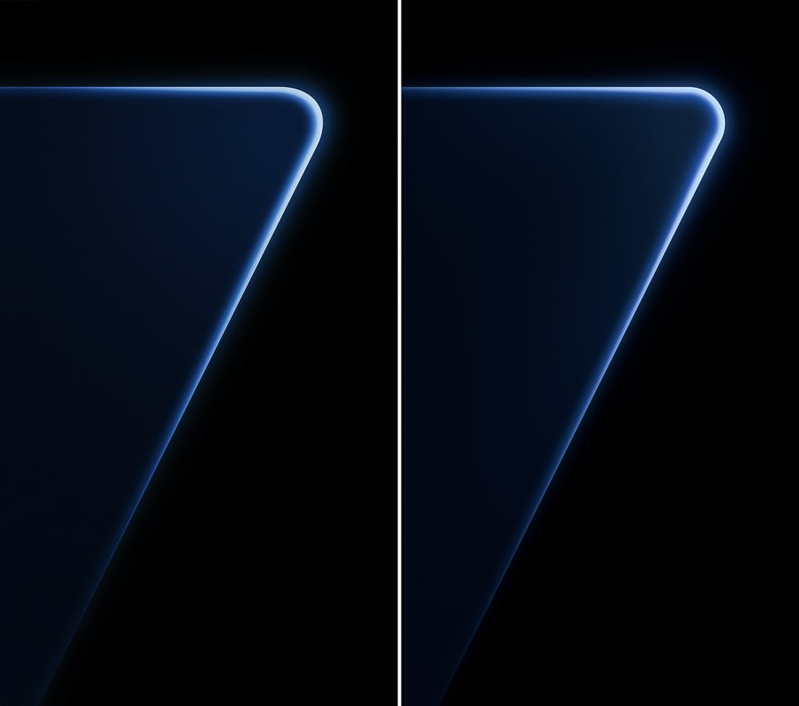 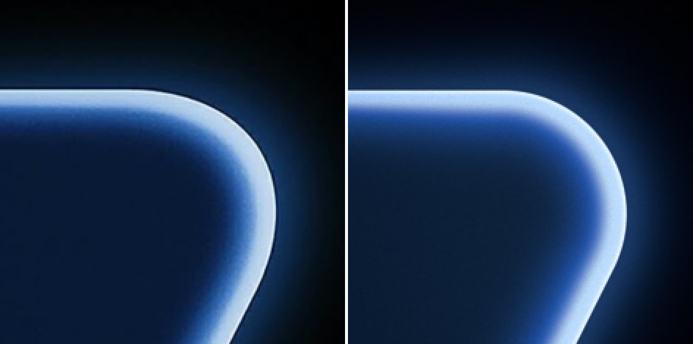

Matches: edge geometry (fit to ±0.3 px), corner radius, brightness along both
edges, pale white corner fading to saturated blue, the inward falloff (1 px
profiles within about 10%), the tight outer glow, the navy interior getting
lighter toward the corner, grain level.
Differences: the brightest stretch of the band is slightly more saturated (blue
reaches 250–255 where the reference holds about 220–230). In the reference that
stretch is flattened by the camera, which our tone curve does not do below 1.
The reference has a 1–2 px darker line right outside the edge (likely
sharpening in the original); the render's outer glow and bloom fill it. The
corner's inner falloff is a few pixels tighter than the reference.

How: two light fields from one light (a plane field for the blue glow, a gauss
field for the white core), a warm-white core lobe plus blue lobes with
per-channel inner widths (red 0.5×, green 0.8× of blue), widths that grow where
the light is strong, an outer glow offset 1.5 px outward, and a medium fill
inside.

### contour-light-line (dE 2.09, 9 rounds)

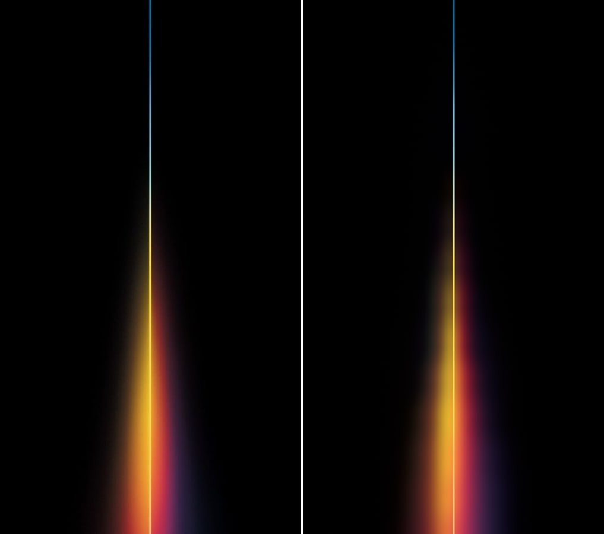 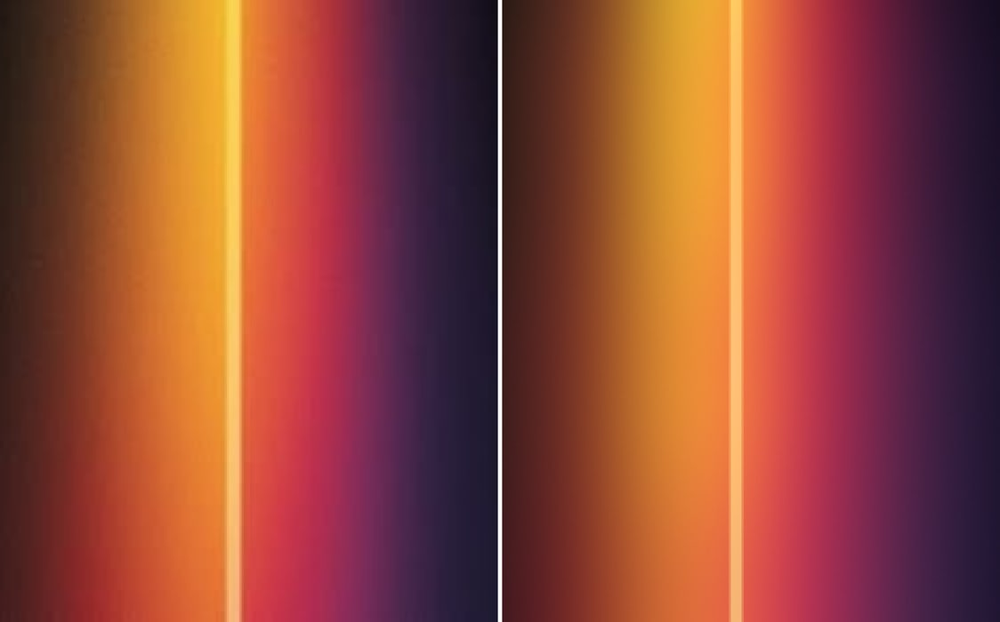

Matches: the 5 px slit core and its color along the line (steel blue, cyan-white,
pale yellow, yellow, light orange); the glow that starts at 40% height and widens
toward the bottom; yellow on the left, red then magenta then violet on the right;
the faint olive haze on the left at mid height and rose haze at the bottom; core
values within 15 8-bit steps down the whole line (most within 8).
Differences: the left edge of the yellow glow is slightly more compact than the
reference at mid height. At the bottom the core's own color had to be set
greenish-yellow so the sum stays under 1 where the red glow already fills red;
the reference camera clips red there instead of whitening.

How: per-channel glow on one lobe (red centered, green 0.65× wide and shifted
left, blue in a separate violet lobe drifting right with an offset curve), width
and hue curves along the line, a wide blue-tinted bloom level for the haze.
The color separation lives in the emitter lobes, not in a lens shift.

### contour-yellow-halo (dE 1.53, 9 rounds)

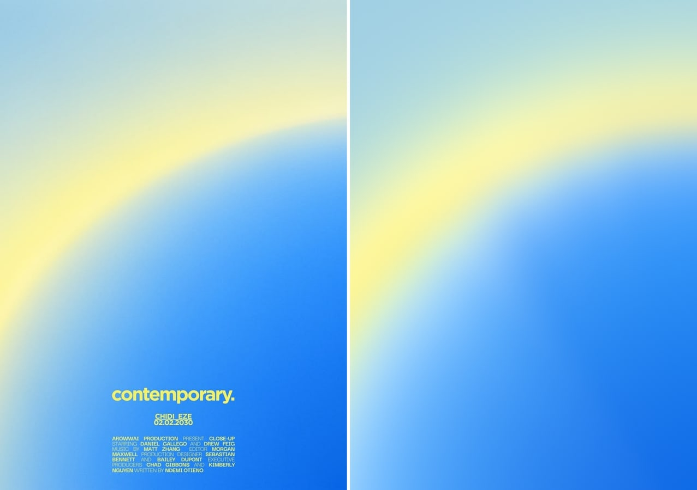 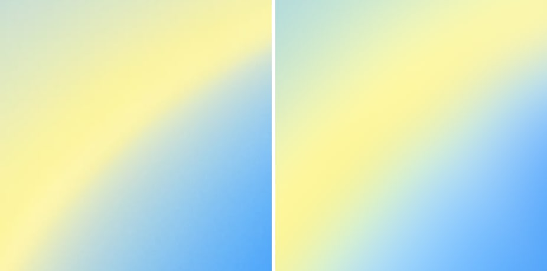

Matches: ring position and radius (circle fit ±8 px), the band color and its
paleness, the light blue to saturated blue inside with the deeper blue at the
center corner, the light blue-grey outside, the band dimming and narrowing
toward the upper right, no dark bridge anywhere (blue to yellow passes through
pale cyan-cream).
Differences: the band at the left edge is slightly narrower; the inner
transition is slightly softer than the reference mid-frame.

How: the ring light itself is a saturated yellow `(1, 0.79, 0)`. Its pale look
comes from the two background fields (blue inside, light blue outside) fading
out under it, so blue at the band (0.38) is set by the fields. A cyan inner lobe
120 px inside the ring brightens the blue toward the ring. The ring uses a
softened inverse power profile (p 1.8 inside, 2.7 outside), with width and
intensity curves along the arc.

### contour-iridescent-rings (dE 2.45, 16 rounds)

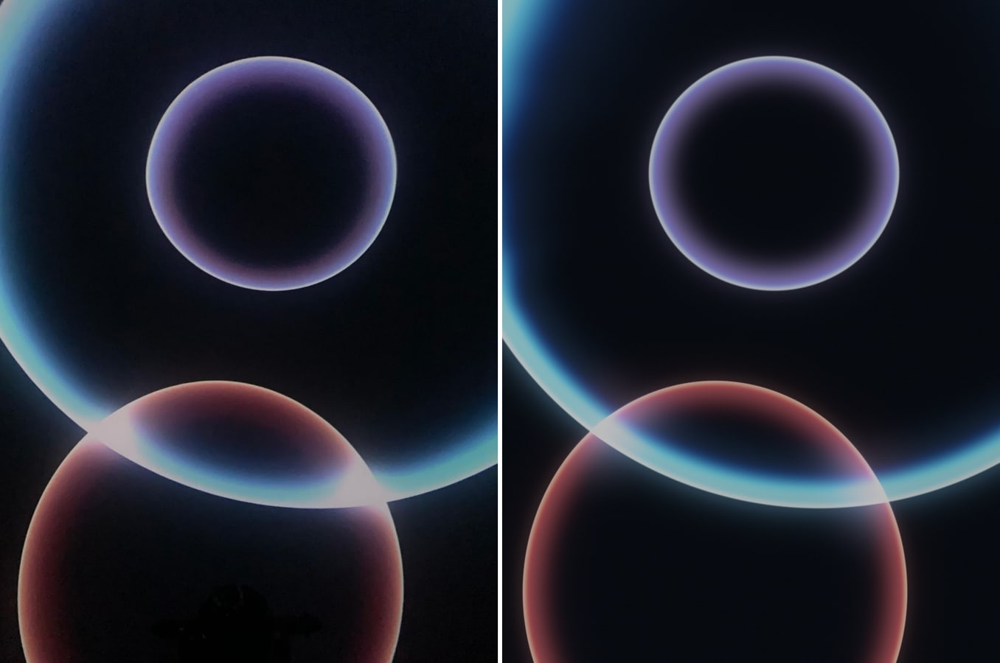 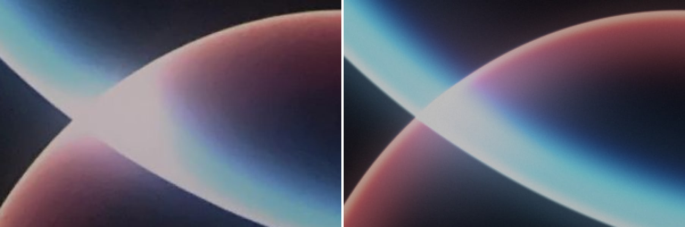

Matches: all three ring positions (ellipse fits within ±3 px, big circle ±0.7 px); the
small ring's white edge, periwinkle band and violet falloff; the big ring's white
edge, cyan band and blue to navy falloff, including the wide band in the top-left
corner; the bottom ring's pinkish white edge and coral to maroon falloff;
white where the bands cross; grain.
Differences: the overlap. In the reference, light around the two crossings is
about 5× the sum of the two rings measured on their own and spreads about 100 px
(a broad white-pink "X" and lavender glow inside the bottom disc). My
cross-scatter term gets part of it; the white X is narrower and the lavender
glow just below the band near the left crossing has about half the reference's
luminance. The silhouette at the bottom was ignored (masked).

How: per-channel inner widths per ring (small ring: red 3.4, green 4.6, blue
12 px plus a violet tail; big ring: per-channel flat tops 18/28/38 px; bottom
ring: red widest). A white level of 0.5 (the reference clips near sRGB 187;
reference-only setting). A rim-shaped medium that scatters only the other rings'
light, spread again and kept inside the disc. A light bloom for the photo's
softness.

### Generality (pack colors only)

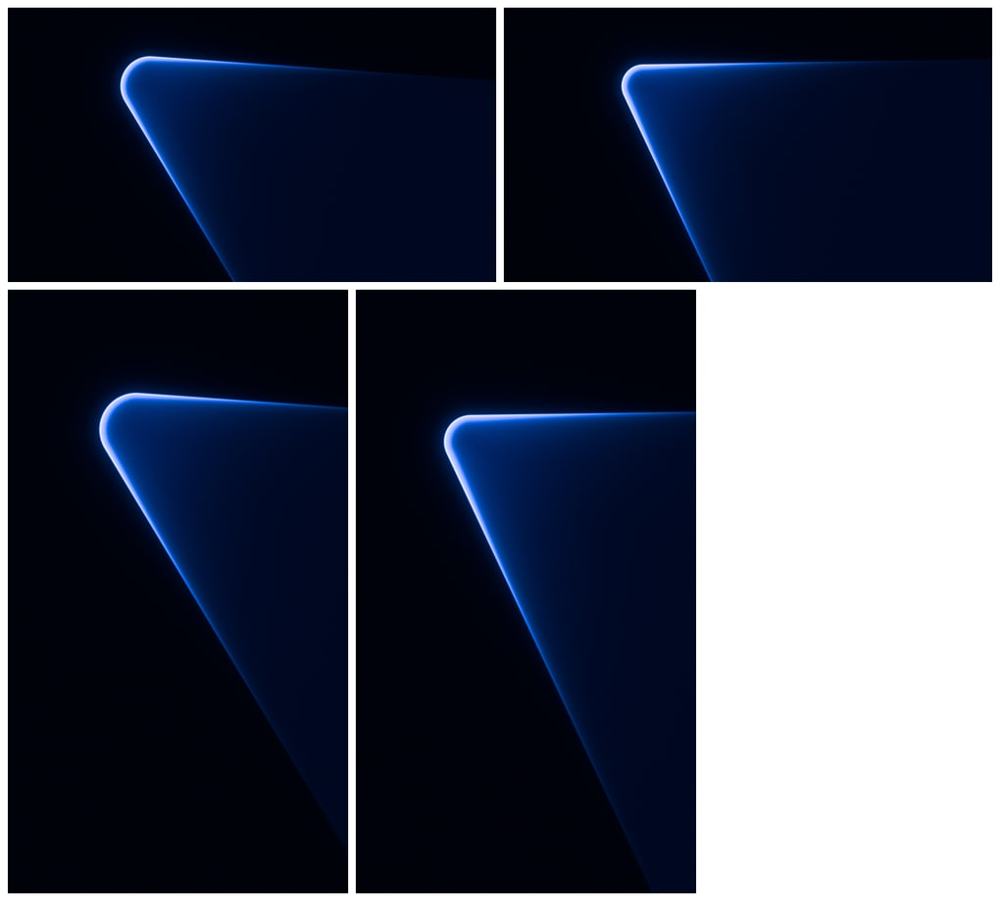
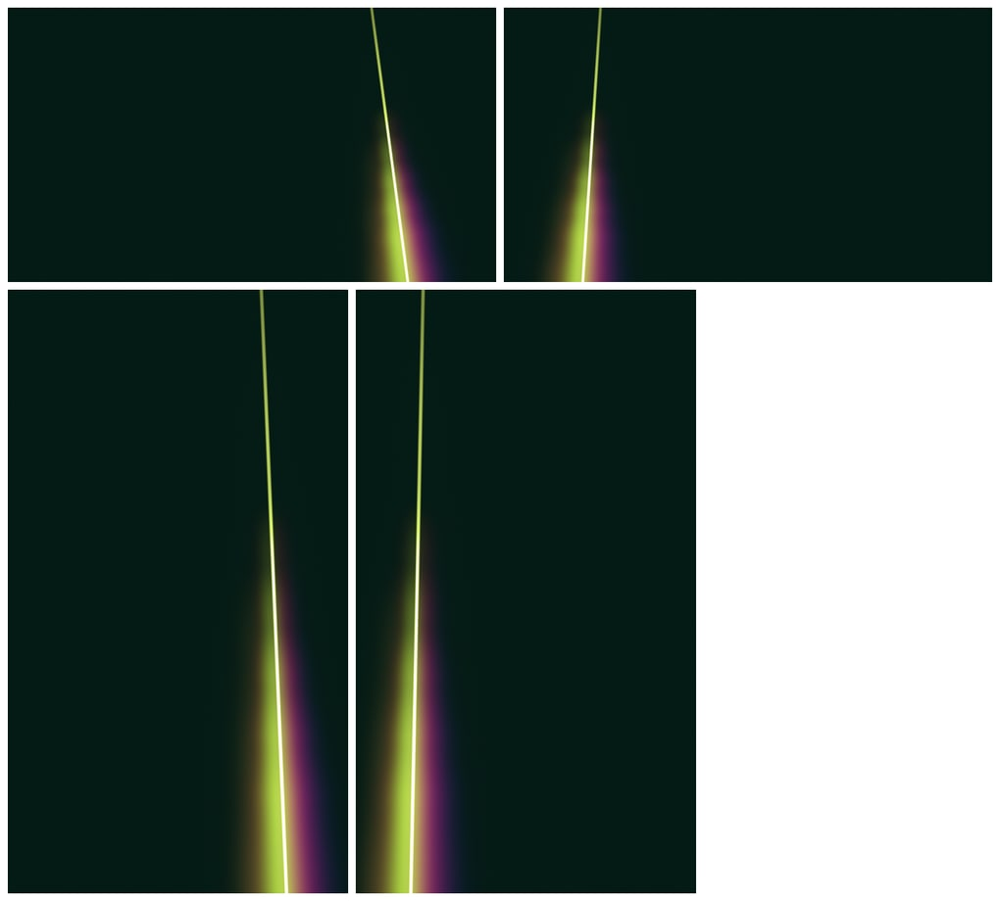
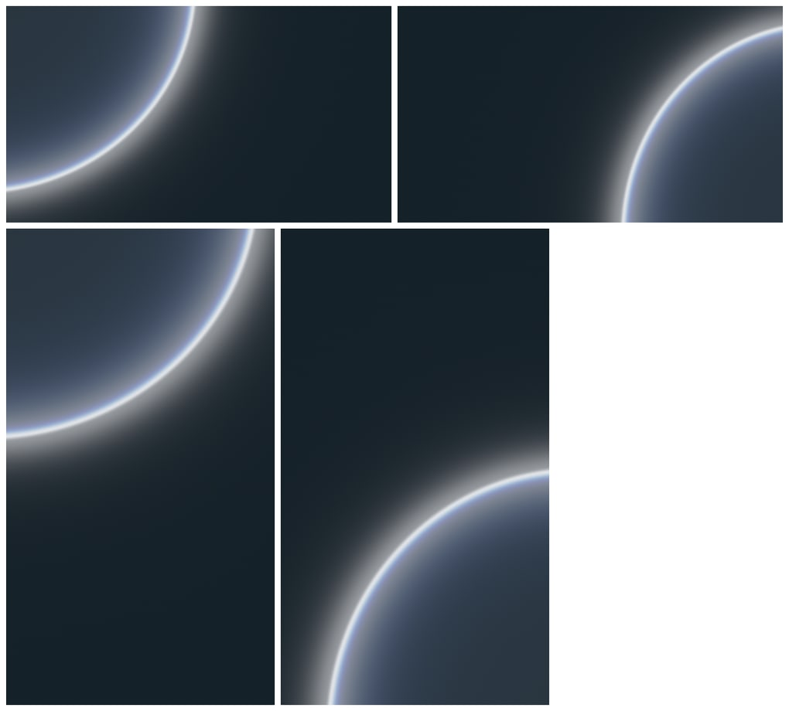

Bold: a rim lit by Meta Blue on a near-black base; the hot corner whitens
through the tone curve (Meta Blue at up to 6×), the edges fall off to saturated
blue. Elemental: a Lime line on Forest; the per-channel offsets turn it lime on
the left and a plum-magenta fringe on the right. Atmospheric: an Ice halo
cropped by a corner, Slate inside and Near-black outside; blue spreads wider
than red, so the rim goes white to pale periwinkle. Each renders sensibly at 16:9
and 9:16; seeds move the corner, angles, line position and tilt. The dark side
of each frame stays free for text.

## What failed, and why

- A single gaussian per profile: every measured profile has a sharp core and a
  long tail. Fixed with a few lobes and softened inverse power shapes.
- Brightness looked up at the nearest curve point: seams where the nearest point
  jumps (the medial axis). Replaced by light fields evaluated at the pixel.
- One point light for the rim: it could not make the corner the brightest spot
  while matching the slow fall-off; a facing term `(1 + n·l)/2` did not help in
  the fit. Two fields of the same light (plane for glow, gauss for core) worked.
- A flat plateau everywhere on the rim: in the dim parts it reads as a separate
  stripe. The plateau in the reference is camera compression of the bright part,
  so it had to shrink with the light.
- Making the hot core by overexposure alone: the engine tone curve keeps the max
  channel at 1 and whitens slowly for blue (luminance-continuous), so the core
  stays bluer and brighter than the reference camera's (which lowers blue to
  about 0.8). The reference preset emits a warm-white core lobe instead. For
  production (pack colors), overexposure alone looks right and is physical.
- Lens-stage dispersion for the light line: a global per-channel shift cannot
  make the glow widen down the line or start at 40% height. The per-channel
  offsets moved into the emitter lobe.
- A heavy-tailed profile (p = 3) for the line's glow: red tails far too wide.
- Rings with a uniform medium inside each disc: grey haze over the whole disc.
  A medium that also scatters its own ring's light: haze along every band.
  Rim-shaped density plus light from the other rings only fixed both, but needs
  a large gain and still under-fills the overlap.
- Thin-film interference was not tried: the measured ring sequences change
  monotonically with depth (white, then one hue, then darker), which per-channel
  widths reproduce within the measurement noise; thin-film would add repeating
  hue bands that the references do not show.

## Cost

Per pixel, one full-screen emission pass: per emitter one SDF (wedge: 3-edge
polygon; ellipse: 2 lengths; line: 2 dot products), 1–2 light fields, and
3 profile evaluations per lobe (exp or pow). Rim: 8 lobes, about 26
transcendental ops; rings: 3 emitters × 3 lobes, about 30.
Medium: one mip-chain blur of the emission (5–8 levels), plus per scattering
emitter one blur of its own emission (for "others") and one spread blur; rings
use 5 blur chains, the rim 1. Lens: one blur chain per bloom level (1–2).
Output: one pass. CPU time in Node for about 1.5 MP: 0.3–0.9 s scene,
10–90 ms lens. On WebGL2 all of it is a handful of passes at interactive rates.

## Recommendation for the GLSL recipe

Passes (RGBA16F):

1. `contour` emission pass: shape SDF + up to 6 lobes + 2 light fields +
   2 background fields + inside fill. Writes total radiance. When the medium uses
   rim density or "others", also write the shape's own luminance or radiance to a
   second target (MRT).
2. Medium (only when enabled): blur the emission with the shared mip chain,
   combine `κ · tint · density · blurred`, optional second blur, add.
3. Lens: reuse the mip chain for bloom levels with per-level tints; halation.
4. Output: tone curve, sRGB, grain, dither (shared engine stage).

Uniforms: `uShape` (kind, 4–6 floats), per lobe `color (vec3)`, `intensity`,
`sigmaIn/Out`, `offset`, `plateau`, `chSigmaIn (vec3)`, `chSigma (vec3)`,
`chOffset (vec3)`, `chPlateau (vec3)`, `powerIn/Out`, `sourceIndex/Gamma`,
`widthGain/Gamma`, and 4-knot curves along `t` for intensity, width and offset;
per field `kind, pos, radius, length, aniso, angle`. Recipes:

- `contour.rim`: wedge or line. Lobes: edge spike, hot core (tight field),
  core with per-channel inner widths, glow, tail, outer glow. Plane field for
  the glow, gauss field for the core. Inside fill plus a light medium.
- `contour.halo`: cropped ellipse. Ring lobe with an asymmetric softened inverse
  power profile and per-channel inner widths (blue wider for white → pale blue).
  Background fields inside and outside. Overlaps of several rings use the
  cross-scatter medium (only in presets that need them; production uses one ring).

User controls:

- Intensity: one multiplier on all lobe intensities. Above 1 the hot core
  overexposes and whitens through the tone curve, which is the natural "hotter"
  look; the glow stays the pack color.
- Softness: one multiplier on every `sigmaIn/Out`, plateau, bloom sigma and
  field softness.
- Mood control for Contour: Reach, the light field's `length` (how far the light
  runs along the edge before it fades; for the line, how far down the glow
  widens; for the halo, the inner width). It changes the composition without
  moving the source.

Keep the per-channel width and offset numbers fixed per recipe (they are the
color separation, not a user setting), and use the pack's light color for every
lobe so nominal intensity encodes to the exact hex.
