# Filters research

CPU versions of four candidate filters (Grain, Riso, ASCII, Pixel), applied to tool renders at strengths 0.25, 0.5 and 1, with a check that each keeps the mean color. The research, sources and recommendations are in [`docs/light/research/filters.md`](../../docs/light/research/filters.md). Every step maps to one fragment pass at output size, after the tone curve.

## Verdict

- **Grain:** keep `src/light/engine/grain.ts` as it is and add the strength control to the tool page. The port here gives the same look; the mean color moves less than 0.0015 Oklab at 0.5.
- **Riso:** the riso end of the same grain at every strength (amplitude 0.016 × strength). The two-level ink screens I built keep the mean exactly but read as salt-and-pepper noise at pixel size and as camouflage blotches when clumped. Left out, with misregistration and ink separation.
- **ASCII:** works and keeps the mean exactly in linear light. The glyph is lit in dark cells and dim in bright cells, glyph choice is dithered per cell, glyphs stop on the near-black base and in hot cores, and each pixel keeps its own color. At strength 1 small thumbnails come out about one just-noticeable difference darker.
- **Pixel:** the brief's flat cells destroy thin rims and step the gradients. With each pixel's own color it keeps the light, but it still reads as a grid.

## How to run

The dev server must be running on :3000. Images go to `out/` (gitignored); the sheets used by the doc are copied to `results/`.

```sh
node shots.mjs          # 10 screenshots of the tool's preview canvas at device scale 2 (not 2x exports)
node run.mjs            # every filter x strengths 0.25, 0.5, 1 -> out/filtered/, out/metrics.json
node sheets.mjs         # strength sweeps, 1:1 and 3x crops, overviews -> out/sheets/
node variants.mjs ramp-bold-s7-16x9 1180,600,400,300 riso            # riso dot screens vs grain
node variants.mjs halo-bold-s4-16x9 1250,430,480,340 ascii x2        # ASCII rows at export size
node variants.mjs rim-bold-s9-9x16 300,780,400,300 pixel             # Pixel flat cells vs own color
node results.mjs        # copy sheets to results/ (each under 1 MB) and write results/metrics.md
```

`run.mjs` takes optional comma lists: `node run.mjs <shotIds> <filters>` (an empty first argument means all shots).

## The shots

Sunset Ramp, Bands, Blooms and Contour Halo, Rim; each look in 16:9 and 9:16; all three packs; seeds 2 to 11; Intensity, Softness and the mood control at 0.5. The canvas renders at 1832 × 1030 (16:9) and 828 × 1472 (9:16). "x2" variants enlarge a shot 2× before filtering, which stands in for a 2160 px export because the light is smooth.

## The filters (`lib/filters.mjs`)

All work on display-linear color (largest channel at most 1), take a strength 0 to 1 and the seed, and size everything by the short side.

- **Grain**: a port of `grain.ts`. `L' = L + amp(L) · G(x)` in Oklab; a and b unchanged. `G` is four octaves (0.5, 1, 2, 8 × size) of B-spline lattice noise, per-pixel noise below 0.6 px with the sub-pixel variance factor. Film up to 0.6, blending to the riso end at 1.
- **Riso**: the riso end of the grain at every strength (`risoGrainParams`). With `contrast > 0` a two-level ink screen runs first: `D = 1 − C`, `m = max(D)`, ink density `t = min(1/m, inkCap)`, coverage `q = 1/t`, so `q · (1 − D t) + (1 − q) · 1 = C` exactly; the output blends `contrast · strength` of the way from the pixel to its print. Kept only for the comparison sheet.
- **ASCII** (`cells`, mode `ascii`): cells of height short / 64 and width 6/9 of that, a 5×7 pixel font (`lib/font.mjs`) with the ramp space . - : + = * % # @ (0 to 38.9% ink). Per cell: mean color and brightest channel `P` (linear). If `P` is at most 38.9% the glyph is lit (coverage ≥ `P`), otherwise dim on a lit background (coverage ≤ `1 − P`); the pick is dithered between the two nearest glyphs by a seeded per-cell threshold. Factors: lit part × `k`, dim part × `d`, `k · litArea + d · (1 − litArea) = 1`, `d = 1 − 0.7 · strength`, `k ≤ 1 / P` (otherwise `d` rises). Glyphs thin out between 1% and 3% linear and the contrast fades in up to 12%.
- **Pixel** (`cells`, mode `led`): square cells of height short / 72, a gaussian spot (sigma 0.3 cell) as the lit part, the same factors with `d = 1 − 0.65 · strength`. Each pixel keeps its own color (`flat: false`); `flat: true` is the brief's quantized version.

## The color check

`run.mjs` writes each output as 8-bit PNG with the engine's triangular dither, decodes it again, then compares it with the unfiltered shot:

- **blur**: both blurred in linear light (gaussian, sigma = 1% of the short side, or one cell height for the cell filters), Oklab distance, mean per image and 95th percentile;
- **shrunk 8×**: both shrunk 8× by sharp in sRGB values (what most apps do when they show an image small), Oklab distance.

| Filter | Strength | Blur: mean (worst image) | Blur: worst p95 | Shrunk 8×: mean (worst image) | Shrunk 8×: worst p95 |
| --- | --- | --- | --- | --- | --- |
| grain | 0.25 | 0.0003 (0.0007) | 0.0013 | 0.0013 (0.0022) | 0.0083 |
| grain | 0.5 | 0.0005 (0.0014) | 0.0025 | 0.0018 (0.0031) | 0.0083 |
| grain | 1 | 0.0024 (0.0029) | 0.0073 | 0.0067 (0.0086) | 0.0217 |
| riso | 0.25 | 0.0006 (0.0007) | 0.0018 | 0.0021 (0.0034) | 0.0086 |
| riso | 0.5 | 0.0011 (0.0015) | 0.0036 | 0.0037 (0.0051) | 0.0116 |
| riso | 1 | 0.0023 (0.0029) | 0.0072 | 0.0067 (0.0086) | 0.0217 |
| ascii | 0.25 | 0.0001 (0.0002) | 0.0007 | 0.0020 (0.0045) | 0.0109 |
| ascii | 0.5 | 0.0002 (0.0003) | 0.0009 | 0.0036 (0.0089) | 0.0232 |
| ascii | 1 | 0.0003 (0.0006) | 0.0018 | 0.0085 (0.0201) | 0.0607 |
| pixel | 0.25 | 0.0001 (0.0002) | 0.0008 | 0.0021 (0.0046) | 0.0101 |
| pixel | 0.5 | 0.0001 (0.0002) | 0.0009 | 0.0032 (0.0075) | 0.0183 |
| pixel | 1 | 0.0001 (0.0003) | 0.0010 | 0.0043 (0.0092) | 0.0337 |

For Grain and Riso at 1 most of the blur difference is texture left by the coarse octave: on the Bold Ramp it falls from 0.0025 to 0.0012 and 0.0008 with sigma 3% and 6% of the short side. For ASCII at 1, letting the dim part go to 15% (instead of 30%) made the shrunk difference about 40% larger.

## Results

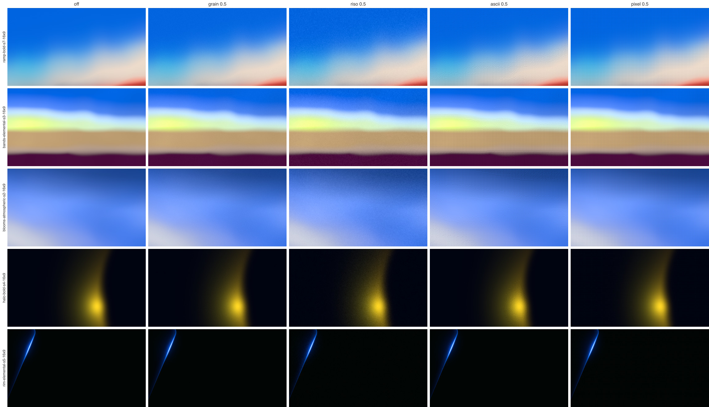
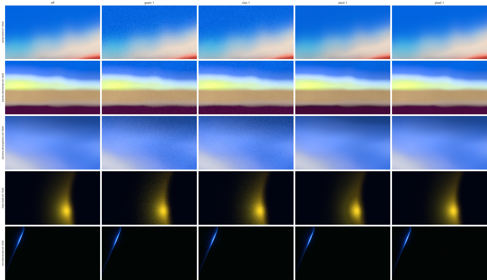
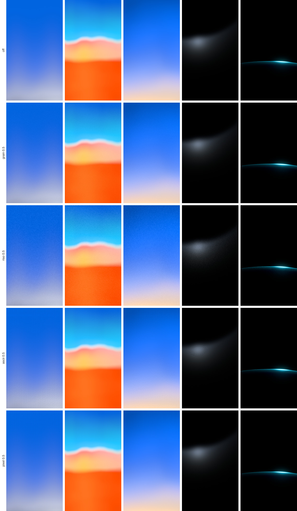
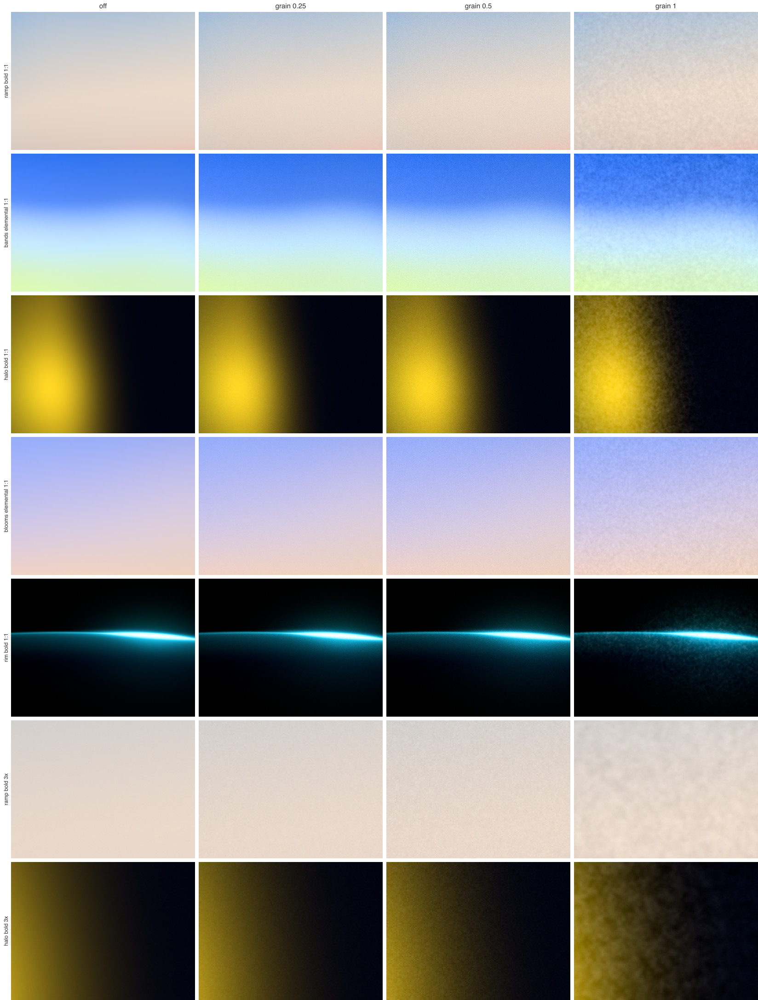

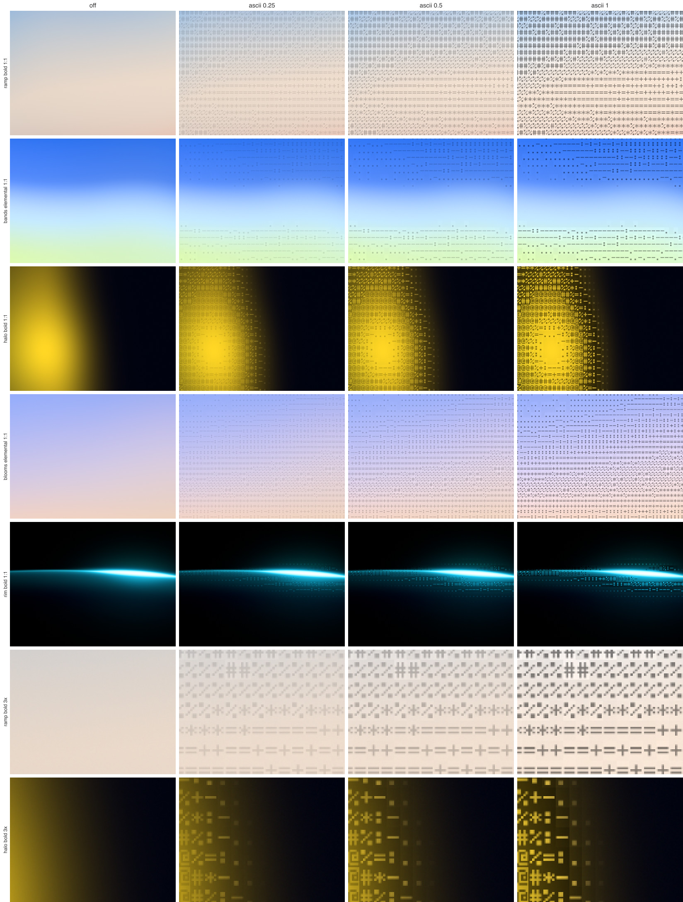
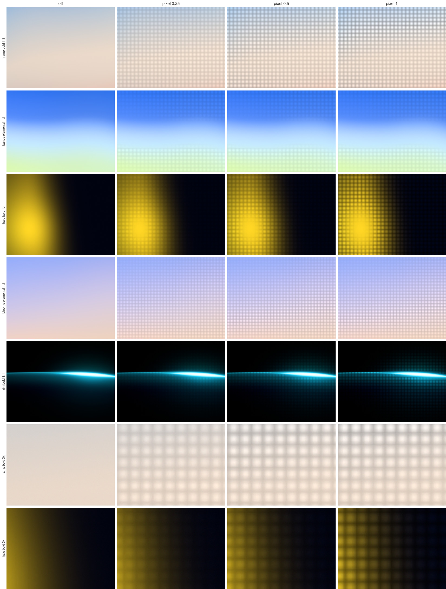
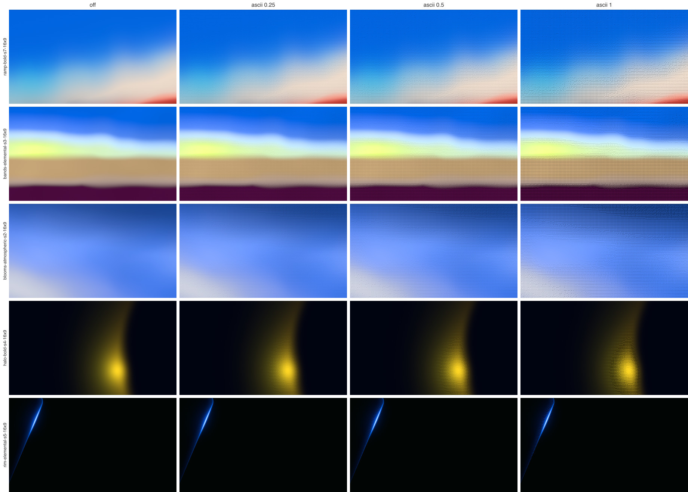
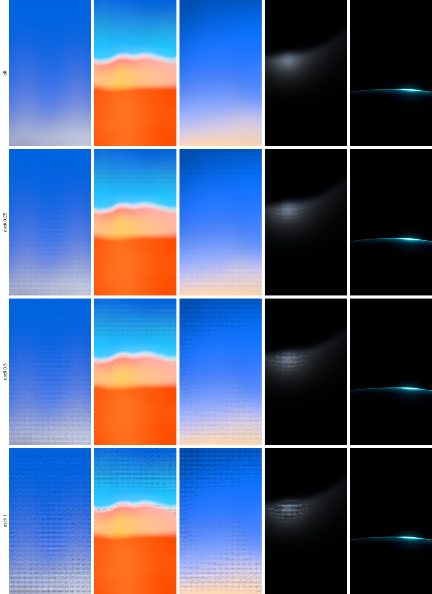
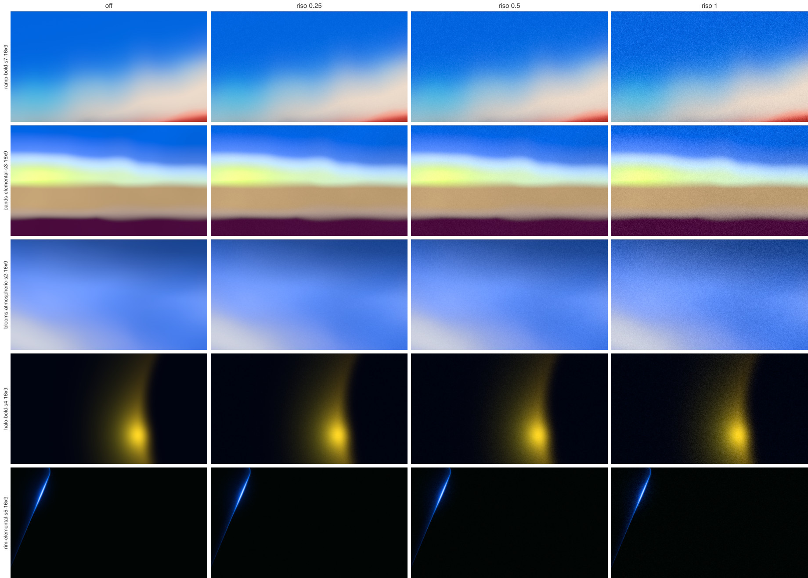
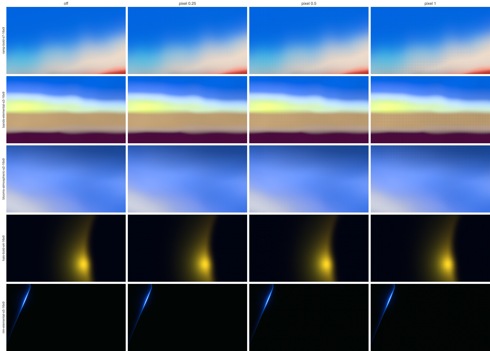
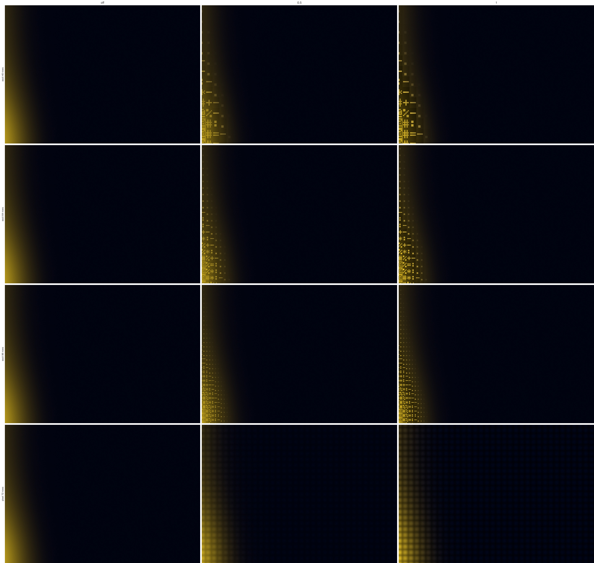
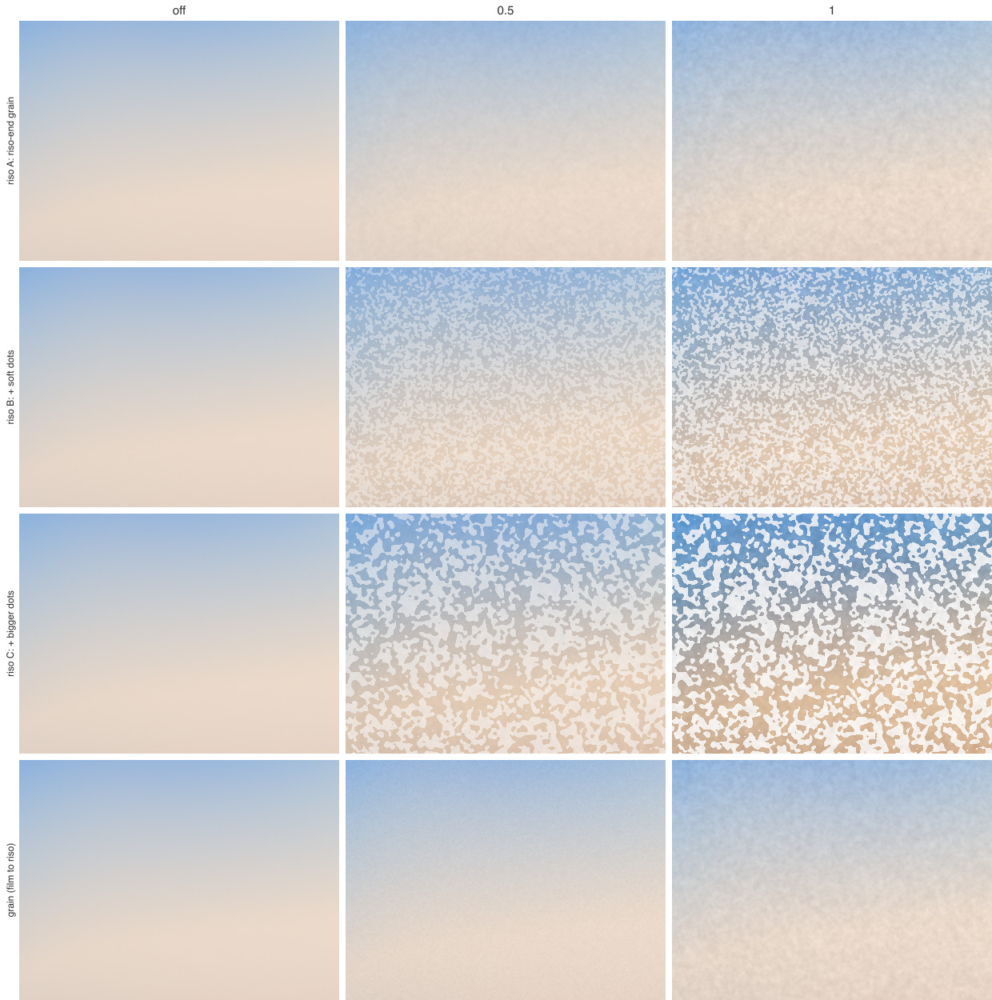
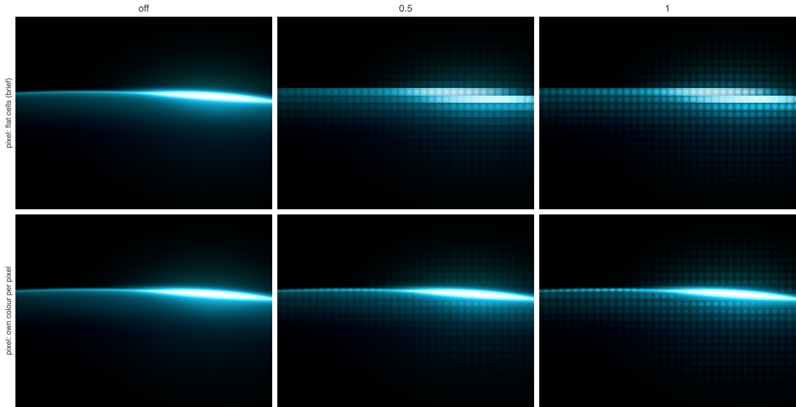

## What failed along the way

- **Light glyphs everywhere.** With the glyph always the lit part, bright cells could not get brighter than the gamut allows, so the background lifted and the strength slider did nothing above 0.25 on Sunset. Flipping the glyph to the dim part in bright cells fixed it.
- **Straight glyph bands.** On smooth ramps each row of cells got the same glyph and read as ruled lines. Dithering the glyph choice per cell mixes neighbouring glyphs.
- **A dot grid on the dark base.** With a glyph floor of 0.3% linear, Contour's near-black base filled with '.' cells. The floor is now 3%, with glyphs thinning out from 1% and the contrast fading in up to 12%.
- **A one-pixel black column.** Each cell computed its own right edge, and rounding left a gap. Cell edges are now computed once and shared.
- **Riso dot screens.** Per-pixel dots looked like digital noise; clumped dots (lattice noise thresholded) looked like camouflage. See the comparison sheet.

## Limits

- The shots are the preview canvas, not 2× exports, so fine textures are seen at preview size; the "x2" sheets approximate an export.
- The CPU code is a reference for the look and the math, not for speed (a few seconds per image).
- The thumbnail check uses sharp's lanczos resize in sRGB values; other apps resample differently.
- The 5×7 pixel font is a stand-in. A real monospace or brand font changes the ink per glyph, so the coverage table must be measured again.

## Files

- `shots.mjs`: tool screenshots, one browser session.
- `run.mjs`: filters, PNGs and the color check.
- `sheets.mjs`, `lib/sheet.mjs`: labelled sheets.
- `variants.mjs`: side-by-side variant crops (riso screens, ASCII rows, Pixel flat vs own color).
- `results.mjs`: copies sheets to `results/` and writes `results/metrics.md`.
- `fetch-text.mjs`: strips a downloaded web page to text, used while reading sources.
- `lib/color.mjs`, `lib/image.mjs`, `lib/noise.mjs`, `lib/measure.mjs`, `lib/font.mjs`, `lib/filters.mjs`.
