# Grain study

What grain the references really have, four grain models tried against
them, and the design of the engine's Grain filter. CPU prototype in Node;
every step maps to one WebGL2 fragment pass.

All amplitudes are the standard deviation of the fine residual in Oklab L
(1% = 0.01 L), measured after a 6 px high-pass and with folds, text and
hard edges masked. Lengths are pixels at the 925 px reference width unless
stated. "Riso tile" means the clean target in `public/references/awe/`.

## Findings

1. **The riso grain is real, but what you see at 925 px is the scan's
   pixels enlarged about 3x.** All three riso tiles are crops of one
   567×1134 PNG scan in Figma (nodes 41:26-41:28), turned 90° and enlarged
   2.92-3.06×. Shrinking a tile back and correlating its fine residual with
   the scan gives r = 0.92 (green), 0.79 (blue), 0.92 (pink). In the scan
   the grain is white noise at its own pixel size (autocorrelation half
   width 0.5 scan px). The clumps of about 2 px at 925 px are therefore set by
   Figma's enlargement, not by the print: two exports of the same node
   measured 1.5-1.9 px and 1.9-2.3 px half width.
2. **The riso grain is mono and symmetric.** 98-99% of the residual
   variance is in L; R, G and B move by the same number of code values
   (correlation 0.93-0.99). Skew is 0 ± 0.1 at every lightness. The scan has
   a JPEG 8/16 px block grid, and equal-RGB residuals are what JPEG's 4:2:0
   chroma leaves, so the true ink colour of the grain is lost. What the
   reference shows is mono grain.
3. **Riso grain grows with ink.** It is about 0.8% on bare paper and about 1.8-1.9% in the
   densest ink (L 0.45). It is not strongest at half coverage.
4. **The poster's texture is a halftone screen, not grain.** It has sharp
   spectral peaks at 4.6 px / 50° and 1.8 px / 29°, about 100× above the
   background, and an oscillating autocorrelation.
5. **The sky photos and contours have no grain.** They show 0.13-0.36%
   residual (0.55% on the rings photo). Most have a block grid at 27-30 px:
   16 px JPEG blocks enlarged about 1.7-1.9×, and the sky-peach source is
   541 px wide. There is also horizontal smearing, ringing specks in the
   blacks (skew −1.5 to −2.1, kurtosis 16-65) and staircase edges from
   enlargement. All of this is compression and should not be copied.
6. **The deck's own Grain picture (slide 44:204) is a 1 px speck noise**:
   white, mono, dark specks (skew −1.8), 4.4% on the white layer and 2.2% on
   the gradient. It looks like Figma's Noise effect at slide resolution and
   shows the idea, not a measured target.

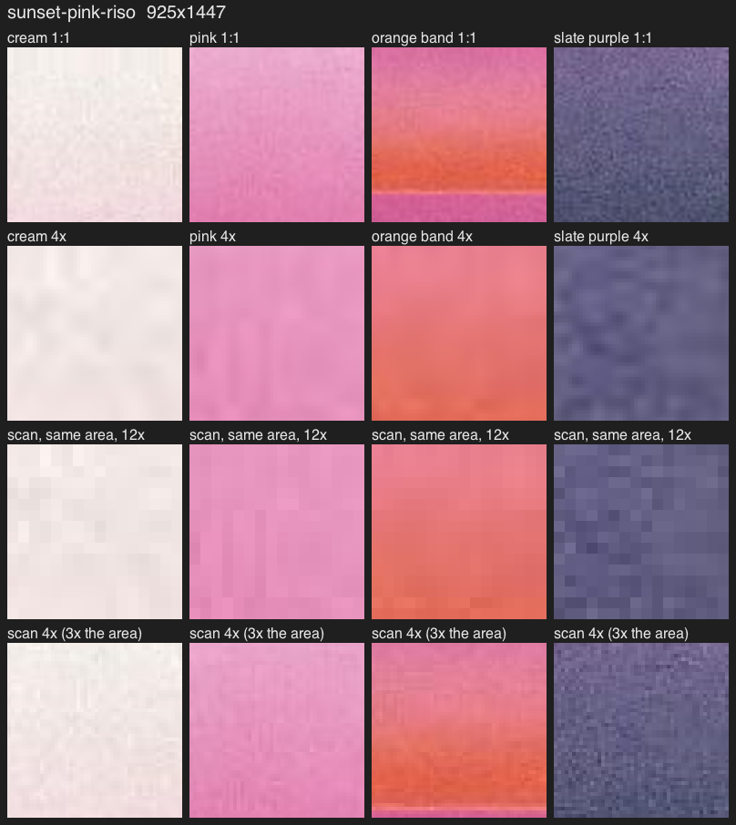

Rows 1-2: pink riso tile at 1:1 and 4×. Row 3: the same area of the scan at
12× (the tile is this, smoothed). Row 4: the scan at 4×.

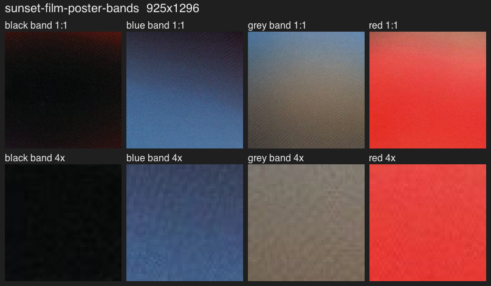
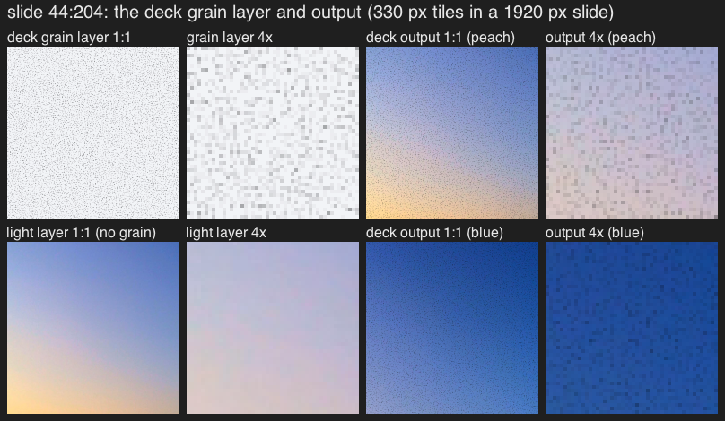

### Measurements

| Reference | std L % | mono | skew | ACF half width px | Structure |
| --- | --- | --- | --- | --- | --- |
| sunset-green-riso | 0.91 | 0.98 | 0.00 | 2.33 | riso, scan ×3.06 |
| sunset-blue-riso | 1.23 | 0.99 | −0.02 | 1.90 | riso, scan ×2.93 |
| sunset-pink-riso | 0.87 | 0.98 | −0.08 | 2.15 | riso, scan ×2.92 |
| riso scan (own px) | 1.1-1.9 | 0.99 | −0.05 | 0.5 | white noise, JPEG grid 8/16 |
| sunset-film-poster-bands | 1.14 | 0.96 | 0.03 | 0.66 | halftone screen |
| sunset-sky-peach | 0.17 | 0.61 | 0.00 | 1.85 | JPEG only |
| sunset-violet-wave | 0.19 | 0.62 | 0.00 | 1.29 | JPEG only |
| sunset-red-yellow-arcs | 0.13 | 0.60 | 0.00 | 1.89 | JPEG only, banding |
| sunset-blue-diagonal | 0.36 | 0.54 | −0.07 | 1.17 | JPEG chroma blocks |
| contour-rim-edge | 0.20 | 0.68 | −1.46 | 1.48 | JPEG ringing |
| contour-yellow-halo | 0.18 | 0.65 | −0.12 | 1.70 | JPEG only |
| contour-iridescent-rings | 0.55 | 0.90 | −0.35 | 1.04 | faint noise (probably camera), JPEG |
| contour-radial-streaks | 0.23 | 0.65 | −0.14 | 2.22 | JPEG only |
| contour-beam-pool | 0.25 | 0.77 | 0.06 | 1.50 | JPEG only |
| contour-light-line | 0.19 | 0.74 | −2.10 | 1.46 | JPEG ringing |
| deck grain layer | 4.37 | 1.00 | −1.82 | 0.47 | 1 px specks |

"mono" is var(L) / (var(L) + var(a) + var(b)).

Riso grain by Oklab L (std L %):

| L bin | 0.4 | 0.5 | 0.6 | 0.7 | 0.8 | 0.9 |
| --- | --- | --- | --- | --- | --- | --- |
| blue | 1.80 | 1.84 | 1.41 | 1.32 | 0.96 | 0.82 |
| pink | 1.88 | 1.51 | 0.90 | 0.66 | 0.65 | 0.73 |
| green | | | 1.03 | 0.80 | 0.80 | 0.98 |

## Models

Test images are smooth ramps in linear light through 8-13 stop colours
measured on each riso tile (`presets/riso-test-ramps.json`; 81×9 px
patches). They are then encoded, have grain applied, and get a ±1 LSB
triangular dither. Parameters are in `presets/grain-models.json`.

- **(a) Gaussian film grain.**
  `L' = L + amp(L)·N_σ(x)`, where `N_σ` is white noise blurred by a gaussian of
  σ = 1.35 px and scaled to unit std. `amp(L)` is read off the reference's bins.
- **(b) Multi-octave grain.**
  `N = Σ w_k N_σk / sqrt(Σ w_k²)`, with σ_k = 1, 2 px. The weights come from a
  non-negative least-squares fit to the reference's band energies
  (`fit-octaves.mjs`): green 0.47/0.88, blue 0.70/0.72, pink 0.51/0.86.
- **(c) Riso ink grain.**
  - Coverage `c = (L_paper − L)/L_paper`.
  - A uniform threshold field `t = Φ(N_σ)`, with an anti-aliased step `H = [c > t]`, so E[H] = c.
  - `c' = c + s·(H − c)` with s = 0.045-0.05, and a stretched paper-tooth noise.
  - The colour moves along the paper→pixel line by `(c'+ε)/(c+ε)`, with the a/b channels shifted 1 px for misregistration.
- **(d) Coordinate jitter (Paper's "grain gradient").**
  `colour = ramp(t + J·N_σ(x))`, with J = 12 px and σ = 0.9 px.

| Riso tile | Measure | Reference | a | b | c | d |
| --- | --- | --- | --- | --- | --- | --- |
| blue | std L % | 1.23 | 1.23 | 1.18 | 1.47 | 0.75 |
| blue | ACF at 1/2/3 px | .79/.47/.19 | .76/.43/.15 | .73/.40/.16 | .61/.26/.05 | .59/.18/.00 |
| blue | skew | −0.02 | 0.01 | −0.01 | −0.76 | −0.11 |
| pink | std L % | 0.87 | 0.90 | 0.79 | 1.38 | 0.55 |
| pink | ACF at 1/2/3 px | .82/.54/.28 | .76/.43/.17 | .79/.51/.29 | .61/.26/.05 | .57/.18/.00 |
| green | std L % | 0.91 | 0.89 | 0.85 | 1.16 | 0.41 |
| green | ACF at 1/2/3 px | .84/.59/.33 | .77/.45/.18 | .80/.54/.31 | .61/.26/.06 | .55/.17/.00 |

Verdicts, from the crops and the numbers:

- **(b) is the best match.** Its strength, clump size and autocorrelation
  tail are all within the spread of the three prints. At 1:1 it is hard to
  tell from the tiles.
- **(a) is close.** It has the right strength and clump size, but its
  autocorrelation tail is shorter, so it looks a little finer.
- **(c) does not match.** Thresholding gives a two-level, posterized dot
  pattern with skew −0.8 to −1.2 overall and down to −2.0 in light areas
  (dark specks on light colour), strongest at half coverage. The prints are symmetric and strongest in dense ink. As a
  filter it also needs a paper and an ink colour, which a light-based image
  does not have; without the ε bound, pixels near paper turned into random-hue
  specks.
- **(d) does not match.** Grain appears only where the ramp is steep: 0.5%
  on the flat cyan plateau where the print has 1.4%, and none on paper or
  flat ink. It is coloured along the ramp (mono 0.59-0.85). It needs the
  recipe's ramp coordinate, or a screen-space displacement that also smears
  edges (12 px at 925 = 50 px at 3840). It gives a sprayed look at band
  edges, which could be a recipe option, but it is not a surface filter.

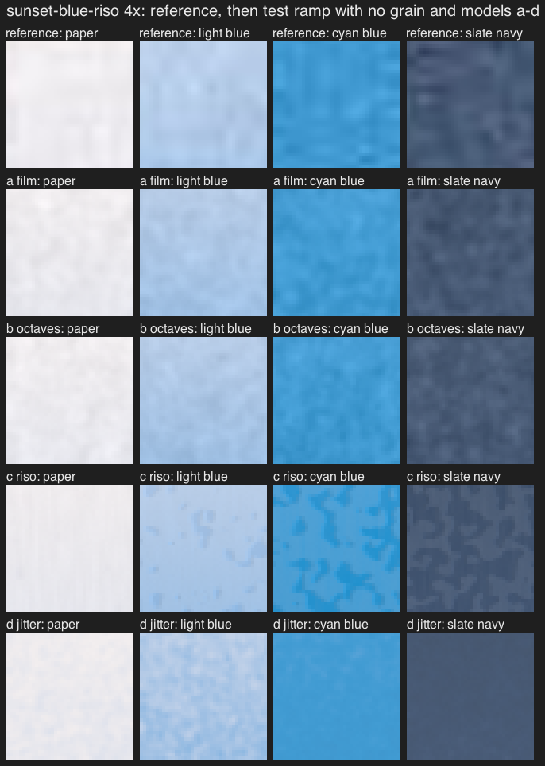
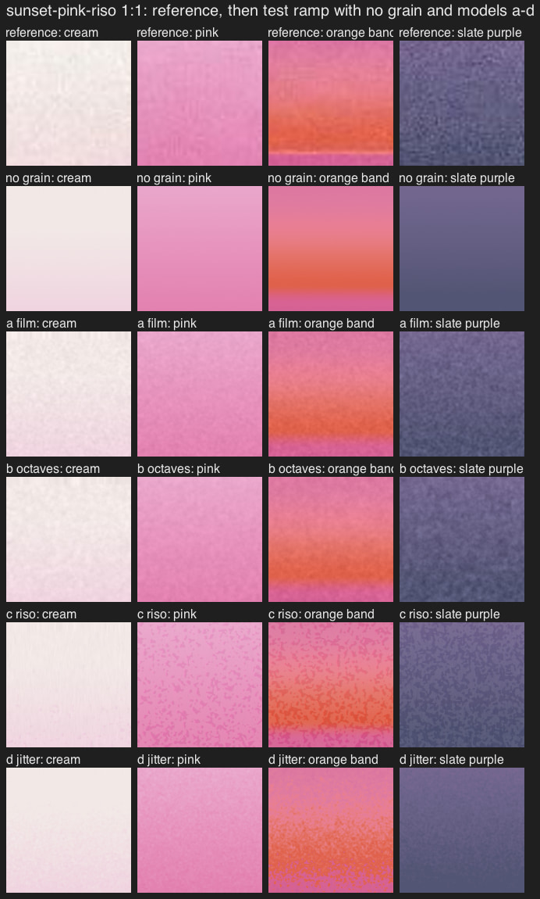

### Best result per reference

- **sunset-green-riso.** The recommended filter at strength 1 matches the
  print's strength (0.99% vs 0.91%) and clump size. It is slightly too strong
  in the full green (1.23% vs 1.03% at L 0.6) and slightly finer
  (autocorrelation .77/.47/.23 vs .84/.59/.33). It lacks the print's faint
  paper streaks.
- **sunset-blue-riso.** At strength 1 it is a little weak in the dense cyan
  and navy (1.53% vs 1.84% at L 0.5; 1.01% vs 1.23% overall), and the clump
  size matches. Model (b) with this print's own fit matches it better (1.18%).
- **sunset-pink-riso.** At strength 1 it matches the cream and slate purple,
  but is too strong in the pink mid-tones (0.97% vs 0.66% at L 0.7).
- **sunset-film-poster-bands.** Its texture is a halftone screen. The Grain
  filter should not try to make it.
- **The four sky photos and six contours** have no grain to match, only
  JPEG artifacts.

For reference presets, set `output.grain` (the 0-1 strength) to 1 for the
three riso prints and 0 for every other reference. Dither stays on for all.

## Recommended Grain filter

`lib/filter.mjs`, parameters in `presets/grain-filter.json`.

```
L'  = L + amp(L) · G(x)                      Oklab L only; a, b unchanged
G   = Σ_k w_k N_k / sqrt(Σ w_k²)            k = 4 octaves, rel = 0.5, 1, 2, 8
σ_k = rel_k · size · shortSide               blob sigma in output px
N_k = unit-std noise of blob σ_k, times sqrt(1 / (1 + 1/(4π σ_k²)))
amp(L) = ampMid · smoothstep(0, shadowEnd, L)
               · (1 − highlightCut · smoothstep(0.5, 1, L))
               · (1 + inkBoost · (smoothstep(0.85, 0.45, L) − 0.5))
```

How the formula works:

- **Mono grain on Oklab L.** Hue and chroma stay as rendered. The mean
  colour of 64 px patches moves 0.02-0.07 Oklab×100 at strength 0.5, against
  a just-visible difference of about 2.
- **Strength by lightness.** It falls to 0 at black, so blacks are not
  lifted, and eases off toward white.
- **Sizes are fractions of the short side,** so a preview and an export carry
  the same grain relative to the picture.
- **Sub-pixel octaves.** The square-root factor removes the variance a pixel
  would average away when an octave is smaller than a pixel. That keeps the
  preview's strength equal to the export's strength at the same viewing size.

| Parameter | Meaning | Useful range | Film end | Riso end |
| --- | --- | --- | --- | --- |
| `ampMid` | Oklab L std at mid-tones | 0-0.02 | 0.015 × s/0.6 | 0.016 |
| `size` | clump σ as a fraction of the short side | 0.0003-0.0015 | 0.0005 | 0.0011 |
| `w_k` | weights of the 0.5, 1, 2, 8 × size octaves | 0-1 | .35/.85/.35/0 | .10/.60/.72/.12 |
| `shadowEnd` | L at which grain reaches full strength coming up from black | 0.1-0.3 | 0.25 | 0.2 |
| `highlightCut` | how much grain is reduced at white | 0-0.6 | 0.5 | 0 |
| `inkBoost` | moves grain from light areas into dense colour | 0-1 | 0 | 0.9 |
| `seed` | the image seed | | | |

### One strength slider

| Strength | Look | Mid-tone std L | Clump σ (short side) | At L 0.1 / 0.45 / 0.95 |
| --- | --- | --- | --- | --- |
| 0 | off (dither only) | 0 | | |
| 0.2 | film | 0.5% | 0.0005 | 0.18 / 0.50 / 0.26% |
| 0.4 | film | 1.0% | 0.0005 | 0.35 / 1.00 / 0.51% |
| **0.5** | film (suggested start) | 1.25% | 0.0005 | 0.44 / 1.25 / 0.64% |
| 0.6 | film | 1.5% | 0.0005 | 0.53 / 1.50 / 0.77% |
| 0.8 | film → riso | 1.9% | 0.0008 | 0.79 / 1.90 / 0.91% |
| 1 | riso | 2.3% dense, 0.9% light | 0.0011 | 1.16 / 2.32 / 0.88% |

- **Up to 0.6** only the amplitude grows. This covers the deck's "fine film
  grain, 1 to 2 percent".
- **From 0.6 to 1** the parameters blend to the riso end by
  `smoothstep(0.6, 1, s)`: clumps get coarser, a faint coarse octave
  (8× size) comes in, and grain moves from light areas into dense colour.
- **The riso end matches the prints at 925 px.** Overall strength is
  0.95-1.01% against 0.87-1.23%, and autocorrelation is .76/.46/.23 against
  .79-.84/.47-.59/.19-.33.
- **Grain is off by default,** as the brief says. When the user turns it on,
  start at 0.5.

The film end puts most weight on one octave (0.35/0.85/0.35 at 0.5/1/2 ×
size), like real film grain with a roughly flat spectrum up to the clump
size. The riso end uses the fitted riso mix (0.10/0.60/0.72/0.12).

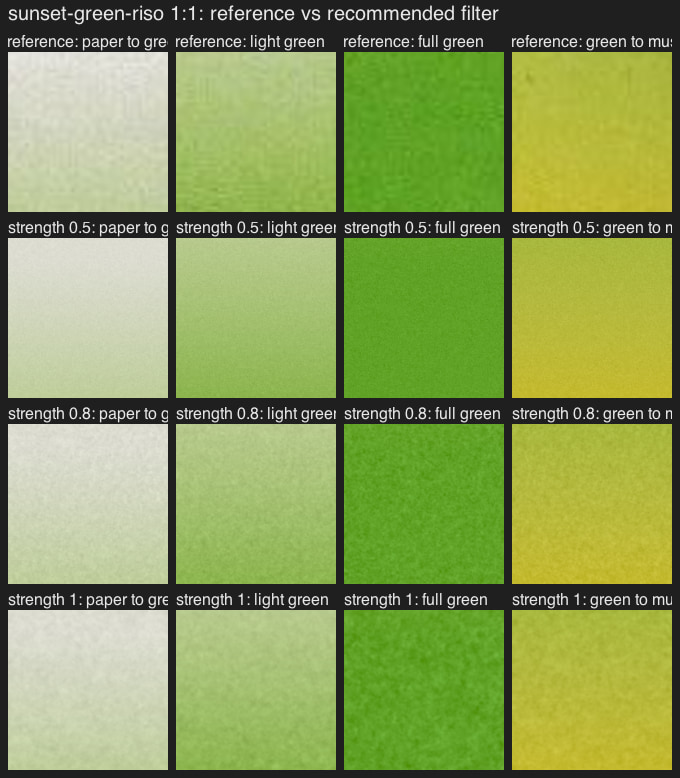
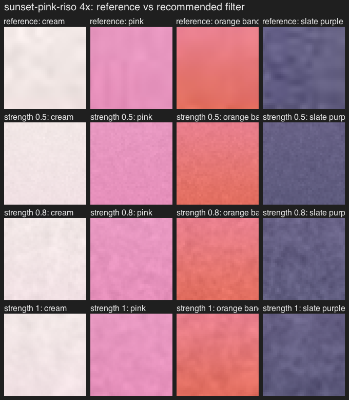

### Preview vs export: size grain relative to the picture

The test is an Atmospheric ramp rendered at 3840×2160, then shrunk to 25%
(960×540, lanczos), next to a 960×540 preview rendered directly.

| Grain | Preview | Export at 25% |
| --- | --- | --- |
| recommended, strength 0.5 | 0.75% | 0.73% |
| recommended, strength 1 | 1.63% | 1.69% |
| fixed 1 px grain at output size, 1.25% | 1.25% | 0.42% |

- **Fixed per-pixel grain disappears.** Grain fixed at the output pixel
  makes the export look about 3× smoother than its preview once the export is
  shown smaller, and it is shown smaller almost everywhere.
- **The recommended sizing reads the same** in preview and export.
- **Preview vs 100% export.** In a 925 px preview of a 16:9 image (short
  side 520) the film octaves are under a pixel, so the preview shows the
  grain at about 0.85% mid-tones. The 100% export shows about 1.2%. That is
  the correct look at each size. Show a 1:1 crop if the UI needs the 100%
  view.


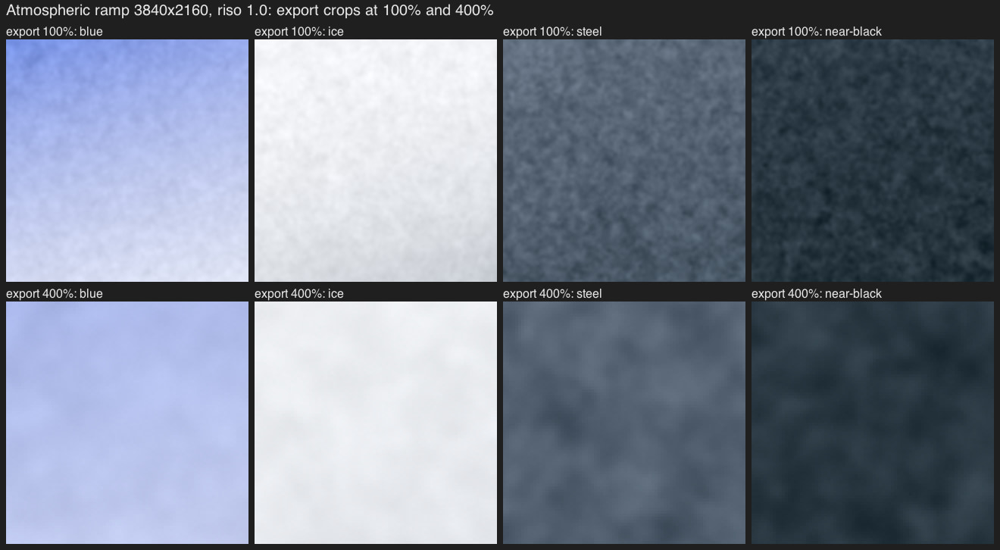
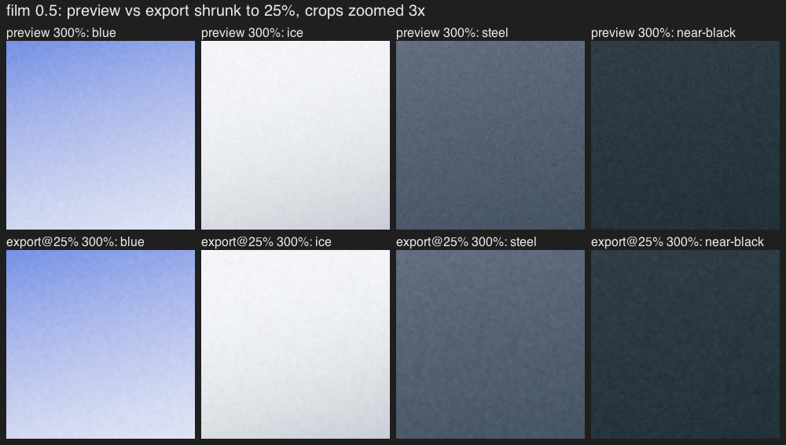
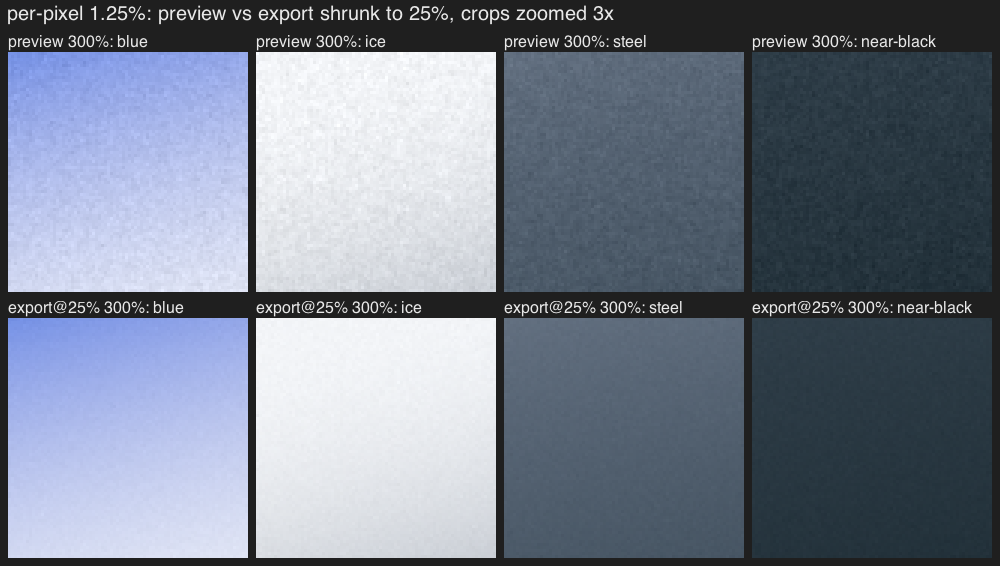

### Grain as dither on dark gradients

Slate → near-black → black over 3840 px (code values 0-30), contrast
stretched 6×:

- **No dither:** bands.
- **±1 LSB triangular dither:** smooth at 100%. The bands come back at 25%,
  because shrinking averages the dither away and the result is rounded to
  8 bits again.
- **Grain at 0.5 and 1:** smooth at both sizes. At strength 0.5 the grain is
  about 1.5-3 LSB at L 0.15-0.4, and it is sized to the picture, so it still
  dithers when the image is shown smaller.

Keep the triangular dither on always, because grain fades to 0 at black and
eases near white.

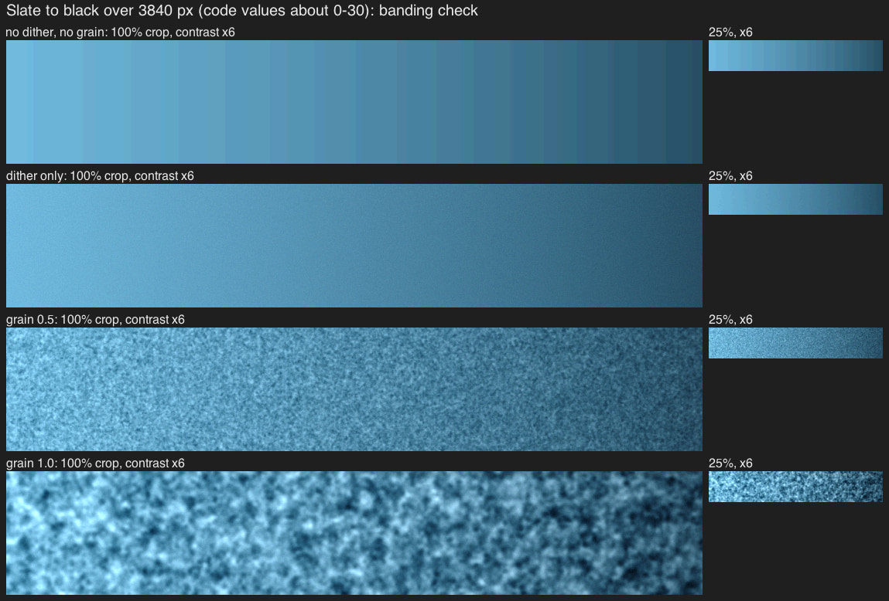

### Pack check

Bold, Elemental and Atmospheric were rendered as simple linear-light ramps
in pack order, at 1920×1080 and 1080×1920, seeds 1 and 2, strengths 0.5 and 1.

- **Strength 0.5** is a fine, even, mono grain on every pack colour. There
  is no colour speckle on Bold yellow or orange-red.
- **Strength 1** reads as a print texture, strongest on Elemental Forest and
  the Atmospheric slates.
- **Mean colour shift** per 64 px patch is ≤ 0.27 Oklab×100 at 0.5. At 1
  it is ≤ 0.91, which is the coarse octave itself.

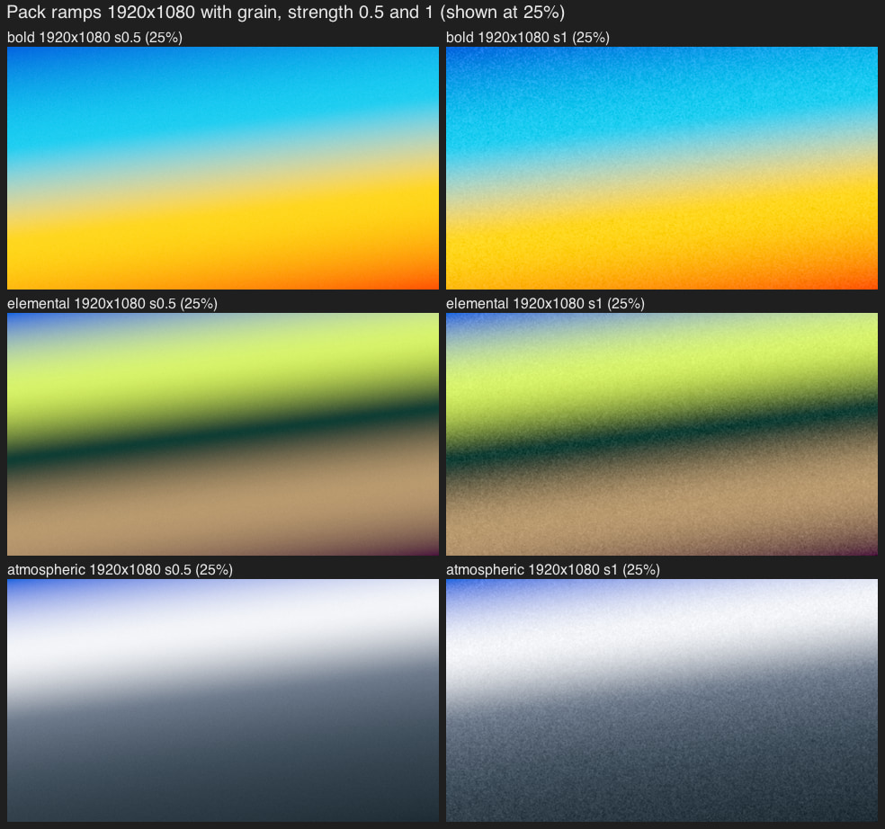
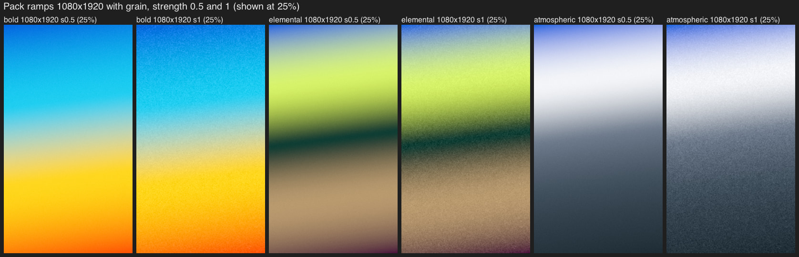
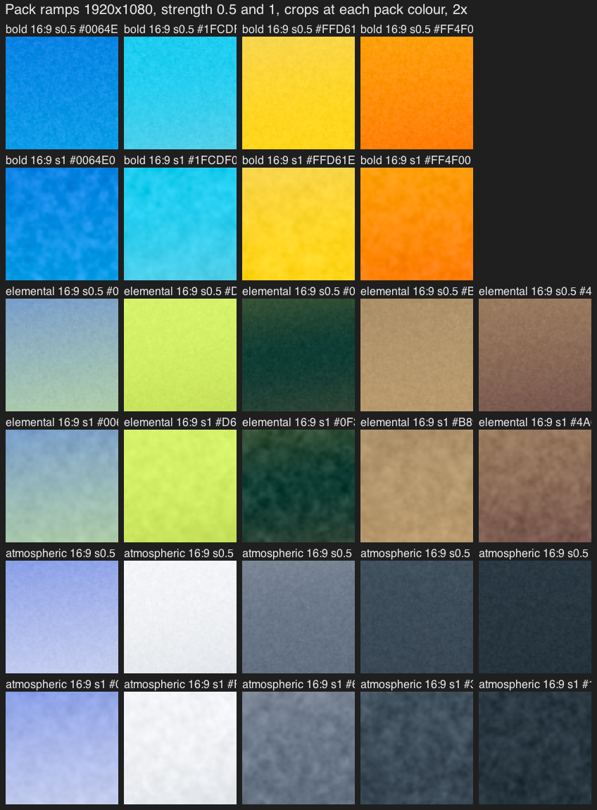

## GLSL port

One output pass at output size, after the tone curve (display-linear,
max ≤ 1), for preview and export alike:

1. linear → Oklab;
2. `L += amp(L) · G(fragCoord)`;
3. Oklab → linear, clamp to [0, 1];
4. sRGB encode (exact piecewise);
5. triangular ±1 LSB dither (with the uniform-noise edge blend near 0 and 255 from `docs/light/research-techniques.md` §9);
6. RGBA8 write.

The grain is generated after the downsample from the 2× render.

The noise for each octave:

- **σ_k ≥ 0.6 px: cubic B-spline lattice noise.** Use 4×4 hashed lattice
  values at `u = fragCoord · 0.577 / σ_k`, divided by `sqrt(Σ weight²)`.
  Lattice coordinates are picture-relative, so the preview and export get
  the same clumps (r = 0.53 at strength 1 vs 0.03 for blurred noise). It
  needs no extra render targets. Statistics match blurred white noise
  (`lattice.mjs`: std 2.05% vs 2.05%, autocorrelation within 0.03 out to
  6 px), and no lattice pattern was visible. The prototype hashes gaussian
  lattice values. Uniform values would be cheaper and are untested here:
  the 16-tap weighted sum acts like about 4 averaged uniforms, which gives
  an excess kurtosis of about −0.3. The 16 taps can be cut to 4 bilinear
  fetches of a noise texture with the B-spline trick.
- **σ_k < 0.6 px: per-pixel hashed noise** (`lowbias32` hash of x, y, seed),
  times the pixel-variance factor.

Uniforms, computed on the CPU from strength and output size:

- `uGrainAmp` (ampMid);
- `uGrainSigmaPx` (vec4, σ_k in output px);
- `uGrainWeight` (vec4: w_k · sqrt(1/(1+1/(4πσ_k²))) / sqrt(Σw²));
- `uGrainCurve` (vec3: shadowEnd, highlightCut, inkBoost);
- `uSeed` (the image seed).

The only user control is the filter's strength slider. Intensity, Softness
and the mood control belong to the recipes, not to this filter.

### Cost

- **GPU, per pixel:** one Oklab round trip (two 3×3 matrices, 3 cube roots,
  3 cubes) and up to 4 octaves × 16 hashed taps (or 4 × 4 texture fetches).
  Add three smoothsteps, an sRGB encode and 2 hashes for the dither. There
  are no extra passes.
- **Blurred-noise alternative:** one noise target and 2 separable blur
  passes. The riso 8× octave (σ 19-34 px at short side 2160-3840) needs
  115-200 taps or a downsampled level.
- **CPU prototype:** about 2.5 s per 3840×2160 render in Node.

## Disagreement with `docs/light/research-techniques.md` §10

That section recommends three things the measurements here argue against:

- **"Grain at output pixel size."** It loses two-thirds of its strength when
  the export is shown smaller (table above).
- **A `sqrt(u(1−u))` amplitude.** The riso prints rise toward dense ink and
  keep about 0.8% on paper.
- **The coverage-threshold riso model for the riso presets.** It is model
  (c), which gives skewed, posterized dots the prints don't have.

At 925 px the riso look is coarse, mono, multi-octave grain. The prints'
fine ink structure is below the scan's resolution.

## What failed along the way

- **A smoothstep soft threshold in (c)** biased the mean near paper and full
  ink, so paper got darker. I replaced it with an anti-aliased hard step.
- **The first paper tooth** was 10× too strong and made vertical streaks.
  The real prints do show faint streaks along the paper feed in light areas.
  I left them out of the filter: they are tied to one printer and scanner,
  and in a background they read as a defect.
- **Gradient descent for the octave weights** diverged. Exact non-negative
  least squares over all subsets works.
- **Downloading the poster's Figma source** was blocked by auto-review. The
  clean target was enough to identify the halftone.

## Files

- `study.mjs`: crops at 1:1 and 4×, including the riso scan and the deck's grain picture.
- `measure.mjs`: residual statistics, autocorrelation, band energies, JPEG grid and halftone peaks, written to `out/measure/`.
- `pick-colors.mjs`: stop colours for the test ramps.
- `fit-octaves.mjs`: octave weight fit.
- `models.mjs`: models (a)-(d) vs references.
- `recommend.mjs`: the recommended filter vs references.
- `export.mjs`: 3840 exports at 100% and 25%, and the dark-gradient check.
- `packs.mjs`: pack ramps, 16:9 and 9:16.
- `lattice.mjs`: lattice vs blurred noise.
- `results.mjs`: copies sheets to `results/`.
- `lib/`: colour, image, noise, measurement, ramp, grain models and the filter.

`study.mjs` and `measure.mjs` read the riso scan from `out/raw/41-26-raw1.png`.
That is Figma's source image for nodes 41:26-41:28 (`download_assets`), and
it is not committed. The other scripts only need the clean targets.
