# organic-boundaries

What makes the boundary between two colors look organic in the Sunset and Contour references, measured, and one boundary model that every Sunset recipe (ramp, bands, blooms) and the Contour glow edges can share. CPU prototype in Node (ESM, `Float32Array` linear RGB, `sharp` for PNG I/O). All noise is an exact port of the engine's `gradientNoise` and PCG hash, so a seed gives the same field on the GPU.

## Short answer

- A boundary in the references is an isoline of the ramp coordinate t (each pixel's position along the image's own color path). Measured that way, the references fall into three groups:
  - Skies (sky-peach, blue-diagonal): boundaries wander 2-16% of the frame height (H) across the width. The waviness has long wavelengths (0.67-1 frame widths, W) and is small next to the transition's own width (wiggle 3-7% of the 10-90 width). It is strongest where transitions are widest. Isolines inside one wide transition wave together; the next transition has its own shape.
  - Horizons and band edges (violet-wave, poster): wander up to 15-18% H, wiggle up to 3-4% H, and up to 0.6 of the edge's width. Neighbouring edges are only loosely related (wiggle correlation 0.26-0.38, spacing varies 35-41%). Edges sharpen at crests and soften in troughs (width min/max 0.2-0.6 along one edge).
  - Clean or printed ramps (red-yellow-arcs, the three riso prints): boundaries are nearly straight. The arcs are a deterministic dome repeated at every height (6% H drop at the edges, wiggle under 0.2% H). The prints add fine mottle (wiggle 0.2-0.7% H, fine residual up to 9% of the width). Their natural look comes from uneven widths between transitions and from light mixing, not from wavy lines.
- In every reference, isolines bunch up a lot (crests, sharp edges) but never spread to more than about 2.2 times their mean spacing: the implied warp slope stays above -0.55 at the 1st percentile. That is the measured version of "they never cross".
- The model: s = s0 + D(a, s0). A recipe supplies its own base coordinate s0 and an along-boundary coordinate a. D is a shared 1D noise along the boundary plus a 2D noise stretched along it, with amplitude that varies along x and down the ramp, and a soft clip. Each boundary also gets a slowly varying softness and an optional fine feather. The CPU calibrates the realized wander per frame and sets a fold guard from the measured steepest slope, so t stays monotone. Bands use the same field per edge ("edge mode") so nothing can fold inside an edge.
- Results: arcs, pink riso and sky-peach match closely (blurred Oklab ΔE 0.66, 1.13, 1.26). Blue-diagonal matches in structure (2.23). Violet-wave needs two layers and a fixed hill profile for 1:1 (2.98). The poster gets the character but not every patch (4.28). All pack variations at 16:9 and 9:16 have organic, fold-free boundaries.
- Contour edges are different: cores and hard edges do not wander (0.5-0.7 px RMS). What varies along a Contour edge is width and brightness, slowly and mostly monotonically, following the light. So Contour should use the model's softness and brightness variation with almost no warp.

## How the boundaries are measured

Code: `lib/rampcoord.mjs` (color path, projection), `lib/isolines.mjs` (tracing and numbers), `lib/audit.mjs` (one call for an image), `measure.mjs` (all Sunset references), `tables.mjs` (tables and plots).

1. Fill the manifest's ignore rects (column-wise interpolation; they all sit inside flat bands) and blur by σ = 6 px in linear light, so grain and JPEG blocks don't move the isolines.
2. Optional, for the two skies whose notes describe a lateral sunlight gain (sky-peach, blue-diagonal): divide out a smooth left-to-right luminance gain (median ratio to the central columns, quadratic in log). A gain changes lightness, not hue, so it doesn't move color boundaries. Removed gains: sky-peach 0.81 left / 1.16 right, blue-diagonal 2.00 / 0.56.
3. Color path: the mean color of a central band (30-60% of the across extent) in 200 bins along the main axis, averaged in linear light, smoothed over 1.5 bins, converted to Oklab. Violet-wave's path starts at its far-left sky blue (`#578ECC`), which the central band never reaches.
4. t(x, y): each pixel's nearest point on the path in Oklab, as arc length / total (0..1). Paths that pass one color twice (pink riso magenta, poster red, blue riso blue) search only path points within a window of the pixel's own axis position.
5. Isolines: 14 equal-t levels (t = (k + 0.5) / 14) and, for each transition between the notes' stops, its 50% isoline and its 10% and 90% isolines. Marching squares for drawing; per-column crossing counts for the numbers.
6. Numbers per boundary (curves smoothed over 1% of W first, so JPEG jitter doesn't count as waviness):
   - mean height;
   - wander range (max - min) and standard deviation, in % H;
   - tilt and bow from a quadratic fit (bow > 0 means the edges are lower, a dome);
   - wiggle RMS after removing the quadratic;
   - DCT spectrum of the tilt-removed curve (wavelength 2W/k and amplitude per component);
   - curvature;
   - 10-90 width measured perpendicular to the boundary, with its mean, min/max, CV and the wavelength of its variation;
   - fine residual (unsmoothed curve minus a 2% W smoothing), in px and in % of the width.
7. Relations: wiggle correlation and spacing CV of neighbouring main boundaries; correlation of all pairs of equal-t isolines against their separation (the vertical correlation length is where it falls to 0.5). Also the implied warp slope from the local spacing of neighbouring isolines (slope = mean / local spacing - 1; folds start at -1) and the share of columns where an isoline crosses more than once (folds).

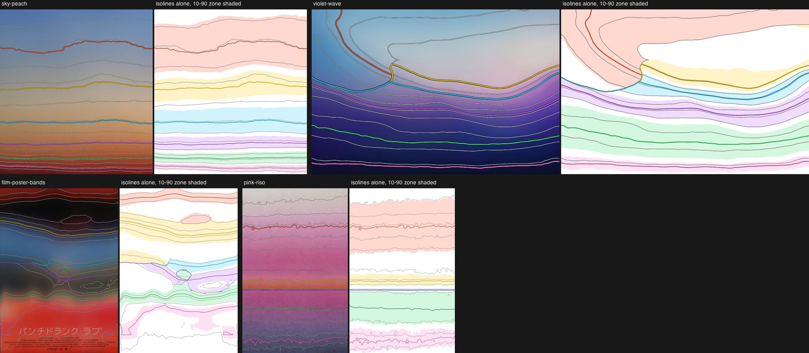

Left of each pair: the reference with the 14 equal-t isolines (white) and the main boundaries (colored). Right: the isolines alone, with each transition's 10-90 zone shaded, so its width along x is visible.

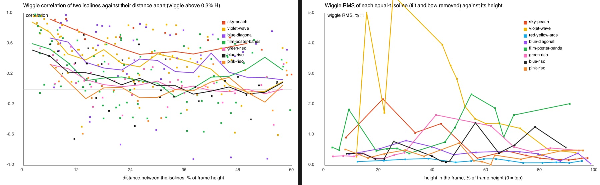

Left: wiggle correlation of two isolines against their distance apart. It falls to 0.5 within 5-11% H in most references. The skies keep a shared part: sky-peach stays near 0.45 out to 50% H. Right: wiggle of each isoline against its height. In sky-peach it is largest in the high sky and fades toward the horizon. In violet-wave it is largest around the glow and the land edge and fades with depth. The poster peaks at its edges. The arcs and the prints stay near the noise floor.

### What makes each boundary look organic

- **sky-peach**: the high-sky boundaries (blue to grey, grey to peach) wander 5-7% H in broad steps: long flat stretches joined by short rises, about 0.67 W apart, not sine waves. The waviness shrinks steadily toward the horizon, to about 0.2% H, and is always small next to the transition width (3-7%). The spacing between boundaries hardly changes (CV 0.06). What is uneven is the widths of the transitions down the frame (30, 13, 15, 8, 6, 4% H).
- **violet-wave**: the land edge is a hill line, high and sharp at the right (36 px), with a broad soft trough (60-90 px) and a lower ridge on the left. Below it, each line repeats a smoother, flatter version of the shape (bow -10%, -7.5%, -2.8% H going down), so curvature fades with depth. Above it, the warm glow is a closed region, and its left edge is a soft diagonal that leaves the land line at a junction. Isolines bunch at the crest and spread in the trough.
- **red-yellow-arcs**: one parabola repeated at every height (drop 5.9% H at the frame edges, 7.5% H in the top 250 px), parallel within 2% spacing, with no measurable waviness. Uneven widths (22, 8, 18, 5, 13% H) and the cream bridge make it natural.
- **blue-diagonal** (gain removed): bands that tilt more the lower they are (8.7, 12.9, 17.9% H across the width). The warm horizon then bends up toward the sun in one curve (bow -5.4% H) and goes level at the bottom. Neighbours are unrelated in their small wiggles (correlation 0.02) and the spacing varies 15%. With the gain left in, the lightness isolines run diagonally at 29-35°; that is the brightness falloff, not the boundaries.
- **film-poster-bands**: every edge has its own shape. The top edge arches up 40 px in the middle. Black to blue is one uneven wave (110 px peak to peak). Blue to grey ripples. The grey band pinches nearly shut in places (spacing CV 0.77 for that pair). The lower red edge is patchy. Round patches inside the bands make closed isolines.
- **riso prints**: straight, level ink edges (the pink riso's hard edge is ruler straight to 0.25 px), soft ramps with ink mottle that makes isolines wiggle by 2-5 px at a 10-40 px scale, and bands whose top and bottom edges differ in softness by up to 8 times.

## Measured targets (acceptance numbers)

Per main boundary, measured on the clean targets with σ = 6 px; sky-peach and blue-diagonal with the lateral gain removed. "Width varies over" is the wavelength of the width's main variation, in W; 2.00 means one change from one side of the frame to the other. Width min/max 0.00 marks boundaries that meet another one (violet-wave's junction, the poster's grey band).

| reference | boundary | height %H | wander range %H | tilt / bow %H | wiggle RMS %H | main wavelengths W (amp %H) | 10-90 width %H | width min/max | width CV | width varies over W |
| --- | --- | --- | --- | --- | --- | --- | --- | --- | --- | --- |
| sky-peach | blue → grey | 22.6 | 7.3 | -5.2 / 2.2 | 1.89 | 0.67 (2.5), 1.00 (1.0) | 29.8 | 0.82 | 0.05 | 2.00 |
| sky-peach | grey → peach | 46.8 | 4.7 | -3.7 / 1.6 | 0.92 | 0.67 (1.1), 0.50 (0.7) | 13.1 | 0.71 | 0.08 | 0.67 |
| sky-peach | peach → light orange | 68.4 | 2.2 | -0.3 / 0.6 | 0.50 | 0.67 (0.5), 0.50 (0.5) | 14.5 | 0.80 | 0.05 | 2.00 |
| sky-peach | light orange → orange | 81.5 | 1.6 | -1.3 / 0.1 | 0.27 | 0.67 (0.3), 0.15 (0.1) | 7.8 | 0.79 | 0.06 | 2.00 |
| sky-peach | orange → red | 90.1 | 1.2 | -0.4 / -0.6 | 0.18 | 1.00 (0.3), 0.33 (0.1) | 6.1 | 0.74 | 0.09 | 2.00 |
| sky-peach | red → deep red | 96.2 | 1.8 | 1.5 / -0.8 | 0.22 | 1.00 (0.4), 0.50 (0.2) | 4.2 | 0.71 | 0.11 | 2.00 |
| violet-wave | blue-white → pink-lilac | 43.5 | 15.6 | -5.1 / -1.0 | 4.02 | 0.50 (3.4), 0.67 (3.1) | 6.3 | 0.00 | 0.77 | 2.00 |
| violet-wave | pink-lilac → violet (land edge) | 48.8 | 15.6 | 3.2 / -7.7 | 2.93 | 0.67 (3.2), 0.50 (2.6) | 5.4 | 0.00 | 0.64 | 2.00 |
| violet-wave | violet → indigo | 59.0 | 18.2 | 11.4 / -10.3 | 1.39 | 1.00 (3.7), 0.50 (2.8) | 10.2 | 0.56 | 0.14 | 2.00 |
| violet-wave | indigo → navy | 78.9 | 11.3 | 7.1 / -7.5 | 0.50 | 1.00 (3.0), 0.50 (1.2) | 20.1 | 0.57 | 0.16 | 2.00 |
| violet-wave | navy → near-black navy | 94.9 | 4.1 | 0.6 / -2.8 | 0.39 | 1.00 (1.1), 0.67 (0.3) | 6.0 | 0.63 | 0.12 | 1.00 |
| red-yellow-arcs | maroon → dark red | 10.0 | 7.3 | 0.2 / 7.5 | 0.17 | 1.00 (3.1), 0.50 (0.7) | 7.7 | 0.65 | 0.11 | 1.00 |
| red-yellow-arcs | dark red → scarlet | 28.6 | 5.9 | 0.1 / 6.2 | 0.19 | 1.00 (2.6), 0.50 (0.5) | 21.6 | 0.93 | 0.02 | 1.00 |
| red-yellow-arcs | scarlet → red-orange | 49.7 | 6.0 | 0.1 / 6.4 | 0.11 | 1.00 (2.6), 0.50 (0.6) | 7.6 | 0.88 | 0.04 | 1.00 |
| red-yellow-arcs | red-orange → golden yellow | 64.2 | 5.2 | 0.1 / 5.7 | 0.20 | 1.00 (2.4), 0.50 (0.4) | 17.1 | 0.93 | 0.01 | 0.50 |
| red-yellow-arcs | golden yellow → cream | 80.1 | 6.3 | 0.1 / 6.6 | 0.06 | 1.00 (2.7), 0.50 (0.7) | 5.0 | 0.75 | 0.07 | 1.00 |
| red-yellow-arcs | cream → light blue | 90.5 | 5.5 | 0.1 / 5.9 | 0.08 | 1.00 (2.4), 0.50 (0.6) | 13.0 | 0.91 | 0.03 | 0.76 |
| blue-diagonal | deep blue → medium blue | 24.2 | 8.1 | 8.7 / -2.1 | 0.52 | 1.00 (0.9), 0.67 (0.7) | 31.6 | 0.81 | 0.06 | 1.00 |
| blue-diagonal | medium blue → pale blue-grey | 50.6 | 11.8 | 12.9 / 0.9 | 0.40 | 0.67 (0.4), 0.33 (0.3) | 14.3 | 0.87 | 0.03 | 1.00 |
| blue-diagonal | pale blue-grey → cream | 74.6 | 15.7 | 17.9 / 1.0 | 0.51 | 0.67 (0.6), 1.00 (0.3) | 22.5 | 0.87 | 0.03 | 1.00 |
| blue-diagonal | cream → amber | 95.5 | 9.4 | 6.5 / -5.4 | 0.31 | 1.00 (2.1), 0.50 (0.6) | 6.4 | 0.23 | 0.39 | 2.00 |
| film-poster-bands | dark red → ink black | 5.3 | 3.5 | -0.2 / 2.4 | 0.49 | 1.00 (1.1), 0.67 (0.3) | 7.7 | 0.47 | 0.28 | 0.62 |
| film-poster-bands | ink black → denim blue | 25.5 | 8.9 | 8.3 / -5.3 | 0.62 | 1.00 (2.3), 0.67 (0.6) | 15.6 | 0.57 | 0.21 | 2.00 |
| film-poster-bands | denim blue → warm grey | 46.0 | 4.5 | 0.2 / -2.7 | 0.64 | 1.00 (1.1), 0.67 (0.8) | 3.3 | 0.00 | 0.83 | 2.00 |
| film-poster-bands | warm grey → olive grey | 50.3 | 10.4 | 10.8 / -4.0 | 1.44 | 1.00 (1.8), 0.67 (1.3) | 4.9 | 0.00 | 0.67 | 2.00 |
| film-poster-bands | olive grey → coral rim | 65.5 | 4.3 | -1.1 / -0.7 | 1.02 | 0.50 (0.8), 0.40 (0.6) | 8.2 | 0.33 | 0.37 | 0.50 |
| film-poster-bands | coral rim → scarlet core | 75.7 | 17.9 | -9.9 / 8.0 | 2.55 | 0.67 (3.3), 1.00 (3.2) | 7.1 | 0.16 | 0.41 | 2.00 |
| green-riso | paper → green | 17.6 | 3.5 | -2.6 / 0.6 | 0.29 | 0.50 (0.2), 0.29 (0.2) | 26.2 | 0.72 | 0.08 | 2.00 |
| green-riso | green → mustard | 78.5 | 7.3 | 6.6 / -2.1 | 0.32 | 1.00 (0.9), 0.25 (0.3) | 27.7 | 0.81 | 0.04 | 0.40 |
| blue-riso | paper → cyan | 18.9 | 2.9 | 2.7 / 0.3 | 0.21 | 0.50 (0.1), 0.67 (0.1) | 17.8 | 0.68 | 0.10 | 2.00 |
| blue-riso | cyan → grey-blue | 41.0 | 1.0 | -0.5 / 0.1 | 0.16 | 0.18 (0.1), 0.17 (0.1) | 2.4 | 0.49 | 0.14 | 2.00 |
| blue-riso | grey-blue → slate | 45.2 | 1.3 | 1.1 / 0.2 | 0.10 | 1.00 (0.1), 0.29 (0.1) | 3.6 | 0.59 | 0.12 | 2.00 |
| blue-riso | slate → grey lavender | 68.8 | 6.8 | -5.9 / 1.4 | 0.68 | 1.00 (0.7), 0.40 (0.5) | 12.3 | 0.74 | 0.07 | 0.67 |
| blue-riso | grey lavender → light blue | 87.6 | 7.5 | 8.1 / -0.2 | 0.36 | 0.17 (0.2), 0.67 (0.2) | 15.7 | 0.69 | 0.09 | 0.93 |
| pink-riso | cream → magenta | 23.4 | 2.3 | -0.7 / 0.2 | 0.40 | 0.40 (0.3), 0.25 (0.2) | 30.1 | 0.81 | 0.04 | 2.00 |
| pink-riso | magenta → orange | 56.4 | 0.7 | -0.1 / -0.2 | 0.18 | 0.40 (0.1), 1.00 (0.1) | 6.7 | 0.81 | 0.05 | 2.00 |
| pink-riso | orange → magenta (hard edge) | 61.9 | 0.1 | 0.1 / -0.0 | 0.02 | - | 0.6 | 0.82 | 0.05 | 2.00 |
| pink-riso | magenta → dusty violet | 73.2 | 2.6 | 1.4 / -0.3 | 0.20 | 0.50 (0.1), 0.33 (0.1) | 19.2 | 0.88 | 0.03 | 0.67 |
| pink-riso | dusty violet → slate | 92.3 | 3.3 | -1.8 / -1.5 | 0.62 | 1.00 (0.7), 0.25 (0.4) | 11.4 | 0.62 | 0.11 | 2.00 |

Per reference. Bump aspect is the main wavelength over twice the wiggle amplitude (how stretched the waves are; only boundaries above 0.3% H wiggle). Slope is the implied warp slope from neighbouring isolines; folds start at -1.

| reference | adjacent wiggle corr | adjacent spacing CV | vertical corr length %H | bump aspect | wiggle / width | fine residual % of width | slope p01 / p99 |
| --- | --- | --- | --- | --- | --- | --- | --- |
| sky-peach | 0.57 | 0.06 | 8.1 | 12-43 | 0.03-0.07 | 0.5-1.0 | -0.17 / 0.25 |
| violet-wave | 0.38 | 0.41 | 11.0 | 3-136 | 0.03-0.64 | 0.6-9.9 | -0.53 / merging |
| red-yellow-arcs | 0.53 | 0.02 | 25.6 | below noise | 0.01-0.02 | 0.2-1.7 | -0.10 / 0.10 |
| blue-diagonal | 0.02 | 0.15 | 10.0 | 35-86 | 0.02-0.05 | 0.4-1.3 | -0.44 / 0.97 |
| film-poster-bands | 0.26 | 0.35 | 5.3 | 7-51 | 0.04-0.36 | 0.3-6.0 | -0.55 / merging |
| green-riso | 0.09 | 0.05 | 5.0 | 70 | 0.01 | 0.7-0.9 | -0.59 / 7.5 |
| blue-riso | 0.02 | 0.12 | 4.1 | 11-33 | 0.01-0.07 | 0.7-5.1 | -0.45 / merging |
| pink-riso | -0.02 | 0.05 | 5.5 | 23-37 | 0.01-0.14 | 0.6-9.0 | -0.25 / 0.43 |

"Merging" means some neighbouring isolines meet: junctions and patches in violet-wave and the poster, the two-step slate edge in the blue riso.

Anisotropy: the visible stretch of the waves is the bump aspect, 10-90 times wider than tall in the skies and 7-50 times on the poster's edges. The lowest values belong to violet-wave's hills (about 3) and its glow loop. The noise itself is not very stretched: along the boundary, the wiggle stays correlated over 0.03-0.08 W at half correlation, against 5-11% H across. What makes the structures read as horizontal is that the amplitude is small next to the wavelength.

Engine today (`artifacts/tool-audit/exports/sunset.ramp-bold-16x9-seed1-small.png`, same audit): wiggle 0.4-1.25% H on every boundary alike, width min/max 0.81-0.93, spacing CV 0.04, slope range -0.12..0.15. The boundaries are nearly parallel and evenly soft.

### Generic acceptance bands for production (no reference)

From the references and from the failure modes below:

- folds 0; implied slope p01 at or above -0.6;
- wiggle of the widest sky boundary 0.5-2.5% H, horizon boundary 0.3-3% H;
- bump aspect at least 10 for every boundary with wiggle above 0.3% H;
- width min/max along each boundary 0.45-0.9 (above 0.95 is "too even");
- widest transition at least 3 times the narrowest (sky-peach 7×, arcs 4×, pink riso 50×);
- neighbouring boundaries' wiggle correlation at most 0.8, spacing CV at least 0.04;
- the largest DCT component carries at most 60% of a boundary's wiggle energy (not a sine);
- fine residual at most 3% of the width for light, up to 10% for a print look.

## Contour glow edges

`contour.mjs` walks each edge along a guide (geometry from the contour-curve-glow presets: wedge, circle, line) and samples a profile across it every 4 px. For each side of the glow, the 50% point is measured against that side's own background, together with the 10-90 width. S is the short side.

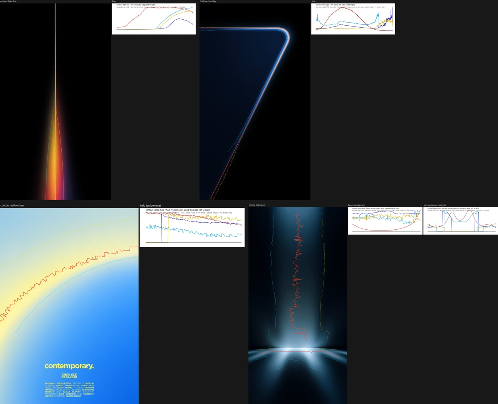

| edge | where it is | peak brightness along the edge | width along the edge | position wander |
| --- | --- | --- | --- | --- |
| light line | core | rises from the dim blue top to the white-yellow middle, then holds; min/max 0.15, changes over about 260 px | half-max width min/max 0.14, cv 0.85 (the halo starts at 40% height) | core 0.5 px RMS from a straight line |
| light line | halo sides | - | 10% reach grows almost linearly from 0 to 0.09 S at the bottom; left (yellow) side wider, 0.032 vs 0.027 S | sides 1.7-5.9 px (0.2-0.6% S) |
| rim edge | outer side (hard) | from the dim ends to the bright corner: min/max 0.01, changes over about 360 px | 10-90 width 0.008 S (7 px), cv 0.9 near the dim ends | 0.7 px |
| rim edge | inner falloff | - | 10-90 width 0.019 S, min/max 0.33, widest at the bright corner, changes over about 240 px | 3.5 px (0.4% S) |
| yellow halo | band (yellowness) | falls toward the upper right, min/max 0.58 | half-max width 0.195 S, narrowing along the arc (min/max 0.66); inside 10% reach 0.10 S, outside 0.23 S | inner side 5.9 px (0.6% S) |
| beam | column sides | rises toward the pool, min/max 0.04 | 10-90 width 0.17 S per side, min/max 0.41-0.51, cv 0.14-0.20, changes over about 100 px | 6-8 px (0.6-0.8% S), from haze streaks |
| beam | pool top | brightest in two lobes either side of the center | top side 10-90 width 0.078 S, cv 0.63 | follows the pool's oval (3% S), not noise |

What this means for the model:

- Contour cores and hard edges are precise geometry: no warp on them (at most 0.001 S).
- The soft sides of a glow may wander a little (0.2-0.8% S) at a long scale.
- Width and brightness vary along every Contour edge, but mostly in one direction, following the light: wider where it is brighter, and widening down the light line. Noise on top of that should be gentle: softness amount 0.1-0.3 at an along-edge scale of at least 0.3 S, brightness variation 10-20%.

## The boundary model

Code: `lib/boundary.mjs` (CPU), `glsl/boundary.glsl` (shader), `lib/scene.mjs` (a ramp, band and layer recipe that uses it).

The engine's copy is `src/light/recipes/sunset/boundary.ts`: the same model, the TypeScript calibration and the GLSL chunk, in short-side units. It changes four things from this prototype:

- the fold guard works along the boundary instead of one factor for the frame;
- very wide transitions get less wander;
- every transition's bumps are kept long in the frame (the bump rule);
- an edge over a much darker ground gets its own rules (silhouette edges).

See the CPU calibration section and [How each recipe plugs in](#how-each-recipe-plugs-in).

### Formulas

Lengths are in frame heights here (short-side units in the engine module). A recipe supplies, per pixel:

- `a`: the along-boundary coordinate (for horizontal boundaries, `a = (x + 0.5 - W/2) / H`);
- `s0`: its base coordinate, increasing from the first color to the last;
- `v`: the vertical noise coordinate. It is `s0` in distance mode. In ramp mode it is the number of transitions passed, `v(s0) = Σ_j logistic((s0 - m_j) / w_j)`.

The model:

```
S(a)     = Σ_o g^o · gradientNoise(vec2(a · 2^o / Ls + 0.37 + 2.9 o, 0.5 + 4 o), seed) / 0.3052 - S_mean
I(a, v)  = Σ_o g^o · gradientNoise(vec2(a · 2^o / Lx + 1.7 o + 0.13, v · 1.5^o / Ly + 3.3 o + 0.71), seed + 131 (o + 1)) / 0.3052
M(a)     = max(0, 1 + μ · clamp(gradientNoise(vec2(a / Lm + 0.31, 7.5), seed + 977) / 0.3052, -2.5, 2.5))
D(a, s0) = E(s0) · M(a) · c · tanh((cS · S(a) + cI · I(a, v)) / c)
s        = s0 + D(a, s0)                       (coordinate mode: ramps, blooms, contour)
s_j      = s0 + f_j · D(a, m_j)                (edge mode: bands; edge j moves as a whole)
k_j(a)   = exp(κ_j · clamp(gradientNoise(vec2(a / Lk + 5.1, m_j / Lky + 2.3), seed + 577) / 0.3052, -2.5, 2.5))
           κ_j = κ · min(1, wRef / w_j)        (wide transitions vary their width less)
φ_j      = A_f · w_j · gradientNoise(vec2(a / Lf + 9.7 + 3.3 j, (s - m_j) / (Ly_f · w_j) + 4.1), seed + 733 + 17 j) / 0.3052
step_j   = logistic(ln 81 · (s + φ_j - m_j) / (w_j · k_j(a) · softness))     (10-90 width = w_j)
```

- `o` runs over 1-3 octaves with gain `g` (0.25-0.4), x lacunarity 2 and y lacunarity 1.5.
- `E(s0)` is a smoothstep interpolation through 2-8 knots `[s0_k, E_k]`.
- `c` is the soft clip, 1.3 spreads.
- The bands recipe can use a disk step instead of the logistic.
- Colors mix in linear light: `C = Σ_i ω_i C_i` with `ω_0 = 1 - step_0`, `ω_i = step_{i-1} - step_i`, `ω_n = step_{n-1}` (negative weights clamped).

Bridge light, per transition (from sunset-diffusion, made local):

```
V_j = |q_j - q_{j+1}|² / 4                       q = rgb / (r + g + b) of each stop color
β   = min(1, Σ_j pull_j · min(1, V_j / 0.25) · 4 step_j (1 - step_j))
Y'  = Y + lift · (1 - Y) · min(1, Y / 0.18)      Y = luminance of the mix
C  ← C + β · (Y' · tint - C)
```

`pull` is 0.5 and `lift` 0.1-0.12. A transition can set `pull_j = 0`. The `min(1, Y / 0.18)` factor matters: without it, ink black next to red turned grey on the poster.

### CPU calibration (once per render, then uniforms)

1. Find the range of `(a, s0)` over the frame from a 17×17 grid of the base coordinate. Check that `∂s0/∂along > 0` (base shapes must not fold either).
2. Over a window at least 1.2 H wide, centered on the frame: `cS = sqrt(share) / std_a(S)`, `cI = sqrt(1 - share) / rms_v(std_a(I))`, and `S_mean = mean_a(S)`. A 9:16 frame then shows the middle of the same pattern instead of a squeezed copy. Reference presets calibrate over their own frame (`calWidth: 0`).
3. Envelope: `E_k = wander_k / std_a(M · clip(cS S + cI I))` at each knot, so the requested wander (standard deviation of the boundary position across the width, in frame heights) is what the frame shows, whatever the seed.
4. Fold guard, coordinate mode: the steepest negative `∂D/∂s0` on a 96 × 240 grid over the frame. If it is below -0.675, scale all `E_k` by `0.675 / |min|`. Edge mode: per-edge factors `f_j` (start at 1, multiply both edges of a pair by 0.93 until it holds) so neighbouring edges stay at least `minGap` (0.3-0.6) of their mean width apart.
5. Feather guard: `A_f ≤ 0.5 · Ly_f / 9.48` (9.48 is the measured steepest slope of `gradientNoise` divided by its RMS).

The engine module changes steps 3 and 4:

- **Wide transitions** (before step 3): a knot nearest a transition wider than `wideWidth` (0.25 S) asks for `wander · wideWidth / width`. On Bold's 0.42-wide cyan ramp that is 0.95% instead of 1.6% S. The faint columns came from moving that whole gradient up and down; the row-to-row lightness spread inside it drops by 27-33% (seeds 1-3) and the columns are no longer visible.
- **Guard along the boundary** (step 4): each of 128 columns gets the factor it needs (`0.675 / |steepest|` in coordinate mode, the edge gap in edge mode). Each of 16 samples takes the lowest need within 0.6 lattice (0.24 S at the default lattice) on either side. A Catmull-Rom curve `G(a)` joins the samples, and the shader evaluates it the same way. The samples are lowered until the curve is at or below every column's need. So only the steep part of the frame is calmed, over at least the length of a wave. The first version took the lowest need within one sample spacing. That let the guard calm one stretch and leave its neighbour at full wander, which cut a mound out of the edge.
- **Bump rule** (after step 3, repeated with the guard until both hold): each transition's 50% line is followed across the frame (160 columns). Its amplitude `F` is lowered until all three of these hold:
  - the audit's bump aspect is at least 12 (the band is 10; this leaves room for measuring from pixels);
  - every single rise or fall between turning points is at least 5 times as long as it is tall;
  - its steepest point is no steeper than a sine of bump aspect 5, or 10 on a silhouette edge (pi / slope).

  The limits are `BOUNDARY_BUMPS`, and `report.scale` and `report.bumps` give the result. Without this rule, the Elemental and Atmospheric portraits kept 70% of a wander the recipe asked for in frame heights (1.78 times as much in short sides), and the horizon reached a slope of pi / 4.4 to pi / 5.8 at its steepest. Read from the pixels, that was a tree line: a rounded mound and short bumps. The references' sky boundaries reach pi / 3.6 to pi / 28 at their steepest, so light-over-light boundaries keep the looser limit.
- **Silhouette edges** (transition `contrast`, from 0.3 up to 0.8; only for an edge whose lower side is darker). Within 1.2 widths of the edge, the boundary follows the same noise:
  - stretched 1 + 0.4 k times along the edge, so its waves are longer;
  - with 1 - 0.7 k of its finer octaves;
  - read at the edge's own noise row and amplitude, so the whole edge moves as one piece (the top and bottom of the edge move with correlation 1.00 and the same amplitude).

  The change back to the usual field happens in the flat color beside the edge. The edge is softer at its crests: its width grows by exp(0.24 k (crest - mean)), the crest in spreads, and its softness noise is calmed by 0.65 k. Crests end up 1.1-1.5 times softer than troughs, width min/max stays 0.62-0.83 (one 0.96), and the edge keeps 2.2-2.6 times less of its wiggle in waves shorter than 0.25 S.

  The crest height is a smooth curve of the edge's move toward the light side, in spreads: near 0 below -1, about the move itself from 1 to 2, levelling off toward 2.5 (a softplus, then a soft limit: `crestOf` on the CPU, `boundaryCrest` in the shader). Until 2026-11-02 it was clamped at 0 and 2.5. The clamp put a kink in the width along the edge, and on a long soft transition the kink showed as a soft vertical column. Ramp moved its glow to `boundarySoftAt` because of it.

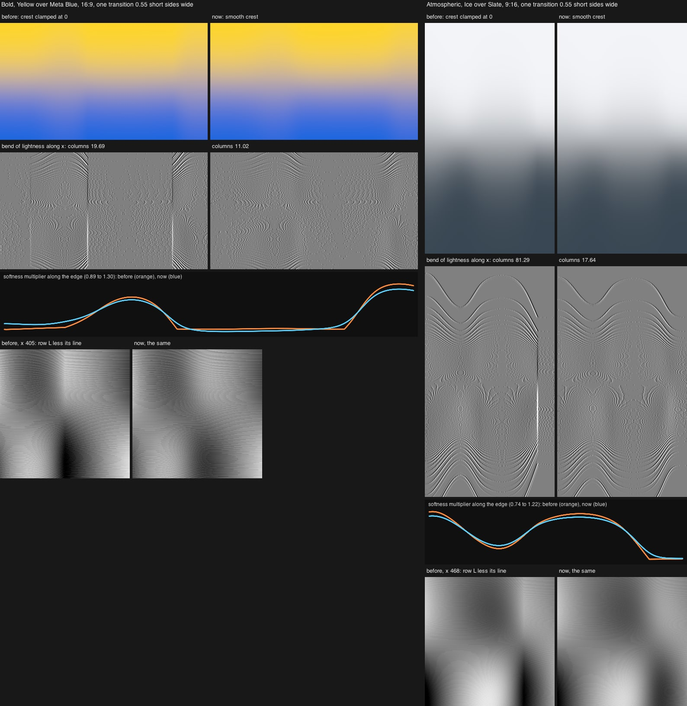

`crest-sheet.mjs`: one 0.55-wide transition over a much darker ground (Bold Yellow over Meta Blue at 16:9, Atmospheric Ice over Slate at 9:16), rendered on the GPU through the engine before (clamped, commit 701d8fa) and now. Under each render, how sharply its lightness bends along x, at one gain for both: the clamp's kinks are the sharp vertical lines through the whole transition, two in Bold and one in Atmospheric, and the smooth crest has none. The plot is the softness multiplier along the edge (orange before, blue now). At the bottom, a 1:1 crop around the strongest column, each row's lightness less its straight-line fit: before, a sharp V runs down the column; now the shading is smooth.

- Largest bend of the softness multiplier along the edge (second difference per short side squared): 2778 → 20 (Bold), 3559 → 33 (Atmospheric).
- Columns (that bend of lightness averaged over the transition's rows, 1e-6 Oklab L per px²): 19.7 → 11.0 and 81.3 → 17.6. What is left is the 8-bit steps, which are the same in both.
- In the looks: Ramp's uniforms change in its 318 cases with a silhouette edge (the crest mean in `uBndDark`, by up to 0.126). Its pixels change by at most 1 code value, in 41 of 624 frames (seeds 1-8, three packs, both formats, 13 control settings). Bands and Blooms do not change.
- The boundary tests pass without changes, GPU and CPU still match (0.009-0.011 mean, 0.34-0.40 max Oklab ΔE × 100), and the calibration takes the same time (Ramp drag step median 3.7 ms both).

Other clamps along the boundary that can still put a kink in it: the softness noise and the amplitude change along the boundary are clamped at ±2.5 RMS (the noise reaches 3.2 RMS at most, so this is rare), and the guard curve is clamped to 0-1 where its spline overshoots.

Measured on the engine's noise (`tools/`): RMS 0.3052, largest value 3.2 RMS, steepest slope 9.5 RMS per lattice unit (12.7 with two octaves), correlation 0.5 at 0.39 lattice units. So a measured half-correlation distance `d` means `Ly = d / 0.39`. A strict guard on the steepest point allows a typical slope of only about 0.19, which is why the guard is measured on the actual frame instead of using a worst-case formula.

### Uniforms

Prototype (`glsl/boundary.glsl`): `uBSeed`; `uBShared` (cS, 1/Ls, S_mean, octaves); `uBWarp` (cI, 1/Lx, 1/Ly, octaves); `uBGain`; `uBClip`; `uBMod` (μ, 1/Lm); `uBKnotCount`, `uBKnotS0[8]`, `uBKnotAmp[8]` (guard applied); `uBSoft` (κ, 1/Lk, 1/Lky, wRef); `uBFeather` (A_f guarded, 1/Lf, Ly_f); `uBEdgeFactor[16]`. Functions: `boundaryWarp(a, s0, v)`, `boundaryEdge(a, j, m, v)`, `boundarySoft(a, m, w)`, `boundaryFeather(a, s, m, w, j)`, `bRampV(...)`.

Engine (`BOUNDARY_GLSL` in `boundary.ts`): `uBndSeed`; `uBndShared` (cS, 1/Ls, S_mean, octaves); `uBndWarp` (cI, 1/Lx, 1/Ly, octaves); `uBndShape` (gain, clip, μ, 1/Lm); `uBndKnotCount`, `uBndKnots[8]` (s0, amplitude); `uBndGuard[16]` and `uBndGuardSpan` (the guard curve along the boundary); `uBndSoft` (κ, 1/Lk, 1/Lky, wRef); `uBndFeather` (A_f guarded, 1/Lf, Ly_f); `uBndTransCount`, `uBndTrans[16]` (position, width, noise row, amplitude scale `F`); `uBndDark[16]` (silhouette strength, half-height of its long-wave zone, crest scale, crest mean); `uBndVertical`.

### Parameters and ranges

| name | meaning | skies | horizons / bands | prints | contour |
| --- | --- | --- | --- | --- | --- |
| `wander` | `[[s0, std], ...]` boundary wander in frame heights | 0.016-0.025 high sky, 0.003-0.006 near the horizon | 0.006-0.025 per edge | 0.001-0.007 | ≤ 0.001 S on cores, ≤ 0.006 S on soft sides |
| `share` | variance all boundaries share | 0.45-0.6 | 0.1-0.2 | 0.5 | - |
| `sharedScale`, `scale` | lattice along the boundary (H) | 0.3-0.45 | 0.28-0.35 | 0.18-0.3 | ≥ 0.3 S |
| `lyMode`, `ly` | vertical lattice: `ramp` (transitions) or distance (H) | ramp, 2-2.5 | ramp 1.0 (edges independent) | ramp 2-3 | distance |
| `octaves`, `gain` | detail along the boundary | 2, 0.25-0.3 | 2, 0.3-0.4 | 2, 0.4 | 1 |
| `clip` | soft clip in spreads | 1.3 | 1.3 | - | - |
| `alongMod` | amplitude change along the boundary | 0.2-0.3, scale 0.8-0.9 | 0.3, 0.6 | - | - |
| `soft` | softness variation `{amount, scale, ly, wRef}` | 0.05-0.15, wRef 0.08 | 0.15-0.2 | 0.1-0.14 | 0.1-0.3 |
| `feather` | fine feather `{amp, scale, ly}` | off | off | 0.03, 0.02, 1.5 | off |
| `mode` | `edges` for bands | - | edges, `minGap` 0.3-0.35 | edges | - |
| `slopeBudget` | fold guard | 0.75 | 0.75 | 0.75 | 0.75 |

### How each recipe plugs in

The engine module is `src/light/recipes/sunset/boundary.ts`, with tests in `boundary.test.ts`. Ramp (`ramp-boundary.ts`, `ramp-shader.ts`) and Blooms (`blooms-boundary.ts`, `blooms.ts`) call `calibrateBoundary` and use `BOUNDARY_GLSL`; Bands uses only its `gradientNoise`.

- In the recipe's `uniforms()`, call `calibrateBoundary(params, aspect, seed)` and spread the returned `uniforms` into the recipe's own. The same parameters, aspect and seed give the same uniforms, so the result can be cached by those three.
- Put `BOUNDARY_GLSL` in front of the recipe's fragment. It uses the engine's `gradientNoise` from the chunk library and adds only `boundary*` functions and `uBnd*` uniforms.
- Lengths are in short-side units, like the engine's `p`: the frame is `aspect × 1` (landscape) or `1 × 1/aspect` (portrait), centered on 0. `a` runs along the boundaries; `s0` runs across them, increasing from the first color to the last.
- `params` (`BoundaryParams`): `wander` knots `[s0, spread]` (up to 8) and `transitions` `{at, width, contrast?}` (up to 16, in order of `at`) are required; the rest default to `BOUNDARY_DEFAULTS`, which are the production values in the table above. New: `wideWidth` (0.25; 0 turns the wide-transition rule off) and `range` (the s0 range over the frame).
- `contrast` on a transition: `boundaryContrast(Y before, Y after)` from the linear luminance of its two colors, gain included. Pass it on every transition. It does something only where the color after the transition (lower in the frame) is much darker. Without it, a light sky over a dark ground is treated as an ordinary edge.
- `field` gives the same numbers on the CPU (`warp`, `edge`, `soft`, `softAt`, `feather`, `v`, `guard`) for audits and tests. `report` gives:
  - the requested and realized wander per knot;
  - the guard's lowest value and the share of the width where it acts;
  - the bump rule's amplitude per transition (`scale`) and the lowest bump numbers it left (`bumps`).
- The bump rule lowers wander a recipe asks for when its bumps would be steep, most of all in tall frames when the request grows with the frame height. Read `report.realized` instead of assuming the request.

In the shader:

- coordinate mode: `float s = s0 + boundaryWarp(a, s0);` then transition j is `boundaryRise((s - uBndTrans[j].x) / (uBndTrans[j].y * boundarySoft(a, j)))`;
- edge mode: transition j sits at `uBndTrans[j].x + boundaryEdge(a, j)` with the same softness;
- `boundarySoftAt(a, m, w)` for a boundary that is not in the transition list (a glow's side), `boundaryFeather(a, s, j)` for print looks.

`gpu-compare.mjs` is a working example: a small ramp fragment on top of `BOUNDARY_GLSL`, rendered through the engine's `ProgramRenderer` next to the same scene on the CPU and next to the previous version of the module (899c06d), for all three packs at 16:9 and 9:16. GPU and CPU match to 0.009-0.011 mean and 0.34-0.40 max Oklab ΔE × 100 (8-bit rounding). Under each landscape row, the portrait's dark ground edge is shown 1.1 times larger, now and before. `node gpu-compare.mjs` writes the sheet to `out/gpu/`; `--update-results` replaces the one below.

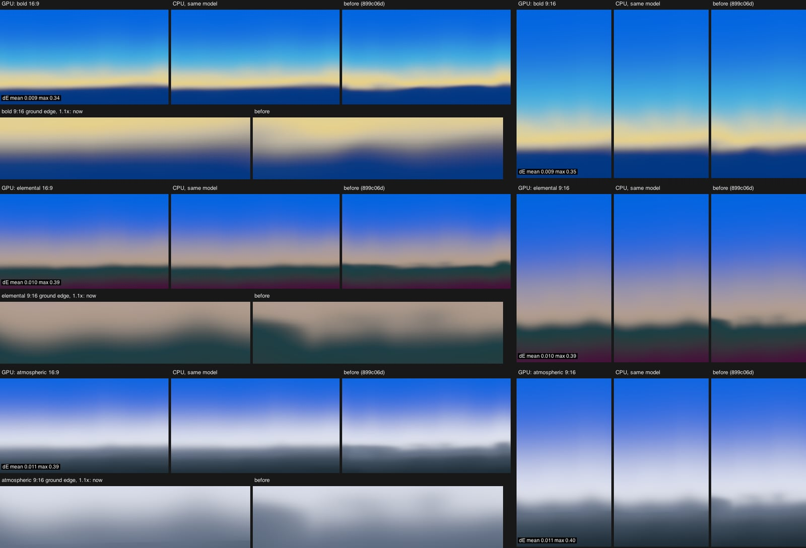

Per recipe, the base coordinate:

- **sunset.ramp**: axis tilted by θ from an anchor, `e` across it. `s0 = along + T(along) · e - ½ B(along) · e²`, with tilt `T` and bend `B` constant or changing down the ramp through knots (a fan). Use `a = e`, coordinate mode, ramp-mode `v`. For a 1:1 shape such as a particular hill line, subtract fixed profiles `Σ P_k(x/W) · G_k(along)`. For a land in front of a sky, use a second layer with its own coordinate and boundary field, composited in linear light through a soft coverage edge in that coordinate.
- **sunset.bands**: the same base coordinate. Edge mode: edge j sits at `m_j + f_j D(a, m_j)` and its softness is `k_j(a)`. Use `v = j + 0.5` (ramp mode) so edges are independent at `ly = 1`.
- **sunset.blooms**: per glow, rotate into the glow's frame. `a = ξ` along its long axis, `s0 = η` across it. Then `η' = η + D(ξ, η)` in distance mode with `Ly` about the glow's minor radius, and the kernel uses `η'`. Keep the wander under a tenth of the minor radius (bump aspect).
- **contour.rim / halo / line**: `a` = arc length along the curve, `s0` = signed distance. Warp only the soft outer haze (≤ 0.006 S). Multiply each lobe's widths by `boundarySoft(a, 0, w)` and its brightness by `1 + 0.1-0.2 · noise(a / 0.35 S)`, on top of the light field that already makes the edge wider where it is brighter.

### Controls

- **Softness**: `kS = 2^((softness - 0.5) · 1.4)` multiplies every transition width. Wander is multiplied by `sqrt(kS)`: a softer sky also drifts a little more. The lattice sizes and the softness-variation amount stay, so the shapes stay the same, softer or crisper. Keep every width at least 0.02 H at Softness 0, so a horizon never becomes a ruler line. The calibration and the guard run again on the scaled values.
- **Seed**: every noise field. The shared term uses `seed`, the octaves of the 2D term `seed + 131(o + 1)`, the amplitude modulation `seed + 977`, softness `seed + 577`, feather `seed + 733 + 17j`. In production it also sets a small composition change from `hashIndex`: horizon ±0.04 H and tilt ±2.5°. Calibration runs per seed, so every seed gets the requested wander and none folds.
- **Intensity** and the mood control (Horizon) are not part of the boundary model. Horizon moves the stops, and the envelope knots and edges move with them.

## Results per reference

Blurred Oklab ΔE × 100 (σ = 4 px, mean). In the tables, target and render values are written target / render. Each sheet: reference | render, then reference isolines | render isolines.

### sunset-sky-peach: close match, 9 rounds (ΔE 1.26)

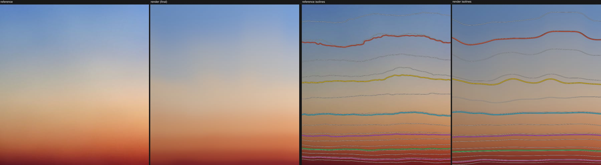

The high-sky boundaries wander 8.3 vs 7.3% H, with the reference's character: flat stretches joined by rises about 0.67 W apart, waviness fading toward the horizon, slope range -0.16..0.23 vs -0.17..0.25, spacing CV 0.05 vs 0.06, vertical correlation length 6.9 vs 8.1% H, no folds. The lower boundaries' widths vary a little less than in the reference (min/max 0.84-0.91 vs 0.71-0.79), and the middle grey is a bit cooler than the reference's khaki grey.

Four things were needed:

- the ramp-mode vertical coordinate, so isolines inside one transition wave together;
- the soft clip, for flat stretches instead of a sine;
- per-frame calibration of the realized wander;
- a lateral gain as light, not as boundary shape.

Rounds 4 and 5 showed two failure modes (a deep blob, then a sine).

### sunset-red-yellow-arcs: exact, 6 rounds (ΔE 0.66)

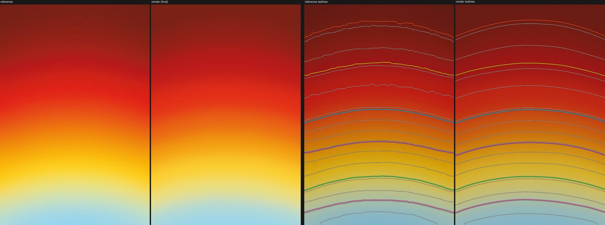

A dome base coordinate with bend knots (7.5% H drop at the top, 5.9% below) and the measured widths. Heights match within 0.5% H, widths within 1% H, ranges within 0.5% H. Round 5 added 0.6% H of wander and the domes went lopsided, so this reference wants none: its natural look is the uneven widths and the light-mixed cream bridge.

### sunset-blue-diagonal: structure matches, 7 rounds (ΔE 2.23)

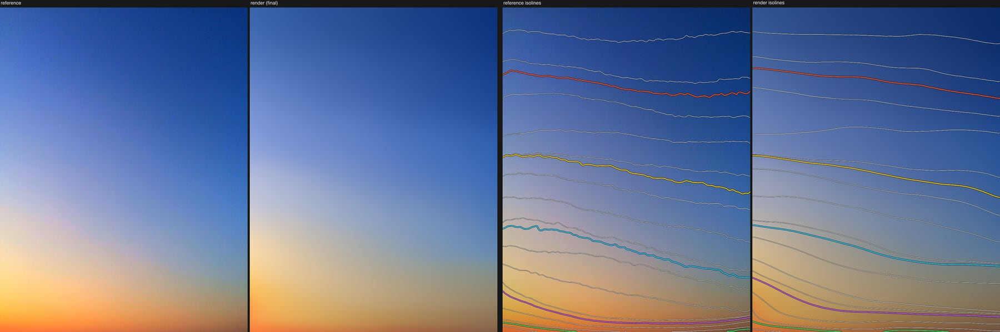

Tilt knots that grow with depth (a fan), a bend that lifts the warm boundary toward the sun, and level bottom bands. Each stop has a left and a right color (both from the notes), mixed across the frame in linear light with a log-linear weight for the 3.6× brightness falloff. Neighbour correlation 0.01 vs 0.02, spacing CV 0.14 vs 0.15, slope p01 -0.43 vs -0.44, no folds. Differences: the right half turns grey-blue a little early, and the lower wiggle is larger than in the reference.

### sunset-violet-wave: needs two layers and a fixed profile, 7 rounds (ΔE 2.98)

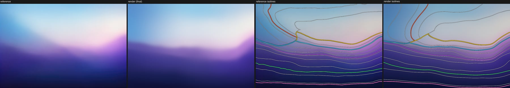

A sky layer (top blue, then the blue-white glow, then pink-lilac, with left, center and right colors) and a land layer in front of it. Each layer has its own coordinate and boundary field; they are composited through a soft coverage edge whose width follows the measured changes (sharp at the right hill, soft in the trough). The land carries a fixed hill profile that fades with depth into a broader valley shape. Land-edge wander 14.9 vs 15.6% H, vertical correlation length 11.7 vs 11.0% H, slope p01 -0.55 vs -0.53. Differences: the lower lines are too alike (neighbour correlation 0.73 vs 0.38), the deepest lines wiggle more than the reference, and the magenta hill is less saturated. Being plain about it: the noise does not draw this particular hill line. With a seed, it draws a hill line with the same statistics; a 1:1 match needs the profile.

### sunset-film-poster-bands: character, not every patch, 10 rounds (ΔE 4.28)

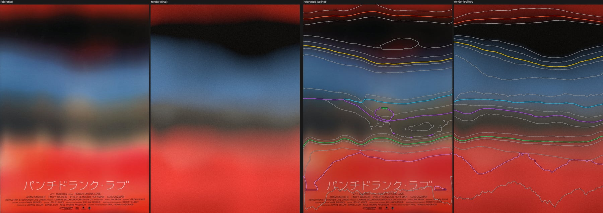

Edge mode: each edge moves as a whole by its own displacement, with per-edge guards. Tilt and bend knots shape the arched top edge and the black-to-blue wave, and the bridge is enabled only on grey to red. A slow light variation stands in for the round patches (not a boundary). The seed was picked from 8 offline. Heights within 2.5% H, independent edges (correlation 0.02 vs 0.26), spacing CV 0.20 vs 0.35, no folds. The reference's grey band pinches harder and its lower red edge is patchier (range 9.9 vs 17.9% H). Two notes on the method: linear-light mixing pushes the perceived edge into the darker band, so edges next to the black had to move away from it, as the notes say; and tilt and bend knots must sit where an edge is seen, not at its stop.

### sunset-pink-riso: close match, 6 rounds (ΔE 1.13)

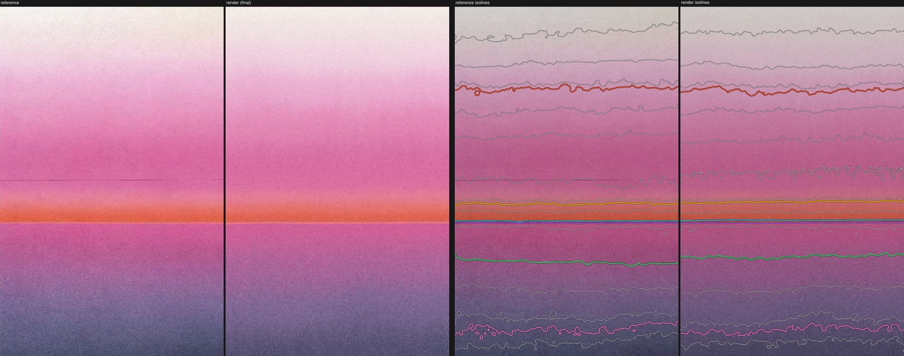

The notes' 16 measured rows as stops, edge mode, near-zero wander on the hard edge, and fine feathering at 3% of each boundary's width standing in for ink mottle. The fine isoline wiggle per boundary matches: 1.0 / 2.2 / 5.2 px against 1.1 / 1.7 / 5.1 px. With feathering off (round 6) it drops to 0.7 / 0.7 / 3.8 px. The upper ramp's wander matches (2.5 vs 2.3% H); width variation is a little lower than in the print.

## Failure modes and the rules that prevent them

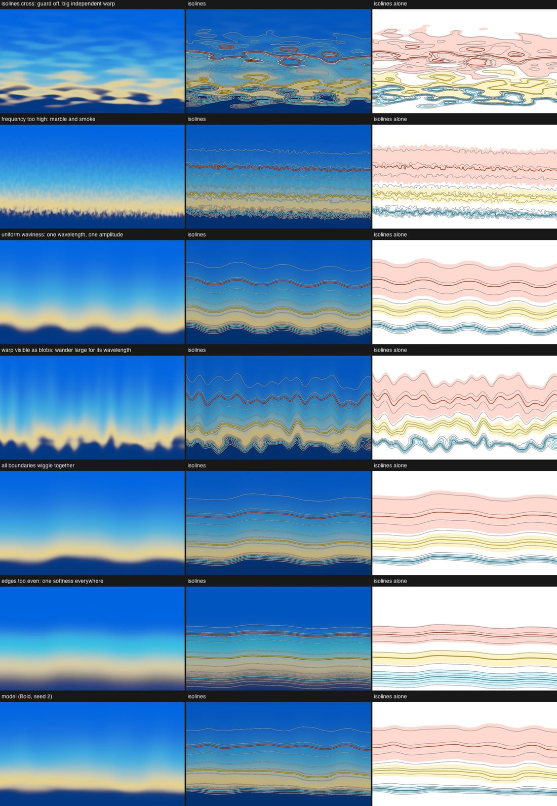

Each row: the failure, its isolines, its isolines alone. The bottom row is the model. All from the Bold scene, seed 2.

| failure | what it looks like | how the audit sees it | rule |
| --- | --- | --- | --- |
| isolines cross (folds, ghost bands) | islands of yellow in the sky, blue in the glow | folds 44.7% of columns (model 0) | t must stay monotone: `∂D/∂s0 ≥ -0.675` measured on the frame, all amplitudes scaled down if not. In edge mode, neighbouring edges stay at least 0.3-0.6 of their mean width apart. Base shapes (tilt, bend, profiles) must keep `∂s0/∂along > 0`. |
| frequency too high | marble and smoke, a grass-like fringe on the horizon | fine residual 6-14% of the width, energy spread over many frequencies (top component 10-16%), neighbours uncorrelated | lattice along the boundary at least 0.25 H (main wavelength at least 0.4 W); octave gain at most 0.4; fine feather only as a print look and at most 3-5% of the width. |
| uniform waviness | wallpaper waves, every boundary the same | one wavelength on every boundary, neighbour correlation 0.99 | no single frequency: 2 octaves, the 1.3-spread soft clip, amplitude that changes along the boundary (0.2-0.3), and most of the variance not shared. The largest component at most 60% of the wiggle energy. |
| warp visible as blobs | soft vertical light columns, a lumpy horizon | wiggle 3% H at 0.25 W, bump aspect about 5, fine residual 10-26% | bump aspect at least 10 for every component; soft clip at 1.3 spreads; softness variation shrinks on wide transitions (`wRef`). In production the same columns appeared in the widest sky ramp until both were applied. |
| all boundaries wiggle together | stamped, parallel wavy lines | neighbour correlation 1.00 | share at most 0.6. Neighbour correlation should be 0.2-0.7 and fall to 0.5 within 5-11% H (in ramp mode, about one transition). |
| edges too even | a blurred CSS gradient with waves | width min/max 0.98 on every boundary | softness that varies along each boundary (min/max 0.5-0.9) and different widths per transition (widest at least 3× the narrowest). The warp's own slope adds width changes that follow the shape: sharper at crests, softer in troughs. |

## Generality: packs at 16:9 and 9:16

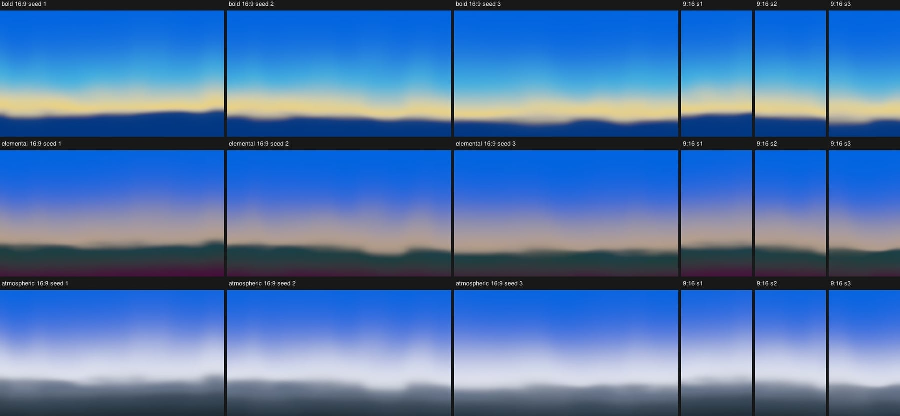

Rows: Bold (Meta Blue, Cyan, Yellow as the one warm color, dim Meta Blue ground), Elemental (Meta Blue, Tan as the one warm color, Forest, Plum), Atmospheric (Meta Blue, Ice, Steel, Slate, Near-black). Columns: 16:9 seeds 1-3, then 9:16 seeds 1-3. Pack hexes only, in pack order, with Meta Blue holding the sky. Every frame has wandering, non-parallel boundaries with softness changing along them, and none has stripes, folds or a ruler line.

Audit of all 18 frames:

- folds 0;
- wiggle 0.1-1.5% H (portraits lower, since they show the middle of the pattern);
- width min/max 0.32-0.91;
- neighbour correlation -0.1 to 0.7;
- spacing CV 0.02-0.09.

Two frames (Elemental 9:16 seed 1, Atmospheric 9:16 seed 1) came out flatter, because the guard cut them to 0.47-0.66. Faint broad columns are still visible in the widest cyan ramp of Bold; they come from the warp acting on a 0.42 H wide transition. The engine module fixes both: the guard now calms only the part of the boundary that needs it, and very wide transitions get less wander (see the CPU calibration section). The first version of that fix kept 70% of the portraits' wander but made their dark ground edges read as a tree line. The bump rule and the silhouette rule fix that (`results/gpu-vs-cpu.jpg`, right column and the enlarged crops). Measured from the rendered pixels at seed 1, the Elemental and Atmospheric portrait horizons now reach pi / 10.3 and pi / 10.8 at their steepest (before: pi / 4.4 and pi / 5.8). Their bump aspect is 15 and 16 and their wiggle 0.54 and 0.51% H, inside the 0.3-3% H band.

## Audit spec for the engine's compare sheet

Add to the target-vs-render sheet:

1. The target and the render, each with the same isolines over it: 14 equal-t levels and each main transition's 50% isoline.
2. The isolines alone for both, with each transition's 10-90 zone shaded.
3. A table, target / render:
   - per main boundary: height, wander range, wiggle RMS, main wavelength, 10-90 width, width min/max;
   - per image: neighbour wiggle correlation, spacing CV, vertical correlation length, slope p01, fold share;
   - pass or fail against the bands below.

Pass bands for a 1:1 preset (from this study's rounds):

- height within ±2% H;
- wander range within ±35% or ±1.5% H;
- wiggle RMS within ±40% or ±0.3% H;
- width within ±20%, width min/max within ±0.15;
- spacing CV within ±0.12, neighbour correlation within ±0.3;
- vertical correlation length within ±50%, slope p01 within ±0.15;
- folds at most the target's plus 0.5%.

For production frames without a target, use the generic bands above.

Procedure: run `rampCoordinate` on the target to get the color path, project both images onto that one path, then measure both with the same code. Per-reference settings (axis, band, search window, extra path color, gain removal, stop positions) are in `lib/config.mjs`. Production frames use their own path and their scene's stops (`auditStops`).

The core code, condensed from `projectToPath` in `lib/rampcoord.mjs` and `columnCrossings` / `traceIsolines` in `lib/isolines.mjs`:

```js
// t(x, y): nearest point of each pixel's Oklab color on the color path, as arc length 0..1.
// path.lab: Oklab points along the main axis; path.t: their arc length / total.
for (let i = 0; i < w * h; i++) {
  const p = linearToOklab(img.ch[0][i], img.ch[1][i], img.ch[2][i]);
  let best = Infinity;
  let bt = 0;
  for (let k = k0; k <= k1; k++) {            // k0..k1: whole path, or a window around the pixel's axis bin
    const d = [P[k+1][0] - P[k][0], P[k+1][1] - P[k][1], P[k+1][2] - P[k][2]];
    const q = [p[0] - P[k][0], p[1] - P[k][1], p[2] - P[k][2]];
    const u = Math.min(1, Math.max(0, dot(q, d) / dot(d, d)));
    const e = dist2(q, scale(d, u));
    if (e < best) { best = e; bt = path.t[k] + u * (path.t[k + 1] - path.t[k]); }
  }
  T[i] = bt;
}

// Height of the level-L isoline in each column: a soft count of pixels with t below L.
// Equal to the crossing where t is monotone, robust where noise wiggles it. NaN if no crossing.
// The hysteresis count of separate crossings flags folds.
function columnCrossing(T, w, h, x, L, eps = 0.004) {
  let s = 0;
  for (let y = 0; y < h; y++) s += Math.min(1, Math.max(0, (L - T[y * w + x]) / eps + 0.5));
  return s < 0.5 || s > h - 0.5 ? NaN : s;
}

// Marching squares for drawing (and for edges that are not functions of x): for each
// 2x2 cell, case = (v0 > L) | (v1 > L) << 1 | (v2 > L) << 2 | (v3 > L) << 3; emit the
// segment(s) between the interpolated edge crossings; saddles (5, 10) split by the cell
// mean; join segments that share an end point into polylines. See traceIsolines().
```

Numbers from the curves: `boundaryGeometry` (wander, tilt, bow, wiggle, DCT spectrum, curvature), `widthAlong` and `widthStats` (perpendicular 10-90 width), `pairStats` (correlation, spacing), `verticalCorrLength`, `warpSlope`, `fineResidual`. Cost on the CPU: about 1-2 s for a 925 × 1447 image; on the GPU, the projection is one pass with a loop over up to 200 path points, and the counts are one reduction per column and level.

## What failed, and why

- **A worst-case fold guard.** With the analytic bound (steepest slope of the noise, all octaves aligned) the guard kept typical slopes near 0.19 and flattened every boundary. The engine's noise reaches its steepest slope rarely, at about 3.9 times its typical slope. Measuring the slope on the actual frame lets the model use the whole budget.
- **Raw noise amplitudes.** A frame holds only 2-3 noise cells, so the realized wander depended on the seed by a factor of 3 or more. In sky-peach round 3, the shared and independent parts also cancelled at one boundary. Calibrating the realized wander per frame fixed both.
- **Distance as the vertical noise coordinate in skies.** In sky-peach, isolines inside the wide top transition wave together while the next transition has its own shape. Distance mode made all boundaries too alike (vertical correlation 18 vs 8% H). Driving the noise by the number of transitions passed matched (6.9 vs 8.1% H).
- **Ramp mode for narrow bands.** On the poster's 4-8% H edges, the transition count changes fast, so the slope cost was high and the guard cut the noise to 32%. Bands need edge mode instead.
- **One global guard in edge mode.** The poster's two closest edges set the factor for every edge, which quieted all of them (0.60). Per-edge factors left the others at full wander.
- **Guarding only inside transitions** (`guardZones`). This would help prints with wide flat bands, but on the poster the transitions cover almost the whole frame. It is kept as an option.
- **The bridge on every transition.** Its lift turned the poster's ink black grey next to red. It is now per transition, and the lift scales down for dark mixes.
- **A single-coordinate violet-wave.** Its left side has the glow's diagonal edge leaving the land line at a junction, with a lavender wedge between them. One monotone coordinate either folds there or loses the shape. It needs two layers, as sunset-ramp-glow and sunset-blooms also found.
- **A neutral lateral gain for blue-diagonal.** The sun side is redder, not just brighter. A neutral gain washed it out to periwinkle and white; a red-tinted gain overexposed the warm end. Left and right colors per stop fixed it.
- **Softness noise on wide transitions.** A 30% width change on a 0.34 H ramp shows as columns of color climbing higher. The `wRef` scaling keeps wide transitions within about 5%, as measured.
- **The same wander in portrait as in landscape.** Forcing a 9:16 frame to show the full wander across its narrow width needs steep slopes, and the guard then flattened it (guard 0.14). Calibrating over at least 1.2 H keeps portraits as the middle of the same pattern.

## Cost

- **Coordinate mode**, per pixel: shared term (2 octaves) + 2D term (2 octaves) + amplitude modulation = 5 `gradientNoise`, plus an envelope loop (≤ 8 knots) and one `tanh`. Per transition: one more `gradientNoise` for softness and optionally one for the feather, plus one `exp`. With 6 transitions, about 12-17 noise calls and 700-1000 ALU. At 3840×2160 that is about 1-2 ms on a desktop GPU and 5-8 ms integrated (estimate). The 1D terms depend only on `a`, so they can also go into a small per-column texture.
- **Edge mode**: one warp per edge, so the pink riso's 15 edges cost about 75 noise calls per pixel. The edge displacements depend only on x, so precompute a `W × edges` texture once per render (one tiny pass); then it is one texture read per edge.
- **CPU calibration**: about 25,000 field evaluations per layer, 50-250 ms in this prototype. Cache it per seed, aspect and Softness value. The engine's `calibrateBoundary` takes 2-4 ms per call on the params Ramp passes during a drag (see the next section).
- **Audit**: about 1.5 s per image on the CPU.

## Speed of the calibration

Every step of a slider drag gives the looks new params, so their caches miss and `calibrateBoundary` runs in full. Before commit 701d8fa that took 21-30 ms per Ramp step on a quiet machine (45-190 ms under load from other work), more than a 16.7 ms frame. 701d8fa makes it about 8 times faster with the same numbers:

- each noise cell's corner gradients are kept per seed (up to 400,000 cells);
- noise down a fixed column works out its x part once, and the x products of its last cell;
- the grids reuse each row's cell and fade, and add one octave at a time down a whole column, in the same order;
- the heavy tables are freed after each call.

None of this depends on the per-edge softness or the silhouette rules: it speeds up the noise and the grids that every path uses, so those rules can be changed or dropped without touching it.

The uniforms match the version before to the last bit: on all 1,146 calls the looks made in captured drags, and in 1,872 look cases (3 looks, 3 packs, 2 formats, 8 seeds, 13 control settings; 318 with a silhouette edge). The rendered frames match to 0 code values (468 frames of Ramp and Blooms, seeds 1-3).

Measured on 2026-11-02 at 21:54, load average 5-6 on 14 cores. Old is commit 3e9cd9c, now is 701d8fa plus the smooth crest. Median per drag step, Bold, seed 1, 31 steps from 0.2 to 0.8:

| look, format | `uniforms()` Softness / Horizon / Intensity, old → now (ms) | preview render at the tool's size, old → now (ms) |
| --- | --- | --- |
| Ramp 16:9 | 27.0 / 21.6 / 26.7 → 3.7 / 2.9 / 3.7 | 28.2 / 22.7 / 26.9 → 6.4 / 4.2 / 5.5 |
| Ramp 9:16 | 29.9 / 27.2 / 29.9 → 3.0 / 2.2 / 2.8 | 27.0 / 20.7 / 26.6 → 4.4 / 3.5 / 4.4 |
| Bands, both | 0.0 (it does not calibrate) | 0.9-1.8, unchanged |
| Blooms, both | 0.0 (its cache hits during a drag) | 1.6-4.7, unchanged |

Blooms calibrates once per seed, pack and format: 22.6 → 6.9 ms at 16:9 and 20.0 → 3.4 ms at 9:16. The worst Ramp step went from 37.8 to 11.6 ms in the preview render.

In the tool (`tools/tool-drag.mjs`: headless Chrome against the dev server, 1440 × 900 at device pixel ratio 2, so the preview is 2152 × 1210 or 940 × 1672), now: on all 18 drags (3 looks, 2 formats, 3 sliders) the frame interval has a median of 16.7 ms and a 95th percentile of at most 16.8 ms. Each drag has 0-2 single frames of 33 ms, Bands included, so they do not come from the calibration. Ramp's preview renders take a median of 7.5-10.0 ms at 16:9 (worst 15.6) and 4.8-6.4 ms at 9:16 (worst 12.2). The old version was not run in the tool, because that would mean replacing the production file; `tools/preview-ab.mjs` renders both versions at the tool's preview size in turn instead.

How to time and compare two versions of `boundary.ts` (the other version runs from a copy of the looks' folder in `out/look-copy/`, made by `tools/look-copy.mjs`; the production files are not touched):

- `node speed-check.mjs --against <boundary.ts>`: each look's `uniforms()` per drag step, both versions in turn.
- `node tools/preview-ab.mjs <boundary.ts>`: the preview render per drag step at the tool's size, both versions in turn.
- `node tools/tool-drag.mjs`: drags in the tool on the dev server (current version only).
- `node tools/uniform-diff.mjs <boundary.ts> [seeds]`: the largest uniform difference over all looks, packs, formats and control settings.
- `node tools/same-moment-diff.mjs <boundary.ts>`: the largest pixel difference; `ONLY=<regex>` and `SEEDS=1,2,3` pick the cases.
- `node tools/capture-params.mjs out/params.json`, then `node tools/calib-bench.mjs out/params.json <module.ts> ...` or `tools/calib-time.mjs`: the calls the looks make in a drag, timed on their own.
- `node --cpu-prof --cpu-prof-dir=<dir> tools/look-profile.mjs ramp`, then `node tools/look-profile.mjs --read <dir>`: where the time goes.

## Recommendation for the engine

1. Put the boundary model in one shared GLSL chunk (`glsl/boundary.glsl`) plus a TypeScript calibration function that turns a preset's `boundary` block, the seed, the aspect and Softness into its uniforms.
2. sunset.ramp: coordinate mode, ramp-mode `v`, tilt and bend knots. Add an optional land layer with its own boundary block for horizons like violet-wave's. The production defaults are the numbers in `lib/production.mjs`.
3. sunset.bands: edge mode with per-edge factors, disk or logistic steps, and the feather only for a print look.
4. sunset.blooms: warp each glow's minor-axis coordinate in its own frame, with wander at most a tenth of its minor radius.
5. Contour: no warp on cores. Softness and brightness variation along the edge at a scale of at least 0.3 S, on top of the light field.
6. Compare sheet: the isoline overlay and the boundary table above. Generic bands for production frames.

## Current Sunset recipes, measured

Measured on 2026-11-02 between 16:28 and 16:31 EST. The code was commit `4daccf7`, the last Sunset commit, plus uncommitted edits: the ramp agent's compose rework, `softFollow` and `dimBelow`, and engine edits in `gl`, `lens`, `passes`, `programRenderer` and `scatter`. The recipes change every few minutes, so re-run before relying on these numbers: `node recipes-audit.mjs`, then `node recipes-table.mjs`, then `node ramp-warp.mjs`. `recipes-table.mjs` writes its table and sheets to `artifacts/organic-boundaries/recipes/`; `--update-results` replaces the committed `results/recipes-*.jpg`.

How:

- **Reference presets:** `scripts/light/audit.mjs` renders each preset at its target's size. The render is projected onto the target's color path and checked against the 1:1 bands.
- **Pack frames:** `composeScene` with every control at 0.5, Bold / Elemental / Atmospheric, seeds 1-3, 16:9 and 9:16, through the engine, checked against the generic bands.
- **Main transitions:** found from each frame's own color path, one per rise of t between two plateaus.
- **t:** these frames pass the same blues twice (a dim blue ground, a light band between blues), so t is computed three ways that differ only in how such a color is resolved: a row window, a column walk that may only step back a little (`lib/tracked.mjs`), and the same walk free to jump forward. Each frame uses the one that fits its colors best (projection distance within 20% of the best) and has the fewest multi-crossings.
- **Folds:** a fold counts only where the color is changing. A short hook (extra crossings within 3% H) is a warp fold and fails. Crossings farther apart are a closed outline (a glow inside the frame) and are reported but don't fail.
- **Not measured:** a check is left out when it needs two boundaries and the frame has one, or (wavelength) when no boundary wiggles more than 0.3% H.
- **Left out:** Bands' Bold seed 2 (16:9 and 9:16) puts a cream band between a Meta Blue sky and a Meta Blue ground, and every projection confuses the two blues there, so those two frames are left out.

Pack frames, frames passing / frames measured:

| recipe | wander | wavelength | width | neighbours | spacing | folds |
| --- | --- | --- | --- | --- | --- | --- |
| sunset.ramp | 9/18 | 2/13 | 9/18 | 9/10 | 9/10 | 15/18 |
| sunset.bands | 3/16 | 1/6 | 6/16 | 16/16 | 12/16 | 12/16 |
| sunset.blooms | 9/18 | 2/12 | 14/18 | 4/4 | 4/4 | 17/18 |

Medians:

- **Ramp:** widest boundary wiggles 0.56% H, top component share 0.69, width min/max 0.76, neighbour correlation 0.11, spacing CV 0.18.
- **Bands:** widest boundary wiggles 0.22% H, top share 0.88, min/max 0.72, correlation 0.16, CV 0.09.
- **Blooms:** widest boundary wiggles 0.70% H, top share 0.70, min/max 0.74.

None of the three makes a warp fold. The fold failures are an implied slope p01 of -0.60 to -0.63, just past the -0.6 band, plus two short hooks: Bands Elemental 16:9 s2 (0.33%) and Blooms Bold 9:16 s2 (0.34%).

Reference presets (1:1 bands):

| reference | recipe | wander | wavelength | width | neighbours | spacing | folds |
| --- | --- | --- | --- | --- | --- | --- | --- |
| sky-peach | sunset.ramp | FAIL | pass | FAIL | pass | pass | pass |
| violet-wave | sunset.ramp | FAIL | pass | FAIL | FAIL | FAIL | FAIL |
| red-yellow-arcs | sunset.ramp | pass | pass | FAIL | pass | pass | pass |
| blue-diagonal | sunset.ramp | FAIL | pass | FAIL | FAIL | pass | pass |
| film-poster-bands | sunset.bands | FAIL | pass | FAIL | FAIL | pass | pass |
| green-riso | sunset.bands | pass | pass | FAIL | FAIL | pass | FAIL |
| blue-riso | sunset.bands | FAIL | pass | FAIL | pass | pass | FAIL |
| pink-riso | sunset.bands | FAIL | pass | FAIL | pass | pass | pass |

The largest misses, target / render:

- sky-peach's top boundary wiggles 1.89 / 0.27% H, and its width is too even (min/max 0.82 / 0.94).
- blue-diagonal's boundaries move together (adjacent correlation 0.02 / 0.43).
- pink-riso's cream-to-magenta edge wiggles 0.40 / 0.06% H.
- The poster's adjacent correlation is 0.26 / -0.48.
- Width min/max misses by more than 0.15 on at least one boundary of every reference.

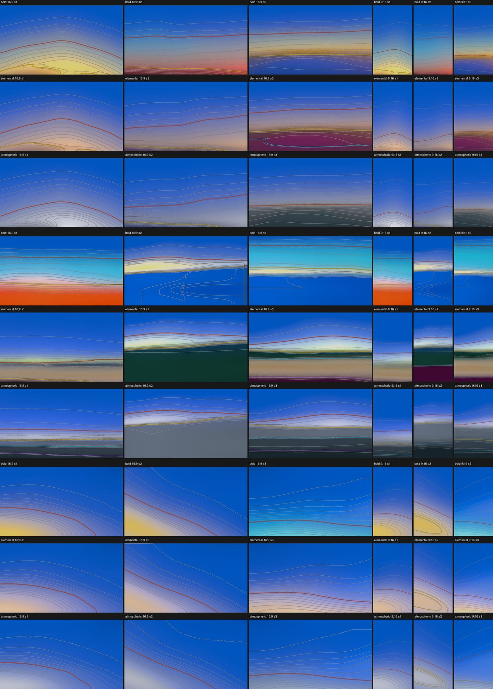

Rows: ramp, bands, blooms, each Bold / Elemental / Atmospheric; columns: 16:9 seeds 1-3, then 9:16 seeds 1-3. Grey lines are the 14 equal-t levels and colored lines each main transition's 50% line. Reference presets, target and render isolines: `results/recipes-refs.jpg`. Full-size sheets: `artifacts/organic-boundaries/recipes/iso-packs-sunset.*.jpg` and `iso-refs-sunset.*.jpg`, frames and `report.json` in the same folder.

What the sheets show:

- **Ramp:** smooth domes over the glow, nearly concentric.
- **Bands:** edges that are almost straight, perfectly parallel in the portraits (spacing CV 0.00-0.02).
- **Blooms:** smooth concentric arcs around the glow, with almost no wander in every portrait (0.04-0.12% H).

### The ramp's warp, checked

The claim was: "every edge moves with the same noise (one `warpNoise` scaled per edge by `uEdgeWarp[j]`), and the warp is 0.01 of the sky scale". `ramp-warp.mjs` renders each composed scene four times with the glow off: warp and drift off, warp only, drift only, both. It then compares the equal-t isolines between the renders.

- **The same noise: confirmed, and it reaches further than the edges.** Edge j sits at `at_j + warp · warpNoise(across) · exp(-|at_j - horizon| / 0.25)`. The same noise also does two more things:
  - When the horizon is below the frame, the shader moves the horizon itself by the full `warp · warpNoise`. The glow, sunlight and horizon dimming are measured from that line, so the whole lower sky moves as one by the full wander. With drift off, the highest and lowest isolines that the warp moves correlate 0.83-1.00 in five of the six frames whose horizon is below the frame. Most of that movement comes from the horizon line, not from the edges' own share. In the sixth frame (Bold seed 2), the sky edge moves only 0.02-0.07% H.
  - In the wave look, `softFollow = 0.45 / noiseSpread` sets the horizon edge's width from the same noise, about ×0.4 to ×2.5. Isolines on either side of that edge move up to 4.5% H in opposite directions.
  - The softness variation (`softNoise`) is also one noise for every edge. The only noise that differs between edges is the drift: `0.16 · width` (0.08 in the wave look), on a 2D noise of position along the edge and the edge's height.
- **0.01 of the sky scale: no longer true.** Compose now asks for a wander of `0.006 · skyScale` (open, corner and arcs looks), measured at 0.65% S on the horizon. The wave look asks for `0.010-0.018 · √haze`. Compose sets `warp = min(0.12, wander / noise spread)`, and the 0.12 cap binds in all three wave frames: they get 0.57% S instead of 1.0-1.8%. The sky edge, 0.44-0.53 S above the horizon, gets `exp(-d / 0.25)` = 0.12-0.17 of the warp: 0.08-0.11% S predicted. On the Bold frames, where the sky edge is clear of the lower sky's light, it measures 0.02-0.31% H. Its visible wander comes from the drift, 0.5-1.1% H.

### What each recipe agent should change

- **sunset.ramp:** move each sky edge with `boundary.ts` (coordinate mode, ramp-mode `v`, share 0.35) instead of the one `warpNoise` plus drift, so the sky edge gets its own 1.2-1.8% S wander instead of about 0.1%. Remove the 0.12 warp cap that holds the wave look at 0.57% S, and vary the wide sky edge's softness along it (min/max is 0.90-0.98 in several frames).
- **sunset.bands:** move every band edge in edge mode, so sky bands get 0.5-2.5% H of wander and ground bands 0.3-1% (now 0.04-0.5%). Give each edge softness that varies along it (min/max 0.5-0.9) and different widths (widest at least 3× the narrowest), and use the 0.03 feather on the riso presets to match the prints' edge wobble.
- **sunset.blooms:** warp each glow's minor-axis coordinate in its own frame with `boundaryWarp` (distance mode, vertical lattice about the minor radius, wander at most a tenth of it) and vary its softness along the arc with `boundarySoftAt`. Today the glow edge is a smooth arc (top component share 0.70, 0.04-0.12% H wander in portraits).

## Files

- `measure.mjs`, `tables.mjs`: Task 1, Sunset measurement, tables and plots. `contour.mjs`: Contour edges.
- `render.mjs <preset> [tag] [--set path=json]`: render a preset at its reference's size and compare boundaries (side-by-side, isolines, isolines alone, 3× zoom, numbers).
- `failures.mjs`, `packs.mjs`, `make-results.mjs`: Tasks 3 and 4, and the committed images.
- `lib/boundary.mjs` (the model), `lib/scene.mjs` (ramp, band and layer recipe), `lib/production.mjs` (pack scenes), `lib/audit.mjs`, `lib/rampcoord.mjs`, `lib/isolines.mjs`, `lib/config.mjs`, `lib/draw.mjs`, plus color, image, blur, noise, output and refs helpers.
- `glsl/boundary.glsl`: the model for the shader.
- `gpu-compare.mjs`: the engine module on the GPU next to the CPU and its previous version (`out/gpu/`, `results/gpu-vs-cpu.jpg`). `lib/engine-scene.mjs`: the production layouts for the engine module, the test ramp in GLSL and on the CPU, and the audit's bump numbers for a line.
- `tools/aspect-probe.mjs`: the bump numbers of every transition in the production layouts, landscape and portrait, from the module's CPU field. `tools/ref-steepness.mjs`: how steep the references' own boundaries get.
- `recipes-audit.mjs`, `recipes-table.mjs`, `ramp-warp.mjs`, `lib/tracked.mjs`: the audit of the current Sunset recipes (`artifacts/organic-boundaries/`, `results/recipes-*.jpg`). `tools/fold-map.mjs` marks where isolines are crossed twice; `tools/crease.mjs` shows abrupt slope changes in a frame's lightness.
- `crest-sheet.mjs`: the silhouette edge's crest term before and now on a long soft transition (`out/crest/`, `results/crest-smooth.jpg`).
- `speed-check.mjs`, `tools/preview-ab.mjs`, `tools/tool-drag.mjs`, `tools/uniform-diff.mjs`, `tools/same-moment-diff.mjs`, `tools/look-copy.mjs`, `tools/capture-params.mjs`, `tools/calib-time.mjs`, `tools/calib-bench.mjs`, `tools/look-profile.mjs`: timing the calibration and comparing two versions of `boundary.ts` (see Speed of the calibration).
- `tools/`: noise bounds and correlation, octave bounds.
- `presets/ref-sunset-*.json`: the six reference presets (`scene.params` holds the recipe fields above).
