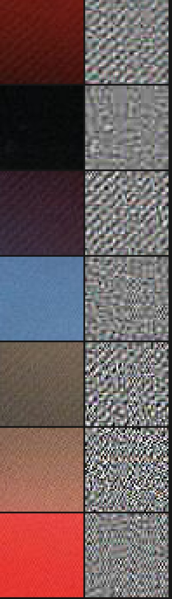
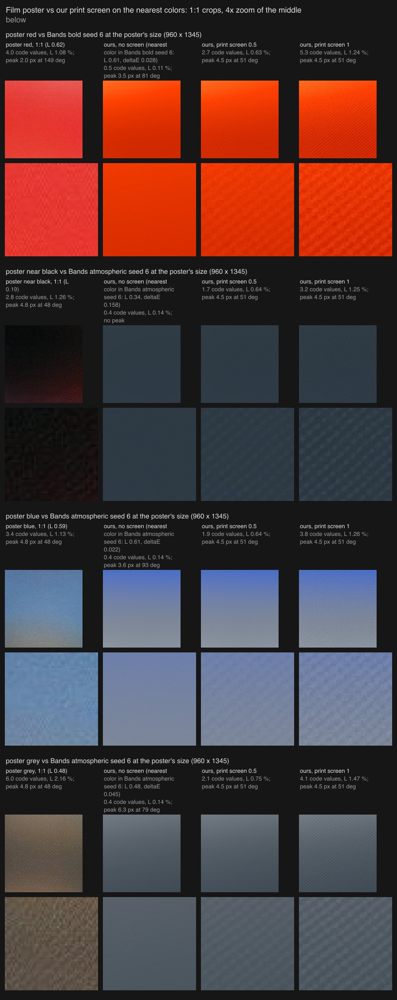
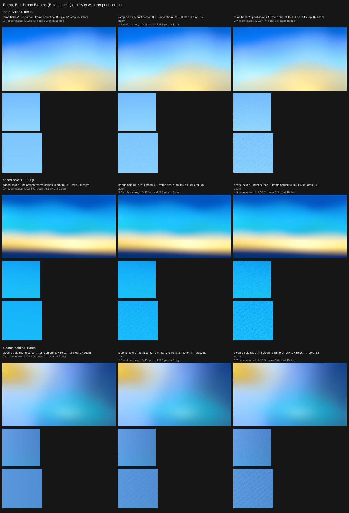
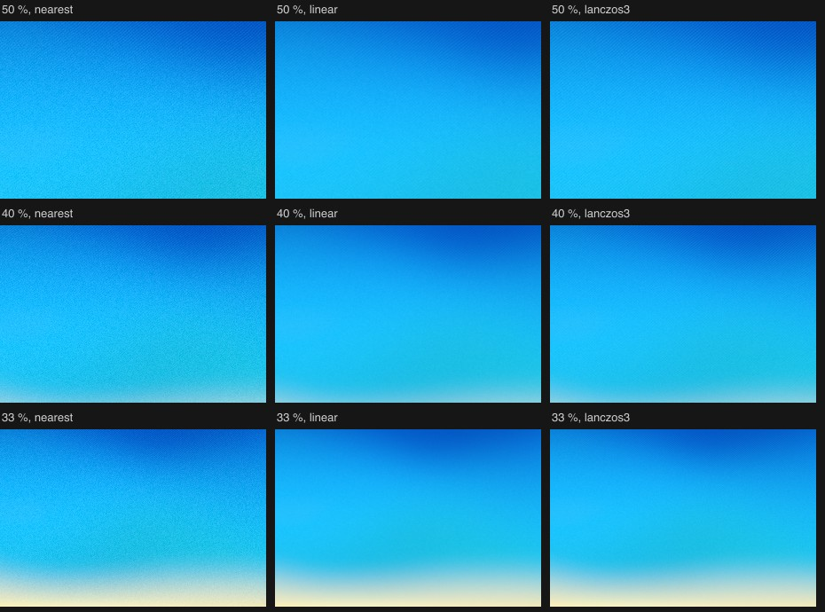

# Print screen

The film poster reference (`sunset-film-poster-bands`, Figma 41:25) has a fine diagonal print screen across the whole poster. No filter makes it: the Grain filter is random, and the poster's texture is ordered. This prototype measures the screen and builds a stage for the output filter chain that makes one in the frame's own ink. Prototype only: nothing here is wired into the engine or the tool.

## The poster's screen, measured at 1:1

`measure.mjs` takes 2D power spectra of 128 x 128 windows in each band of `public/references/awe/sunset/sunset-film-poster-bands-full.png` (960 x 1345), per channel. `bands.mjs` measures the texture strength per band with the grain measurement (`scripts/light/lib/grain.mjs`).

- **One screen, not one per ink.** At every peak, R, G and B have the same amplitude, and their coherence is 1.00. The poster's JPEG kept the screen only in lightness, so what the moodboard shows is a mono screen.
- **Angle and frequency.** The main pattern is 4.5 to 5.1 px across, centred on 4.7 px, which is about 210 cells per 1000 px. Its wave points at 48 to 55° (x right, y down), so the dashes run in rows rising to the right at about 39°. A weaker second direction sits at 3.7 to 3.9 px and 15 to 17°. Relative to the picture, that is about 205 cells across the short side.
- **Dashes, not round dots.** The high-passed crops show short dashes along the rows, irregular in length and spacing, plus JPEG's 8 px blocks.
- **Light to dark ink.** In mid and dark ink (plum, grey, dark red) the dashes dominate. In light ink (the bright red, the blue) a finer two-pixel dot pair at 57° and 147° takes over. The 4.7 px pattern is probably moiré between a finer real screen and the scan's pixels, which is why it changes like this.
- **Strength by band:**

| Band | Oklab L | L std % | Luma std (code values) | Strongest peak (luma, code values) |
| --- | --- | --- | --- | --- |
| near black | 0.18 | 1.26 | 2.8 | 1.5 at 4.96 px, 54° |
| top red | 0.33 | 1.04 | 3.1 | 2.6 at 4.64 px, 47° |
| plum | 0.34 | 1.58 | 4.1 | 2.7 at 4.96 px, 54° |
| grey | 0.43 | 2.01 | 5.5 | 3.2 at 4.96 px, 54° |
| blue | 0.54 | 1.64 | 4.8 | 1.5 at 3.74 px, 15° (1.0 at 2.08 px) |
| warm grey | 0.55 | 1.84 | 5.4 | 1.8 at 5.12 px, 53° |
| red | 0.62 | 1.16 | 4.3 | 1.3 at 2.02 px, 149° |

It is strongest in mid-dark ink (grey, L 0.43) and weaker toward near-black and toward light ink. These totals include the scan's JPEG noise.

## The stage

`lib/screen.mjs` is the CPU reference. `stage.mjs` has the same math in GLSL, in the shape of the engine's `OutputFilter`. It runs after the tone curve on display-linear color, like the Grain stage, and changes Oklab lightness only:

- Ink coverage comes from lightness: 0 at paper white (L 0.97) and 1 at full ink (L 0.12).
- The screen is a halftone of elongated dots ("cross" 0.45, so dashes along the rows): 0.0049 of the short side per cell (4.7 px at 960, 5.3 px at 1080p, 10.6 px at 4K), at a 51° angle.
- A dot's area is its coverage, found from each spot value's rank within its cell. Dots grow from the cell centres in light ink, meet as a checker at half coverage, and become light holes in dark ink.
- Every cell keeps its mean lightness exactly: the stage subtracts the mean of the soft-edged ink over the cell. Hue and chroma stay the frame's own, so there are no new colors and packs never mix.
- Edges are soft (0.3 of coverage). The rows waver (a seeded warp of 0.3 cells over about 6 cells) and dot size varies from dot to dot (0.15), so it doesn't look machine-made.
- 35 % of the swing is fine noise in the same ink, rising to 75 % in light ink, where the poster's texture is finer.
- Paper white and black stay exact: there are no dots below 6 % coverage, and pure black stays 0.
- The pixel is sampled 2 x 2. When a cell is under 3.6 px, as on small thumbnails, the screen fades out, so it never aliases. The seed sets the warp, the jitter and the noise.
- Strength 0..1 scales the swing: 0.058 Oklab L at 1, which is about 1.3 % L of texture in mid-tones.

`gpu-check.mjs` runs the stage in the engine's own output pass, through `buildOutputShader([stage])` on a page in `harness/`, as the Pixel prototype does. On Bands Bold at 1920 x 1080 and at 960 x 1345, GPU and CPU are 0.01 code values apart on average and at most 2, with no channel more than 1 apart. Flat greys keep their mean within 0.06 code values; 0, 245, 250 and 255 come out exact.

## Ours against the poster

`sheets.mjs` screens our own renders only (`render.mjs`: the engine harness, no grain, no dither) and finds, for each poster area, the window of our frames with the closest mean color. The frames are Bands Bold seed 6 and Bands Atmospheric seed 6 at the poster's size. Below, each crop's luma std in code values, its L std, and its strongest peak, measured the same way for both.

| Area | Poster | Ours, no screen | Ours, screen 0.5 | Ours, screen 1 |
| --- | --- | --- | --- | --- |
| red (ours: Bold Orange-red, ΔE 0.028) | 4.0, 1.08 %, 2.0 px at 149° | 0.5, 0.11 % | 2.7, 0.63 %, 4.5 px at 51° | 5.3, 1.24 %, 4.5 px at 51° |
| near black (ours: Atmospheric, ΔE 0.16) | 2.8, 1.26 %, 4.8 px at 48° | 0.4, 0.14 % | 1.7, 0.64 %, 4.5 px at 51° | 3.2, 1.25 %, 4.5 px at 51° |
| blue (ours: Atmospheric, ΔE 0.022) | 3.4, 1.13 %, 4.8 px at 48° | 0.4, 0.14 % | 1.9, 0.64 %, 4.5 px at 51° | 3.8, 1.26 %, 4.5 px at 51° |
| grey (ours: Atmospheric, ΔE 0.045) | 6.0, 2.16 %, 4.8 px at 48° | 0.4, 0.14 % | 2.1, 0.75 %, 4.5 px at 51° | 4.1, 1.47 %, 4.5 px at 51° |

Over a whole screened frame, the poster's spectrum script finds our main peak at 4.74 px (211 per 1000 px) and 51.0°, where the poster's is 4.5 to 5.1 px at 48 to 55°. At strength 1 our texture is 1.2 to 1.5 % L, against the poster's 1.1 to 2.2 % (its grey band is the strongest).

At normal viewing size the screen disappears. In the frames shrunk to 480 px, Ramp, Bands and Blooms look the same with and without it, and every edge stays soft. At 1:1 it shows as fine diagonal dashes.

Moiré check: a viewer that shrinks the image with nearest-neighbour sampling shows a fine cross-hatch at 33 to 50 %. With linear or lanczos shrinking the screen averages away. No coarse moiré bands appear in any case, because the warp, jitter and noise break up the period.

## How it could reach the owner, with no new controls

Two ways:

1. **As Grain's top range** (Grain 1 the riso prints, a print screen above that). This means remapping the slider, for example film to 0.5, riso to 0.8 and the screen at 1. Partway along one slider, random grain would turn into an ordered pattern with a direction. That is a change of kind, which the slider rules forbid for the looks ("never switch a structure"), and it would read the same way here. It would also move the riso match from 1, which round 11 confirmed.
2. **As its own filter option, "Print"**, next to Grain, ASCII and Pixel, one at a time, with the existing strength slider. 0.5 is a light screen (about 0.65 % L, the poster's lighter areas) and 1 is the poster (about 1.3 % L).

**Option 2 reads better.**
- Each filter stays one kind of surface: Grain random, ASCII characters, Pixel LED cells, Print a halftone screen.
- Picking Grain still gives grain.
- Grain 1 stays the riso prints.
- It adds no control: the Filter choice and Strength already exist.

The cost is a fourth entry in the brief's filter list (Grain, ASCII or Pixel), so the owner decides. Wiring it in would take an `output.print` setting, `PRINT_SCREEN_FILTER` (`stage.mjs`, already checked on the GPU) in `OUTPUT_FILTERS`, and `'print'` in the tool's `TOOL_FILTERS`. On Contour it is safe: black stays black, and the dark falloffs get a faint screen, as the poster's near-black has.

## Not done

- Ours is more regular than the poster's. Its peaks are much sharper (thousands of times the background against the poster's 50 to 230 times), because the poster's screen is smeared by moiré and the scan. More warp or noise would close that gap but move it toward grain.
- The poster's weaker second direction (3.8 px at 16°) and the two-pixel dot pair in light red are not copied. Fine noise in light ink stands in for the latter.
- Bands seed 6 in Bold and Atmospheric has nothing as dark as the poster's near-black (nearest L 0.34 against 0.19, ΔE 0.16), so that row compares a darker slate, not black.
- Not profiled in the engine. Per pixel it is 4 samples of two value noises, a hash and two cosines, plus one Oklab round trip.

## Files

- `measure.mjs`: spectra and peaks per band and channel (`--file` for any image), written to `out/`. `bands.mjs`: texture strength per band. `look.mjs`: 8x crops and high-passed crops.
- `lib/screen.mjs`: the stage, CPU reference. `lib/spectrum.mjs`: windowed 2D spectra, peaks, coherence.
- `stage.mjs`: the GLSL and uniforms in the shape of an engine `OutputFilter`.
- `render.mjs`: our input frames through the engine harness. `sheets.mjs`: the sheets and numbers. `moire.mjs`: the shrink check. `gpu-check.mjs` and `harness/`: the stage in the engine's output pass against the CPU reference.
- `results/`: the sheets above.
