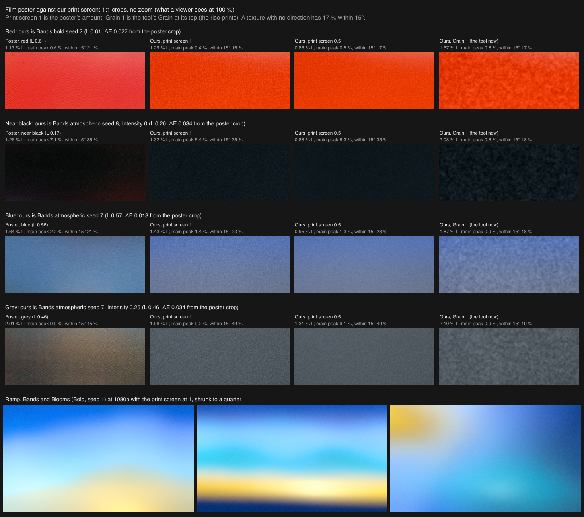

# Print screen

The film poster reference (`sunset-film-poster-bands`, Figma 41:25) has a fine diagonal print screen across the whole poster. No filter makes it: the Grain filter is random, and the poster's texture is ordered. This prototype measures the screen and builds a stage for the output filter chain that makes one in the frame's own ink. Prototype only: nothing here is wired into the engine or the tool.

## The poster's screen, measured at 1:1

`measure.mjs` takes 2D power spectra of 128 x 128 windows in each band of `public/references/awe/sunset/sunset-film-poster-bands-full.png` (960 x 1345), per channel. `bands.mjs` measures the texture strength per band with the grain measurement (`scripts/light/lib/grain.mjs`).

- **One screen, not one per ink.** At every peak, R, G and B have the same amplitude, and their coherence is 1.00. The poster's JPEG kept the screen only in lightness, so what the moodboard shows is a mono screen.
- **Angle and frequency.** The main pattern is 4.5 to 5.1 px across, centred on 4.7 px, which is about 210 cells per 1000 px. Its wave points at 48 to 55° (x right, y down), so the dashes run in rows rising to the right at about 39°. A weaker second direction sits at 3.7 to 3.9 px and 15 to 17°. Relative to the picture, that is about 205 cells across the short side.
- **Dashes, not round dots.** The high-passed crops show short dashes along the rows, irregular in length and spacing, plus JPEG's 8 px blocks.
- **Light to dark ink.** In mid and dark ink (plum, grey, dark red) the dashes dominate. In light ink (the bright red, the blue) a finer two-pixel dot pair at 57° and 147° takes over. The 4.7 px pattern is probably moiré between a finer real screen and the scan's pixels, which is why it changes like this.
- **Strength by band:**

| Band | Oklab L | L std % | Luma std (code values) | Strongest peak (luma, code values) |
| --- | --- | --- | --- | --- |
| near black | 0.18 | 1.26 | 2.8 | 1.5 at 4.96 px, 54° |
| top red | 0.33 | 1.04 | 3.1 | 2.6 at 4.64 px, 47° |
| plum | 0.34 | 1.58 | 4.1 | 2.7 at 4.96 px, 54° |
| grey | 0.43 | 2.01 | 5.5 | 3.2 at 4.96 px, 54° |
| blue | 0.54 | 1.64 | 4.8 | 1.5 at 3.74 px, 15° (1.0 at 2.08 px) |
| warm grey | 0.55 | 1.84 | 5.4 | 1.8 at 5.12 px, 53° |
| red | 0.62 | 1.16 | 4.3 | 1.3 at 2.02 px, 149° |

It is strongest in mid-dark ink (grey, L 0.43) and weaker toward near-black and toward light ink. These totals include the scan's JPEG noise.

- **Direction.** Seen at 1:1 the poster is a fine, even mesh with mottle, not rows. `direction.mjs` measures, per area, the share of the high-pass energy (periods up to 16 px) in the main spectral peak and in the two strongest peaks, and the share of the 3 to 7 px energy within 15° of the main angle (17 % for a texture with no direction). The poster: red 0.6 / 1.3 / 21 %, near black 7.1 / 8.1 / 35 %, blue 2.2 / 2.9 / 21 %, grey 9.9 / 11.5 / 45 %.

## The stage

`lib/screen.mjs` is the CPU reference. `stage.mjs` has the same math in GLSL, in the shape of the engine's `OutputFilter`. It runs after the tone curve on display-linear color, like the Grain stage, and changes Oklab lightness only. Sizes are shares of the short side.

- Ink coverage comes from lightness: 0 at paper white (L 0.97) and 1 at full ink (L 0.12). The dots and the mottle use coverage^1.5, which puts the strongest texture at L 0.43, where the poster's is.
- **A mesh, not rows.** In mid and dark ink the halftone is made of two waves: the poster's 4.7 px at 51° and its weaker 3.8 px at 16° (at 960 px; weight 0.55 against the main wave). Each wave is warped by short seeded noise (0.42 cells over 2.5 cells), so no row lines up for more than a few cells, and each dot's coverage varies from dot to dot (0.2). The mean pitch stays 4.7 px.
- **Fine dots in light ink.** Between L 0.45 and 0.62 the mesh hands over to round two-pixel dots at 57° and 147°, as on the poster's light red and blue. They fade from 2.4 px down and are gone at 1.6 px (at 960 px they are 2.05 px, at 59 %).
- **Mottle.** Part of the swing is broadband mottle in the same ink: value noise at two sizes (1.1 and 2.5 px at 960). It is 68 % of the swing with the mesh and 55 % with the fine dots.
- A dot's area is its coverage, found from each spot value's rank within its cell, and every cell keeps its mean lightness exactly: the stage subtracts the mean of the soft-edged ink over the cell. Hue and chroma stay the frame's own, so there are no new colors and packs never mix.
- Paper white and black stay exact: the screen fades out within 6 % of paper white and of full ink, and the pixel is left as it is there.
- The pixel is sampled 2 x 2. On frames under about 735 px on the short side the whole screen fades out (gone at 450 px), so thumbnails don't alias. The seed sets the warps, the jitter and the mottle.
- **Strength sets the amount only, as Grain's does** (5f42419): the swing is 0.0977 Oklab L x strength^0.6, so 1 is the poster and 0.5 is two thirds of it. The character is the same at every setting.

`gpu-check.mjs` runs the stage in the engine's own output pass, through `buildOutputShader([stage])` on a page in `harness/`, as the Pixel prototype does, and times it:

- On Bands Bold at 1920 x 1080 and at 960 x 1345, GPU and CPU are 0.01 code values apart on average and at most 1.
- Flat greys keep their mean within 0.05 code values; 0 and 255 come out exact, and 245 and 250 only get the dither.
- GPU time of the output pass (timer query, median of 9, Bands Bold): with no filter 0.35 ms at 1080p and 0.7 ms at 4K; the print screen adds 2.6 ms at 1080p and 6 to 10 ms at 4K (the machine was shared, and runs differed); Grain 1 adds 5.4 ms and 13 to 16 ms. The screen costs about half as much as Grain.

## Ours against the poster

`render.mjs` renders our frames through the engine harness, without grain or dither, plus the same frames with the tool's Grain at 1. For each of the poster's areas, the frames are the ones with the even area nearest in color, found over Ramp, Bands and Blooms, three packs, seeds 1 to 8 and Intensity 0, 0.25 and 0.5: Bands Bold seed 2 for the red (ΔE 0.027), Bands Atmospheric seed 8 at Intensity 0 for the near-black (L 0.20 against 0.17, ΔE 0.034), Bands Atmospheric seed 7 for the blue (ΔE 0.018) and at Intensity 0.25 for the grey (ΔE 0.034). Matching counts the window's own spread of lightness as distance, so a dark window with a bright edge in it doesn't pass for an even one.

`strength.mjs` and `direction.mjs` measure the poster's band and 384 x 256 px of ours around the matched window the same way: strength as the grain measurement's high-pass RMS (`scripts/light/lib/grain.mjs`), and direction as above. At strength 1:

| Area | Strength, % L (poster / ours) | Main peak | Both peaks | Within 15° |
| --- | --- | --- | --- | --- |
| red | 1.17 / 1.29 | 0.6 / 0.4 % | 1.3 / 0.9 % | 21 / 16 % |
| near black | 1.26 / 1.32 | 7.1 / 5.4 % | 8.1 / 7.6 % | 35 / 35 % |
| blue | 1.64 / 1.43 | 2.2 / 1.4 % | 2.9 / 1.8 % | 21 / 23 % |
| grey | 2.01 / 1.98 | 9.9 / 9.2 % | 11.5 / 10.7 % | 45 / 49 % |

The amplitude, 0.0977, is the one at which the geometric mean of poster over ours is 1 over the four areas. Ours is within 13 % of the poster's strength in each area. The screen before this one had rows: its main peak held 42 to 52 % of the energy and 55 to 80 % lay within 15°. The tool's Grain at 1 has no direction at all in the same areas (main peak 0.8 to 0.9 %, 17 to 19 % within 15°) and coarser grains.

At 1:1 the print screen reads as the same kind of texture as the poster: a fine, even mesh with mottle and a slight diagonal, no rows. Grain 1 is a different kind: random blotches a few times larger. At normal viewing size the screen disappears; the full frames shrunk to a quarter look as they do without it, with every edge soft.

Moiré check (`moire.mjs`): shrunk to 50, 40 and 33 % with nearest-neighbour sampling the screen turns into fine noise; with linear or lanczos it averages away. No coarse moiré bands appear.

## How it could reach the owner, with no new controls

No Grain setting looks like the poster: Grain is random and coarser at every strength, and since 5f42419 its strength only sets the amount. So the print screen can't be a Grain preset. The two ways:

1. **Its own filter option, "Print"**, next to Grain, ASCII and Pixel, one at a time, with the existing strength slider, which keeps Grain's meaning (the amount only, strength^0.6, 1 is the poster). Wiring it in would take: an `output.print` setting and `'print'` in `FilterKey` (`src/light/scene.ts`, `src/light/engine/filters/types.ts`); the stage as `src/light/engine/filters/print.ts` (from `stage.mjs` and the per-frame values in `lib/screen.mjs`) in `OUTPUT_FILTERS`; `'print'` in the tool's `TOOL_FILTERS` and the file name tag; and tests that the mean is kept, black and white stay exact and GPU matches CPU.
2. **Grain's character changed to the print screen.** Grain 1 would stop being the riso prints, which round 11 confirmed, and every look's grain would gain a direction.

**Option 1 is better.** Each filter stays one kind of surface (Grain random, ASCII characters, Pixel LED cells, Print a halftone screen), picking Grain still gives the riso grain, and no control is added. The cost is a fourth entry in the brief's filter list (Grain, ASCII or Pixel), so the owner decides. On Contour it is safe: black stays black, and dark falloffs get a faint screen, as the poster's near-black has.

## Not done

- Light ink is a little less directional than the poster's (blue's main peak 1.4 % against 2.2 %), and red a little stronger (1.29 % against 1.17 %). On the poster, the red and the blue at nearly the same lightness differ by 40 % in strength. The stage works on lightness only, so it can't follow that.
- The Bands frames were rendered with another agent's uncommitted Bands edits in the tree. Only their colors matter here, but a re-render can pick different windows.

## Files

- `measure.mjs`: spectra and peaks per band and channel (`--file` for any image), written to `out/`. `bands.mjs`: texture strength per band. `look.mjs`: 8x crops and high-passed crops.
- `lib/screen.mjs`: the stage, CPU reference. `lib/spectrum.mjs`: windowed 2D spectra, peaks, coherence, direction. `lib/areas.mjs`: the poster's four areas and the matching of our frames.
- `stage.mjs`: the GLSL and uniforms in the shape of an engine `OutputFilter`.
- `render.mjs`: our input frames through the engine harness. `strength.mjs` and `direction.mjs`: the numbers above. `sheets.mjs`: the sheet. `moire.mjs`: the shrink check. `gpu-check.mjs` and `harness/`: the stage in the engine's output pass against the CPU reference, levels and timing.
- `results/`: the sheets above.
