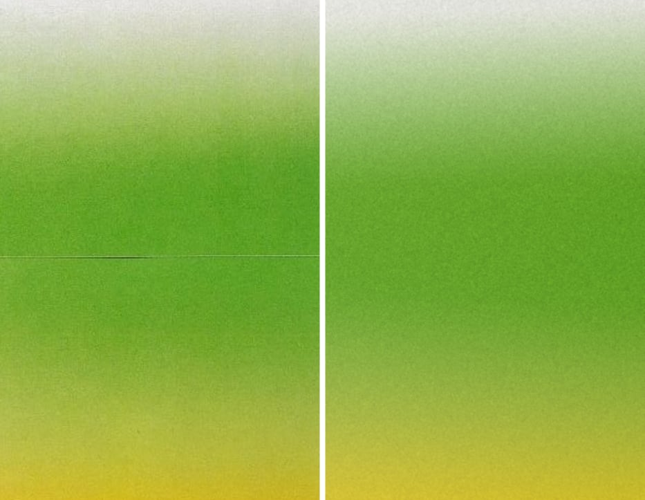
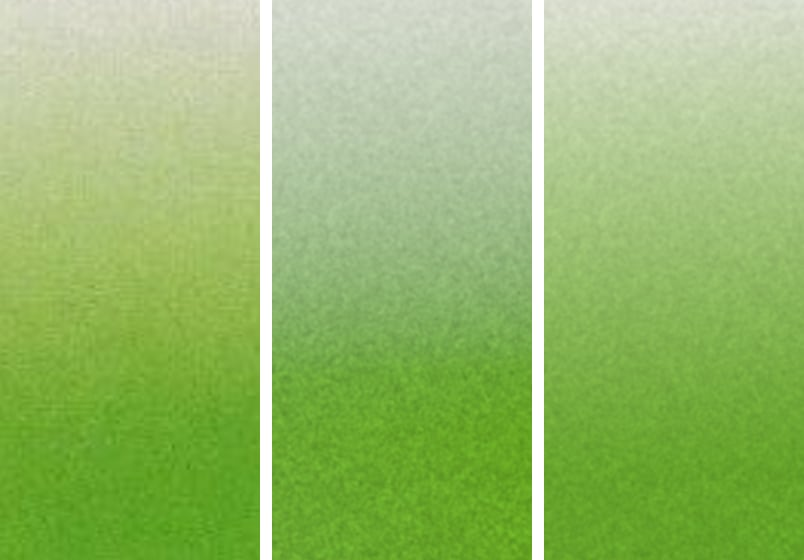
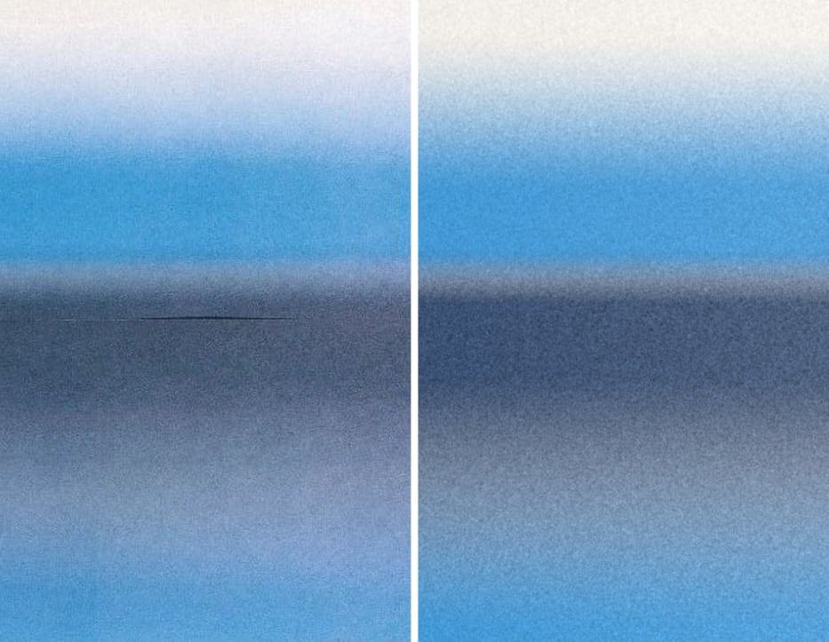
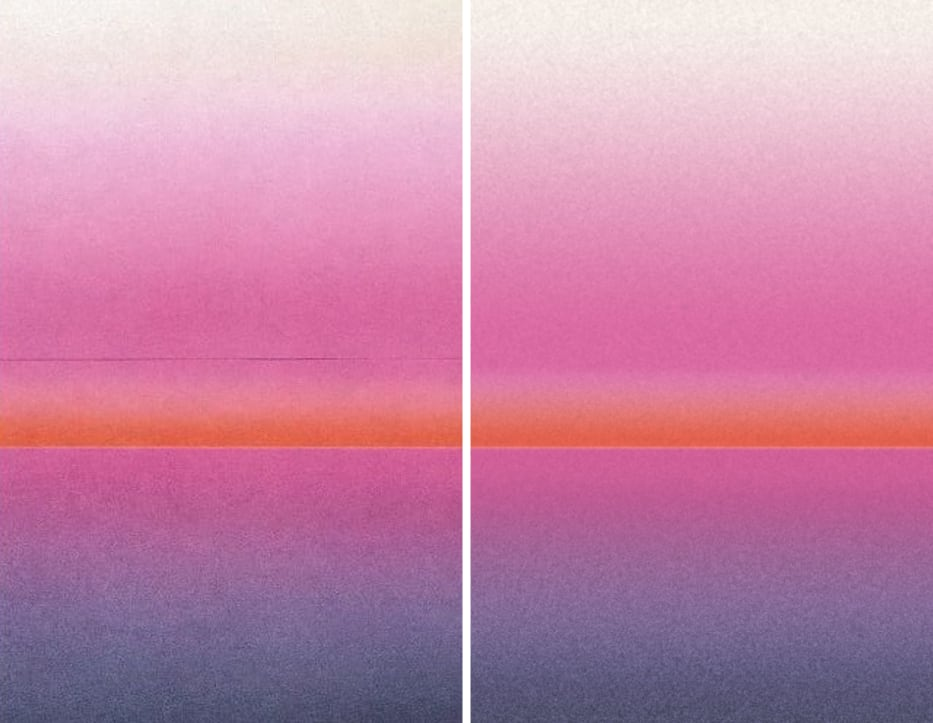
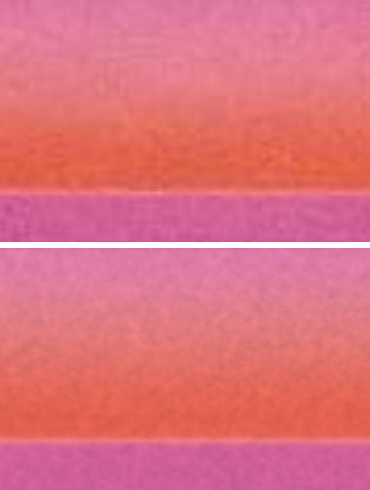
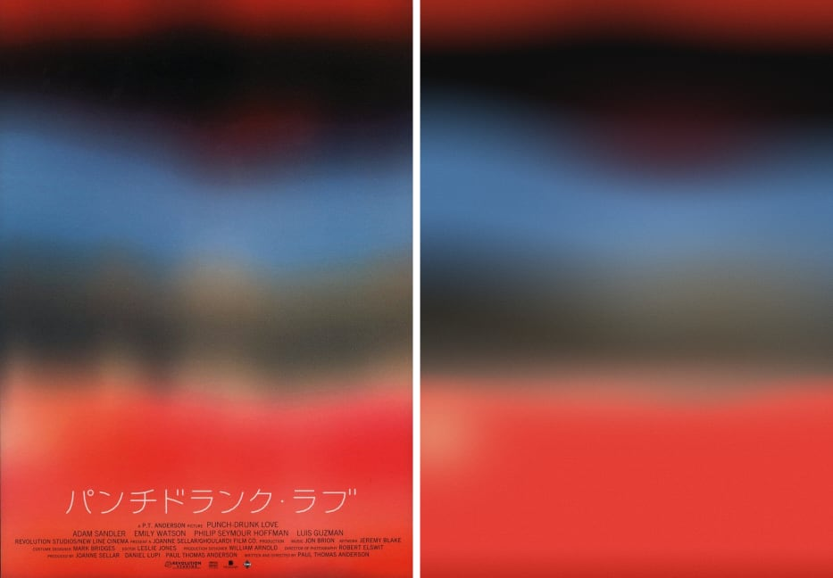
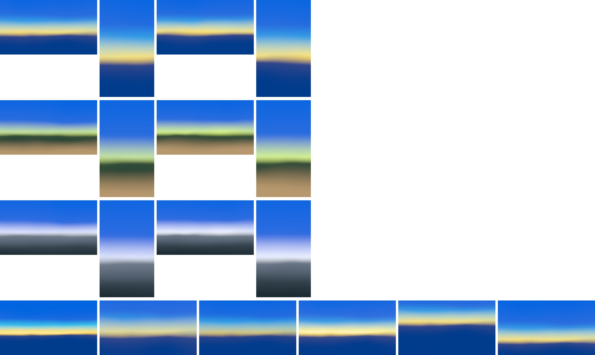

# sunset-bands-riso

CPU prototype of the deck's second Sunset technique, "three to five stacked bands in pack order blurred hard", fitted to `sunset-green-riso`, `sunset-blue-riso`, `sunset-pink-riso` and `sunset-film-poster-bands`, plus a pack-based production recipe for the generality check.

Run from this folder (Node 24, `sharp` from the repo):

```sh
node render.mjs presets/ref-sunset-pink-riso.json final   # render + compare; writes out/<id>/<tag>/
node general.mjs                                          # pack renders at 16:9 and 9:16, seeds 1 and 2
node tools/variants.mjs                                   # light-only variants for the comparison below
node make-results.mjs                                     # rebuilds results/*.jpg from out/
```

`render.mjs` writes `side.png` (reference | render), `side-half.png`, `zoom.png` (3× crop), `profile.png` (Oklab row means, reference dark, render light), `errmap.png` (blurred ΔE map, red = render lighter) and prints the metrics. Targets come from `public/references/awe/` with the manifest's ignore rects.

## Summary

Blurred ΔE is Oklab ΔE × 100 after a σ = 6 px masked blur, mean and 90th percentile over the frame. "Light only" is the same band structure refitted with linear-light mixing (n = 1) and translucent layers over the base.

| Reference | Final model | Blurred ΔE mean / p90 | Light only (n = 1) | Result |
| --- | --- | --- | --- | --- |
| sunset-green-riso | 2 inks, multiply, n = 3.7, box edges | 0.93 / 1.55 | 1.68 / 3.29 | `results/green-riso.jpg` |
| sunset-blue-riso | 3 inks, multiply, n = 1.6, disk edges | 1.25 / 2.00 | 1.42 / 2.40 | `results/blue-riso.jpg` |
| sunset-pink-riso | 4 inks + violet bridge + seam line, n = 4.3, disk edges | 1.02 / 1.68 | 1.21 / 2.06 | `results/pink-riso.jpg`, `results/pink-horizon-3x.jpg` |
| sunset-film-poster-bands | 5 bands + lumps + 4 blooms, over, n = 2, disk edges | 1.68 / 3.07 | 1.84 / 3.23 (additive: 2.28 / 4.02) | `results/poster.jpg` |

Main findings:

1. **The blur is a lens defocus disk, not a sum of gaussians.** On all eight broad edges I measured, a disk edge fits 2-7× better than the core-plus-tail gaussian sum, and better than a single gaussian at each edge's best mixing exponent. A box with rounded corners (a nearly linear ramp) ties with the disk on the riso ramps. A sum of centered gaussians is always peakier than one gaussian, and these edges come from a flat-topped blur, so no choice of radii or weights can fix it. The gaussian sum is still the right shape for thin bright lines.
2. **Rothko-style "over" beats additive.** When adjacent band edges meet, additive and over give identical images at n = 1. Where they differ (the poster), over wins (1.84 vs 2.28) and additive needed implausible colors, because added light can't make a patch darker than what is under it.
3. **Two of the three riso prints need an ink-like mixing step; the third doesn't.** The green and pink ramps have mid-tones that no linear-light mix of paper and ink can reach. The blue ramp is linear light. One parameter, the Yule-Nielsen exponent `mixN`, covers all three. Details and how to ship it as a look are under "The ink question".
4. **Where two inks cross, some paper shows.** In every riso crossover the inks meet with complementary edges, so about a quarter of the bare paper shows at the midpoint. That gives a lighter, greyer bridge, which is the brief's light rule. Gaps between the inks are far too light, and overprints are far too dark.
5. **The pink's thin orange band** is a band with a disk-shaped soft top (10-90% ≈ 90 px) and a nearly hard bottom (disk radius 2.6 px, 10-90% ≈ 4 px), with a 4 px light seam on the hard edge. A one-sided glow tail fits 2.6× worse.

## The model

Coordinates: `v = y / H` (0 at the top), `u = x / H`, so positions and softness are in frame heights and keep their meaning at any aspect ratio.

**Band coverage.** Each band has a top edge `T`, a bottom edge `B` and its own softness above and below (`sUp`, `sDown`):

```
p(v) = max(0, E((v - T) / sUp) - E((v - B) / sDown))
```

`E` is the blurred step for the chosen kernel shape:

- `disk` (default): the share of a unit disk below a line at distance t, `E(t) = 1/2 + (t·sqrt(1 - t²) + asin t) / π` for |t| < 1. This is a defocused lens. Optional softening `soft` (3-tap Gauss-Hermite: offsets 0, ±√3·soft, weights 2/3, 1/6, 1/6) and an optional wide haze, `E' = (1 - haze)·E + haze·Φ(t / hazeRadius)`.
- `box`: linear ramp, `E(t) = (t + 1) / 2` clamped, same softening options.
- `gauss`: `E(t) = Σ w_k Φ(t / r_k)`, the sum of gaussian radii.

Profiles other than a band:

- `line`: a thin bright line, `p = Σ w_k exp(-d² / (2 (s r_k)²))` around the band center, with `s = sUp` above and `sDown` below. Sharp core, long tail.
- `glow` (tested, not used): a one-sided tail `Σ w_k exp(-(B - v) / (sUp r_k))` above `B`, cut below `B`.

**Variation along x** (per band, computed once per column): edge shift `= warp.amp · fbm1(u / warp.scale) + tilt·(u - u_mid) + Σ lumps`. The bottom edge can also move on its own (`tiltDown`, `lump.shiftDown`). Softness `× (1 + softVar · fbm1)`. Coverage gain `× (1 + gainTilt·(u - u_mid)) · Π(1 + lump.gain·g)`. Light `× Π(1 + lump.bright·g)`, where `g = exp(-(u - lump.u)² / (2 width²))`.

**Combine**, per pixel, bands in order, in mixing space `x = L^(1/n)`:

```
add:      x += a · E                        (light adds; n must be 1)
over:     x += a · (E - x)                  (translucent light layer over what is below)
multiply: x *= 1 - a + a · E / base         (ink: passes E/base of what is below)
L = x^n
```

`a = min(1, p · gain · opacity)`, `E` is the band color × intensity, raised to `1/n`. With `n = 1` this is plain linear light. With `n > 1` it is the Yule-Nielsen print model: partial coverage gives more saturated mid-tones than a linear mix. Blooms are elliptical gaussians combined the same way.

**Ink grain** (riso presets): each band's coverage gets `a += grain · noise · (a + grainMid · 4a(1 - a))`, read from one shared blurred-noise field at a per-band offset. Solid ink can only lose coverage, which shows as light pinholes. Half-covered areas get screening noise. Light tints barely change. The grained stack is composited next to the clean one and only its luminance is kept, because all four references have lightness-only grain (channels correlate 0.93-1.00).

**Output stage**: linear radiance → tone curve (max channel ≤ 1 unchanged; brighter colors keep their hue direction and blend toward white, `t = 1 - exp(-k (m - 1))`, with `k = Y0 / (1 - Y0)` so luminance has no kink at the knee) → surface texture → exact piecewise sRGB encode → ±1 LSB triangular dither → 8-bit.

- **Riso surface** (`risoGrainLinear`), applied to linear light before encode: paper texture `L *= 1 + tooth · n1`. Because it multiplies, it is weaker under ink, as measured (the yellow is smoother than bare paper). An optional ink term `L += ink · Y_paper · c^p · n2` with `c = 1 - Y / Y_paper` is for images without inks.
- **Print screen** (`screenTexture`, poster only), added after encode: line gratings `amp · drive · sin(2π k·x + wobble · fbm2(x / 8 px))` plus fine noise. `drive` is `4c(1 - c)` (mid coverage), or the same times `max(0, 1 - 2.5 chroma)` for the black-ink screen.

## Parameters

Scene (`scene.params`):

| Name | Meaning | Range |
| --- | --- | --- |
| `mode` | default combine for bands: `over`, `multiply`, `add` | |
| `mixN` | mixing exponent: 1 = linear light, higher = ink on paper | 1-6 (refs: 1.6-4.3) |
| `base` | color under all bands (sky or paper) | pack color |
| `kernel` | `{shape: disk\|box\|gauss, soft, haze, hazeRadius, radii, weights}` | soft 0-0.3, haze 0-0.3 |
| `light` | `{x, y}` linear lighting gradient across the frame (the photographed prints) | ±0.3 |
| `grainSize`, `grainMid` | ink-grain noise size (px) and mid-coverage boost | 1-2 px, 0-1.5 |

Band (`scene.params.bands[]`):

| Name | Meaning | Range |
| --- | --- | --- |
| `color` | index into `colors` or hex | |
| `top`, `bottom` (or `center`, `height`) | edge positions in frame heights | -1 to 2 |
| `softUp`, `softDown` | blur radius of each edge in frame heights | 0.002-0.3 |
| `intensity`, `opacity` | light multiplier; coverage for over/multiply | 0-2, 0-1 |
| `op`, `profile`, `kernel` | per-band overrides | |
| `tilt`, `tiltDown`, `gainTilt` | linear change across x of both edges, the bottom edge, coverage | ±0.3 per frame height |
| `warp` | `{amp, scale, softVar, gainVar}` low-frequency noise along x | amp 0-0.03, scale 0.3-1.5 |
| `lumps[]` | `{u, width, shift, shiftDown, gain, bright, soft}` gaussian bumps along x | width 0.05-0.3 |
| `grain` | ink coverage noise | 0-0.06 |

Blooms (`scene.params.blooms[]`): `color, u, v, rx, ry, opacity` (or `intensity` for add).

Output (`scene.output`): `exposure`, `grain: {type: 'riso', tooth, size, ink, p, paper}` or `{type: 'screen', gratings: [{period, angle, amp, drive, wobble}], noise, noiseSize, noiseDrive, wobbleScale}`, `dither`.

Production recipe (`model/recipe.mjs`, `sunsetBandsScene`): `pack`, `seed`, `softness` 0-1 (edge radius 0.06-0.26 H), `intensity` 0-1 (glow light 0.85-1.6, brighter rolls toward white), `horizon` 0-1 (clamped to 0.3-0.8).

## Results per reference

Each image is reference | render at half size.

### sunset-green-riso: close match (0.93 / 1.55)



Paper → green ink ramp → green plateau → crossover into mustard. Matches: the ramp position and shape, the yellow-green mid-ramp, the plateau, the lighter chalky crossover into mustard, the left-right ink unevenness (`gainTilt`, edge tilts), and grain amount and size within 10-25% per scale band. Differences: the mid-ramp is still about 1 ΔE greener than the reference (no two-color law reaches its extra red, which may be the photo's color processing), and the reference's JPEG block texture isn't copied. 17 rounds.



Mid-ramp crop: reference | light only (n = 1) | final (n = 3.7). Linear light turns the ramp grey-green.

### sunset-blue-riso: good match (1.25 / 2.00)



Paper → cyan ink, cyan plateau, cyan → navy crossing with a lighter grey-blue step, navy band, a long navy fade through lavender-grey, cyan at the bottom. Matches: positions, softness, both lighter crossovers, the navy, the left-right density change, and grain in every region (it is strongest in the navy, about 5 units). Differences: the lower lavender bridge is about 1 ΔE less blue, and the very bottom rows are slightly off. This print mixes almost linearly (n = 1.6); light only is nearly as good (1.42). 17 rounds.

### sunset-pink-riso: close match (1.02 / 1.68)





Horizon at 3×, reference above, render below. Cream → pink ramp, pink plateau, the lighter salmon bridge where the pink fades and the orange comes in, the orange band with its soft top and hard bottom, the 4 px light seam on the edge, then magenta → violet → slate. All of it matches within about 1 ΔE per segment. The magenta → slate crossing needed a translucent violet bridge layer (`#A57AD0`, over, 48%). Pink over slate multiplied (ink logic) is far too dark, and a two-color mix turns plum. The reference notes reach the same conclusion. The seam is a thin `line` layer (sum of gaussians, 77% over), not a paper gap: a gap loses chroma and reads white. Grain is light in the pinks and stronger in the slate, as in the print. 19 rounds.

Orange band profile, rms ΔE over rows 700-910 after refitting each shape: disk-edged band 0.78, gaussian-sum band 1.40, one-sided glow tail 2.04.

### sunset-film-poster-bands: partial match (1.68 / 3.07)



Red top (darker and lower in the middle), black, plum blob, blue (lighter in the middle, higher on the left), steel grey with a warm patch, olive (dark on the left), tan bridge into the red, coral glow at the left edge, darker red at the bottom. The band structure, edge waves and colors match. What doesn't: the photo's local vertical patches in the grey and olive area (±3-5 ΔE in places) and the streaky tan-pink highlights in the red rise. Five bands with lumps and four blooms are about the limit of this model for a 2D photo. The print screen texture matches orientation, period and strength in the dark and grey areas (a hatch rising to the right at about 40°, 4.5 px apart). In the red it is a 4 px row pattern where the reference has a checker; at about 1% of 255 the difference is barely visible. 11 rounds.

## The ink question

**Does the light model need a subtractive step?** For `sunset-green-riso` and `sunset-pink-riso`, yes. For `sunset-blue-riso`, hardly.

Why: I fitted each single-ink ramp row by row as a mix of its two end colors under several laws (`tools/mixlaw.mjs`, `tools/edgefit.mjs`). Mean ΔE per row with the best mix amount:

| Ramp | Linear light | Ink density (Beer-Lambert) | sRGB values | Best Yule-Nielsen n |
| --- | --- | --- | --- | --- |
| green: paper → green | 2.12 (max 4.6) | 1.08 | 0.92 | n = 4: 0.71 |
| pink: paper → pink | 1.25 (max 2.7) | 0.62 | 0.88 | n = 6: 0.72 |
| blue: paper → cyan | 0.75 | 1.27 | 0.89 | n = 1.5: 0.74 |

In the green, the reference mid-ramp is `#B6C88B`, while the linear-light mix at the same lightness is `#B3C7A6`: the blue channel falls faster than red and green. Light mixing can't do that, because a linear mix moves all channels in proportion. Ink on paper can: light scatters sideways in the paper under the ink dots (the Yule-Nielsen effect), so partial coverage absorbs more than its area share. The more strongly absorbed channels drop first and mid-tones come out more saturated. The poster prefers n ≈ 2, which fits a print of a photo that was blurred in gamma-encoded RGB.

**How it becomes an output look, not part of the light model.** The light structure (positions, edges, warps, lumps) is the same for both. Only the rule for combining overlapping layers changes. In the shader that is one uniform, `u_mixN`: composite the band colors in `L^(1/n)` space and raise the result to `n`. With `n = 1` it is the light model. A "Print" look is:

1. `u_mixN` = 2-4 and the `multiply` operator for layers that overprint,
2. the riso surface filter (paper texture plus lightness-only ink grain) at output size.

It can't be an exact post-process on the finished image. To turn a straight-line light mix into the ink curve you need to know which ink each pixel contains and how much, and the final image doesn't say. A per-pixel approximation does exist: treat each pixel as one ink over the base, extend the line from the base color through the pixel to the edge of the gamut, and re-mix along it with Yule-Nielsen. It is only right for one ink over the base. I recommend the composite-space uniform. Note that this look mixes close to gamma space, which the light rules forbid for the light model, so it should stay an explicit look and never be the default.

## Edge shape measurements

`tools/edgefit.mjs` converts each transition into a coverage profile under its best mixing law, then fits each kernel shape by position and radius. Rms coverage error:

| Edge | n | Disk | Box, rounded | One gaussian | Gaussian sum (0.45/1/2.2) |
| --- | --- | --- | --- | --- | --- |
| green: paper → green | 4 | 0.0154 | 0.0154 | 0.0267 | 0.0443 |
| green: green → mustard | 1 | 0.0144 | 0.0181 | 0.0211 | 0.0357 |
| blue: paper → cyan | 1 | 0.0137 | 0.0129 | 0.0248 | 0.0440 |
| pink: paper → pink | 1 | 0.0163 | 0.0191 | 0.0205 | 0.0357 |
| poster: red → black | 4 | 0.0124 | 0.0150 | 0.0158 | 0.0338 |
| poster: black → blue | 2.5 | 0.0058 | 0.0072 | 0.0210 | 0.0396 |
| poster: blue → grey | 1 | 0.0125 | 0.0139 | 0.0215 | 0.0387 |
| poster: grey → red | 6 | 0.0098 | 0.0135 | 0.0169 | 0.0356 |

The fitted disk radius is the same on both green edges (292 px, 0.2 of the frame height): one blur for the whole print.

## Grain and texture

- **Riso:** lightness only, correlation 0.86 at 1 px and 0.57 at 2 px (blurred noise, σ ≈ 1.3 px at 925 px wide; the reference notes trace it to a scan enlarged 2.9×). Paper texture is a multiplicative 3% (σ 1.9 px). Ink grain depends on the ink: green 5.3%, cyan 4-5%, navy 3%, slate 5.5%, pink 1.5%, orange 2.2%, yellow 0. In 8-bit units it ranges from about 1.6 (yellow, paper) to 5.4 (navy, slate). Matched per region and in four scale bands (0.5-1, 1-2, 2-4, 4-8 px) within about 10-25%.
- **Strongest at mid coverage:** crossover zones are grainier than solids, so the ink noise has a mid-coverage term (`grainMid` 0.4-0.8).
- **Poster:** a print screen, not grain. A black-ink grating (period 4.55 px, wave direction 49°) shows in greys and near-blacks, strongest around 60% coverage. A fainter 4 px pattern appears in the blue and red, plus fine noise. Std 2-4 units, in line with the reference.
- I did not copy JPEG blocks.

## What I tried that failed

- **Gaussian-sum edges on broad transitions:** rms coverage error 2-7× worse than a disk on all eight edges (for example blue ramp 0.044 vs 0.014; poster black → blue 0.040 vs 0.006). They give a sharp middle and long tails where the prints have linear-looking ramps with rounded ends.
- **Pure linear light on the green and pink ramps:** grey mid-ramps (ΔE up to 4.6 in the green).
- **Additive bands:** identical to over when edges meet. On the poster it is worse and can't darken a patch.
- **Gaps between inks** (blue riso round 1): blurred ΔE 7.8; the inks must meet.
- **Paper gap for the pink seam:** a white, desaturated line. Replaced with a thin light line.
- **Pink × slate overprint, or "over" in n = 6 space, for the bottom of the pink:** too dark (L −0.03 to −0.08). A violet bridge layer fixed it.
- **One-sided exponential glow for the orange band:** 2.6× worse than the disk-edged band.
- **Colored ink grain:** visible pink/blue mottling. Fixed by keeping only the luminance of the grained stack.
- **Ink-grain noise too coarse** (σ 1.9 px): matched the high-pass numbers but looked blotchy at half size. The four-band energy measure caught it.
- **Hand tuning multi-ink crossovers stalled,** so I wrote an offline coordinate search (`tools/fit1d.mjs`, one column or 8-10 strips). It only makes presets; nothing is fitted at render time.

## Cost

Everything in the band model is per-pixel math in one pass. Edge positions depend only on x (computed per column here; in GLSL per pixel).

- Per band: 2 edge evaluations (disk: 1 `asin`, 1 `sqrt`; ×3 if `soft` > 0), 3-octave 1D value noise for warp and soft, about 1 `exp` per lump, 1 combine (3 `pow` when `mixN` ≠ 1).
- Per pixel: base, ≤ 6 bands, ≤ 4 blooms, 3 `pow` at the end. With ink grain the composite runs twice (clean and grained), plus 1 noise-texture fetch per band.
- About 150-300 ALU operations per pixel for 6 bands. At 3840×2160 that is roughly 1-3 ms on an integrated GPU (an estimate, not measured).
- CPU (Node, one thread): 925×1447 in 0.3-0.8 s.
- Output pass: tone curve, encode, grain (a precomputed blurred-noise texture at output size or a 5×5 hash sum), dither. The print screen adds about 20 operations per pixel.
- No blur passes are needed. Bands are straight in y and the warp is low frequency, so the analytic edge is close to blurring a warped sharp band, as long as the warp's wavelength is several times the edge radius.

## Recommendation for the GLSL recipe (`sunset.bands`)

One full-screen fragment pass, analytic, then the shared output pass.

Uniforms:

- `u_bandCount` (≤ 6), and per band: `top, bottom, softUp, softDown, color (linear), intensity, opacity, op, profile, warpAmp, warpScale, softVar, seed`. Lumps are optional, ≤ 4 per band: `u, width, shift, shiftDown, gain, bright`.
- `u_kernel`: disk with `soft` and `haze` as the default. Gaussian sum only for `line` profiles.
- `u_mixN`: 1 for production. 2-4 for a Print look.
- `u_base`: the first pack color (Meta Blue sky).
- Blooms (≤ 4): `u, v, rx, ry, color, opacity`.
- Output: `u_exposure`, grain filter and strength, dither.

Band layout from the pack (`model/recipe.mjs`):

- Pack order, Meta Blue on top as the sky, at most one warm color (the first; Oklab hue ≤ 110° or ≥ 330°).
- The brightest color after the sky is the horizon glow: a thin layer with a soft top.
- Later colors fill below the horizon. If there are none, use the sky color at 35% light.
- Every band is a layer from its top edge down; the next band paints over it, so crossovers mix two colors and never show the sky underneath.
- The horizon edge gets warp 0.018 H and 40% softness variation.

User controls:

- **Softness** → one multiplier on all `softUp` / `softDown` (edge radius 0.06-0.26 H).
- **Intensity** → light of the glow band (0.85-1.6). Above 1 it rolls toward white through the tone curve.
- **Mood control for Sunset: Horizon** → horizon height (0.3-0.8 of the frame).
- The seed sets the warp noise and ±20% jitter of band heights and the horizon.



Generality check, one row per pack: Bold, Elemental, Atmospheric; each row is 16:9 seed 1, 9:16 seed 1, 16:9 seed 2, 9:16 seed 2. Bottom row: softness 0.1 and 0.9, intensity 0 and 1, horizon 0.42 and 0.75 (Bold). All are linear light (n = 1) with disk edges and 1.2% paper-style grain.

- **Bold:** blue sky, cyan, a gold glow on a warped horizon, dark blue below.
- **Elemental:** sky, lime glow, forest, tan.
- **Atmospheric:** sky, ice haze, steel, slate, near-black.

Crossovers stay clean (yellow → blue passes through a pale cream, never a dark mud) and no image has a ruler-straight horizon. Seed changes are modest (warp shape, ±20% heights), so a production version may want a wider seed range.

## Notes for other agents

- Manifest ignore rects are used as given. My own fold rects (now unused) were 2-8 px narrower.
- The poster's last ~25 rows darken to `#C22A1F`. I first took that for a scan edge, but the reference notes call it real, so it is modeled as a fifth band.
- The reference notes list the poster's halftone hatch under "ignore". I matched it anyway because my task asked for it. It is a separate output texture (`output.grain.type = 'screen'`) and can be switched off.
