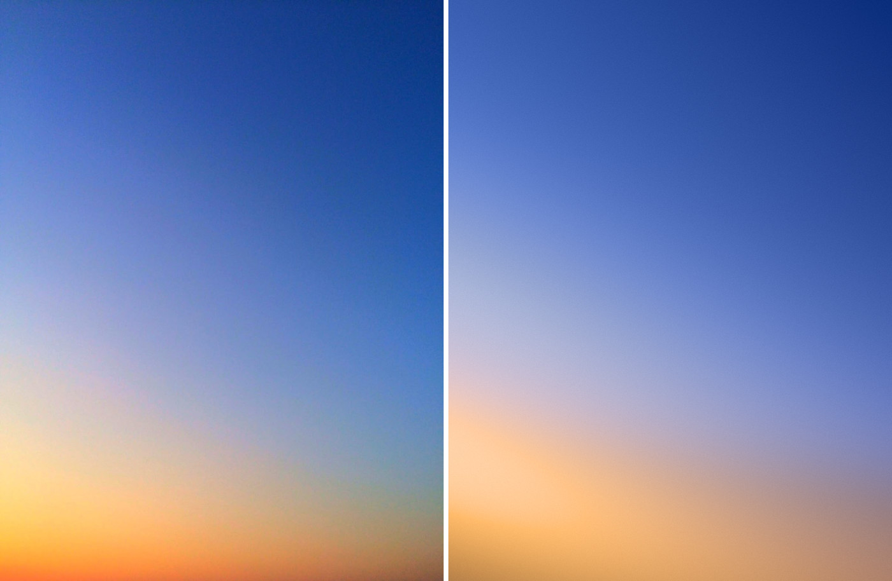
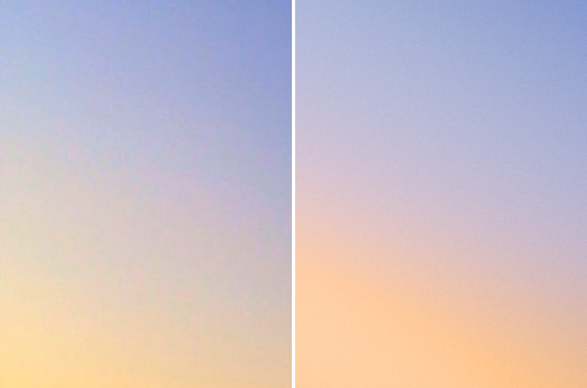
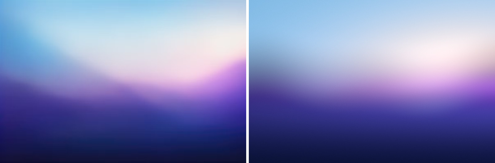
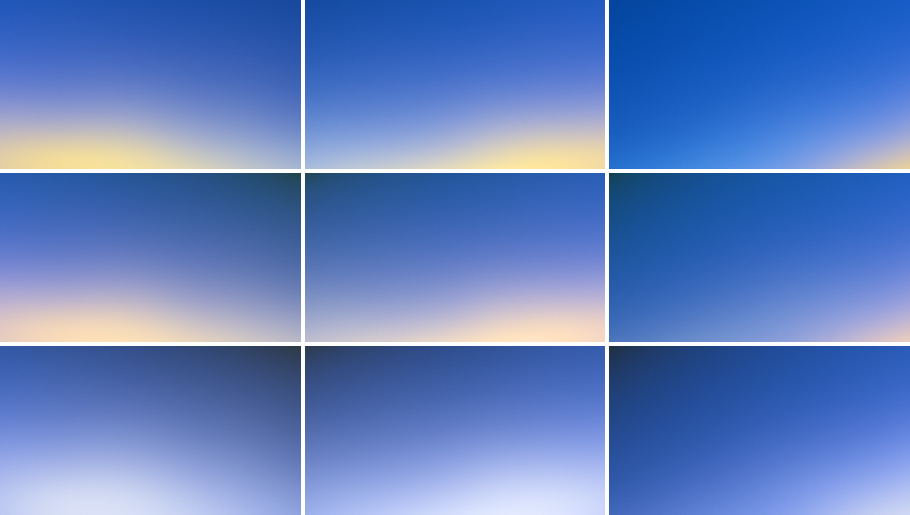
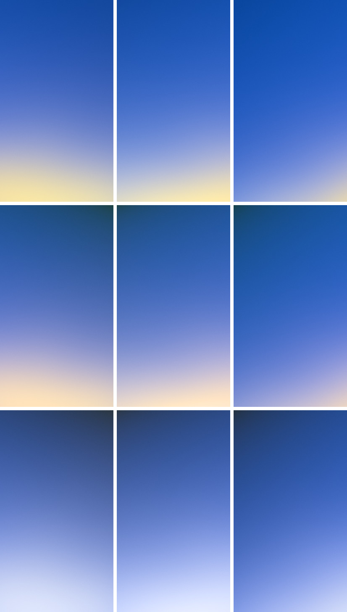
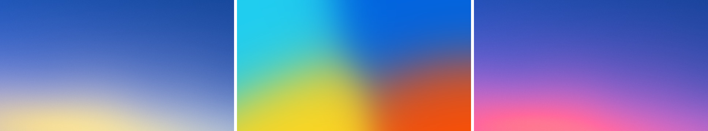
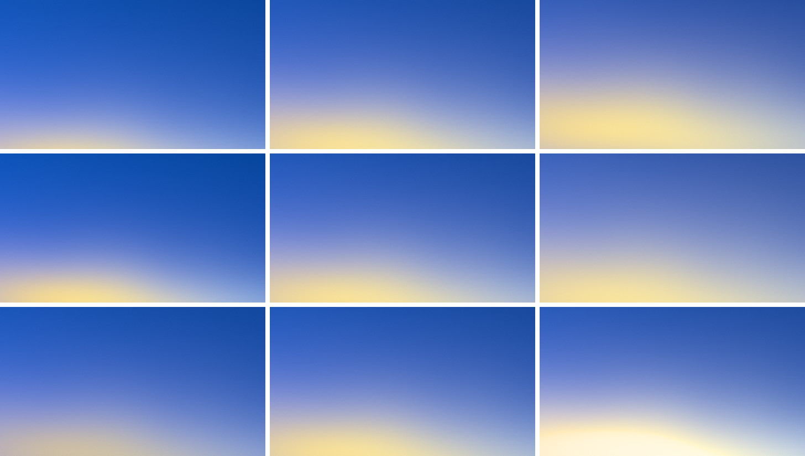
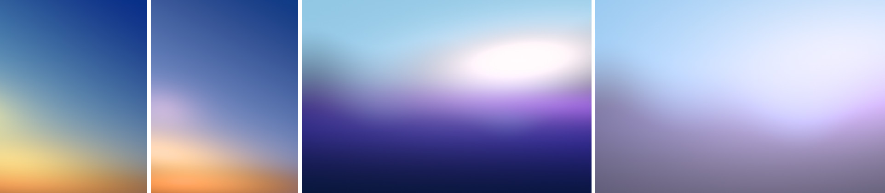

# sunset-blooms: Sunset technique 3, "no horizon at all and a few wide blooms"

CPU prototype in Node (ESM, `Float32Array` linear RGB, `sharp` for PNG I/O).
Every step maps to a WebGL2 full-screen pass or a standard blur pyramid.

## Short answer

- A base sky field plus 2 or 3 very wide additive glows makes natural-looking
  sky light, and the pack variations hold up across seeds and both aspects.
  To get there, the glows have to stay wide and flat (4 to 6 times wider than
  tall), their centers have to stay off-frame, and only one of them may be
  strong. Rounder or stronger glows read as a dome, an oval, or a blob.
- `sunset-blue-diagonal`: the overall light matches (mean ΔE 1.97). The
  bottom tenth does not: the reference turns darker, saturated orange at the
  horizon, and glows coming from off-frame can only get brighter toward their
  source.
- `sunset-violet-wave`: the glow matches (warm white, pink along its lower
  edge, mean ΔE 2.19). This only works on top of a soft, wavy ground layer
  that sits in front of the glow, which is the horizon technique, not blooms.
  With additive glows alone, their tails turn the navy ground grey-mauve.
- Bold with Orange-red as the warm light makes the Instagram gradient (blue,
  purple, hot pink). Use Yellow. Orange-red also turns pink when it rolls off
  toward white (see "Notes for the engine").

## The model

Frame coordinates: `p = ((x + 0.5) - W/2, (y + 0.5) - H/2) / R`, with
`R = sqrt(W * H)`, so a preset keeps its shape at any aspect. Glow centers are
given in frame fractions `(u, v)` (0..1 inside the frame, outside it for
off-frame) and converted with `c = ((u - 0.5) W / R, (v - 0.5) H / R)`.

1. Warp (only applied to glow coordinates):
   `q = p + A * (n1(p / s), n2(p / s))`, where `n1` and `n2` are 2-octave
   seeded gradient noise.
2. Base sky field, a two-color ramp in linear light:
   `t = clamp((p · d - t_min) / (t_max - t_min))` with `d = (sin θ, cos θ)`,
   `e = t^γ`, `B = I_top C_top (1 - e) + I_bot C_bot e`.
3. Glow kernel, a softened power law (Moffat) on a rotated ellipse:
   `(u, v) = rotate(q - c_i, -φ_i)`,
   `d² = (u / (r √a))² + (v √a / r)²`, `K_i = (1 + d²)^(-β)`.
4. Haze near a glow's core hides the sky behind it:
   `T = exp(-Σ_i α_i K_i^2)`.
5. Radiance: `L = B T + Σ_i I_i C_i K_i`.
6. Lens: `L' = (1 - s) L + s P(L)`, where `P` is a 6-level downsample /
   upsample pyramid with equal level weights (keeps total energy).
7. Output: exposure; tone curve; exact piecewise sRGB; monochrome grain
   (about gaussian, sigma = `grain`, fading toward black and white);
   triangular dither of ±1 LSB; 8 bits.
   - Tone curve: when `m = max(r, g, b) <= 1`, the color is unchanged.
     Above that, `ĉ = L / m`, `k = Y(ĉ) / (1 - Y(ĉ))` (clamped to
     0.15..8), `t = 1 - 1 / (1 + k (m - 1))`, `out = ĉ + (1 - ĉ) t`. That
     `k` keeps the luminance slope the same on both sides of `m = 1`.

Optional parts, used only where noted:

- Per-channel spread `σ`: the red channel's kernel reaches `(1 + σ)` times
  farther and blue's reaches `1 / (1 + σ)` as far, so one glow's tail can be
  redder than its core. It failed in both references; see "What failed".
- Soft step and ground layer (`base.center`, `base.width`, `base.wave`,
  `base.front`), used for `sunset-violet-wave` only. Here
  `e = smoothstep(c - w, c + w, t + Σ a_k sin(2π (f_k u + φ_k)))`, and the
  base's second color becomes a ground in front of the sky:
  `L = (C_top T + E_behind)(1 - e) + C_ground e + E_front`, where glows
  marked `front` add on top of the ground. This is the horizon technique.

## Parameters

| name | meaning | reference presets | production (`compose.mjs`) |
| --- | --- | --- | --- |
| `base.top`, `base.bottom` | color index (or hex) at each end of the sky ramp | picked colors | pack colors |
| `base.topI`, `base.bottomI` | intensity of each end (1 = exact hex) | 1 | 0.45 to 1 |
| `base.angle` | ramp direction in degrees, 0 = top to bottom | -40 to 0 | -34 to 34 |
| `base.curve` | ramp exponent `γ`; below 1 keeps the top color near the top | 0.9 to 1.3 | 0.55 to 1.3 |
| `blooms[i].color` | color index | | |
| `blooms[i].intensity` | `I`; at 1 the glow's own light at its center is the exact hex (the sky behind adds to it unless hidden); above 1 rolls toward white | 0.2 to 1 | 0.2 to 2.2 (up to about 3.3 at Intensity 1) |
| `blooms[i].x`, `.y` | center in frame fractions; outside 0..1 is off-frame | x -0.15 to 1.11, y 0.36 to 0.94 | x -0.11 to 1.11, y 1.01 to 1.27 (default Rise) |
| `blooms[i].radius` | `r`, in units of `sqrt(W * H)` | 0.3 to 1.14 | 0.58 to 1.22 (default Softness) |
| `blooms[i].aniso` | glow width / height, `a` | 2.6 to 12 | 1.9 to 5.6 |
| `blooms[i].angle` | tilt `φ` of the long axis in degrees; positive descends to the right | -16 to 24 | -24 to 25 |
| `blooms[i].beta` | falloff exponent `β`; lower = longer tail | 1.8 to 4 | 2.2 (1.9 to 2.5 with Softness) |
| `blooms[i].absorb` | `α`, how much the glow's haze hides the sky near its core | 0 to 8 | 0 to 1.4 |
| `warp.amount`, `warp.scale` | `A` and `s` of the coordinate warp | 0 | 0.08, 1 |
| `lens.bloom` | `s`, lens bloom mix | 0.12 | 0.12 |
| `output.grain` | grain sigma in sRGB units | 0.004 to 0.008 | 0.012 |

The reference fits needed more freedom than production uses: a high
`absorb` makes a pure absorber (dark haze), and some centers sit inside the
frame. In violet-wave, those glows sit behind the ground layer.

Presets in `presets/` use the shared preset shape. `params` holds the
fields above, and colors are referenced by index into `scene.colors`.

## Results per reference

Scores are Oklab ΔE × 100 after a 6 px blur, at the reference's native size,
against the clean targets in `public/references/awe/sunset/`. They are guide
numbers only; every round was judged by looking at a side-by-side and a 3×
crop.

### sunset-blue-diagonal (overall light): 20 rounds

Preset `presets/ref-sunset-blue-diagonal.json` uses 5 colors, 3 glows and 36
numbers: a pale blue sky glow from the left, a warm glow from the lower left,
and a dim red haze along the bottom whose main job is hiding the sky. Mean ΔE
1.97, median 1.46, p95 4.9.

- Matches: the deep blue at top right and the saturation of the sky (chroma
  13 to 14); the roughly 30° tilt of the light; the lavender-pink bridge (hue
  280 to 310 at chroma 2 to 4, measured); the peach zone and its tilt; the
  grain (0.8%).
- Does not match: the bottom tenth. The reference turns saturated orange there
  (#FEA63D), darker than the yellow above it, from extinction at the horizon.
  These glows all come from off-frame, so the render keeps getting brighter
  toward the bottom and stays amber-peach. The bottom-left corner is about
  4 ΔE off and a little khaki.
- To reproduce: the sky has to lighten toward the horizon with pale blue light
  (#B0D0FF keeps hue 262°; adding white drifts toward lavender, adding cyan
  toward green), and the warm light has to lean orange or pink so the bridge
  passes through lavender, not green.

### sunset-violet-wave (the glow): 13 rounds

Preset `presets/ref-sunset-violet-wave.json` uses 6 colors, 4 glows and 50
numbers: a warm white glow and a flat pink horizon glow behind the ground,
magenta-violet and blue-violet haze glows in front of it, and a soft ground
step whose top edge is warped by two sine waves. Mean ΔE 2.19, median 1.73,
p95 5.15.

- Matches: the glow itself. It is broad, warm white (hue 5 to 30° at chroma
  0 to 2), clean light blue above it, pink along its lower edge, then orchid
  and violet. The violet at the right edge and the indigo-to-navy fall below
  it match within 1 to 2 ΔE.
- Does not match: the horizon shape, which belongs to the ramp technique. The
  left hill is too low and too flat, and the saturated blue diagonal band on
  the left reads grey-blue in the render. There is also a slightly brighter
  spot inside the glow.
- Can blooms alone do it? No. With glows added straight onto a light-to-dark
  base, their tails lift the navy to grey-mauve (#6F6988 against #161649).
  Steeper glows keep the dark but turn into a visible white oval. The glow has
  to sit behind the ground, meaning the ground is a layer in front of it.

## Pack variations

Rows: Bold, Elemental, Atmospheric. Columns: seeds 2, 5, 8 (a left band, a
lifted light on the right, a corner light on the right). I picked these seeds
because they cover the three composition types. Seeds 1 to 3 happen to all
be left bands; seeds 1 to 9 for Bold are in `results/bold-seeds-1-9.jpg`.
Renders are 1920×1080 and 1080×1920, with default controls.

Roles per pack (`compose.mjs`):

| pack | sky (base) | zenith | primary light | second light |
| --- | --- | --- | --- | --- |
| Bold | Meta Blue | Meta Blue at 0.45 | Yellow (the one warm color) | Cyan, weak |
| Elemental | Meta Blue | Forest, kept near the top | Tan at 2× nominal (the one warm color) | Lime, weak |
| Atmospheric | Meta Blue | Near-black | Ice | Steel |

How a seed composes a frame:

- Both lights sit below the bottom edge, on opposite sides. The primary is
  never centered, and its long axis tilts down away from the light.
- The sky darkens toward the upper corner away from the light.
- The composition type is picked by seed: a band (50%), a corner light with
  the horizon tilted 14 to 26° (30%), or a lifted light that reaches higher
  (20%).
- Tall frames get proportionally taller glows (radius × 1.33, aniso ÷ 1.33
  at 9:16).

Guide numbers for the grid:

- Meta Blue-hued sky (within 30°, chroma above 0.05) covers 75 to 100% of the
  frame.
- The steepest lightness change is 5 to 9 Oklab L per 10% of the short side.
  It sits in the lower third, where the glow meets the sky. The upper two
  thirds hold text in every frame.

Lime is Oklab hue 120° (yellow-green). I counted it as not warm. If it
counts as warm, set Elemental's second light to 0 or to Meta Blue at low
intensity.

### Natural light, mesh gradient, or Instagram gradient

Left: this model, Bold seed 2. Middle: what a mesh gradient tool makes from
the same four Bold colors, with gaussian blobs averaged in sRGB. Right: this
light model with Orange-red straight onto Meta Blue.

What makes the left one read as light at a distance, in order of importance:

1. **One light, one direction.** The brightest region sits off-frame at one
   edge and everything falls off from it. The mesh has four color centers of
   similar strength, which the eye reads as four objects.
2. **Brightness and color move together.** The strongest light is the palest
   (cream), color is most saturated at middle brightness, and the far sky is
   the deepest blue. In the mesh, every color has the same saturation and
   lightness wherever it sits.
3. **Bridges are lighter and greyer**, never darker:
   - Yellow on Meta Blue goes blue → lavender-grey → cream;
   - Tan goes blue → mauve-beige → peach;
   - Ice goes blue → periwinkle → white.

   In the sRGB mesh, yellow meets blue in green and orange meets blue in
   brown-grey. In the Instagram gradient, Orange-red meets Meta Blue in
   saturated purple and hot pink: measured chroma rises from 18 to 24 as the
   hue goes from 281° to 358°.
4. **Scale.** Ramps cross 40 to 70% of the frame. No lightness contour closes
   inside the frame, because every glow center is off-frame. A mesh has its
   centers inside the frame, with closed contours around them.
5. **Horizontal structure.** Glows 4 to 6 times wider than tall give long,
   flat contours, like a horizon. At a 3:1 ratio, the Yellow glow reads as
   the dome of a rising sun.
6. **The sky deepens away from the light** (zenith and far side). That
   gives the frame depth, the sense of distance.
7. **Fine monochrome grain.** It makes the surface read as photographic
   rather than as a flat fill.

What still reads synthetic in these renders:

- The contours of a lifted light are still a little too elliptical.
- At low intensity, the lavender-grey bridge in Bold and Elemental can look
  dusty.
- Atmospheric comes close to a plain blue-to-white ramp, because Ice is
  neutral. Narrowing its glow (`widthScale 0.6` in `compose.mjs`) helps.

### Controls

Rows: rise, softness, intensity. Columns: 0, 0.5, 1. Bold seed 2.

- **Rise:** the light goes from a thin band at the bottom to a broad glow that
  reaches past the middle.
- **Softness:** 0 starts to show the glow's upper edge as a dome, and 1 hazes
  the lower half.
- **Intensity:** 1 rolls the core to cream-white, and 0 stays a dim
  beige-lavender. It turned olive before the haze was tied to intensity.

## What failed, and why

Left to right: blue-diagonal round 6, blue-diagonal round 10, violet-wave
round 3, violet-wave round 6.

- **Long power-law tails everywhere** (`β = 1`, blue-diagonal round 1): the
  warm light reached the whole frame and greyed the sky to lavender. The warm
  light has to stay within its own part of the frame (`β` 2 to 3).
- **Fitting on plain ΔE** (blue-diagonal round 6): the bridge went
  green-olive. The fitter moved the sky toward cyan and the glow toward
  yellow, and that pair sums to green light. The pale bridge has a very low
  chroma, so plain ΔE barely notices a hue error there, while the eye sees it
  at once. Two things fixed it: weighting `a` and `b` by 2.5, and hand-picking
  the hues.
- **Clipping out-of-gamut colors channel by channel** while fitting: a
  pinned hue of 262° came out cyan (#B7FBFF). Lowering chroma until the color
  fits keeps the hue.
- **Several single-color glows** (blue-diagonal round 10): a pink blob at the
  left edge and two stacked stripes. Each glow showed up as its own shape:
  the mesh-gradient look.
- **Per-channel spread** (red tail wider than the core): the red tail reached
  the top of the frame and turned the blue sky lavender, in both references.
  A power-law tail keeps the red/green ratio `(1 + σ)^(2β)` everywhere far
  away.
- **A haze that hides earlier glows**: it made a flat mustard stripe with a
  hard top edge, which is a horizon line, not light. Removed.
- **Absorbing the sky over the whole glow** instead of only near its core:
  the overlap turned grey-mauve. For Yellow at `K = 0.3` on Meta Blue, that
  gives #958A96 (L 0.65), where pure addition gives #959BE1 (L 0.71). Using
  `K²` in the haze term gives #9595C7 (L 0.69) and keeps the overlap
  lavender.
- **Bright, steep glows** (violet-wave round 3): the glow became a white oval
  with a visible shoulder. With `β` above 3 and the intensity above 1, the
  core rolls off into a flat white plateau.
- **Additive glows over a dark base** (violet-wave round 6): the long tails
  lift the navy ground to grey-mauve. This is the main limit of this
  technique on its own.
- **Orange-red as the Bold primary**: over Meta Blue it gives saturated
  purple and pink. A strong Cyan glow between them removes the magenta but
  leaves a cold daytime sky with a faint pink edge. When overexposed, it turns
  pink (see "Notes for the engine").
- **A secondary light from an upper side**: it made a bright corner spot at
  16:9 and a round patch in the upper sky at 9:16. Moving it below the bottom
  edge, on the far side, fixed it.

## Cost

- CPU (one JavaScript thread): 1920×1080 in 0.6 s without warp and 1.2 s
  with it; 3840×2160 in about 2.6 s without warp.
- Per pixel, 3 glows:
  - about 80 multiply-adds;
  - one `pow` per glow (two with spread);
  - one `exp`;
  - the warp: 2 × 2-octave gradient noise, which is 8 hashed gradients.
- GPU equivalent:
  - one full-screen recipe pass;
  - the shared lens pyramid (6 downsample and 6 upsample passes, on frames
    that shrink by 4 each level);
  - one output pass.

  That is well under a frame at 3840×2160 on any WebGL2 GPU. There is no
  iterative solve.
- `fit.mjs` is offline only (20 to 90 s per reference). It proposes reference
  preset numbers that were then checked by eye. Nothing is optimized at render
  time.

## Recommendation for the GLSL recipe

`sunset.blooms` should be a recipe pass followed by the shared lens and output
passes.

**Pass 1, `sunset/blooms.frag`** (full screen, RGBA16F, linear radiance),
uniforms:

- `uResolution`, `uSeed`;
- `uSkyTop`, `uSkyBottom` (vec3 linear, already multiplied by their
  intensities), `uSkyDir` (vec2), `uSkyRange` (vec2: `t_min` and span),
  `uSkyCurve`;
- `uGlowCount` (at most 4);
- `uGlowColor[4]` (vec3 linear × intensity), `uGlowCenter[4]` (vec2 in frame
  units), `uGlowAxis[4]` (vec4: cos, sin, 1/rx, 1/ry), `uGlowBeta[4]`,
  `uGlowAbsorb[4]` (fix the haze exponent at 2);
- `uWarpAmount`, `uWarpScale`.

Leave spread out. Leave the ground layer to `sunset.ramp`. If the ramp
recipe wants a glow, it can reuse this glow loop for the light behind its
ground.

**Pass 2:** the shared lens pyramid, `bloom` 0.1 to 0.15. Halation isn't
needed.

**Pass 3:** the shared output stage.

**On the CPU:** a composition function like `composeScene()` turns pack,
seed, controls and aspect into those uniforms. It is small and deterministic.

Controls:

- **Intensity:** `gain = 2^((i - 0.5) * 1.2)` on all glow intensities, with
  the primary's haze `absorb = 1.4 * min(1, gain)`.
- **Softness:** radius × (0.85 to 1.2), `β` from 2.5 down to 1.9.
- **Mood control, "Rise"** (how high the light reaches): the primary's
  center `v` from 1.26 to 1.0, radius × (0.9 to 1.15).
- **Seed:** composition type, light side, positions, tilts, about ±10%
  intensity variation, and warp noise.

Rules worth keeping in the composition function:

- At most 2 or 3 glows, one clearly dominant.
- All centers off-frame.
- Glows at least 4 times wider than tall, at 16:9.
- The warm light never reaches the top third, so Meta Blue stays the sky.
- The primary's peak inside the frame stays near max channel 1.

### Notes for the engine's output stage

1. The tone curve leaves `max <= 1` unchanged, so a glow's chroma peaks
   exactly where it crosses `m = 1`. If that crossing falls inside the frame,
   it shows as a saturated ring. I saw it with Yellow at intensity above 1.2
   in tall frames. Either keep the crossing off-frame (this prototype does),
   or let desaturation start a little below `m = 1`.
2. Orange-red #FF4F00 has almost no green (0.078 linear), so mixing it
   straight toward white passes through salmon and pink. Overexposed sunlight
   on film goes orange → yellow → white. A roll-off that fills the next
   channel by wavelength first (red into green, then green into blue) would
   keep warm highlights warm.

## Files

- `lib/color.mjs`: sRGB, Oklab, pack hexes.
- `lib/blooms.mjs`: the model.
- `lib/output.mjs`: tone curve, encode, grain, dither.
- `lib/blur.mjs`, `lib/noise.mjs`, `lib/image.mjs`, `lib/measure.mjs`:
  helpers.
- `render.mjs <preset> <w> <h> <out.png>`: render a preset.
- `iterate.mjs <preset> <tag>`: one audit round. It writes the render, the
  side-by-side and the 3× crop to `out/`, and prints guide numbers.
- `fit.mjs <preset> <out.json> [sweeps] [levels]`: offline pattern search.
  `AB_WEIGHT` and `GRAD_WEIGHT` set the loss weights; `scene.fitFixed` and
  `scene.fitBounds` pin or bound parameters.
- `compose.mjs`: pack, seed and controls become a scene.
- `grid.mjs [tag] [seeds...]`: the results grid. `extras.mjs`: the contrast,
  controls and seeds images. `results.mjs`: copies the README images into
  `results/` as JPEGs under 400 KB.
- `presets/ref-*.json`: the two reference presets.
- `presets/<pack>-seed2-16x9.json`: one production scene per pack.
