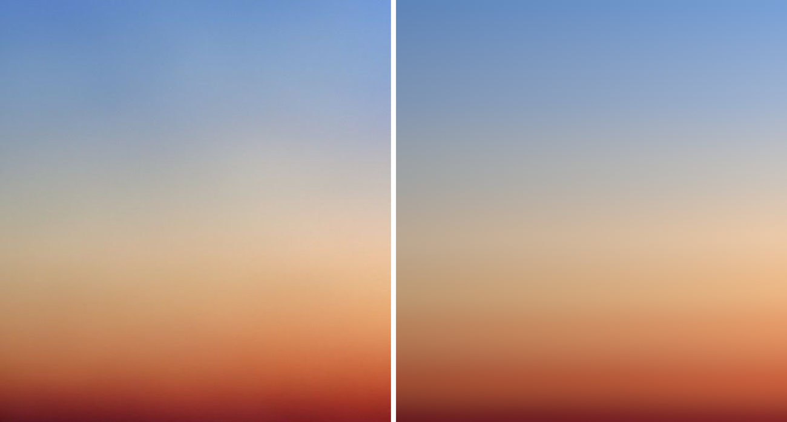
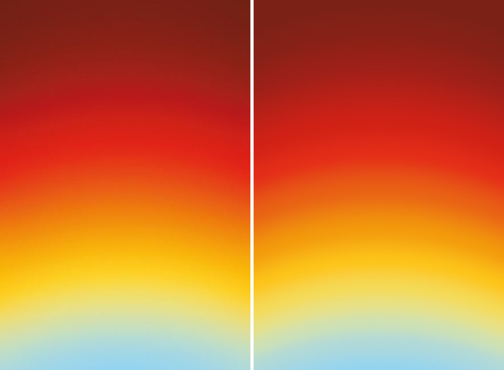
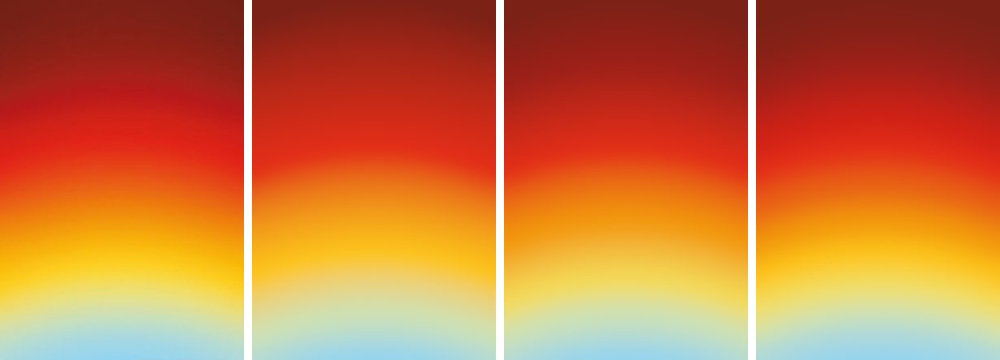
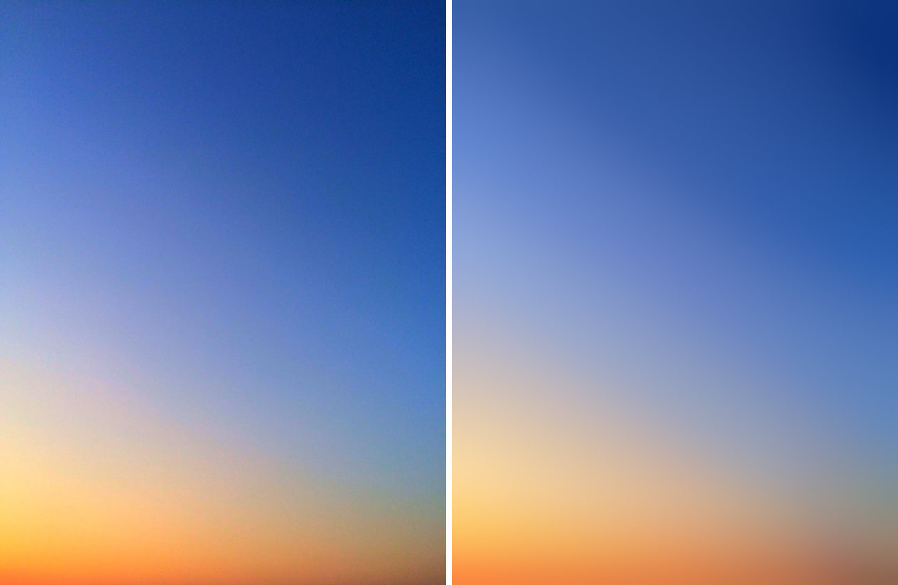
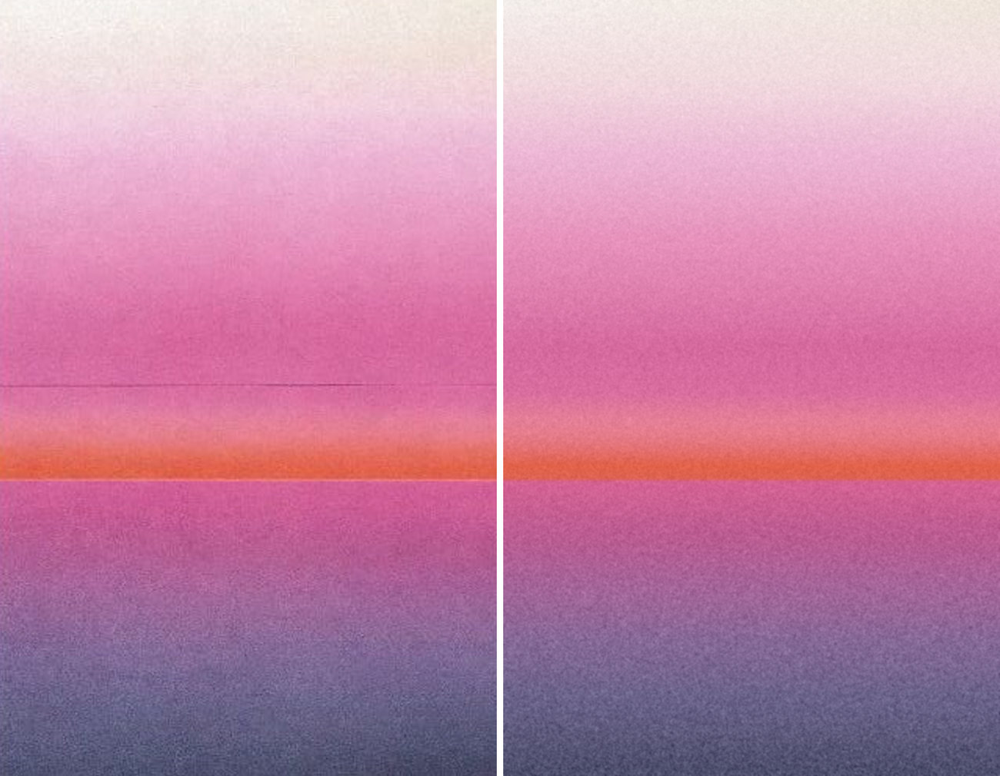
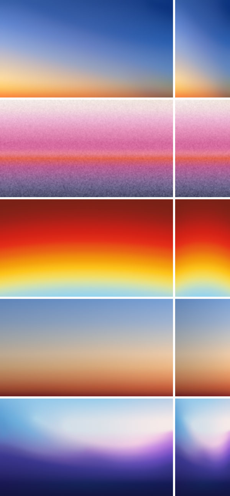
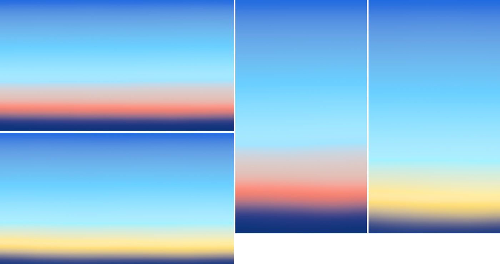
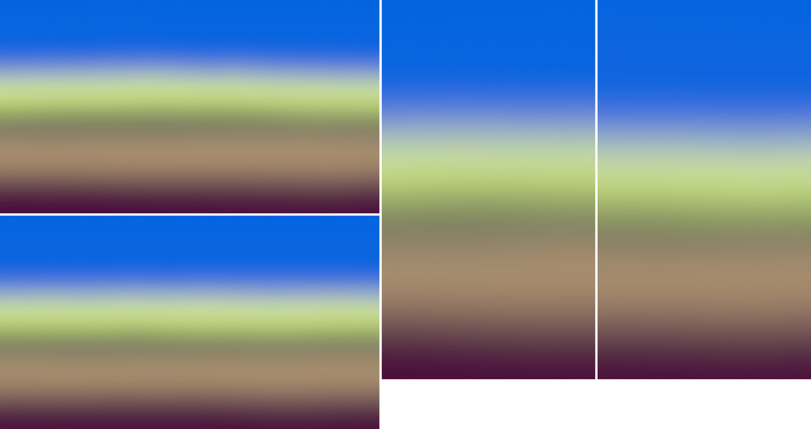
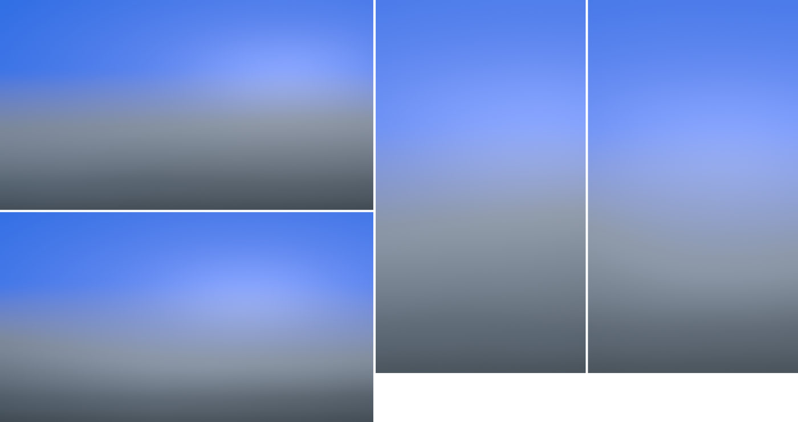
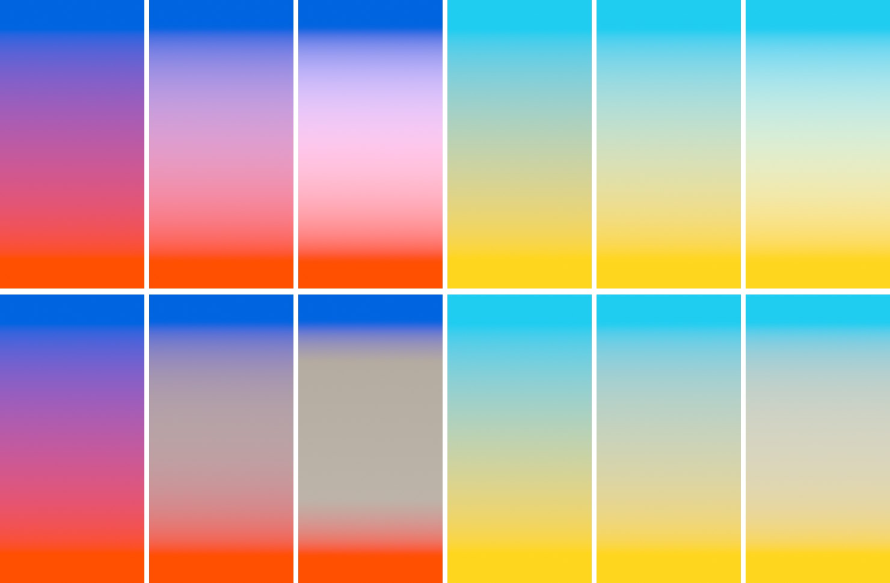

# sunset-diffusion

A CPU prototype (Node, `.mjs`, `Float32Array` linear RGB, `sharp` for PNGs) of one Sunset light model: colored light seeds (strokes, lines, arcs) whose colors are spread across the image by a diffusion fill in linear light, in the spirit of Zach Lieberman's ofxPoissonFill. On top of the fill: a bridge-light step, an exposure gradient, added glows, an Inigo Quilez style domain warp, a blur, and the engine's output stage.

## Short answer

- Diffusion matches all five references closely (blurred Oklab error 0.5 to 1.5, see below) and renders sensibly at other aspect ratios and seeds.
- For plain vertical ramps it gives nothing over stops: a membrane fill between full-width horizontal strokes is exactly a linear-light stop ramp (measured difference: mean 0.23 ΔE). Its value is in 2D: corner glows, wavy hills, isolines that bend around a light source.
- A 1:1 match needs many seed colors. A stroke is invisible only when its color agrees with the field around it, so strokes need color stops along their length. Sky-peach needs 8 colors, the arcs 13, the blue diagonal 23, the violet wave 48. That is more than "a handful".
- The useful new piece for the engine is the bridge-light step (neutral bridge from the variance of seed hues). It turns Meta Blue → orange-red from saturated violet-magenta into blue → light grey-beige → peach → orange, and cyan → yellow from olive into mint → cream. It works with any recipe that knows which hues meet where.
- GPU cost at 4K is small if the fill is solved at 1/4 resolution, which loses nothing (measured): about 5 to 8 ms on a desktop GPU, 15 to 25 ms on an integrated one.

## The model

All colors are linear RGB floats. Coordinates: `u = x/W`, `v = y/H` (v down). Lines are functions of `u`; strokes, arcs and blobs are measured in an isotropic frame `X = (u − ½)·W/H, Y = v`, sizes in canvas heights.

1. **Seed raster.** Each seed `k` has a footprint `f_k = 1 − smoothstep(w, w + s, d_k)` (d = distance to its centerline), a weight `α_k` and a color `c_k(t)` that may vary along the seed (`color`, `colorR`, or `stops`, interpolated in linear light). Coverage `A = min(1, Σ α_k f_k)`, seed color `C = Σ α_k f_k c_k / Σ α_k f_k`. The raster also stores the second moment of seed chromaticity `q = c / (r + g + b)` for the bridge step.
2. **Fill (membrane / harmonic).** Solve for `u` with `uᵢ = Aᵢ Cᵢ + (1 − Aᵢ)·avg4(u)ᵢ`, i.e. Laplace's equation between seeds with the seeds held at their colors. The grid covers the canvas plus `pad` on every side, so the frame is a crop of a larger fill. It runs at `solveScale` of the output size and is upsampled with a cubic B-spline.
   - Starting guess: push-pull pyramid (ofxPoissonFill structure). Down: `P₊ = gain·T(P)`, `A₊ = gain·T(A)`, renormalized when `A > 1` (T = 4×4 tent at stride 2). Up: `F = P + (1 − A)·B(F₊)` (B = B-spline upsample).
   - Then 2 multigrid V-cycles (red-black Gauss-Seidel, 3 + 3 smoothing steps per level, rediscretized coarse operator). Two cycles are converged to within 0.03 ΔE of four.
3. **Bridge light.** Fill the chromaticity second moment too: `M = fill(q²)`, variance `V = Σ max(0, M − (F/ΣF)²)`. V is 0 where all nearby seeds share a hue and rises smoothly (as `w(1 − w)`) across a transition between hues; halfway it is 0.05 for sky blue/peach, 0.17 for cyan/yellow, 0.4 for Meta Blue/orange-red. Weight `β = amount·V / 0.25`.
   - `neutral` mode (recommended): `F ← F + min(1, β)·(Y′·tint − F)` with `Y′ = 1 − (1 − Y(F))·(1 − lift)`: pull the mix toward a neutral whose luminance is raised part of the way to white (broad-band scattered light).
   - `add` mode: `F ← F + β·tint` (adds light but keeps the mix's hue, so blue/orange turns pink-lavender).
4. **Exposure gradient** (sky is brighter toward an off-frame sun): `F_c ← F_c · 2^(stops·tint_c·t)`, `t = (u − ½)cos θ + (v − ½)sin θ`. A warm tint (`[1.2, 0.95, 0.75]`) raises red more than blue.
5. **Glows** (added light): `F += color·strength·Σᵢ wᵢ exp(−d²/2rᵢ²)`, d = distance to a line (separate scale above/below) or to a stretched center.
6. **Domain warp** (IQ): `G(x) = F(x + A ⊙ n(x))`, `n = (fbm(p + o₁), fbm(p + o₂))`, optionally folded `n = fbm(p + fold·n)`.
7. **Blur:** gaussian, σ = `blur`·H.
8. **Output stage:** exposure → tone curve (max channel ≤ 1 unchanged; brighter keeps its hue at max 1 and mixes toward white with `t = 1 − e^(−a(m−1))`, `a = Y₀/(1 − Y₀)`, so the luminance slope is continuous: no ring) → exact piecewise sRGB → grain → TPDF dither ±1 LSB → 8-bit.
   - Grain: monochrome gaussian noise blurred by `grainSize` px, amplitude `grain·(1 + grainInk·(1 − max channel))`. The pink riso's grain is twice as strong in the dense purple ink as in the pink and orange (measured per band); this weighting matches it within 0.5/255 per band.

Every step is a per-pixel pass, a pyramid pass, or a small fixed-kernel iteration, so it maps to WebGL2 fragment passes (see Cost).

## Parameters

| Name | Meaning | Range |
| --- | --- | --- |
| `seeds[].kind` | `line` (y as a function of u), `stroke` (smoothed polyline, points may be off-frame), `arc`, `blob` | |
| `y, slope, bend, wave, warp` | line centerline `y + slope(u−½) + bend(u−½)²` plus a low-frequency wobble | y 0–1, slope ±1, bend ±0.5, warp amp 0–0.05 |
| `width, soft, softVar` | half-width and edge softness (canvas heights); softness variation along the seed | 0.0005–0.05; 0.001–0.05; 0–1 |
| `color, colorR, stops` | seed color(s) along the seed | hex |
| `gain` | seed intensity; above 1 rolls toward white | 0.15–2 |
| `weight` | how hard the seed holds its color | keep 1 (partial weights leave stripes) |
| `solver` | `harmonic` (use this) or `pushpull` | |
| `gain` (params) | push-pull coverage gain | 2–4 |
| `cycles` | multigrid V-cycles | 2 |
| `pad` | extra fill area on each side, fraction of the canvas | 0.1–0.15 |
| `bridge.mode, amount, lift, tint` | bridge light | neutral; 0–1; 0.3–0.4; warm white |
| `light.angle, stops, tint` | exposure gradient | 0–360°; 0–1.5 stops; per channel 0.6–1.3 |
| `glows[]` | added light: kind, position, profile `[[radius, weight], ...]`, color, strength | radii 0.005–0.6 |
| `warp.ampX, ampY, freqX, freqY, octaves, fold` | post domain warp | amp 0–0.03, freq 0.5–3, fold 0–2 |
| `blur` | final blur, fraction of height | 0.0015–0.06 |
| `output.grain, grainSize, grainInk` | grain | 0–3/255, 0–2 px, 0–4 |

## Results

Error = mean and 95th percentile Oklab distance ×100 between reference and render after a 4 px blur on both (so grain and JPEG noise don't count). About 2 is a just-noticeable difference. Targets are the clean files in `public/references/awe/sunset/`. Each reference got 6 to 9 render → look → adjust rounds.

| Reference | Mean / p95 | Seeds / colors / numbers |
| --- | --- | --- |
| sunset-sky-peach | 0.96 / 2.10 | 8 / 8 / 36 |
| sunset-red-yellow-arcs | 0.52 / 1.08 | 13 / 13 / 54 |
| sunset-blue-diagonal | 1.54 / 3.19 | 8 / 23 / 56 |
| sunset-violet-wave | 1.32 / 2.65 | 11 / 48 / 169 |
| sunset-pink-riso | 0.95 / 2.08 | 16 / 17 / 50 |

### sunset-sky-peach

Eight full-width lines, harmonic fill, exposure gradient brighter and warmer to the right (0.62 stops, tint 1.2/0.95/0.75), small warp, blur 0.012. Matches: the blue → neutral grey → peach → orange → deep red profile row by row, the brighter right side, the lighter bridge. Needed a hand-placed neutral seed at v = 0.41, because a plain linear-light mix of this blue and peach leans mauve. Doesn't match: the reference's soft cloud mottling and faint diagonal haze (a smooth fill has no texture), and its top-left is a little more saturated.

### sunset-red-yellow-arcs

Thirteen arched lines with the same bend (0.27): colors are constant along a parabolic arch from edge to edge, so this is a 1D ramp on an arched coordinate. Matches very closely, including the cream bridge and the dome of light blue. With fewer seeds it fails: 5 seeds give 2.57 and a muddy orange, 7 give 1.33 with a visible crease where the orange starts (below, reference | 5 | 7 | 13). Doesn't match: faint concentric banding in the reference's reds (JPEG).

### sunset-blue-diagonal

Eight strokes laid along measured isolines (straight-ish diagonals that curve around the dark top-right and the warm bottom-left), each with 1 to 4 color stops; padding 0.15; blur 0.03. Matches the diagonal structure, the corner glow and the warm horizon strip. Doesn't match: the reference's upper-left blue is more vivid, and its lavender-pink bridge is a little more saturated. Faint creases at the blue strokes remain unless the blur is raised.

### sunset-violet-wave

Eleven strokes following the wave contours, a wide plateau stroke for the flat white glow, a magenta stroke at the right edge. Matches the wave shape, the warm white glow, the pink and magenta on the right, and the violet → indigo → navy floor. Doesn't match: the left hill's edge is softer than in the reference. It took 48 colors. A compact version with 19 colors scores 1.81, and its single-color strokes show as streaks (below): the price of fewer colors is visible strokes.

### sunset-pink-riso

Sixteen lines; the hard edge under the orange band is two seeds 4 px apart (orange above, magenta below) with a 2 px blur, so nothing blends across it. Grain: monochrome, 1.3 px, weighted by dark-ink coverage, matched per band. Matches the band profile row by row (including the lighter salmon bridge above the orange) and the edge position. Not modeled: the paper fold (masked when measuring) and the 3 px light line along the edge (ink misregistration). For production the edge must be warped; the 1:1 preset keeps the print's straight edge.

### Other aspect ratios and production variations

The reference presets at 16:9 and 9:16: all still read sensibly (diagonals flatten or steepen, the wave compresses into a V in portrait).

Production-style scenes, pack colors only, two seeds each, 1920×1080 and 1080×1920 (`lib/production.mjs`):

- Bold, "warped horizon with a flat glow": Meta Blue sky, Cyan pushed bright for the low sky, one warm color (the seed picks yellow or orange-red), neutral bridge light, dark Meta Blue below. With yellow (seed 2) it reads as a clear-sky sunset. With orange-red (seed 1) it passes through beige-grey into salmon instead of pink. A visible ridge remains at the bright cyan seed.
- Elemental, "stacked bands in pack order, blurred hard": Meta Blue holds the top third, then a lime glow, forest, tan (the one warm color), plum. Smooth, but reads as a soft banded landscape more than light.
- Atmospheric, "no horizon, a few wide blooms": Meta Blue to steel and slate with Ice blooms added as light. Calm and natural, a bit flat.

### Bridge light

Two seeds only, far apart. Top row: additive white (0, 0.15, 0.3). Bottom row: neutral mode (0, 0.5, 1). Left: Meta Blue → orange-red; right: Cyan → Yellow. Without bridge light the mix is violet-magenta or olive. Additive light lightens but keeps the magenta (pink-lavender). Neutral at 0.5 gives blue → grey-beige → salmon and cyan → mint → cream, lighter than both ends where it should be.

## Answers to the brief's questions

**More organic than stop ramps?** Only in 2D. Between full-width horizontal strokes the membrane fill is a piecewise-linear ramp in linear light, the same as stops (0.23 ΔE apart). Where seeds have 2D shape, diffusion gives naturally curved isolines that bend around light sources without writing any geometry for them (blue diagonal, violet wave). Its artifacts are specific: a crease (slope change) at every seed, ridges at seeds whose color is more extreme than their neighbors, flat discs for blobs, bright bulbs at stroke ends inside the frame, and no brightness peaks between seeds (maximum principle). Padding, off-frame strokes, added glows and blur handle these.

**Precise enough for 1:1?** Yes, at the cost of many colors: wherever the reference's color curve bends, a seed is needed, and every stroke needs colors that follow the reference along it or it shows as a streak. Seed colors were picked by measuring spots; nothing samples the reference at render time.

**Stable across seeds and aspect ratios?** Yes. The fill has no grid or seed dependence once it is harmonic (push-pull alone depends on where seeds fall on the power-of-two grid). Presets render sensibly at 16:9 and 9:16; production scenes vary with the seed as intended.

**GPU cost at 4K?** See below: about 5 to 8 ms desktop, 15 to 25 ms integrated, dominated by the full-resolution passes once the fill runs at 1/4 resolution.

## What failed

- **Push-pull as the fill.** S-shaped transitions with flat plateaus at each seed read as stacked bands. On sky-peach, which of two neighboring seeds held its color depended on where they fell on the power-of-two pyramid, not on the seeds themselves, so the profile isn't predictable from seed placement. Kept only as the multigrid starting guess.
- **Blobs as seeds.** A blob becomes a flat disc with a visible edge; a small one becomes a cone-shaped spot. Blooms must be added light (glows).
- **Stroke ends inside the frame.** The end is a singular point and shows as a bright bulb. Fixed by running strokes off-frame (padding) or ending them under another seed.
- **Frame edges as walls.** Without padding, isolines bend to meet the frame at right angles, which a cropped sky doesn't do.
- **Soft, partial-weight seeds** to avoid creases: the fill sags between partial pins and leaves stripes.
- **Arcs around the corner** for the blue diagonal: the real isolines are near-straight diagonals; fixed by measuring contours first.
- **An additive glow for the violet wave's bright area:** it also brightened the violet below the horizon. A glow behind hills needs an occlusion mask.
- **Bridge light, first versions:** weighting by raw RGB variance also fired between same-hue colors of different brightness (peach, orange, red); weighting by the standard deviation with a threshold gave a flat grey band with hard edges; plain white light kept the magenta; neutral without a bounded lift was a dull mid-grey for blue/orange and blew out cyan/yellow. The chromaticity variance with a bounded lift fixed all four.
- **Bridge light in place of hand-placed bridge seeds** on sky-peach: worse (2.0 to 2.8 depending on amount, vs 1.6 with neither), and too light, because that blue and peach already mix near neutral.
- **Removing seeds:** arcs at 5 or 7 seeds and the violet wave at 19 colors look wrong (muddy orange, creases, visible streaks).
- **Blur as the cure for ridges in production scenes:** enough blur to remove the ridge at the bright cyan seed (0.08 of height) also smears the horizon into mauve.

## Cost

CPU timings here are not meaningful for the GPU; the estimate below counts passes and texture reads. 4K export (3840×2160), pad 0.12 → padded 4762×2678; fill at 1/4 → 1190×670 ≈ 0.8 Mpx. Solving at 1/4 resolution gave the same error on all five references (within 0.01), and 1/8 still held on the blue diagonal (1.55 vs 1.54). The riso's hard edge stays crisp at 1/4, 2 to 3 px softer.

| Pass | Resolution | Work per pixel | Estimate |
| --- | --- | --- | --- |
| Seed raster (2 RGBA16F targets) | 0.8 Mpx | per seed ~40 ALU + optional fbm wobble; draw strokes as triangle-strip ribbons rather than testing every segment per pixel | < 0.5 ms |
| Push-pull down + up | pyramid, ~1.1 Mpx total ×2 | 4 bilinear taps ×2 targets | < 0.3 ms |
| Multigrid, 2 V-cycles | ~40 passes at 0.8 Mpx | 5 taps ×2 targets | 1–2 ms (desktop), ~6 ms (integrated) |
| Compose: B-spline upsample, bridge, exposure gradient, glows | 8.3 Mpx | 4 bilinear taps ×2 targets + ~100 ALU | ~1 ms |
| Domain warp | 8.3 Mpx | 2–4 fbm (3 octaves) + 1 bilinear tap | ~1 ms |
| Blur pyramid | 8.3 Mpx → small | ~6 passes | ~1 ms |
| Output (tone, sRGB, grain, dither) | 8.3 Mpx | ~40 ALU; grain blur +2 passes | ~1 ms |

Total about 5 to 8 ms on a desktop GPU, 15 to 25 ms integrated; a 1080p preview is about a quarter of that. Memory: ~50 MB for the solve pyramids and ~200 MB for three full-resolution RGBA16F buffers at 4K. The bridge step doubles the fill's channels (second RGBA16F target); without it the fill needs one target.

## Recommendation for the GLSL recipe

1. **Don't make diffusion the core of the Sunset ramp.** For vertical ramps a linear-light stop ramp along a warped vertical coordinate gives the same image for far less. Use the membrane fill where color has to flow in 2D: corner glows, hills, isolines that bend around a source, blends between partial strokes. It fits as a "blooms" or "composition" layer, or as the fill behind a ramp recipe.
2. **Take the bridge-light step into the engine regardless of recipe.** Any recipe that knows which seed colors meet where (stops in a ramp, bands, seeds) can compute the hue variance and apply the neutral bridge. It is the step that makes Meta Blue + one warm color look like a sky instead of an Instagram gradient.
3. **If the fill is built,** use these passes and uniforms:
   - `seedRaster` (MRT, 1/4 resolution, padded 12%): `uSeedCount ≤ 16`, per seed `uKind`, geometry (`y, slope, bend` or 4 control points), `uWidth`, `uSoft`, `uSoftVar`, up to 4 color stops, `uGain`, wobble `amp/freq/seed`.
   - `pushPullDown` ×log2, `pushPullUp` ×log2 (`uGain = 4`).
   - `mgSmooth` (red-black), `mgResidual`, `mgRestrict`, `mgProlong`, 2 V-cycles.
   - `compose` (full resolution): B-spline upsample and crop; bridge (`uBridgeAmount`, `uBridgeLift`, `uBridgeTint`); exposure gradient (`uLightAngle`, `uLightStops`, `uLightTint`); glows (`uGlowCount ≤ 4`, position, stretch, 3 radii and weights, color, strength).
   - `warp`: `uWarpAmp` (vec2), `uWarpFreq` (vec2), `uWarpFold`, `uWarpSeed`.
   - Blur pyramid: `uBlur`. Then the shared output pass.
   - Keep the ground or horizon as its own layer (sky fill, then a ground layer composited with a warped soft mask). The sky fill can then be blurred enough to hide seed creases without smearing the horizon.
4. **User controls:**
   - **Intensity:** gain of the warm seed together with its glow strength (how strong the low sun is).
   - **Softness:** the final blur (0.01 to 0.06 of height) together with seed edge softness.
   - **Sunset control: Horizon,** the height of the warm horizon seed (0.55 to 0.92). The bridge, glow and ground follow it.

   Seed placement, colors, bridge settings and the exposure gradient stay inside the preset; the pack chooses the colors.

## Files

- `lib/` — `color.mjs` (sRGB, Oklab, tone curve), `noise.mjs` (hash noise, fbm), `image.mjs`, `seeds.mjs` (seed raster), `solve.mjs` (push-pull, multigrid), `pipeline.mjs` (full render, output stage, stop-ramp baseline), `measure.mjs`, `refs.mjs` (clean targets, fold mask for the riso), `production.mjs` (pack scenes).
- `render-ref.mjs <id> [--tag t] [--solver harmonic|pushpull] [--solveScale s] [--set path=json]` — render a preset at the reference size, write side-by-side, 3× zoom and error map to `out/<id>/`, print profiles.
- `render-variations.mjs [scale]` — production scenes at 16:9 and 9:16.
- `probe.mjs`, `experiments/*.mjs` — profiles, contours, color sampling along strokes, grain statistics, solver and bridge experiments, diffusion vs stops.
- `presets/*.json` — the five reference presets (`recipe: "sunset.diffusion"`).
