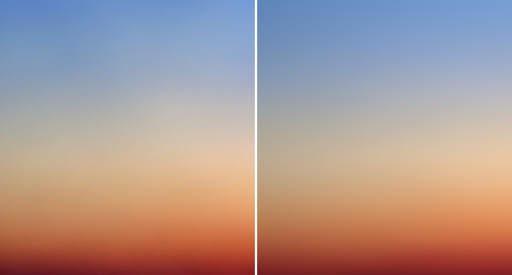
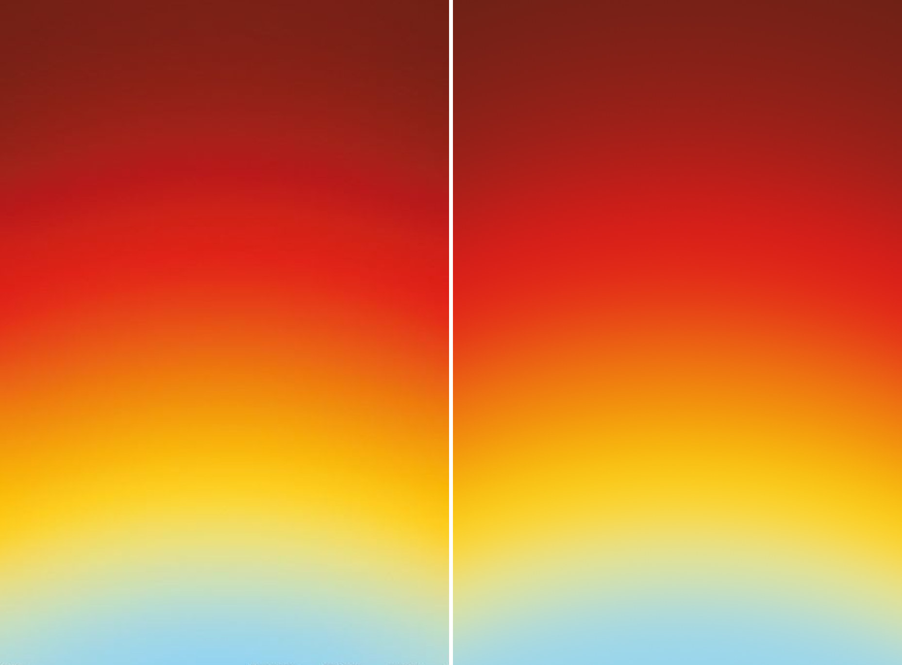
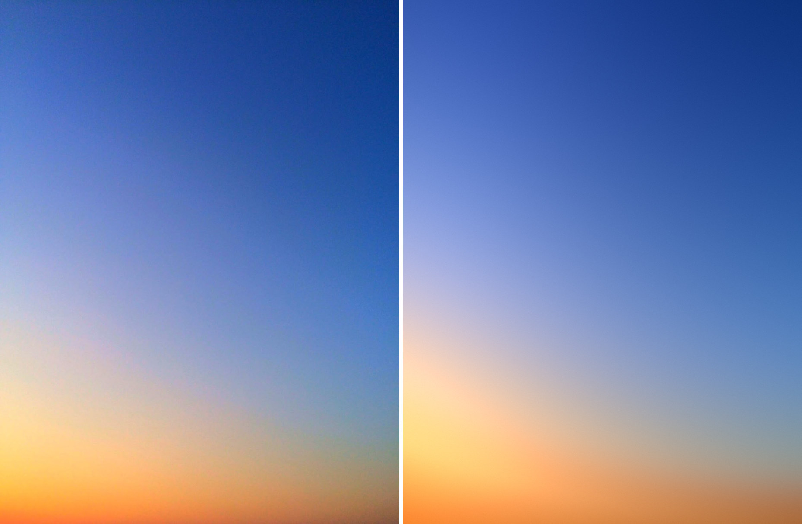
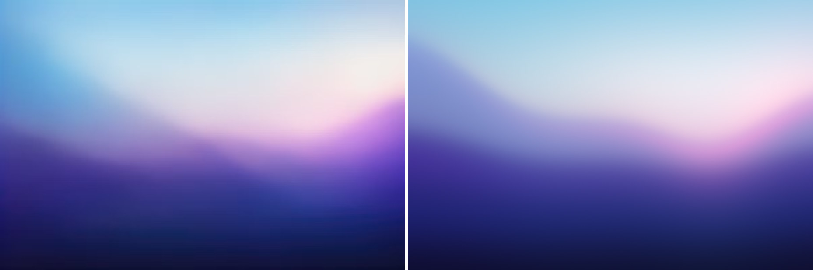
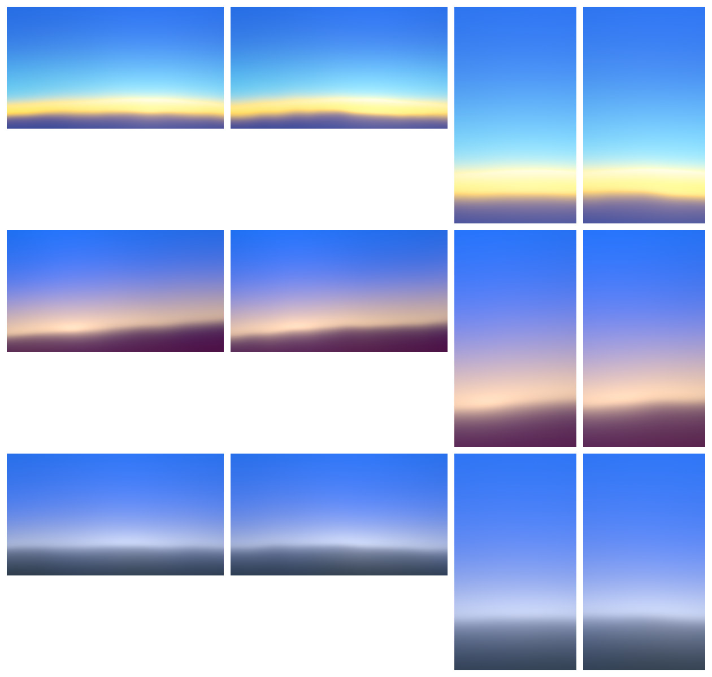
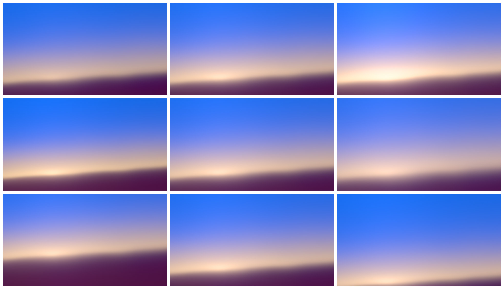
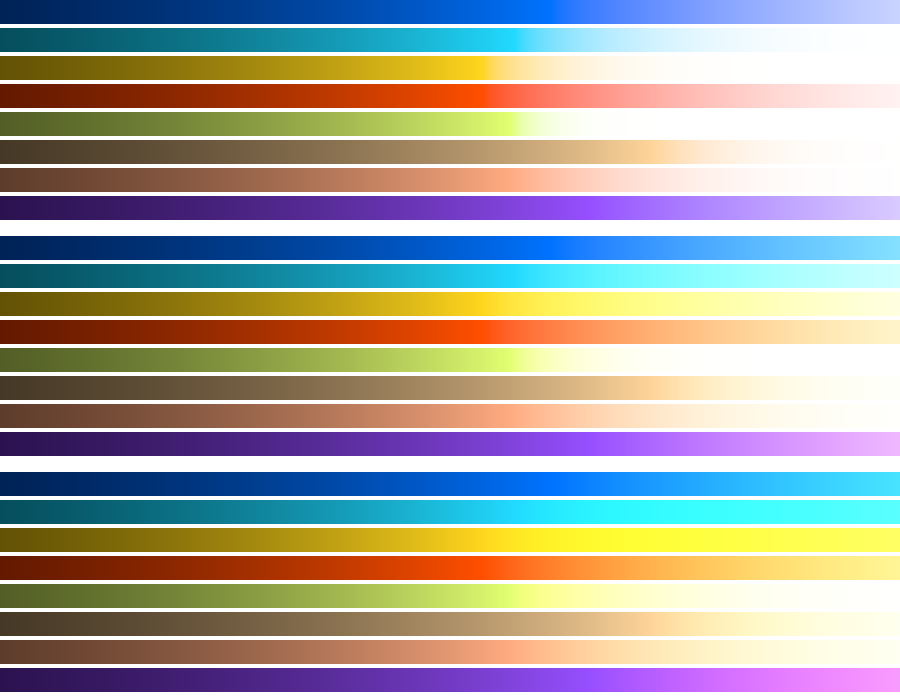

# sunset-ramp-glow: Sunset technique 1, "a vertical ramp with a warped horizon line and a flat glow"

CPU prototype in Node (ESM, `Float32Array` linear RGB, `sharp` for PNG I/O).
The sky is a stop ramp mixed in linear light. On top of it: a lateral
sunlight gain, an additive horizon glow and sun glow that also dim the sky
behind them, then the engine's lens and output stage. Every step is
per-pixel math or a standard blur, so it ports to one WebGL2 recipe pass plus
the shared lens and output passes.

## Short answer

- Sky-peach and the red-yellow arcs match closely (blurred Oklab error 0.74
  and 0.31). Every must-have in their reference notes passes.
- Blue-diagonal gets the composition and the light falloff right (error
  1.07), but its blue-to-warm bridge comes out light pink where the reference
  is neutral grey, and its bottom right is too light and too orange.
- Violet-wave gets the land line, the pink band, the glow's position and the
  navy floor right (error 1.98). It needs a second ridge on the left that one
  warped horizon can't make, so the left sky reads periwinkle instead of
  blue, and the right hill is too pale.
- The stops do most of the work: uneven positions, a width per transition,
  and a smooth logistic step, mixed in linear light. On sky-peach and the arcs
  the fitter turned the glows down to almost nothing. The lighter bridges come
  from the stop colors themselves: a khaki stop gives sky-peach its neutral
  grey and a lemon-cream stop gives the arcs their mint.
- The added light matters where the light changes across the frame (the warm
  corner of blue-diagonal, the white wash and pink band of violet-wave) and in
  every production preset, because pack colors include no pale bridge colors.
- Four parts beyond the brief's description were needed:
  - a multiplicative sunlight gain (at every height, the sky is brighter
    toward the sun);
  - extinction (a glow dims the sky behind it, which keeps blue plus warm
    light from turning lavender);
  - occlusion (the land hides the sun glow below the horizon);
  - a tone-curve `spill` setting that whitens warm light through yellow and
    cream instead of pink.
- The red-yellow arcs are parallel parabolas, not circles around a point
  below the frame. A parabolic bend of the ramp coordinate fits them within a
  few pixels.
- Cost: one full-screen pass with about 15 to 20 `exp`/`pow` calls and 3 to 5
  1D noise lookups per pixel, or 6 more 2D lookups with haze on. Then the
  shared lens and output passes. There is no solve.

## The model

All colors are linear RGB floats. Positions are in frame heights:
`p = ((x + 0.5 − W/2) / H, (y + 0.5) / H)`, x from the frame center, y down
from the top. Points given in frame fractions `(u, v)` convert to
`((u − 0.5)·W/H, v)`.

1. **Axis.** For tilt θ (θ = 0 points straight down), the direction is
   `d = (sin θ, cos θ)`; the anchor is `A`.
   - Along the axis, toward the ground: `a = (p − A)·d`.
   - Across it: `e = (p − A)ₓ·cos θ − (p − A)ᵧ·sin θ`.
   - The ramp coordinate is `s = a − ½·bend·e²`. With bend > 0 the bands make
     a dome, highest in the middle. For θ = 0 the drop at the frame edge is
     `½·bend·(W/2H)²` frame heights.
2. **Horizon warp and softness.** One transition `h` is the horizon.
   - Along it, two noise curves: `n₁(e) = fbm₁(e·scale + 3.7 + phase)` (1D
     gradient noise, 1 to 3 octaves) and `n₂(e) = fbm₁(e·softScale + 11.3)`
     (2 octaves, another seed).
   - Transition j sits at `m_j = stop_j + warp·n₁·g_j` and has the width
     `w_j = width_j·exp(soft·n₂·g′_j)`.
   - `g_j = exp(−|stop_j − stop_h| / reach)`, and `g′_j` is the same with
     `softReach`. So the warp and the softness change are strongest at the
     horizon and fade for transitions far from it.
3. **Ramp.** `R(s) = C₀ + Σ_j (C_{j+1} − C_j)·σ((s − m_j) / w_j)`, with
   `σ(x) = 1 / (1 + exp(−2·ln 9·x))`.
   - Each transition rises from 10% to 90% over exactly `w_j`.
   - `C_i` is the stop color in linear RGB times its gain.
   - The sum is smooth everywhere: no kinks, checked on row profiles of every
     render. Stops can be spaced unevenly.
   - Neighboring transitions may overlap. A middle color is then only partly
     reached, which is why some fitted stop colors are more extreme than the
     colors measured in the reference.
4. **Haze** (optional). Let `q = (e·scale/stretch, a·scale)`. The haze bends
   the ramp, `s += hazeWarp·fbm₂(q + o₁)`, and varies the light by the factor
   `Z = 1 + hazeLight·fbm₂(q + o₂)` (2D gradient noise, 3 octaves). The bands
   bend a little and the light becomes uneven.
5. **Sunlight** (multiplies the ramp). Per channel,
   `S = 1 + gain·tint / (1 + ((e − e_sun) / width)²)`. At every height the
   sky is brighter toward the sun's side, in proportion to its own color.
6. **Horizon glow** (added light).
   - Signed distance to the glow line: `t = s − m_h − offset`, negative
     above. Optionally the glow has its own line (anchor and tilt), warped
     with the same noise.
   - Each layer k: `f_k = lat·w_k·exp(−(√(t² + ε²) − ε) / τ_k)`, with
     `τ_k = up_k` above the line, `down_k` below it, and `ε = τ_k / 2`. The
     rounded peak has no kink at the line.
   - Lateral falloff:
     `lat = 1 − lateral + lateral / (1 + ((e − e_sun) / lateralWidth)²)`.
   - Light added: `G_h = intensity·Σ_k f_k·color_k`.
   - The same haze dims the sky behind it: `K = exp(−extinction·Σ_k f_k)`.
7. **Sun glow** (added light).
   - Distance from the sun: `r² = (a − a_sun)² + ((e − e_sun) / aspect)²`.
   - Moffat layers: `G_s = intensity·V·Σ_k w_k·(1 + r²/R_k²)^(−β)·color_k`.
   - Below the horizon the land hides it:
     `V = 1 − occlude·σ((s − m_h) / occludeWidth)`.
8. **Radiance.** `L = Z·(R(s)·S·K + G_h + G_s)`.
9. **Lens** (optional).
   - Vignette: `L·1/(1 + r_c²/f²)²`, the cos⁴ law, with `r_c` measured from
     the frame center.
   - Bloom: take the bright part,
     `B = L·smoothstep((Y − threshold + knee) / (2·knee))` on luminance Y,
     then add `Σ_i weight_i·tint_i·gauss(B, radius_i·H)`.
10. **Output.** Exposure `2^EV`, then the tone curve, per pixel with
    `m = max(r, g, b)`:
    - `m ≤ 1`: unchanged, so a pack color at nominal intensity encodes to its
      exact hex.
    - `m > 1`: with `ĉ = c / m` and `rate_c = (ĉ_c + 0.05)^spill` (all 1 when
      spill = 0), `out_c = ĉ_c + (1 − ĉ_c)·(1 − exp(−k·rate_c·(m − 1)))`.
    - `k` makes Oklab L rise at the same rate just above m = 1 as just below,
      so there is no ring where the roll-off starts. It is computed from two
      small Oklab differences.
    - spill 0 whitens all channels at the same rate and keeps the hue: orange
      goes to salmon, then pink-white.
    - spill 2 whitens the channels closest to the maximum first: orange goes
      to yellow, cream, then white. That is what a camera does when red
      clips.

    Then the exact piecewise sRGB encode; grain `grain·(n + 0.25·n_c)`, where
    n is monochrome and n_c is per channel, both gaussian per output pixel;
    triangular dither of ±1 LSB; 8 bits.

`scene.seed` seeds all the noise. Fitting (`fit.mjs`) happens offline only. It
runs a separable CMA-ES on blurred, downsampled Oklab error, with the lens
and tone curve in the loop. It proposes numbers. I checked every result by
eye. The renderer never reads the reference.

## Parameters

Presets use the shared shape (`id`, `referenceId` or `pack`, `scene` with
`recipe: "sunset.ramp"`, `seed`, `colors`, `params`, `lens`, `output`).

| Name | Meaning | Range |
| --- | --- | --- |
| `colors` | stop colors, sky to ground | 3 to 7; pack hexes in production |
| `params.gains` | per-stop multiplier (a pack color dimmed below nominal) | 0.3 to 1 |
| `params.stops` | transition positions along `s`, in frame heights from the anchor | uneven |
| `params.widths` | 10–90% width of each transition, in frame heights | 0.02 to 0.8 |
| `axis.anchor` | where `s = 0`, in frame fractions | usually `[0.5, 0]` |
| `axis.tilt` | ramp direction in degrees | −15 to 15 |
| `axis.bend` | parabolic dome (negative bows the other way) | −0.6 to 1.2 |
| `horizon.index` | which transition is the horizon | |
| `horizon.warp` | warp amplitude, in frame heights | 0.01 to 0.04 for a sky; 0.87 to make hills |
| `horizon.scale`, `phase`, `octaves` | warp noise frequency along the horizon, offset, octaves | 0.6 to 2; any; 1 to 3 |
| `horizon.reach` | how far from the horizon the warp still moves other transitions | 0.1 to 0.3 |
| `horizon.soft`, `softScale`, `softReach` | softness change along the horizon: widths vary by up to `exp(±soft)` | 0 to 0.7; 1; = `reach` |
| `haze.scale`, `stretch`, `octaves` | haze noise size, how much wider than tall, octaves | 2 to 2.5; 2.5 to 3; 3 |
| `haze.warp`, `haze.light` | how much the haze bends the ramp and varies the light | 0 to 0.025; 0 to 0.06 |
| `sunlight.pos` | sun position in frame fractions; also the center of the horizon glow's lateral falloff | off-frame or at an edge |
| `sunlight.gain`, `width`, `tint` | lateral sky gain | 0 to 1.5; 0.3 to 1.6; warm white |
| `horizonGlow.color`, `intensity` | glow color (for layers without their own) and strength | intensity 0 to 2 |
| `horizonGlow.layers` | `[weight, up, down, color?]`: decay lengths above and below the line, in frame heights | up 0.06 to 0.3, down 0.05 to 0.4 |
| `horizonGlow.offset` | glow line relative to the horizon (negative = higher) | −0.45 to 0.1 |
| `horizonGlow.lateral`, `lateralWidth` | how much the glow falls off away from the sun, and over what width | 0 to 1; 0.4 to 1 |
| `horizonGlow.extinction` | how much the glow dims the sky behind it | 0 to 0.8 |
| `horizonGlow.line` | optional own line, `{ anchor, tilt }` | |
| `sunGlow.pos`, `color`, `intensity` | broad glow around the sun | intensity 0 to 0.6 |
| `sunGlow.layers` | `[weight, radius, color?]`, radius in frame heights | 0.1 to 0.6 |
| `sunGlow.aspect`, `beta` | width/height; falloff exponent (lower = longer tail) | 1 to 4; 1.2 to 3 |
| `sunGlow.occlude`, `occludeWidth` | how much the land hides the glow, and the softness of that edge | 0 to 0.85; 0.05 to 0.08 |
| `lens.vignette` | cos⁴ falloff distance f, in frame heights | off, or 2.5 and up |
| `lens.threshold`, `knee`, `bloom[]` | bloom bright pass and `{ radius, weight, tint }` layers | 0.75 and 0.25; radius 0.04 to 0.15, weight 0.2 to 0.25 |
| `output.exposure`, `spill`, `grain` | exposure in stops; the tone curve's path to white; grain sigma in sRGB units | 0; 0 to 2; 0 to 0.005 |

## Results per reference

Errors are the mean and 95th percentile of Oklab ΔE × 100 between reference
and render, both blurred with σ = 6 px. Values with σ = 4 px are in
parentheses, which is the setting `sunset-diffusion` used. Both are measured at
the reference's native size against the clean targets in
`public/references/awe/sunset/`. About 2 is a just-noticeable difference.
Each reference took 6 to 14 render → look → adjust rounds.

The checks below are the measurements that the reference notes
(`docs/references/awe/<id>.md`) list as must-haves. `checks.mjs` measures them
on both images after a 2 px blur and prints them as reference → render.

| Reference | Mean / p95 | Colors / numbers |
| --- | --- | --- |
| sunset-sky-peach | 0.74 / 1.65 (0.75) | 8 / 35 |
| sunset-red-yellow-arcs | 0.31 / 0.62 (0.32) | 7 / 20 |
| sunset-blue-diagonal | 1.07 / 2.70 (1.09) | 7 / 32 |
| sunset-violet-wave | 1.98 / 4.95 (2.00) | 9 / 52 |

Images: reference on the left, render on the right.

### sunset-sky-peach: close match

Built from:

- a near-vertical ramp (tilt 0.7°) with 6 stops;
- sunlight from beyond the right edge (gain 1.5, width 0.71, warm tint);
- a weak flat horizon glow at 58% H;
- light haze;
- a mild lens falloff that the fitter kept (−11% in the corners).

Checks:

- Bridge at 39% H: `#B1B1B2` → `#B0B0B2` (C 0.001 → 0.002). Neutral grey, no
  mauve.
- Brightest band: `#D1B9A0` L 0.801 at y 562 → `#D1BA9F` L 0.802 at y 569.
- Right/left luminance at the top, 56% and 85% H: 1.47, 1.43, 1.37 → 1.45,
  1.47, 1.39.
- Red at 94% H: `#A1402F` → `#9C3C2F`. The chroma peak sits 21 px lower
  (y 945 against 924).
- Bottom: `#7D2228` → `#782123`, crimson with blue above green.

What doesn't match:

- The reference's slight unevenness. My haze makes similar low-contrast
  patches, but in other places, which costs a little error.
- The lens falloff. The notes say the reference has none. It doesn't show as
  a vignette because the sunlight gain dominates, but production should leave
  it off.

The glow adds under 10% of the light at the brightest band. The neutral
bridge comes from a khaki stop (`#B6B17B`) between the blue and the peach.
Blue and peach alone mix to faint mauve in linear light (the notes measure the
same), and a peach glow added over the blue also gave mauve.

### sunset-red-yellow-arcs: close match

Built from a vertical ramp with a parabolic bend (bend 1.1, edge drop
0.063 H) and 7 stops with widths from 0.10 to 0.48 H. There is no glow, haze,
lens or grain.

Checks:

- Dome, from the L = 0.6 line at the center and at the edge: y 584 and 669 →
  590 and 672 (drop 85 → 82 px). From the b = 0 line: 1250 and 1335 → 1253
  and 1335.
- Saturation through the warm half: chroma peak 0.223 at y 530 → 0.218 at
  y 534. Crimson at y 358: `#B91A19` → `#BA1E18`.
- Cream band: `#EBE17A` L 0.896 → `#EBDE7A` L 0.890. Its peak sits 22 px
  lower (y 1131 against 1109).
- Cream-to-blue midpoint: `#C7DFC1` → `#C5DEC1`, a pale mint-grey.
- Top center and corner: `#7B2116`, `#722014` → `#782116`, `#702116`.
- Bottom center and corner: `#96D4EE`, `#B1D9D6` → `#9AD6EA`, `#AFDADA`.

What doesn't match: the notes measure a slightly stronger bend in the top
250 px (0.075 H against 0.059 H below). One bend value gives the same drop at
every height, so the top arcs bend a little too little. The JPEG banding in
the reds isn't light and isn't modeled.

The iso-lines are parallel parabolas, so I didn't use the distance from a
point below the frame (the brief's example). That would bend the lower arcs
too much and the upper ones too little. The notes reach the same conclusion.

### sunset-blue-diagonal: composition matches, bridge and bottom colors don't

Built from:

- a tilted (−12.9°) ramp with a negative bend, from the deep blue at the top
  right;
- a warm horizon glow with two layers: orange with a long tail below, and
  cream with a short one. It is centered laterally on the sun just past the
  left edge (lateral 1, width 0.46);
- extinction 0.74, so the warm light dims the blue behind it instead of
  turning it lavender;
- sunlight from the left (gain 0.79);
- tone curve spill 2 and grain 0.0045.

Checks:

- Where blue turns warm (Oklab b = 0) at x 0, 300, 600 and 900: y 749–764,
  873, 970–979, 1027 → 735, 869, 983, 1052. It rises toward the left in one
  bend, within 25 px.
- Left/right brightness: 3.56 at the top and 3.33 in the middle → 2.82 and
  3.16.
- Brightest area, left edge at y 942: `#FDDEAA` → `#FEDF9B`. Both have L 0.915;
  the render is a bit more yellow. The red channel's clip path reads
  cream-yellow, not white, with no ring.
- Bottom edge at left, center and right: `#FE7835`, `#DC7445`, `#815642` →
  `#FA8931`, `#DD8946`, `#AB6B3C`. Close on the left. Toward the right it is
  lighter and more orange (hue 56° against 46°, L 0.59 against 0.50).
- Bridge at the left edge, y 763: neutral `#D1D0CA` (C 0.009) → pinkish
  `#E6CDC9` (C 0.028, hue 29°).
- Right edge at y 1030: grey-green `#7E918C` → blue-grey `#89979C`.

Verdict: the composition and the light falloff match, and it reads as the
same sky. The meeting zone's color doesn't: the reference passes through
neutral grey on the sun side and grey-green on the far side, and the render
through light pink and blue-grey.

The warm light has to do two things that one glow doesn't do here. It has to
neutralize the blue at the bridge, which needs yellower light, and it has to
turn darker and redder at the bottom right. I offered the fitter a third,
narrow red-orange layer, and it set that layer to zero.

### sunset-violet-wave: land line and glow placement match; left side and hill color don't

Built from:

- a vertical ramp (tilt 1.5°) whose horizon transition is warped strongly
  enough to make the hills (warp 0.87, scale 0.66, 2 octaves). I chose the
  seed and the phase by a grid search against the measured land line;
- a wide golden sun glow at the upper right (aspect 4). Over the blue sky it
  adds up to a near-white wash, and the land hides it (occlusion 0.84);
- a magenta horizon glow centered at x 0.85 W, which makes the pink band;
- light bloom (0.04 H and 0.15 H, pink tint).

Checks:

- Land line (L = 0.5) at x 10, 440, 700 and 910: y 301, 384, 412, 362 → 308,
  387, 415, 361.
- Pink band at (750, 280): `#F4CFE7` → `#F3CFE6`.
- Glow core at (839, 160): `#F2EEEB` L 0.952 → `#F1E6F1` L 0.936, a little
  pink and dimmer.
- Brightest point left of x 260 (the notes require below L 0.88): 0.879 →
  0.859.
- Left sky at (10, 200): medium blue `#578DCB` (hue 253°) → periwinkle
  `#7B8ECB` (hue 270°).
- Right hill at (905, 260) and (905, 330): `#BF84DB`, `#8859CD` (C 0.14,
  0.17) → `#C99EDA`, `#7D76BC` (C 0.10, 0.11).
- Left ridge at (10, 360), and the floor: `#3D3891`, `#0F1137` → `#44359A`,
  `#101339`.

Verdict: the land line, the pink band, the glow's place and the
indigo-to-navy floor match. Two things don't:

- The left side. In the reference, the light's lower edge climbs up to the
  left as a soft diagonal while a separate dark ridge runs below it, with a
  lavender-grey wedge between them. A single warped horizon is one line, so
  the render carries the lavender band to the left edge, and the left sky
  reads periwinkle.
- The right hill. The glow lights it in the reference (saturated
  magenta-violet). Here the land colors are the same at every x, so it stays
  a paler, greyer violet.

Both need a land layer in front of the sky, with its own warped edge and its
own light from the side. The notes and the `sunset-blooms` prototype reached
the same conclusion.

The notes find no bloom in this reference. Here the bloom mostly widens the
white wash, so a wider sun glow could likely replace it.

## Pack variations

Rows: Bold, Elemental, Atmospheric. Columns: 1920×1080 seed 1 and seed 2,
then 1080×1920 seed 1 and seed 2. The presets (`presets/prod-*.json`) use
pack colors only. In every one, Meta Blue holds the sky, there is at most one
warm color, and the horizon is warped with softness that varies along it.

- **Bold:** Meta Blue → Cyan → Yellow at the horizon (a stop plus a glow) → a
  dimmed Meta Blue ground. It reads as a clear-sky sunset. The yellow band is
  still a little crisp and saturated, more so at 9:16, where it reads as a
  stripe.
- **Elemental:** Meta Blue → lavender-grey → a Tan glow (peach, lighter than
  both sides) → a Plum ground, with the horizon tilted 4°. The most natural
  of the three. Plum is used as a dark ground; if it counts as a second warm
  color, use a dimmed Meta Blue instead.
- **Atmospheric:** Meta Blue → periwinkle → an Ice glow → a Steel, Slate and
  Near-black ground. Calm and correct, a little plain.
- **Seeds:** in these presets the seed only moves the noise (horizon warp,
  softness, haze), so seeds 1 and 2 look alike. A production composition
  function should also pick the sun's side, its position and a small tilt
  from the seed.

### Controls

Elemental at 640×360. Rows: Intensity, Softness, Horizon. Columns: 0, 0.5
and 1, where 0.5 is the preset as written. The mappings are in
`lib/controls.mjs`:

- **Intensity:** one gain, `2^((i − 0.5)·1.5)`, on both glows and the
  sunlight together. At 0 the light is a dim peach band. At 1 its core rolls
  to cream and the sky above it lightens.
- **Softness:** a scale of `2^((s − 0.5)·1.4)` on the transition widths,
  full at the horizon and fading with distance from it. The glow sizes get the
  square root of that scale, with a floor of 0.04 H. Horizon softness
  variation rises with it. Two of these choices came from failed versions:
  - Scaling every width alike turned the high sky lavender at Softness 1.
  - Scaling glows as much as widths turned Atmospheric's Ice glow into a thin
    bright line at Softness 0.
- **Horizon:** moves all stops and the sun ±0.15 H. Range 0.65 to 0.95 H for
  Elemental.

## Tone curve

Eight colors (Meta Blue, Cyan, Yellow, Orange-red, Lime, Tan, a peach and a
violet), each ramped from 1/8× to 6× nominal along x on a log scale. 1× is at
x 483. The blocks, from the top, are spill 0, 1 and 2.

- Every row is unchanged up to 1×, then turns smoothly toward white. Matching
  the Oklab L rate at m = 1 removed the bright ring that the first version
  (which matched luminance) showed in Lime.
- spill 0 turns Orange-red salmon, then pink-white, and Meta Blue lavender.
- spill 2 turns Orange-red yellow, then cream, like the clipped red of
  blue-diagonal. But it also turns Meta Blue toward cyan and violet toward
  pink.
- So spill should be set per recipe or per pack (1 to 2 under a warm sun, 0
  for Atmospheric's Ice light), not as one global value.
- Chroma still has a corner at m = 1: it rises up to 1× and falls after. I
  didn't see it as a ring on this chart or in any render, but it's worth
  checking on the GPU with a slowly brightening glow.

## What failed, and why

- **An additive warm glow for sky-peach's brighter right side.** It turned the
  blue top right lavender. At every height the reference's right side is
  brighter in proportion to its own color, which is a gain (sunlight), not
  added light.
- **Sky-peach with 3 stops and the glow making the bridge.** The top three
  quarters worked (blue → lavender-grey → beige → peach). The bottom went flat
  orange-red, with a muddy olive-brown band at 75–80% H. The bottom, which
  gets darker and redder, needs its own stops. With free stops the fitter
  then turned the glow down.
- **A peach glow over the blue for sky-peach's bridge.** Blue plus peach light
  is faint mauve. The reference is neutral grey with a trace of green. A khaki
  stop color fixed it; more light didn't.
- **A cream horizon glow for the arcs' bridge**, in place of a lemon-cream
  stop. Yellow light over the blue gave beige-grey, not the pale mint. I kept
  the 7-stop ramp.
- **A round sun glow for blue-diagonal's warm corner.** The fitter moved it to
  the left edge with a tight radius: a whitish spot that washed out the warm
  colors (a local minimum). Placed by hand, it read as a blob, against the "no
  shapes" rule. I replaced it with a horizon glow with lateral falloff.
- **Blue-diagonal with a hue-preserving tone curve.** The clipped warm corner
  went peach and pink-white instead of cream-yellow. I added `spill`.
- **Sunlight gain above 1 on blue-diagonal's left side.** It pushed the left
  blue past m = 1 and the tone curve whitened it, where the reference has a
  rich periwinkle. A lower gain (0.79), with the warm light dimming the blue
  behind it (extinction), fixed it.
- **A level glow line under blue-diagonal's tilted sky** (`horizonGlow.line`).
  It made the warm bands level, as the notes describe, but it didn't lower the
  error. The fitter preferred the tilted, bent axis with the glow following
  it. The option is still in the model.
- **Violet-wave, free fit.** The fitter flattened the horizon and moved the
  sun glow out from behind the hills. I fixed it with a grid search of the
  warp's scale and phase per seed against the measured land line, then a fit
  with the sun held at the upper right and hidden by the land.
- **Violet-wave, other seeds and hand edits.** Seed 4 made a sharp mountain
  peak on the left. Tighter sun glows made a round sunspot instead of a broad
  wash.
- **Free stop colors for violet-wave's left side.** The fitter chose a
  grey-lavender stop, a compromise between the blue left and the white
  middle. Pinning it near the measured blue, and letting the horizon tilt,
  lowered the error from 2.17 to 1.98, but the periwinkle band stayed.
- **First production presets.** Bold with Orange-red gave a pink-white glow
  band, the Instagram look. Bold with Yellow at full strength looked neon
  lemon until I dimmed the ground and set spill to 1. Atmospheric's first Ice
  glow was thin and sharp and looked like a planet's limb; I widened and
  softened it.
- **Haze patches** never line up with a reference's own patches, so they raise
  the error slightly even when they look right. They're optional.

## Cost

CPU, one JavaScript thread, at the reference sizes (0.6 to 1.3 MP):

| Step | Time |
| --- | --- |
| Scene without haze | 90 to 125 ms |
| Scene with 2D haze (sky-peach) | about 910 ms |
| Lens and output | 110 to 260 ms |

Work per pixel in the scene pass, in GPU terms:

- Axis and bend: about 10 multiply-adds.
- Horizon warp: 1D gradient noise, 1 to 3 octaves, about 15 ALU each.
  Softness noise: 2 more octaves.
- Ramp: per transition, one `exp` for the step and one for the softness, plus
  about 10 ALU. At most 6 transitions.
- Sunlight: one division.
- Horizon glow: one `sqrt` and one `exp` per layer (2 layers), plus one `exp`
  for extinction.
- Sun glow: one `pow` per layer (1 or 2), plus one `exp` for the occlusion
  step.
- Haze (optional): 6 2D gradient-noise lookups (2 fields × 3 octaves), the
  most expensive part.
- Total: about 15 to 20 transcendental calls, and 300 to 500 ALU per pixel
  with haze.

Passes:

1. One full-screen recipe pass (RGBA16F linear radiance).
2. The shared lens pyramid, only when bloom is on (violet-wave).
3. The shared output pass. The tone curve needs three Oklab conversions only
   for pixels with m > 1; then grain and dither.

That is well under a frame at 3840×2160 on any WebGL2 GPU. There is no
iterative solve and no per-image optimization at render time.

## Comparison with the other Sunset prototypes

Based on their READMEs as of today:

- **sunset-diffusion** (seed strokes and a harmonic fill):
  - Errors with a 4 px blur on sky-peach, arcs, blue-diagonal and violet-wave:
    0.96, 0.52, 1.54 and 1.32, against 0.75, 0.32, 1.09 and 2.00 here.
  - Colors used: 8, 13, 23 and 48, against 8, 7, 7 and 9 here.
  - It wins on violet-wave because its strokes can follow the second ridge in
    2D. That is exactly what one warped horizon can't do.
  - Its own conclusion matches mine: for vertical ramps, a linear-light stop
    ramp on a warped coordinate gives the same image for less.
  - Its "bridge light" step pulls mixes of distant hues toward a lifted
    neutral. It would fit this ramp well, because the ramp knows exactly which
    two colors meet at each transition. In production it could replace
    hand-picked bridge stops, for example for Meta Blue → Orange-red. I didn't
    test it here.
- **sunset-blooms** (a sky field plus wide off-frame glows):
  - Errors with a 6 px blur on blue-diagonal and violet-wave: 1.97 and 2.19,
    against 1.07 and 1.98 here.
  - Its README says it can't make the darker, saturated orange at the horizon,
    because glows from off-frame only get brighter toward their source. Here
    the ramp's lower stops and the glow extinction handle that part.
  - For violet-wave it needed a wavy ground layer in front of the glow, which
    is this model's horizon.
  - Its glow (Moffat on a rotated ellipse, with haze near the core) is close
    to this model's sun glow.
- **sunset-scattering** (physical scattering): no README yet, so I can't
  compare it. In physical terms, this model's sunlight gain stands in for the
  brighter scattering toward the sun, and the glow extinction stands in for
  the light lost along the long path near the horizon.

## Recommendation for the GLSL recipe

Build `sunset.ramp` from this model: one recipe pass, then the shared lens
and output passes.

**Pass 1, `sunset/ramp.frag`** (full screen, RGBA16F linear radiance).
Uniforms:

- `uResolution`, `uSeed`.
- Axis: `uAnchor` (vec2, in frame heights), `uAxisDir` (vec2: sin and cos of
  the tilt), `uBend`. Compute `uBend` on the CPU from the preset's drop at the
  frame edges, so that drop is the same at every aspect. A fixed bend gives a
  16:9 frame ten times the edge drop of a 9:16 frame.
- Ramp: `uStopCount` (up to 6 transitions), `uColors[7]` (vec3 linear, gains
  applied), `uStopPos[6]`, `uStopWidth[6]`. Add `uWarpGain[6]` and
  `uSoftGain[6]`, both computed on the CPU from the horizon index and the
  reach, plus `uHorizonIndex`.
- Horizon: `uWarp`, `uWarpScale`, `uWarpPhase`, `uWarpOctaves` (up to 3),
  `uSoft`, `uSoftScale`.
- Haze: `uHaze` (vec4: scale, stretch, warp, light).
- Sun: `uSunPos` (vec2, one position for the sunlight, the glow's lateral
  center and the sun glow), `uSunlight` (vec3: tint × gain),
  `uSunlightWidth`.
- Horizon glow: `uGlowCount` (up to 3), `uGlowColor[3]` (vec3 linear ×
  intensity × weight), `uGlowTau[3]` (vec2: up, down), `uGlowOffset`,
  `uGlowLateral` (vec2: amount, width), `uGlowExtinction`.
- Sun glow: `uSunGlowCount` (up to 2), `uSunGlowColor[2]`,
  `uSunGlowRadius[2]`, `uSunGlowShape` (vec2: aspect, beta),
  `uSunGlowOcclude` (vec2: amount, edge width).

Keep:

- the logistic step (10–90% = width);
- the parabolic bend;
- the up/down glow decay with the rounded peak;
- extinction and occlusion.

Leave out:

- the glow's own line, which didn't lower any error;
- the vignette. The notes find none in these references, and the fit used it
  only to trim sky-peach's corners.

**Pass 2:** the shared lens pyramid, off by default. Use bloom only for
presets with a near-white core; violet-wave used 0.25 at 0.04 H and 0.2 at
0.15 H.

**Pass 3:** the shared output stage, with the Oklab L match at m = 1. Make
`spill` a preset or pack constant: Bold and Elemental 1 to 2, Atmospheric 0.

**Controls** (tested in `controls.mjs`, see the sheet above):

- **Intensity: how strong the low sun is.** One gain on the horizon glow, the
  sun glow and the sunlight, with the stop colors fixed so Meta Blue keeps its
  hex. At the top of the range the glow core crosses m = 1 and rolls to cream
  through the spill path.
- **Softness: how hazy the horizon is.** Transition widths near the horizon
  scale fully, the high sky barely changes, glow sizes scale less, and
  softness varies more along the horizon. Keep the horizon's width at least
  0.02 H at Softness 0 so it never becomes a ruler line.
- **Sunset control: Horizon.** Moves all stops and the sun together by up to
  ±0.15 H around the preset's horizon: about 0.6 to 1.0 H across the three
  production presets. It sets how much of the frame is open sky for text.
- **Seed:** the warp, softness and haze noise. Not in these presets, but
  worth adding: the sun's side, its lateral position and a tilt of up to ±4°.

The pack picks the stop colors and the one warm light. The preset holds stop
positions, widths, glow shapes and gains.

For 1:1 matches of references with two ridges (violet-wave), add a land
layer as an option of this recipe: a second warped edge in front of the sky,
with its own colors and its own light from the side, composited in linear
light.

## Files

- `lib/model.mjs`: the scene (axis, ramp, warp, haze, sunlight, glows).
- `lib/output.mjs`: lens, tone curve, output encode.
- `lib/controls.mjs`: Intensity, Softness and Horizon.
- `lib/color.mjs`, `lib/noise.mjs`, `lib/blur.mjs`, `lib/image.mjs`: helpers.
- `lib/refs.mjs`: clean targets from the manifest.
- `lib/compare.mjs`, `lib/plot.mjs`: ΔE, diff maps, profile plots.
- `lib/cmaes.mjs`, `lib/json.mjs`: fitting and preset writing.
- `render.mjs <preset> [--size WxH] [--seed N] [--name n] [--zoom x,y,w,h] [--set path=json]`:
  render, side-by-side, 3× zoom, row and column profiles, diff map, error.
- `fit.mjs <preset> <spec> [--evals N] [--scale k] [--sigma s] [--seed N] [--write] [--haze] [--color-range path=r]`:
  the offline fit. Specs are in `fitspecs.mjs`.
- `checks.mjs [id ...]`: the reference notes' must-haves, measured on the
  reference and the render.
- `measure.mjs`, `contours.mjs`, `horizon-fit.mjs`, `grain-measure.mjs`:
  analysis.
- `tonetest.mjs`, `generality.mjs`, `controls.mjs`, `results.mjs`: the tone
  chart, the pack sheet, the controls sheet, and the committed images.
- `presets/ref-*.json`: the four reference presets.
- `presets/prod-*.json`: Bold, Elemental, Atmospheric.
