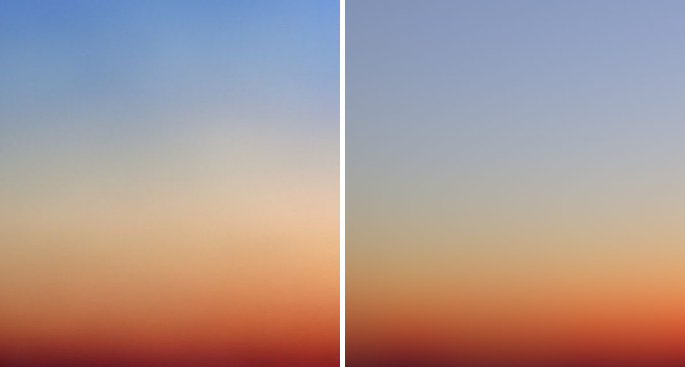
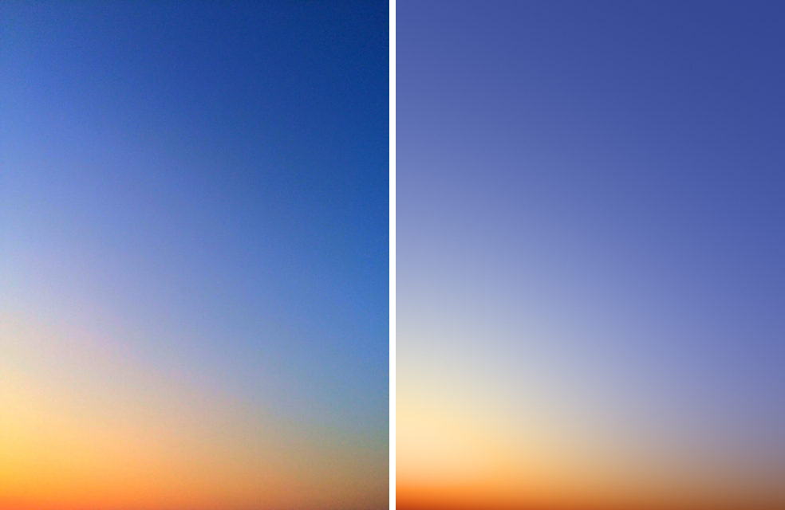
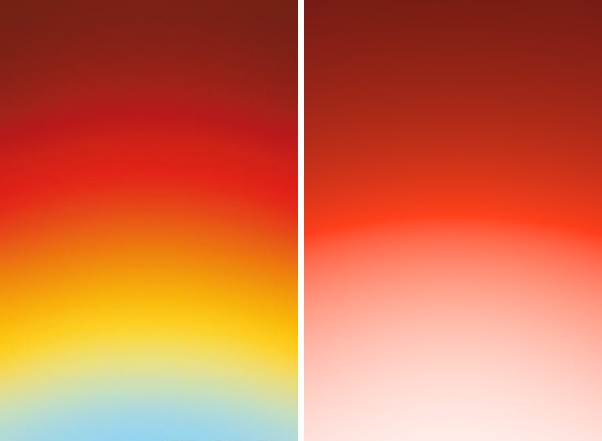
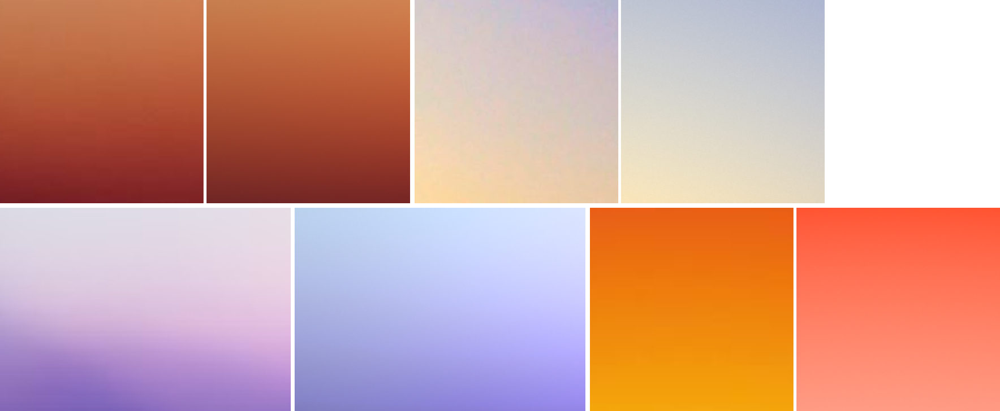
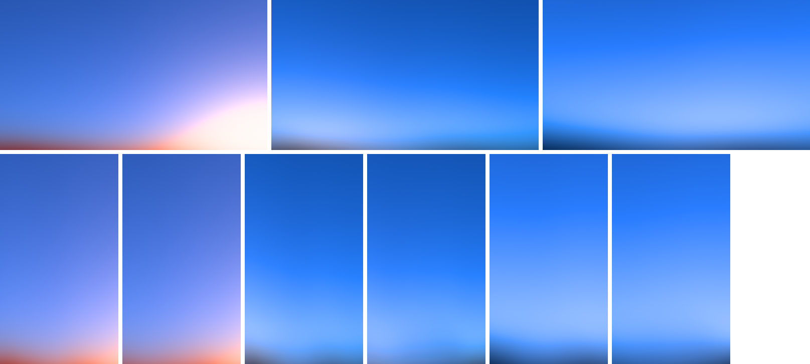
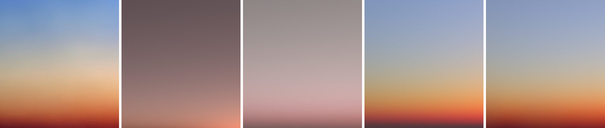

# sunset-scattering

A CPU prototype of a twilight sky computed by single scattering in a
spherical atmosphere (air, a low haze layer, ozone, the Earth's shadow), with
the palette driving the colors of the light. Node ESM, `Float32Array` linear
RGB, `sharp` for PNGs.

## Short answer

- **One palette color per extinction band (the brief's suggestion) does not
  work.** Physical band responses are so broad that every pixel gets all
  palette colors in similar amounts, so the result is a grey-mauve average.
- **Real RGB transport with palette-defined spectra makes muddy bridges**
  wherever light of one palette color is filtered by, or scattered with, the
  spectrum of another. The products come out olive, green or brown.
- **What works is a "two-light" formulation.** Sky light (the sky color) and
  warm light (the warm color's own Beer-Lambert chain, carried by haze) are
  both shaped by the full physical integral: geometry, the Earth's shadow and
  path lengths. Their colors only ever add. Bridges come out lighter and less
  saturated, never darker than both sides, with no mud in any final render.
  One warm color produces the whole warm sequence (pale tint → warm → deep
  red, darker) by itself.
- **1:1 matching:** sky-peach is close; blue-diagonal has the right structure
  with small color offsets; violet-wave is approximate; red-yellow-arcs is not
  matched. The physics only changes color near the horizon and around the
  sun, so long sequences that run evenly over the whole frame are hard. The
  arcs' lightness order is the opposite of a real twilight sky.

## The model

### Geometry (all modes)

- Earth radius 6360 km, atmosphere top 6460 km. Densities: air
  `ρR = exp(−z/8 km)`, haze `ρM = exp(−z/H)` with `H = hazeHeight`, ozone a
  tent from 10 to 40 km peaking at 25 km. Observer at altitude `observer`.
- Camera: a pinhole with vertical field of view `fov`, pitched so the
  horizon sits at frame height `horizon` (0 top, 1 bottom, > 1 below the
  frame), rolled by `tilt`. Each pixel becomes an azimuth `a` and elevation
  `h`.
- Horizon warp: `h' = h − warp·fov·fbm(a·warpScale/width + warpPhase)`.
  This is low-frequency value noise with `warpOctaves` octaves, seeded by the
  scene seed. The warp moves sky and ground together.
- Horizon softness: the radiance is a 9-tap gaussian along `h'` with width
  `softness·fov·(1 + softnessVar·fbm₂(a))`. The width varies along the horizon
  with a second noise, so the horizon is never a ruler line.
- Sun direction from `sunElevation` and `sunAzimuth`; the sun is not drawn.

### Transport (all modes)

For a view ray from the observer, with `T(0→t)` the view-path transmittance:

```
L_c = ∫ T_c(0→t) · [ σ_c(t) · P(θ) · S_c(t) + σ_c(t) · Ψ(t) ] dt   (+ ground term)
S_c(x) = V(x) · exp(−(kR_c·ODR + kM_c·ODM + kO_c·ODO))             sunlight reaching x
```

- `ODR`, `ODM`, `ODO` come from an optical-depth table (64 radii × 256 sun
  angles) built once per haze height.
- `V` is the Earth's shadow: a smoothstep over the sun's disc (±0.27°)
  against the local geometric horizon.
- Phase functions: Rayleigh `3/(16π)(1+cos²θ)` and Mie Cornette-Shanks with
  `mieG`.
- `Ψ` is multiple scattering (Hillaire 2020): a 32×32 table (altitude × sun
  angle) of second-order isotropic scattering times `1/(1 − f_ms)`, scaled by
  `msScale`. Each texel uses 64 directions × 20 steps.
- Rays below the warped horizon end on flat ground with albedo
  `groundAlbedo × ground color`, lit by sun and skylight.
- The integral is evaluated on a sky-view table: 48 azimuths × 320 warped
  elevations (asinh spacing, denser near the horizon), with 40
  quadratic-spaced steps per texel. Pixels read the table bilinearly.

### Palette mappings tried

1. **`bands`**: one channel per palette color. Band `b` gets
   `kR_b = air · 0.0331 · spread^(−b/(N−1))`, so the first color scatters
   most, and the image is `Σ_b c_b · L_b`. This is the brief's suggestion. It
   failed (see "What failed").
2. **`spectra`**: three RGB channels. The air scatters with the sky color's
   spectrum `ŝ = sky/max(sky)` (`airModel: "physical"`). The haze extinction
   is `β_h(1 + redden·K_c)` with `K_c = −ln(warm_c)`. Physically coupled; it
   gives muddy products.
3. **`twolight`** (recommended). Two light components, each integrated with
   its own transmittance:

```
sunlight S_c = V · exp(−(β_a·ℓ·ODR + β_h·(1 + redden·(K̄ + hazeChain·(K_c − K̄)))·ODM))
               K_c = −ln(warm_c), K̄ = luminance-weighted mean, ℓ = luminance(ŝ)

sky light   source  β_a·(1−airWarmth)·ŝ_c·ρR · [P_R(θ)·Y(S) + Ψ]
            dimmed by  β_a·(ℓ + skySat·(ŝ_c − ℓ))·ρR + β_h,gray·ρM
warm light  source  [β_a·airWarmth·ℓ·ρR·P_R(θ) + β_h·ĥ_c·ρM·P_M(θ, g_c)] · S_c + β_h·ĥ_c·ρM·Ψ·m_c
            dimmed by  β_a·ℓ·ρR + β_h,c·ρM
L_c = ∫ (T_sky,c · source_sky,c + T_warm,c · source_warm,c) dt
```

What each term does:
- **Sky light** keeps the sky color. It is lit only by the luminance
  `Y(S)` of the sunlight, so it darkens physically (shadow, extinction) but
  never changes hue from the sun. Along long view paths it saturates toward
  white through its own spectrum (`skySat`).
- **Warm light** is sunlight colored by the warm color's chain. After haze
  optical depth τ the sunlight is `e^(−τ)·warm^(redden·τ)`, so at
  `redden·τ = 1` the light is the warm hex (times gray dimming). Shorter paths
  give a pale tint; longer paths give a deeper, darker, redder color.
- **Neither component** is filtered by the other's color.
- `m_c` is the color of the haze's multiple scattering: the local sunlight
  chromaticity where lit, the sky color in shadow.
- `g_c = mieG + mieGSpread·(c − 1)` optionally widens the red lobe relative
  to blue (a diffraction ring around the sun). Only the arcs preset uses it.

### Output stage

Per PROTOTYPES.md:
1. Exposure. With `output.exposureMode: "sky"`, the exposure is metered so
   the top 8% of the frame has the sky color's channel values at nominal
   intensity. This is how the production presets make Meta Blue hold the sky.
2. Optional lens (`lib/lens.mjs`: bloom from three radii, warm halation from
   highlights). It is implemented but at 0 in all final presets; none of
   these soft skies needed it.
3. Tone curve: colors with max channel ≤ 1 are unchanged. Brighter colors
   keep their Oklab hue, Oklab lightness eases toward 1 with a slope-matched
   exponential, and chroma is cut only as far as the gamut requires
   (bisection).
4. Exact piecewise sRGB encode.
5. Grain (gaussian in encoded values).
6. TPDF dither ±1 LSB.
7. 8-bit PNG.

## Parameters

| name | meaning | range used |
| --- | --- | --- |
| `sunElevation` | sun elevation, degrees (negative = set) | −6 … 4 |
| `sunAzimuth` | sun azimuth from frame center, degrees | −60 … 60, 180 = behind |
| `fov`, `horizon`, `tilt` | framing: vertical field of view, horizon height in frame, roll | 15–90°, 0.3–1.3, −40…20° |
| `air` | air density (sky light amount and its saturation) | 0.02 … 4 |
| `airWarmth` | share of the air's scattering that carries the sunlight color | 0 … 0.5 |
| `haze`, `hazeHeight` | haze density and scale height (km): the warm glow | 0.2 … 40, 0.4 … 5 |
| `redden` | depth of the warm color's chain per unit haze | 0 … 10 |
| `hazeChain` | 1 = chain exactly follows the warm color, 0 = gray haze | 0 … 1.5 |
| `mieG`, `mieGSpread` | haze forward peak; per-channel spread (ring) | 0.2 … 0.9, 0 … 0.3 |
| `skySat` | how strongly long paths saturate the sky color toward white | 0 … 1.5 |
| `msScale` | multiple scattering strength | 0 … 2 |
| `warp`, `warpScale`, `warpPhase`, `warpOctaves` | horizon warp amplitude (fraction of fov), cells across frame, offset, octaves | 0 … 0.3, 0.4 … 3 |
| `softness`, `softnessVar` | horizon blur width (fraction of fov) and its variation along the horizon | 0 … 0.15, 0.5 |
| `observer`, `groundAlbedo` | observer altitude (km), ground reflectance | 0.05 … 3, 0 … 1.5 |
| `wbTemp`, `wbTint` | camera white balance (blue-orange, green-magenta), linear gains | −0.6 … 1.2, ±0.4 |
| `output.exposure` | stops (offset on top of sky metering if enabled) | −3 … 9 |
| colors | `roles` picks palette indices: `sky`, `warm`, `haze`, `ground` (−1 = none) | pack colors only in production |

The production presets use these: sky, warm, ground role; `sunElevation`,
`sunAzimuth`, `fov`, `horizon`, `air`, `airWarmth`, `haze`, `hazeHeight`,
`redden`, `mieG`, `skySat`, `warp`, `softness`, with sky-metered exposure.

## Results

All numbers are the mean blurred Oklab difference ×100 against the clean
targets in `public/references/awe/`. Lower is better; it guides but does not
decide. Presets are in `presets/`. Their light parameters were proposed by an
offline Nelder-Mead search (`fit-params.mjs`) and then checked and adjusted by
eye over many rounds: about 23 for sky-peach, 7 for blue-diagonal, 17 for
arcs and 9 for wave. The renderer never reads reference pixels; a preset is
3 to 4 hexes and about 20 numbers. The wave's warp numbers come from a ridge
line read by eye at 7 points (`ridge.mjs`).

### sunset-sky-peach: close (2.44)



- **Matches:** the lower 30% is nearly exact, a smooth orange → red → deep
  red (#792A26 vs #7B2725) with the right darkening at the bottom. The order
  and placement of grey-beige, peach and orange match, as do the slightly
  warmer right side and the soft horizon.
- **Differs:** the top third is grey-periwinkle (chroma about 5) where the
  reference is a clear blue (chroma about 9–10), and 3–5 L too light. The
  peach band on the right is greyer than the reference. Bluer tops tested
  (less `airWarmth`, a purer sky color) pushed the warm zone down into the
  bottom quarter. That is the model's main limit here: warm light falls off
  fast with elevation, so a warm middle and a pure blue top trade against
  each other.

### sunset-blue-diagonal: right structure, small color offsets (3.56)



- **Matches:** deep blue upper right, lighter blue left, a lavender bridge,
  a yellow-peach glow at the lower left (the sun below the horizon off-frame
  left), an orange bottom, a brown-orange bottom right, and the light grain.
  The blue → lavender → peach bridge is clean and lighter than both sides.
- **Differs:** the top is slightly violet (#3C4F9A vs #1F4695) because 20% of
  the air carries warm light. The diagonal is weaker. The glow is cream where
  the reference is a more saturated yellow-peach. Cutting the warm share
  fixes the top but loses the lavender bridge.

### sunset-violet-wave: approximate (4.12)


- **Matches:** light cyan-blue upper left, a bright white glow upper right,
  a single smooth ridge valley rising to the right (warp seed 30, 1 octave),
  violet below the ridge on the right, navy at the bottom, and a very soft
  horizon.
- **Differs:** the pink in the glow above the ridge is missing (render
  white-lavender). The violet just below the ridge on the left is too grey
  and dark. The reference has a lighter violet band and darker purple
  "mountain" masses that a flat ground with haze does not produce. The fitted
  warm color is a violet (#8957FA); a pinker warm color made the ridge
  magenta-red.

### sunset-red-yellow-arcs: not matched (5.94)



- **Matches:** the upper half (maroon → dark red → red → red-orange) and the
  wide ∩ arches centered below the frame. The best version is a diffraction
  ring (`mieGSpread`, red spreads wider around a sun just below the frame).
- **Differs:** the lower half is salmon → pink → white instead of orange →
  yellow → cream → light blue. There is also a visible crease where the
  bright orange crosses max channel 1.
- **Why:** this reference gets lighter away from the horizon, while a real
  twilight sky is brightest near the horizon toward the sun. Every physical
  orientation either inverts the lightness or the hue order (details below).

### Zoomed transitions (3×, reference left, render right)



Top row: sky-peach orange → deep red, blue-diagonal lavender → peach. Bottom
row: violet-wave ridge, arcs orange → yellow (miss).

### Generality check: production presets (pack colors only)

`presets/production-{bold,elemental,atmospheric}.json`, rendered at
1920×1080 and 1080×1920 with seeds 1 and 2 (`variations.mjs`).



- **Bold** (Meta Blue sky, Yellow as the one warm color): a believable clear
  sunset. Meta Blue at the top, a lavender-pink bridge, a pale warm glow
  around the off-frame sun, and a thin peach-red band at the soft horizon.
  Yellow's own chain turns orange-red near the horizon, so one warm color
  makes the whole warm sequence. The glow corner is slightly bright.
- **Atmospheric** (Meta Blue sky, Ice glow, Slate ground): a calm blue hour,
  Meta Blue to a pale glow over a soft, slightly warped dark band. The
  lighter strip just above the band reads a little like a horizontal stripe.
- **Elemental** (Meta Blue sky, Tan glow, Plum ground): clean, but Tan does
  not show. A desaturated warm color's chain is mostly a brightness change, so
  next to Meta Blue it reads as white or grey.
- **Seeds** only change the horizon warp (and grain), so the two seeds
  differ little in these sky-only framings.
- **Bridge check:** no final render or production render has an Oklab
  lightness dip between lighter regions along its vertical profiles (no dark
  bridges).

## What failed, and why



Sky-peach, left to right: reference; one band per color with hand-picked
colors; the same with least-squares colors; physical coupling (`spectra`);
two-light.

1. **One palette color per extinction band.** In single scattering a band
   with extinction k contributes about `k·e^(−kτ)`. That bump is about 11×
   wide in k at half height, wider than the whole palette, and inside one
   frame τ varies only 2–20×. With the sun near the horizon the zenith is
   spectrally neutral (all bands equal). So every pixel is an average of all
   palette colors (dE 19.8). A least-squares solve for the band colors uses
   only two bands (cyan-white and red) and still gives pinkish grey (dE 8.3).
   Stretching the extinction spread to 30–1000× does not help; the
   low-extinction bands then all grow toward the horizon with the same shape.
2. **Physical coupling (sky color as the scattering spectrum, lit by
   reddened sunlight).** Sky color × warm sunlight is a product of two
   different colors, and it comes out olive or green-grey. Two variants were
   tried: the warm extinction on the air (blue sunlight only survives above
   about 20 km) and on the haze. Both gave an olive band in blue-diagonal, a
   grey-green top in sky-peach and olive arcs. Bare physical RGB twilight is
   greenish without ozone and purple with it. Photos look blue because of
   white balance.
3. **Gray air extinction alone (`airModel: "split"`).** This removes the
   olive, but the twilight warmth that real Rayleigh reddening provides goes
   with it, and the blue saturates through cyan.
4. **Arcs, every attempt:**
   - Camera rolled 180° (horizon at the top): the hue order is right, but the
     lightness is inverted.
   - An "inverted" sky with a red scattering spectrum: the complement
     (light blue) appears at the horizon, but twilight shadow geometry turns
     the middle green.
   - A neutral sun path for that inverted sky: it went olive again where the
     blue-tinted haze light passed through red-extinguishing air.
   - A diffraction ring: right half, wrong half.
5. **Warm colors without a yellow stage.** A chain passes through clean
   yellow only if blue extinction is at least about 7× green extinction
   (blue hex channel near 00). #E95618 or #FF4F00 go peach → orange → red
   with no yellow. An amber such as #EEAA00 goes yellow → amber → orange-red
   → red → maroon.
6. **First tone curve** (add white in linear light past the knee). A channel
   near zero jumps visibly in sRGB (blue 0.05 → 0.24), which made a ring. The
   Oklab roll-off is smoother. Any curve that leaves max ≤ 1 unchanged still
   has a chroma peak where a saturated gradient crosses 1, so presets should
   avoid pushing saturated light past 1.
7. **Fitting a noisy ridge.** Steepest-slope ridge detection caught glow
   edges and gave a W-shaped horizon; three-octave noise follows that.
   Reading the ridge at 7 points by eye and fitting a 1-octave warp fixed it.

## Cost

| pass | size | work | when |
| --- | --- | --- | --- |
| optical-depth table | 64×256, 3 floats | 2×160 steps per texel | once per haze height (63 ms CPU) |
| multiple-scattering table | 32×32, 1 float (two-light) | 64 directions × 20 steps | on parameter change (96 ms CPU) |
| sky-view table | 48×320, 3 floats | 40 steps × (3 density exps, 2 table fetches, about 12 exps) | on parameter change (tens of ms CPU) |
| full-res pass | output size | camera angles, 2 noise lookups, 9 bilinear fetches (1 without softness), tone, encode, grain, dither | every render (whole scene ≈2.6 s at 3840×2160 in single-threaded JS; well under a ms per megapixel on a GPU) |

No per-image optimization at render time. Sky metering reads one band of the
frame (or one sky-view texel on the GPU).

## Recommendation for the GLSL recipe (`sunset.scatter`, Simple Sunset)

Use the two-light formulation. Do not use one band per palette color, and do
not multiply palette colors through each other's spectra.

Passes:
1. **Optical-depth texture** RGBA16F 64×256 `(ODR, ODM, ODO)`, indexed by
   √altitude and √(sun-zenith cosine above the local horizon), as in
   `lib/atmosphere.mjs`. Rebuild only when `hazeHeight` changes.
2. **Multiple-scattering texture** R16F 32×32 from the gray medium. Rebuild on
   parameter change.
3. **Sky-view texture** RGBA16F 64×256 (azimuth × asinh(elevation)) over the
   frame's angle range plus warp margin, 40 steps per texel, both light
   components summed to RGB. Rebuild on parameter change.
4. **Full-res pass:** pixel → camera ray → (a, h) → `h' = h − warp(a)` → 1 or
   9 taps along h' (softness, varying with a second noise) → texture lookup →
   white balance → exposure (sky-metered) → output stage (Oklab tone,
   sRGB, grain at output size, dither).

Uniforms: `sky`, `warm`, `ground` (and optional `hazeTint`) as linear RGB;
`sunDir`; `fov`, `horizonY`, `roll`; `air`, `airWarmth`, `haze`,
`hazeHeight`, `redden`, `hazeChain`, `mieG`, `skySat`, `msScale`, `observer`,
`groundAlbedo`; `warpAmp`, `warpScale`, `warpPhase`, `softness`,
`softnessVar`; `exposure`, `seed`. Fix `hazeChain = 1`, `skySat ≈ 0.3–0.5`,
`msScale ≈ 0.8–1` and `observer`, and keep `mieGSpread = 0`, in the recipe.

User controls:
- **Intensity** → `haze` with `redden` (from a faint pale glow to a deep warm
  band at the horizon).
- **Softness** → `softness` with a lower `mieG` (a flatter, wider glow) and a
  smaller `warp`.
- **Mood control** (Sunset) → `sunElevation`, from just set (+0.3°: bright
  glow, blue sky) to blue hour (−3°: dim glow, deeper blue).
- **Recipe-picked, not user-facing:** `sunAzimuth` (glow side), framing, and
  the seed (horizon warp shape).

Pick roles per pack:
- Bold: Yellow or Orange-red as warm.
- Atmospheric: Ice as warm (a neutral glow), Slate as ground.
- Elemental: Tan does not read as a glow. Use it as the ground color, or
  accept a near-neutral glow.

Keep sky-metered exposure so Meta Blue holds the top of the frame.

Do not use this recipe for red-yellow-arcs-like images: a saturated
six-color sequence that runs evenly across the frame and gets lighter away
from the horizon. That belongs to a bands or blooms recipe.

## Files

- `lib/atmosphere.mjs`: densities, optical-depth and multiple-scattering
  tables, the three palette mappings, view-ray integrals.
- `lib/scene.mjs`: camera, warp, softness, sky-view table, per-pixel lookup,
  white balance.
- `lib/pipeline.mjs`, `lib/lens.mjs`, `lib/output.mjs`: exposure (sky
  metering), lens, tone curve, encode, grain, dither.
- `lib/color.mjs`, `lib/image.mjs`, `lib/noise.mjs`: helpers.
- `render.mjs`: render a preset at its reference size with side-by-side,
  3× zoom and row profiles. `sweep.mjs`: variant sheets. `variations.mjs`:
  generality renders. `make-results.mjs`: the images in `results/`.
- `fit-params.mjs` (offline Nelder-Mead over named parameters),
  `fit-colors.mjs` (least-squares band colors for the bands mode),
  `ridge.mjs` (warp numbers for an in-frame horizon), `finalize.mjs`,
  `bands.mjs` and `measure.mjs` (diagnostics), `sheet.mjs`.
- `presets/`: `sunset-*.json` (reference presets), `production-*.json`
  (pack colors), `compare-sky-peach-{bands,physical}.json` (the failed
  mappings shown above).

Run, for example, `node render.mjs presets/sunset-sky-peach.json --tag final`;
outputs go to `out/` (gitignored).
